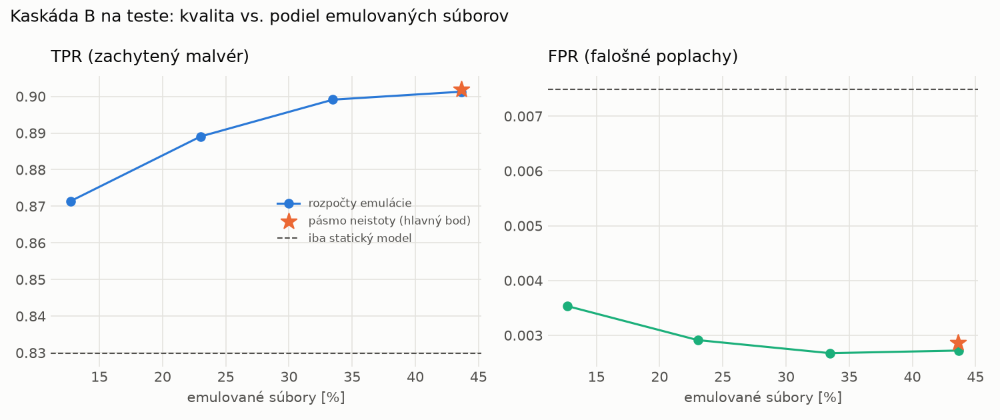

# Kaskáda B `b_nokd` – beh `20261123-184122`

> Generované `src/cascade/evaluate_b.py` (2026-11-23T18:41:22+01:00). Seedy: [0, 1, 2]; hodnoty = priemer ± sm. odchýlka.
> Všetky prahy a pásmo neistoty sú z validácie; test sa na nič nenastavuje. Postup: `docs/09_plan_v2.md`.

| rola | beh |
|---|---|
| static | `runs_v4/real_p/lofo/Boxer/students_static/mlp_nokd/20261123-183830` |
| dynamic | `runs_v4/real_p/lofo/Boxer/students_dynamic/mlp_nokd/20261123-183942` |
| hybrid | `runs_v4/real_p/lofo/Boxer/hybrid/lightgbm/20261123-183451` |

Druhý stupeň: **dynamic**. Pásmo neistoty statického modelu: FPR ≤ 0.1% nad `hi`,
najviac 1% malvéru validácie pod `lo` (seed 0: lo = 0.0291, hi = 0.9997, seed 1: lo = 0.0309, hi = 0.9998, seed 2: lo = 0.0356, hi = 0.9973).

## Test
| prístup | accuracy | balanced_accuracy | precision | recall_tpr | fpr | f1 | mcc |
|---|---|---|---|---|---|---|---|
| kaskáda B | 0.9545 ± 0.0059 | 0.9496 ± 0.0067 | 0.9961 ± 0.0005 | 0.9020 ± 0.0137 | 0.0029 ± 0.0004 | 0.9467 ± 0.0073 | 0.9106 ± 0.0112 |
| statický | 0.9196 ± 0.0103 | 0.9112 ± 0.0116 | 0.9890 ± 0.0004 | 0.8299 ± 0.0236 | 0.0075 ± 0.0005 | 0.9024 ± 0.0138 | 0.8444 ± 0.0189 |
| dynamický | 0.8432 ± 0.0021 | 0.8260 ± 0.0024 | 0.9844 ± 0.0019 | 0.6606 ± 0.0050 | 0.0085 ± 0.0011 | 0.7906 ± 0.0035 | 0.7071 ± 0.0037 |
| hybrid (každá vzorka) | 0.9786 ± 0.0009 | 0.9769 ± 0.0009 | 0.9914 ± 0.0011 | 0.9605 ± 0.0014 | 0.0067 ± 0.0009 | 0.9757 ± 0.0010 | 0.9570 ± 0.0017 |

- **emulované súbory: 43.62%** (ostatné rozhodne iba statický model); na hybrid ide 10.93% súborov
- chyby pri istom rozhodnutí statického modelu (seed 0): 50
- validácia: emulované 40.34%, na hybrid 8.65%

## Validácia
| prístup | accuracy | balanced_accuracy | precision | recall_tpr | fpr | f1 | mcc |
|---|---|---|---|---|---|---|---|
| kaskáda B | 0.9659 ± 0.0021 | 0.9598 ± 0.0025 | 0.9935 ± 0.0008 | 0.9240 ± 0.0045 | 0.0043 ± 0.0005 | 0.9575 ± 0.0027 | 0.9308 ± 0.0043 |
| statický | 0.9321 ± 0.0050 | 0.9203 ± 0.0060 | 0.9841 ± 0.0002 | 0.8503 ± 0.0121 | 0.0097 ± 0.0000 | 0.9123 ± 0.0070 | 0.8635 ± 0.0098 |
| dynamický | 0.8758 ± 0.0019 | 0.8526 ± 0.0023 | 0.9812 ± 0.0001 | 0.7149 ± 0.0047 | 0.0097 ± 0.0000 | 0.8271 ± 0.0032 | 0.7563 ± 0.0036 |
| hybrid (každá vzorka) | 0.9790 ± 0.0004 | 0.9766 ± 0.0005 | 0.9868 ± 0.0007 | 0.9624 ± 0.0013 | 0.0092 ± 0.0005 | 0.9744 ± 0.0005 | 0.9569 ± 0.0009 |

## Januárové vzorky vynechanej rodiny (iba malvér → TPR)
| prístup | TPR |
|---|---|
| kaskáda B | 0.7795 ± 0.0819 |
| statický | 0.6991 ± 0.1343 |
| dynamický | 0.3537 ± 0.0157 |
| hybrid (každá vzorka) | 0.9423 ± 0.0048 |

Podiel emulovaných: 94.36%

## Krivka rozpočtu emulácie (test, priemer cez seedy)
| budget_val | emulation_rate | hybrid_rate | recall_tpr | fpr | f1 |
|---|---|---|---|---|---|
| 0.1000 | 0.1271 | 0.0649 | 0.8714 | 0.0035 | 0.9291 |
| 0.2000 | 0.2301 | 0.0912 | 0.8891 | 0.0029 | 0.9394 |
| 0.3000 | 0.3348 | 0.1070 | 0.8991 | 0.0027 | 0.9452 |
| 0.4000 | 0.4366 | 0.1149 | 0.9013 | 0.0027 | 0.9464 |

## Výpočtové nároky
Čas dynamickej analýzy (beh v emulátore alebo na zariadení) dataset neuvádza, preto sa neodhaduje. Úspora kaskády B = podiel súborov s dynamickou analýzou: **43.62%** (ostatné prístupy 100 %).

_Chýba benchmark niektorého komponentu (v zero-day behoch sa nemeria)._

