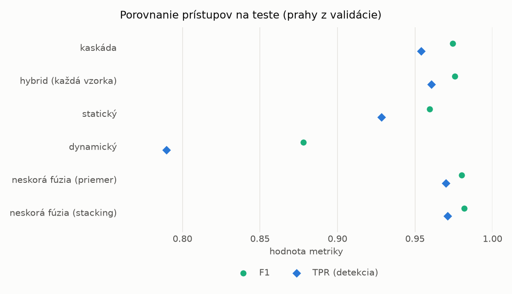
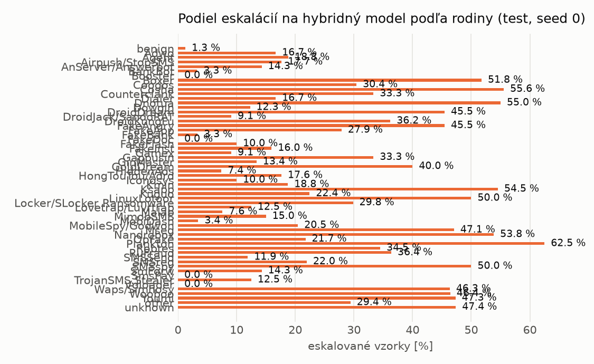

# Kaskáda `baselines` – beh `20261123-184110`

> Generované `src/cascade/evaluate.py` (2026-11-23T18:41:10+01:00). Seedy: [0, 1, 2]; hodnoty = priemer ± sm. odchýlka.
> Všetky prahy sú určené na validácii (FPR ≤ 1 %); test sa na nič nenastavuje.

| rola | beh |
|---|---|
| static | `runs_v4/real_p/lofo/Boxer/static/lightgbm/20261123-011538` |
| dynamic | `runs_v4/real_p/lofo/Boxer/dynamic/lightgbm/20261123-183231` |
| hybrid | `runs_v4/real_p/lofo/Boxer/hybrid/lightgbm/20261123-183451` |

## Test
| prístup | accuracy | balanced_accuracy | precision | recall_tpr | fpr | f1 | mcc |
|---|---|---|---|---|---|---|---|
| kaskáda | 0.9776 ± 0.0007 | 0.9753 ± 0.0007 | 0.9959 ± 0.0005 | 0.9539 ± 0.0011 | 0.0032 ± 0.0004 | 0.9744 ± 0.0008 | 0.9552 ± 0.0014 |
| hybrid (každá vzorka) | 0.9786 ± 0.0009 | 0.9769 ± 0.0009 | 0.9914 ± 0.0011 | 0.9605 ± 0.0014 | 0.0067 ± 0.0009 | 0.9757 ± 0.0010 | 0.9570 ± 0.0017 |
| statický | 0.9648 ± 0.0010 | 0.9613 ± 0.0012 | 0.9926 ± 0.0006 | 0.9283 ± 0.0028 | 0.0056 ± 0.0005 | 0.9594 ± 0.0013 | 0.9300 ± 0.0020 |
| dynamický | 0.9015 ± 0.0041 | 0.8910 ± 0.0046 | 0.9883 ± 0.0010 | 0.7896 ± 0.0091 | 0.0076 ± 0.0007 | 0.8779 ± 0.0057 | 0.8112 ± 0.0076 |
| neskorá fúzia (priemer) | 0.9824 ± 0.0008 | 0.9813 ± 0.0009 | 0.9906 ± 0.0006 | 0.9700 ± 0.0023 | 0.0075 ± 0.0005 | 0.9802 ± 0.0009 | 0.9646 ± 0.0015 |
| neskorá fúzia (stacking) | 0.9837 ± 0.0004 | 0.9825 ± 0.0004 | 0.9927 ± 0.0013 | 0.9709 ± 0.0013 | 0.0058 ± 0.0010 | 0.9817 ± 0.0004 | 0.9673 ± 0.0007 |

## Validácia
| prístup | accuracy | balanced_accuracy | precision | recall_tpr | fpr | f1 | mcc |
|---|---|---|---|---|---|---|---|
| kaskáda | 0.9803 ± 0.0004 | 0.9772 ± 0.0004 | 0.9940 ± 0.0006 | 0.9585 ± 0.0004 | 0.0041 ± 0.0004 | 0.9759 ± 0.0005 | 0.9598 ± 0.0008 |
| hybrid (každá vzorka) | 0.9790 ± 0.0004 | 0.9766 ± 0.0005 | 0.9868 ± 0.0007 | 0.9624 ± 0.0013 | 0.0092 ± 0.0005 | 0.9744 ± 0.0005 | 0.9569 ± 0.0009 |
| statický | 0.9665 ± 0.0010 | 0.9616 ± 0.0012 | 0.9858 ± 0.0003 | 0.9328 ± 0.0024 | 0.0096 ± 0.0002 | 0.9586 ± 0.0013 | 0.9315 ± 0.0021 |
| dynamický | 0.9246 ± 0.0021 | 0.9113 ± 0.0025 | 0.9838 ± 0.0001 | 0.8324 ± 0.0050 | 0.0097 ± 0.0000 | 0.9018 ± 0.0029 | 0.8491 ± 0.0040 |
| neskorá fúzia (priemer) | 0.9825 ± 0.0010 | 0.9809 ± 0.0012 | 0.9862 ± 0.0003 | 0.9715 ± 0.0022 | 0.0096 ± 0.0002 | 0.9788 ± 0.0012 | 0.9640 ± 0.0021 |
| neskorá fúzia (stacking) | 0.9840 ± 0.0004 | 0.9826 ± 0.0006 | 0.9868 ± 0.0004 | 0.9745 ± 0.0014 | 0.0093 ± 0.0003 | 0.9806 ± 0.0005 | 0.9670 ± 0.0009 |

## Správanie kaskády (test, seed 0)
- podiel eskalácií na hybrid: **11.14%** (1410 vzoriek)
- chyby pri zhode študentov (kaskáda ich nemôže opraviť): **149**
  (1.325% zo zhôd; FP 2, FN 147)
- úspešnosť na eskalovaných vzorkách: hybrid 0.9078014184397163, statický 0.7978723404255319,
  dynamický 0.20212765957446807  → prínos hybridu pri nezhode

## Výpočtové nároky (odhad z benchmarkov komponentov)
_Chýba benchmark niektorého komponentu (`python -m src.evaluation.benchmark`)._

