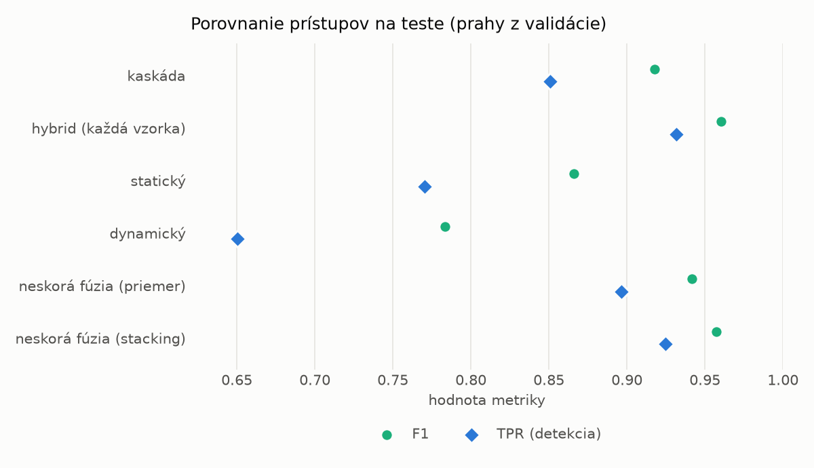
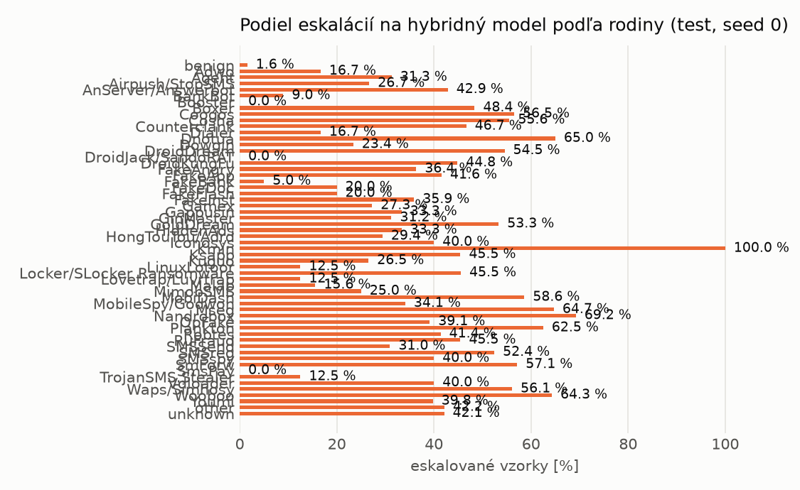

# Kaskáda `heavy` – beh `20261123-184107`

> Generované `src/cascade/evaluate.py` (2026-11-23T18:41:08+01:00). Seedy: [0, 1, 2]; hodnoty = priemer ± sm. odchýlka.
> Všetky prahy sú určené na validácii (FPR ≤ 1 %); test sa na nič nenastavuje.

| rola | beh |
|---|---|
| static | `runs_v4/real_p/lofo/Boxer/students_static/mlp_kd/20261123-183817` |
| dynamic | `runs_v4/real_p/lofo/Boxer/students_dynamic/mlp_kd/20261123-183926` |
| hybrid | `runs_v4/real_p/lofo/Boxer/hybrid/mlp_large/20261123-183513` |

## Test
| prístup | accuracy | balanced_accuracy | precision | recall_tpr | fpr | f1 | mcc |
|---|---|---|---|---|---|---|---|
| kaskáda | 0.9317 ± 0.0132 | 0.9241 ± 0.0148 | 0.9966 ± 0.0002 | 0.8506 ± 0.0297 | 0.0024 ± 0.0002 | 0.9176 ± 0.0173 | 0.8680 ± 0.0244 |
| hybrid (každá vzorka) | 0.9654 ± 0.0057 | 0.9622 ± 0.0064 | 0.9906 ± 0.0013 | 0.9316 ± 0.0131 | 0.0072 ± 0.0010 | 0.9602 ± 0.0068 | 0.9310 ± 0.0111 |
| statický | 0.8934 ± 0.0129 | 0.8818 ± 0.0145 | 0.9898 ± 0.0011 | 0.7701 ± 0.0298 | 0.0064 ± 0.0009 | 0.8660 ± 0.0187 | 0.7970 ± 0.0228 |
| dynamický | 0.8389 ± 0.0044 | 0.8212 ± 0.0049 | 0.9851 ± 0.0011 | 0.6504 ± 0.0099 | 0.0080 ± 0.0006 | 0.7835 ± 0.0071 | 0.6999 ± 0.0076 |
| neskorá fúzia (priemer) | 0.9501 ± 0.0040 | 0.9450 ± 0.0045 | 0.9914 ± 0.0006 | 0.8964 ± 0.0094 | 0.0063 ± 0.0005 | 0.9415 ± 0.0049 | 0.9016 ± 0.0075 |
| neskorá fúzia (stacking) | 0.9629 ± 0.0019 | 0.9593 ± 0.0021 | 0.9920 ± 0.0007 | 0.9247 ± 0.0039 | 0.0061 ± 0.0005 | 0.9572 ± 0.0023 | 0.9263 ± 0.0038 |

## Validácia
| prístup | accuracy | balanced_accuracy | precision | recall_tpr | fpr | f1 | mcc |
|---|---|---|---|---|---|---|---|
| kaskáda | 0.9544 ± 0.0066 | 0.9461 ± 0.0080 | 0.9929 ± 0.0005 | 0.8969 ± 0.0157 | 0.0046 ± 0.0003 | 0.9424 ± 0.0089 | 0.9081 ± 0.0131 |
| hybrid (každá vzorka) | 0.9654 ± 0.0072 | 0.9603 ± 0.0087 | 0.9855 ± 0.0003 | 0.9304 ± 0.0173 | 0.0097 ± 0.0000 | 0.9571 ± 0.0093 | 0.9293 ± 0.0144 |
| statický | 0.9223 ± 0.0058 | 0.9085 ± 0.0070 | 0.9839 ± 0.0005 | 0.8266 ± 0.0139 | 0.0096 ± 0.0002 | 0.8984 ± 0.0084 | 0.8446 ± 0.0112 |
| dynamický | 0.8722 ± 0.0029 | 0.8483 ± 0.0035 | 0.9810 ± 0.0002 | 0.7063 ± 0.0070 | 0.0097 ± 0.0000 | 0.8213 ± 0.0048 | 0.7496 ± 0.0054 |
| neskorá fúzia (priemer) | 0.9490 ± 0.0039 | 0.9406 ± 0.0047 | 0.9849 ± 0.0002 | 0.8909 ± 0.0094 | 0.0097 ± 0.0000 | 0.9355 ± 0.0052 | 0.8966 ± 0.0077 |
| neskorá fúzia (stacking) | 0.9650 ± 0.0013 | 0.9599 ± 0.0016 | 0.9855 ± 0.0000 | 0.9295 ± 0.0032 | 0.0097 ± 0.0000 | 0.9567 ± 0.0017 | 0.9285 ± 0.0027 |

## Správanie kaskády (test, seed 0)
- podiel eskalácií na hybrid: **15.71%** (1988 vzoriek)
- chyby pri zhode študentov (kaskáda ich nemôže opraviť): **611**
  (5.727% zo zhôd; FP 0, FN 611)
- úspešnosť na eskalovaných vzorkách: hybrid 0.9466800804828974, statický 0.6866197183098591,
  dynamický 0.31338028169014087  → prínos hybridu pri nezhode

## Výpočtové nároky (odhad z benchmarkov komponentov)
_Chýba benchmark niektorého komponentu (`python -m src.evaluation.benchmark`)._

