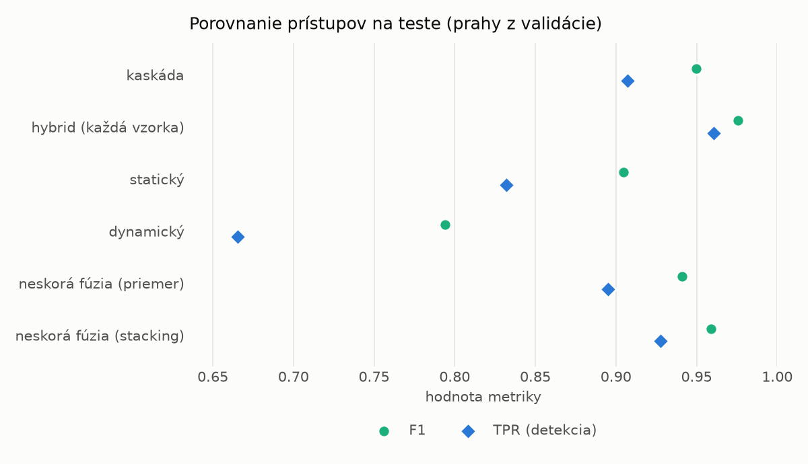
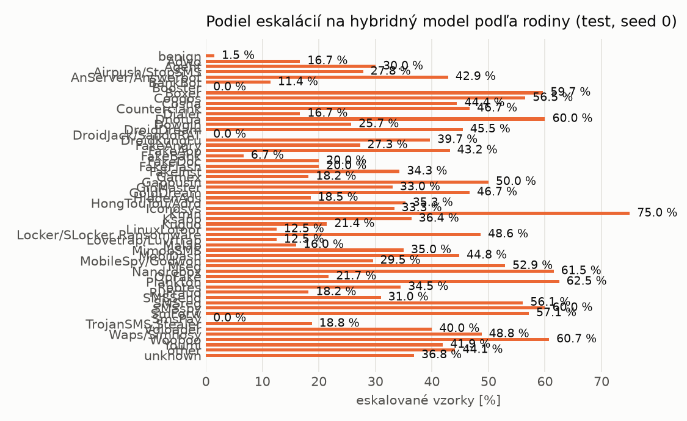

# Kaskáda `heavyteacher` – beh `20261123-184112`

> Generované `src/cascade/evaluate.py` (2026-11-23T18:41:12+01:00). Seedy: [0, 1, 2]; hodnoty = priemer ± sm. odchýlka.
> Všetky prahy sú určené na validácii (FPR ≤ 1 %); test sa na nič nenastavuje.

| rola | beh |
|---|---|
| static | `runs_v4/real_p/lofo/Boxer/students_static/mlp_kd_heavy/20261123-183913` |
| dynamic | `runs_v4/real_p/lofo/Boxer/students_dynamic/mlp_kd_heavy/20261123-184042` |
| hybrid | `runs_v4/real_p/lofo/Boxer/hybrid/lightgbm/20261123-183451` |

## Test
| prístup | accuracy | balanced_accuracy | precision | recall_tpr | fpr | f1 | mcc |
|---|---|---|---|---|---|---|---|
| kaskáda | 0.9571 ± 0.0011 | 0.9524 ± 0.0012 | 0.9969 ± 0.0003 | 0.9072 ± 0.0023 | 0.0023 ± 0.0002 | 0.9499 ± 0.0013 | 0.9157 ± 0.0020 |
| hybrid (každá vzorka) | 0.9786 ± 0.0009 | 0.9769 ± 0.0009 | 0.9914 ± 0.0011 | 0.9605 ± 0.0014 | 0.0067 ± 0.0009 | 0.9757 ± 0.0010 | 0.9570 ± 0.0017 |
| statický | 0.9213 ± 0.0014 | 0.9129 ± 0.0015 | 0.9909 ± 0.0005 | 0.8320 ± 0.0031 | 0.0062 ± 0.0004 | 0.9045 ± 0.0018 | 0.8477 ± 0.0026 |
| dynamický | 0.8451 ± 0.0027 | 0.8283 ± 0.0030 | 0.9839 ± 0.0011 | 0.6654 ± 0.0059 | 0.0088 ± 0.0006 | 0.7939 ± 0.0043 | 0.7104 ± 0.0047 |
| neskorá fúzia (priemer) | 0.9499 ± 0.0009 | 0.9447 ± 0.0011 | 0.9924 ± 0.0007 | 0.8949 ± 0.0025 | 0.0055 ± 0.0005 | 0.9412 ± 0.0012 | 0.9013 ± 0.0017 |
| neskorá fúzia (stacking) | 0.9645 ± 0.0017 | 0.9611 ± 0.0018 | 0.9928 ± 0.0003 | 0.9276 ± 0.0035 | 0.0055 ± 0.0002 | 0.9591 ± 0.0020 | 0.9295 ± 0.0032 |

## Validácia
| prístup | accuracy | balanced_accuracy | precision | recall_tpr | fpr | f1 | mcc |
|---|---|---|---|---|---|---|---|
| kaskáda | 0.9631 ± 0.0009 | 0.9565 ± 0.0010 | 0.9933 ± 0.0005 | 0.9174 ± 0.0018 | 0.0044 ± 0.0003 | 0.9538 ± 0.0012 | 0.9252 ± 0.0019 |
| hybrid (každá vzorka) | 0.9790 ± 0.0004 | 0.9766 ± 0.0005 | 0.9868 ± 0.0007 | 0.9624 ± 0.0013 | 0.0092 ± 0.0005 | 0.9744 ± 0.0005 | 0.9569 ± 0.0009 |
| statický | 0.9246 ± 0.0020 | 0.9113 ± 0.0024 | 0.9838 ± 0.0001 | 0.8323 ± 0.0047 | 0.0097 ± 0.0000 | 0.9017 ± 0.0028 | 0.8490 ± 0.0038 |
| dynamický | 0.8770 ± 0.0016 | 0.8540 ± 0.0019 | 0.9813 ± 0.0001 | 0.7177 ± 0.0039 | 0.0097 ± 0.0000 | 0.8290 ± 0.0026 | 0.7585 ± 0.0030 |
| neskorá fúzia (priemer) | 0.9501 ± 0.0029 | 0.9419 ± 0.0035 | 0.9849 ± 0.0001 | 0.8936 ± 0.0070 | 0.0097 ± 0.0000 | 0.9370 ± 0.0039 | 0.8988 ± 0.0057 |
| neskorá fúzia (stacking) | 0.9661 ± 0.0014 | 0.9612 ± 0.0016 | 0.9855 ± 0.0001 | 0.9322 ± 0.0033 | 0.0097 ± 0.0000 | 0.9581 ± 0.0018 | 0.9307 ± 0.0027 |

## Správanie kaskády (test, seed 0)
- podiel eskalácií na hybrid: **16.31%** (2064 vzoriek)
- chyby pri zhode študentov (kaskáda ich nemôže opraviť): **461**
  (4.352% zo zhôd; FP 1, FN 460)
- úspešnosť na eskalovaných vzorkách: hybrid 0.9651162790697675, statický 0.7364341085271318,
  dynamický 0.26356589147286824  → prínos hybridu pri nezhode

## Výpočtové nároky (odhad z benchmarkov komponentov)
_Chýba benchmark niektorého komponentu (`python -m src.evaluation.benchmark`)._

