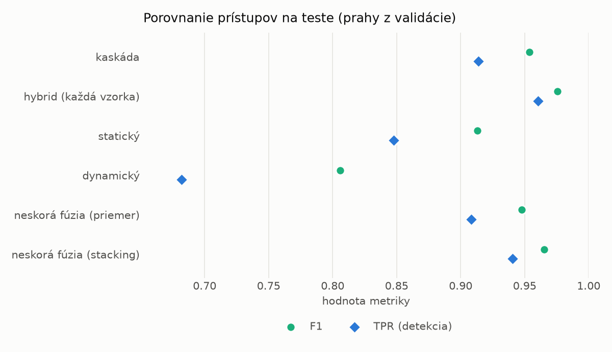
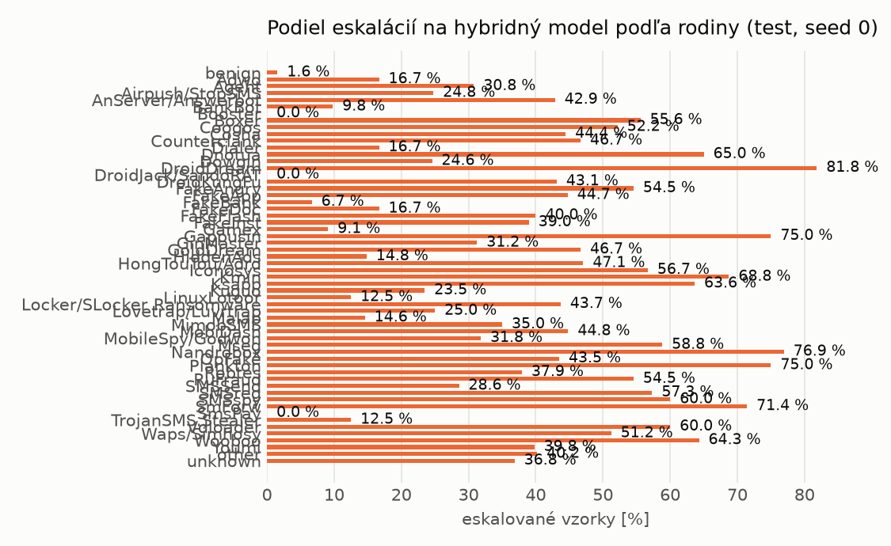

# Kaskáda `modal` – beh `20261123-184105`

> Generované `src/cascade/evaluate.py` (2026-11-23T18:41:05+01:00). Seedy: [0, 1, 2]; hodnoty = priemer ± sm. odchýlka.
> Všetky prahy sú určené na validácii (FPR ≤ 1 %); test sa na nič nenastavuje.

| rola | beh |
|---|---|
| static | `runs_v4/real_p/lofo/Boxer/students_static/mlp_kd_modal/20261123-183851` |
| dynamic | `runs_v4/real_p/lofo/Boxer/students_dynamic/mlp_kd_modal/20261123-184015` |
| hybrid | `runs_v4/real_p/lofo/Boxer/hybrid/lightgbm/20261123-183451` |

## Test
| prístup | accuracy | balanced_accuracy | precision | recall_tpr | fpr | f1 | mcc |
|---|---|---|---|---|---|---|---|
| kaskáda | 0.9601 ± 0.0018 | 0.9557 ± 0.0020 | 0.9967 ± 0.0004 | 0.9139 ± 0.0043 | 0.0024 ± 0.0003 | 0.9535 ± 0.0022 | 0.9213 ± 0.0035 |
| hybrid (každá vzorka) | 0.9786 ± 0.0009 | 0.9769 ± 0.0009 | 0.9914 ± 0.0011 | 0.9605 ± 0.0014 | 0.0067 ± 0.0009 | 0.9757 ± 0.0010 | 0.9570 ± 0.0017 |
| statický | 0.9276 ± 0.0022 | 0.9202 ± 0.0024 | 0.9894 ± 0.0007 | 0.8477 ± 0.0045 | 0.0074 ± 0.0004 | 0.9131 ± 0.0028 | 0.8592 ± 0.0042 |
| dynamický | 0.8530 ± 0.0093 | 0.8370 ± 0.0103 | 0.9854 ± 0.0011 | 0.6821 ± 0.0207 | 0.0082 ± 0.0006 | 0.8061 ± 0.0147 | 0.7245 ± 0.0163 |
| neskorá fúzia (priemer) | 0.9552 ± 0.0037 | 0.9508 ± 0.0042 | 0.9912 ± 0.0009 | 0.9082 ± 0.0089 | 0.0066 ± 0.0008 | 0.9479 ± 0.0045 | 0.9114 ± 0.0070 |
| neskorá fúzia (stacking) | 0.9698 ± 0.0019 | 0.9670 ± 0.0021 | 0.9918 ± 0.0007 | 0.9404 ± 0.0048 | 0.0063 ± 0.0006 | 0.9654 ± 0.0022 | 0.9397 ± 0.0036 |

## Validácia
| prístup | accuracy | balanced_accuracy | precision | recall_tpr | fpr | f1 | mcc |
|---|---|---|---|---|---|---|---|
| kaskáda | 0.9668 ± 0.0015 | 0.9608 ± 0.0017 | 0.9945 ± 0.0007 | 0.9252 ± 0.0032 | 0.0036 ± 0.0004 | 0.9586 ± 0.0019 | 0.9326 ± 0.0029 |
| hybrid (každá vzorka) | 0.9790 ± 0.0004 | 0.9766 ± 0.0005 | 0.9868 ± 0.0007 | 0.9624 ± 0.0013 | 0.0092 ± 0.0005 | 0.9744 ± 0.0005 | 0.9569 ± 0.0009 |
| statický | 0.9339 ± 0.0011 | 0.9225 ± 0.0013 | 0.9844 ± 0.0003 | 0.8546 ± 0.0025 | 0.0096 ± 0.0002 | 0.9149 ± 0.0015 | 0.8671 ± 0.0021 |
| dynamický | 0.8724 ± 0.0032 | 0.8485 ± 0.0039 | 0.9813 ± 0.0001 | 0.7066 ± 0.0080 | 0.0096 ± 0.0002 | 0.8216 ± 0.0054 | 0.7501 ± 0.0060 |
| neskorá fúzia (priemer) | 0.9536 ± 0.0032 | 0.9461 ± 0.0039 | 0.9850 ± 0.0001 | 0.9020 ± 0.0077 | 0.0097 ± 0.0000 | 0.9417 ± 0.0043 | 0.9056 ± 0.0064 |
| neskorá fúzia (stacking) | 0.9691 ± 0.0012 | 0.9648 ± 0.0014 | 0.9858 ± 0.0003 | 0.9393 ± 0.0027 | 0.0096 ± 0.0002 | 0.9620 ± 0.0015 | 0.9368 ± 0.0025 |

## Správanie kaskády (test, seed 0)
- podiel eskalácií na hybrid: **16.02%** (2027 vzoriek)
- chyby pri zhode študentov (kaskáda ich nemôže opraviť): **457**
  (4.300% zo zhôd; FP 2, FN 455)
- úspešnosť na eskalovaných vzorkách: hybrid 0.9649728663048841, statický 0.758756783423779,
  dynamický 0.24124321657622103  → prínos hybridu pri nezhode

## Výpočtové nároky (odhad z benchmarkov komponentov)
_Chýba benchmark niektorého komponentu (`python -m src.evaluation.benchmark`)._

