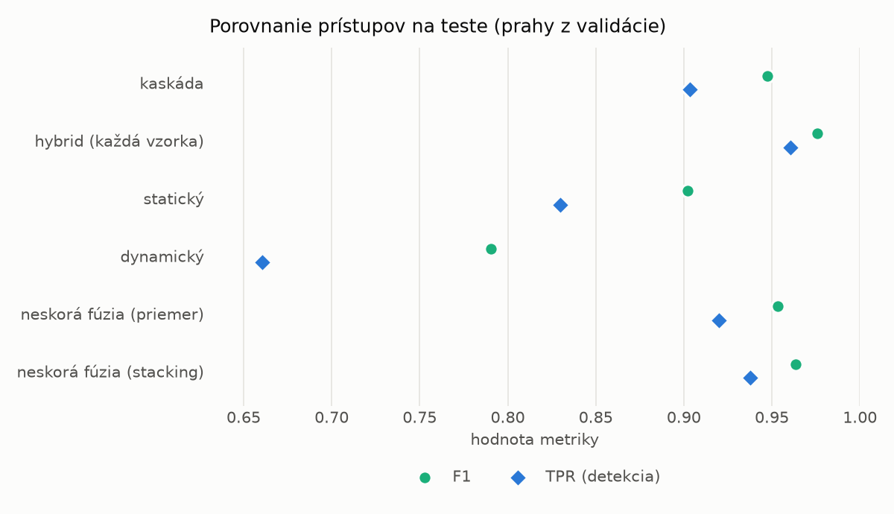
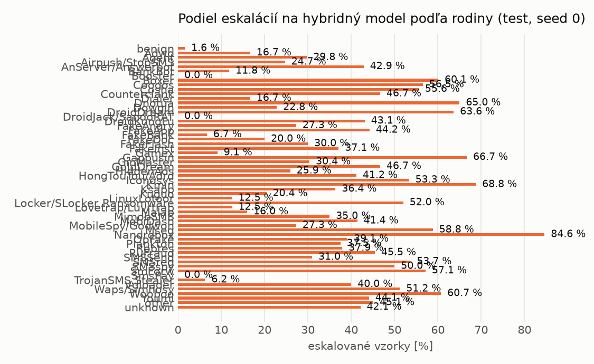

# Kaskáda `nokd` – beh `20261123-184103`

> Generované `src/cascade/evaluate.py` (2026-11-23T18:41:03+01:00). Seedy: [0, 1, 2]; hodnoty = priemer ± sm. odchýlka.
> Všetky prahy sú určené na validácii (FPR ≤ 1 %); test sa na nič nenastavuje.

| rola | beh |
|---|---|
| static | `runs_v4/real_p/lofo/Boxer/students_static/mlp_nokd/20261123-183830` |
| dynamic | `runs_v4/real_p/lofo/Boxer/students_dynamic/mlp_nokd/20261123-183942` |
| hybrid | `runs_v4/real_p/lofo/Boxer/hybrid/lightgbm/20261123-183451` |

## Test
| prístup | accuracy | balanced_accuracy | precision | recall_tpr | fpr | f1 | mcc |
|---|---|---|---|---|---|---|---|
| kaskáda | 0.9552 ± 0.0060 | 0.9503 ± 0.0068 | 0.9963 ± 0.0006 | 0.9033 ± 0.0141 | 0.0027 ± 0.0005 | 0.9475 ± 0.0075 | 0.9119 ± 0.0115 |
| hybrid (každá vzorka) | 0.9786 ± 0.0009 | 0.9769 ± 0.0009 | 0.9914 ± 0.0011 | 0.9605 ± 0.0014 | 0.0067 ± 0.0009 | 0.9757 ± 0.0010 | 0.9570 ± 0.0017 |
| statický | 0.9196 ± 0.0103 | 0.9112 ± 0.0116 | 0.9890 ± 0.0004 | 0.8299 ± 0.0236 | 0.0075 ± 0.0005 | 0.9024 ± 0.0138 | 0.8444 ± 0.0189 |
| dynamický | 0.8432 ± 0.0021 | 0.8260 ± 0.0024 | 0.9844 ± 0.0019 | 0.6606 ± 0.0050 | 0.0085 ± 0.0011 | 0.7906 ± 0.0035 | 0.7071 ± 0.0037 |
| neskorá fúzia (priemer) | 0.9597 ± 0.0016 | 0.9559 ± 0.0019 | 0.9895 ± 0.0010 | 0.9197 ± 0.0046 | 0.0079 ± 0.0008 | 0.9533 ± 0.0020 | 0.9198 ± 0.0030 |
| neskorá fúzia (stacking) | 0.9683 ± 0.0002 | 0.9655 ± 0.0002 | 0.9912 ± 0.0006 | 0.9377 ± 0.0007 | 0.0068 ± 0.0004 | 0.9637 ± 0.0002 | 0.9368 ± 0.0003 |

## Validácia
| prístup | accuracy | balanced_accuracy | precision | recall_tpr | fpr | f1 | mcc |
|---|---|---|---|---|---|---|---|
| kaskáda | 0.9671 ± 0.0023 | 0.9612 ± 0.0027 | 0.9939 ± 0.0008 | 0.9264 ± 0.0049 | 0.0040 ± 0.0005 | 0.9590 ± 0.0029 | 0.9331 ± 0.0046 |
| hybrid (každá vzorka) | 0.9790 ± 0.0004 | 0.9766 ± 0.0005 | 0.9868 ± 0.0007 | 0.9624 ± 0.0013 | 0.0092 ± 0.0005 | 0.9744 ± 0.0005 | 0.9569 ± 0.0009 |
| statický | 0.9321 ± 0.0050 | 0.9203 ± 0.0060 | 0.9841 ± 0.0002 | 0.8503 ± 0.0121 | 0.0097 ± 0.0000 | 0.9123 ± 0.0070 | 0.8635 ± 0.0098 |
| dynamický | 0.8758 ± 0.0019 | 0.8526 ± 0.0023 | 0.9812 ± 0.0001 | 0.7149 ± 0.0047 | 0.0097 ± 0.0000 | 0.8271 ± 0.0032 | 0.7563 ± 0.0036 |
| neskorá fúzia (priemer) | 0.9621 ± 0.0018 | 0.9564 ± 0.0022 | 0.9854 ± 0.0001 | 0.9225 ± 0.0044 | 0.0097 ± 0.0000 | 0.9529 ± 0.0024 | 0.9226 ± 0.0037 |
| neskorá fúzia (stacking) | 0.9700 ± 0.0005 | 0.9659 ± 0.0006 | 0.9857 ± 0.0000 | 0.9414 ± 0.0012 | 0.0097 ± 0.0000 | 0.9630 ± 0.0007 | 0.9385 ± 0.0010 |

## Správanie kaskády (test, seed 0)
- podiel eskalácií na hybrid: **16.38%** (2073 vzoriek)
- chyby pri zhode študentov (kaskáda ich nemôže opraviť): **411**
  (3.884% zo zhôd; FP 3, FN 408)
- úspešnosť na eskalovaných vzorkách: hybrid 0.9638205499276411, statický 0.773757838880849,
  dynamický 0.226242161119151  → prínos hybridu pri nezhode

## Výpočtové nároky (odhad z benchmarkov komponentov)
_Chýba benchmark niektorého komponentu (`python -m src.evaluation.benchmark`)._

