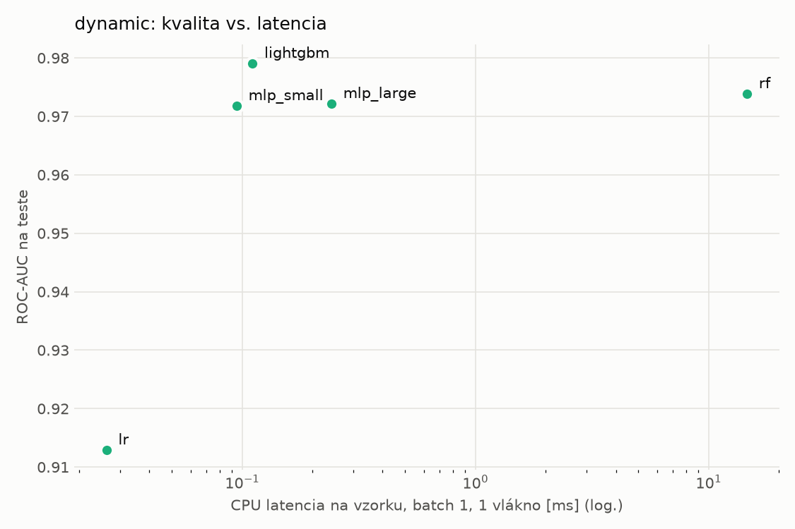
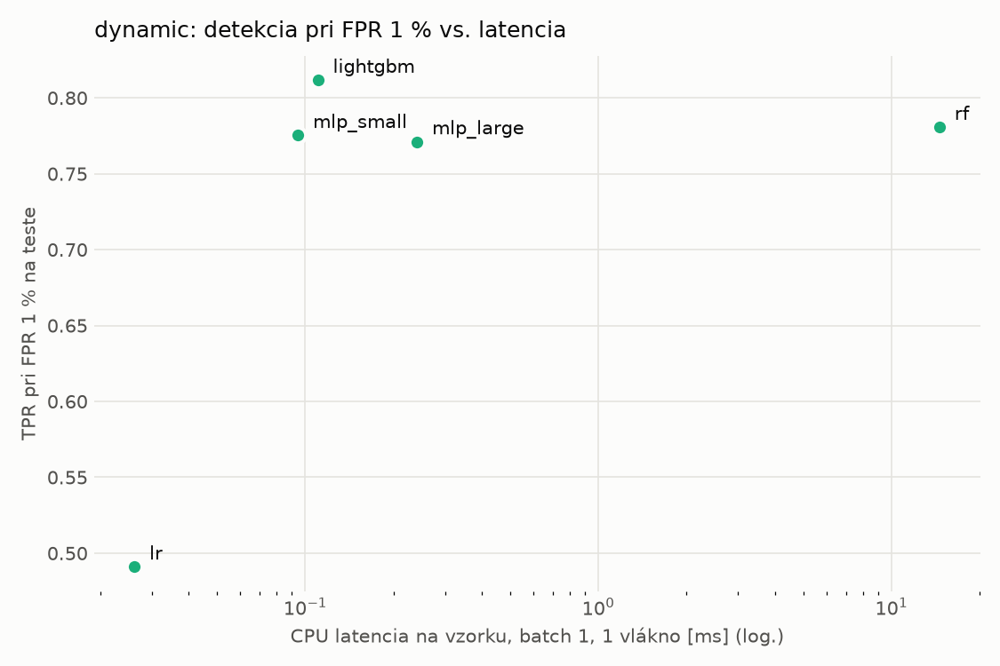
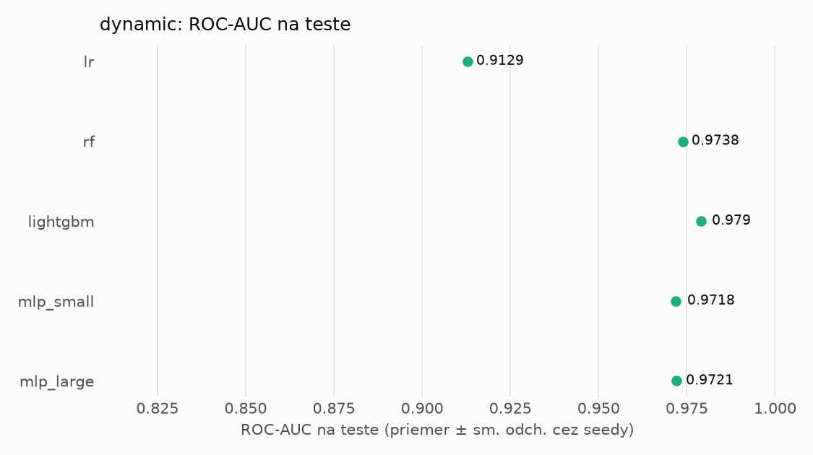
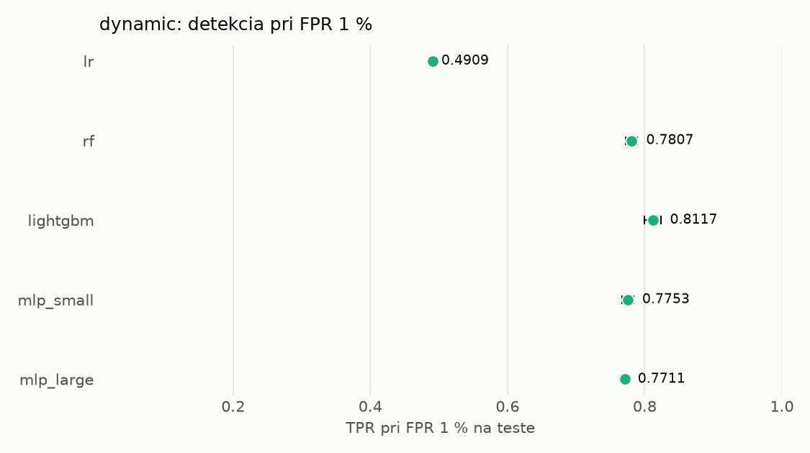

# Porovnanie modelov – dynamic

> Generované `src/evaluation/compare.py` (2026-11-23T18:34:30+01:00); použitý je posledný beh každého modelu.
> Metriky sú priemer cez seedy. \* = pri prahu určenom na validácii (FPR ≤ 1 %).
> CPU ms/vz. = medián latencie jednej vzorky na 1 vlákne vrátane transformácie vstupu (meranie hneď po tréningu,
> orientačné). Oficiálne merania spotreby sú v časti „Spotreba zdrojov pri inferencii“.

## Detekčná kvalita a orientačné časy
| model | ROC-AUC val | ROC-AUC test | TPR@FPR 1 % test | TPR@FPR 0,1 % test | F1 test* | FPR test* | gap train−val | CPU ms/vz. | CPU vz./s | GPU ms/vz. | parametre | MB | tréning s | ladenie min |
|---|---|---|---|---|---|---|---|---|---|---|---|---|---|---|
| [lr](../../dynamic/lr/20261123-011748/README.md) | 0.9073 | 0.9129 ± 0.0000 | 0.4909 | 0.3896 | 0.6310 | 0.0074 | 0.0080 | 0.026 | 2 235 805 | – | 124 | 0.01 | 1.1 | 0.0 |
| [rf](../../dynamic/rf/20261123-183213/README.md) | 0.9730 | 0.9738 ± 0.0001 | 0.7807 | 0.6531 | 0.8623 | 0.0069 | 0.0250 | 14.609 | 100 130 | – | 3 211 352 | 257.28 | 2.3 | 0.0 |
| [lightgbm](../../dynamic/lightgbm/20261123-183231/README.md) | 0.9792 | 0.9790 ± 0.0006 | 0.8117 | 0.6901 | 0.8779 | 0.0076 | 0.0197 | 0.111 | 138 513 | – | 206 712 | 11.33 | 10.1 | 0.0 |
| [mlp_small](../../dynamic/mlp_small/20261123-183309/README.md) | 0.9717 | 0.9718 ± 0.0009 | 0.7753 | 0.5863 | 0.8423 | 0.0054 | 0.0141 | 0.095 | 2 929 358 | 0.635 | 65 537 | 0.27 | 17.8 | 0.0 |
| [mlp_large](../../dynamic/mlp_large/20261123-183405/README.md) | 0.9718 | 0.9721 ± 0.0001 | 0.7711 | 0.5937 | 0.8440 | 0.0061 | 0.0137 | 0.241 | 370 166 | 0.652 | 1 119 745 | 4.51 | 7.6 | 0.0 |

## Nízka prevalencia malvéru (test, prah z validácie)
| model | TPR | FPR | precision @ 1 % | falošné na 1 skutočný poplach @ 1 % | precision @ 0.1 % | falošné na 1 skutočný poplach @ 0.1 % |
|---|---|---|---|---|---|---|
| lr | 0.4652 | 0.0074 | 0.387 | 1.58 | 0.059 | 15.99 |
| rf | 0.7644 | 0.0069 | 0.529 | 0.89 | 0.100 | 8.98 |
| lightgbm | 0.7896 | 0.0076 | 0.512 | 0.95 | 0.094 | 9.60 |
| mlp_small | 0.7325 | 0.0054 | 0.576 | 0.74 | 0.119 | 7.42 |
| mlp_large | 0.7355 | 0.0061 | 0.549 | 0.82 | 0.108 | 8.30 |

Prepočet: TPR a FPR nezávisia od podielu malvéru, preto sa dajú preniesť na nízku prevalenciu (v reálnej prevádzke je malvéru ~1 % alebo menej; v teste 54 %). „Falošné na 1 skutočný poplach“ = koľko neškodných súborov je označených na každý zachytený malvér.

## Spotreba zdrojov pri inferencii (benchmark, testovacia množina)
_Benchmark zatiaľ nebol spustený (`python -m src.evaluation.benchmark --approach dynamic`)._

## Grafy

