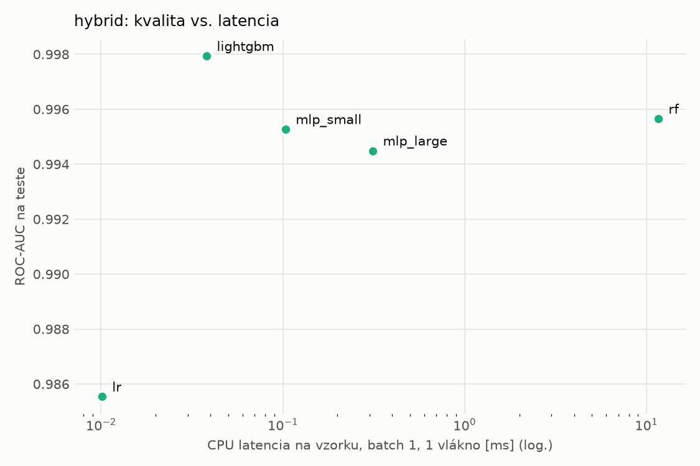
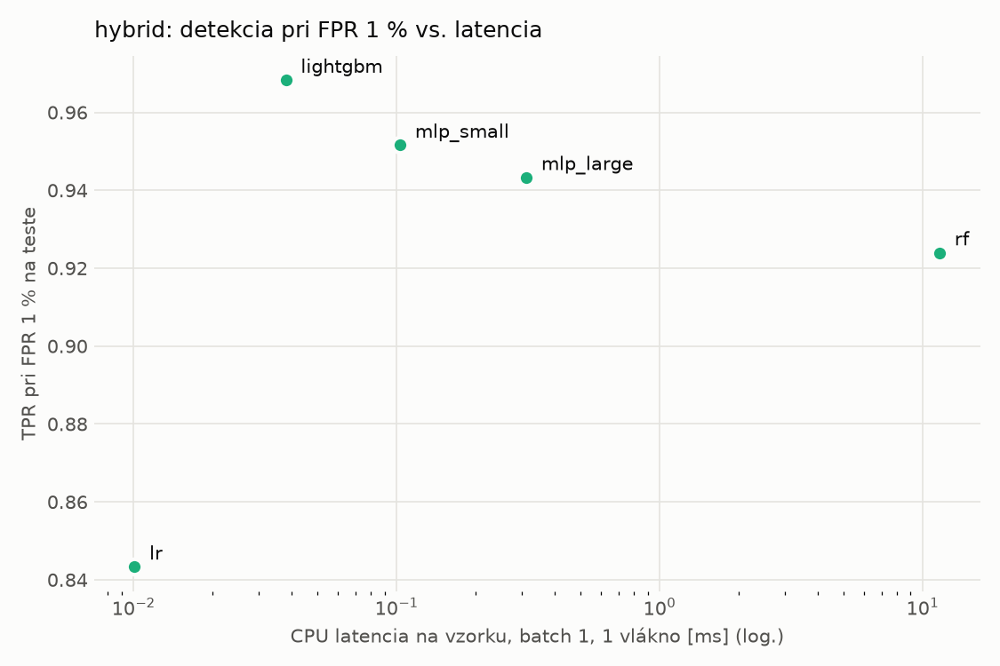
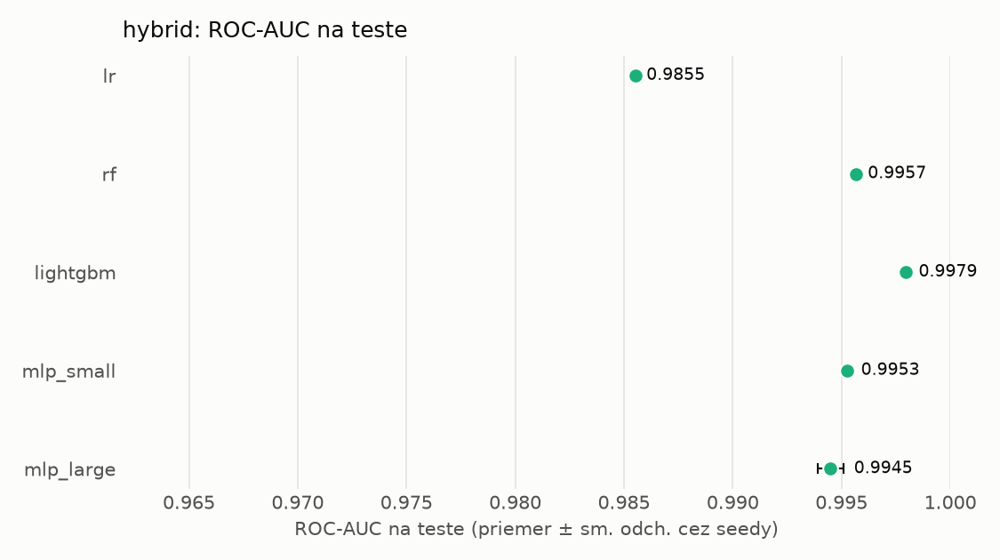
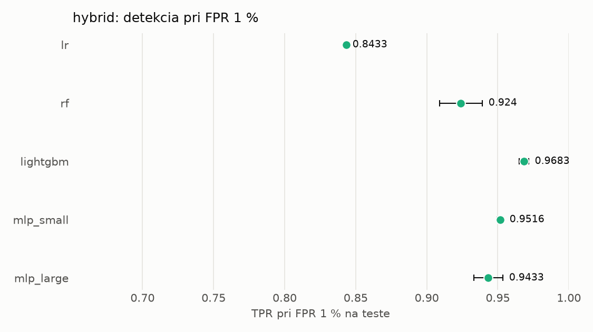

# Porovnanie modelov – hybrid

> Generované `src/evaluation/compare.py` (2026-11-23T18:35:32+01:00); použitý je posledný beh každého modelu.
> Metriky sú priemer cez seedy. \* = pri prahu určenom na validácii (FPR ≤ 1 %).
> CPU ms/vz. = medián latencie jednej vzorky na 1 vlákne vrátane transformácie vstupu (meranie hneď po tréningu,
> orientačné). Oficiálne merania spotreby sú v časti „Spotreba zdrojov pri inferencii“.

## Detekčná kvalita a orientačné časy
| model | ROC-AUC val | ROC-AUC test | TPR@FPR 1 % test | TPR@FPR 0,1 % test | F1 test* | FPR test* | gap train−val | CPU ms/vz. | CPU vz./s | GPU ms/vz. | parametre | MB | tréning s | ladenie min |
|---|---|---|---|---|---|---|---|---|---|---|---|---|---|---|
| [lr](../../hybrid/lr/20261123-183433/README.md) | 0.9829 | 0.9855 ± 0.0000 | 0.8433 | 0.5544 | 0.9010 | 0.0076 | 0.0027 | 0.010 | 2 297 957 | – | 287 | 0.01 | 0.2 | 0.0 |
| [rf](../../hybrid/rf/20261123-183436/README.md) | 0.9948 | 0.9957 ± 0.0001 | 0.9240 | 0.8259 | 0.9408 | 0.0066 | 0.0052 | 11.612 | 119 365 | – | 1 891 210 | 151.63 | 2.4 | 0.0 |
| [lightgbm](../../hybrid/lightgbm/20261123-183451/README.md) | 0.9964 | 0.9979 ± 0.0001 | 0.9683 | 0.9042 | 0.9757 | 0.0067 | 0.0036 | 0.038 | 544 367 | – | 42 622 | 2.39 | 4.0 | 0.0 |
| [mlp_small](../../hybrid/mlp_small/20261123-183506/README.md) | 0.9936 | 0.9953 ± 0.0001 | 0.9516 | 0.7975 | 0.9643 | 0.0075 | 0.0052 | 0.103 | 1 389 975 | 0.664 | 107 265 | 0.45 | 1.8 | 0.0 |
| [mlp_large](../../hybrid/mlp_large/20261123-183513/README.md) | 0.9932 | 0.9945 ± 0.0006 | 0.9433 | 0.7784 | 0.9602 | 0.0072 | 0.0049 | 0.312 | 130 842 | 0.444 | 2 400 257 | 9.64 | 5.2 | 0.0 |

## Nízka prevalencia malvéru (test, prah z validácie)
| model | TPR | FPR | precision @ 1 % | falošné na 1 skutočný poplach @ 1 % | precision @ 0.1 % | falošné na 1 skutočný poplach @ 0.1 % |
|---|---|---|---|---|---|---|
| lr | 0.8274 | 0.0076 | 0.524 | 0.91 | 0.098 | 9.16 |
| rf | 0.8955 | 0.0066 | 0.577 | 0.73 | 0.119 | 7.40 |
| lightgbm | 0.9605 | 0.0067 | 0.590 | 0.69 | 0.125 | 7.00 |
| mlp_small | 0.9398 | 0.0075 | 0.557 | 0.79 | 0.111 | 8.02 |
| mlp_large | 0.9316 | 0.0072 | 0.566 | 0.77 | 0.115 | 7.73 |

Prepočet: TPR a FPR nezávisia od podielu malvéru, preto sa dajú preniesť na nízku prevalenciu (v reálnej prevádzke je malvéru ~1 % alebo menej; v teste 54 %). „Falošné na 1 skutočný poplach“ = koľko neškodných súborov je označených na každý zachytený malvér.

## Spotreba zdrojov pri inferencii (benchmark, testovacia množina)
_Benchmark zatiaľ nebol spustený (`python -m src.evaluation.benchmark --approach hybrid`)._

## Grafy

