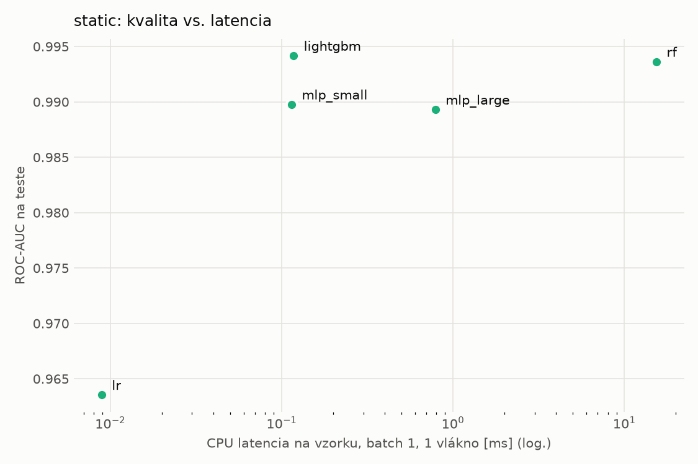
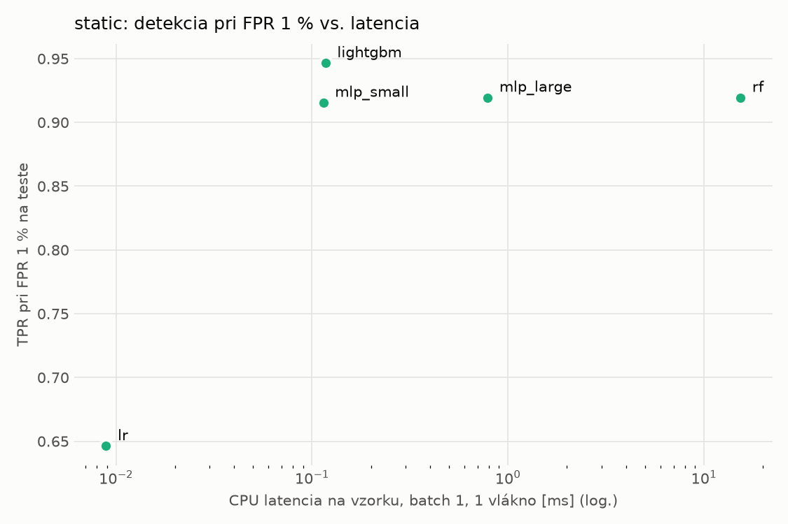
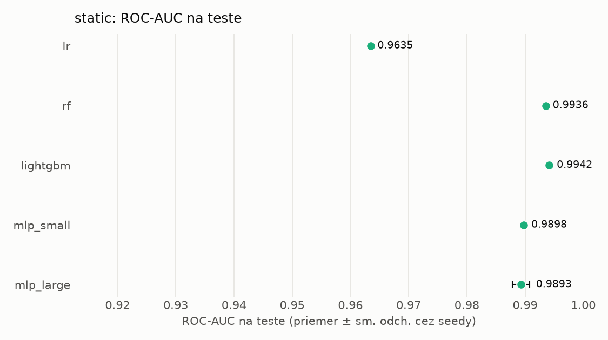
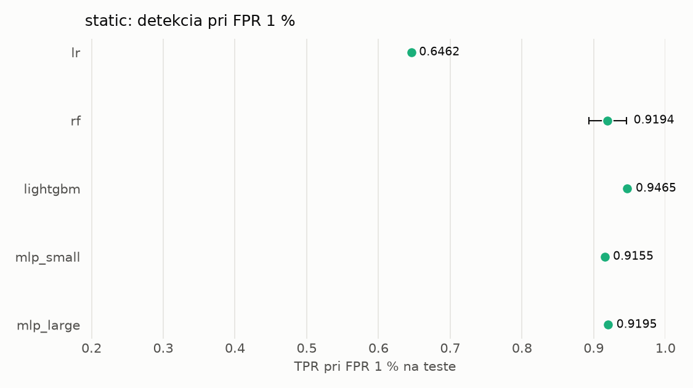

# Porovnanie modelov – static

> Generované `src/evaluation/compare.py` (2026-11-23T01:17:44+01:00); použitý je posledný beh každého modelu.
> Metriky sú priemer cez seedy. \* = pri prahu určenom na validácii (FPR ≤ 1 %).
> CPU ms/vz. = medián latencie jednej vzorky na 1 vlákne vrátane transformácie vstupu (meranie hneď po tréningu,
> orientačné). Oficiálne merania spotreby sú v časti „Spotreba zdrojov pri inferencii“.

## Detekčná kvalita a orientačné časy
| model | ROC-AUC val | ROC-AUC test | TPR@FPR 1 % test | TPR@FPR 0,1 % test | F1 test* | FPR test* | gap train−val | CPU ms/vz. | CPU vz./s | GPU ms/vz. | parametre | MB | tréning s | ladenie min |
|---|---|---|---|---|---|---|---|---|---|---|---|---|---|---|
| [lr](../../static/lr/20261123-011520/README.md) | 0.9594 | 0.9635 ± 0.0000 | 0.6462 | 0.1484 | 0.7562 | 0.0082 | 0.0040 | 0.009 | 3 425 818 | – | 164 | 0.01 | 0.2 | 0.0 |
| [rf](../../static/rf/20261123-011523/README.md) | 0.9928 | 0.9936 ± 0.0000 | 0.9194 | 0.8049 | 0.9291 | 0.0063 | 0.0072 | 15.364 | 110 436 | – | 3 056 536 | 244.89 | 1.5 | 0.0 |
| [lightgbm](../../static/lightgbm/20261123-011538/README.md) | 0.9935 | 0.9942 ± 0.0002 | 0.9465 | 0.7874 | 0.9594 | 0.0056 | 0.0065 | 0.117 | 126 508 | – | 299 854 | 16.75 | 7.5 | 0.0 |
| [mlp_small](../../static/mlp_small/20261123-011611/README.md) | 0.9893 | 0.9898 ± 0.0002 | 0.9155 | 0.5910 | 0.9268 | 0.0067 | 0.0074 | 0.114 | 1 932 656 | 0.647 | 75 777 | 0.32 | 11.2 | 0.0 |
| [mlp_large](../../static/mlp_large/20261123-011647/README.md) | 0.9898 | 0.9893 ± 0.0015 | 0.9195 | 0.4862 | 0.9406 | 0.0064 | 0.0081 | 0.788 | 45 992 | 0.980 | 2 966 529 | 11.91 | 16.9 | 0.0 |

## Nízka prevalencia malvéru (test, prah z validácie)
| model | TPR | FPR | precision @ 1 % | falošné na 1 skutočný poplach @ 1 % | precision @ 0.1 % | falošné na 1 skutočný poplach @ 0.1 % |
|---|---|---|---|---|---|---|
| lr | 0.6141 | 0.0082 | 0.432 | 1.32 | 0.070 | 13.28 |
| rf | 0.8743 | 0.0063 | 0.584 | 0.71 | 0.122 | 7.20 |
| lightgbm | 0.9283 | 0.0056 | 0.627 | 0.60 | 0.143 | 6.01 |
| mlp_small | 0.8710 | 0.0067 | 0.568 | 0.76 | 0.115 | 7.67 |
| mlp_large | 0.8949 | 0.0064 | 0.586 | 0.71 | 0.123 | 7.14 |

Prepočet: TPR a FPR nezávisia od podielu malvéru, preto sa dajú preniesť na nízku prevalenciu (v reálnej prevádzke je malvéru ~1 % alebo menej; v teste 54 %). „Falošné na 1 skutočný poplach“ = koľko neškodných súborov je označených na každý zachytený malvér.

## Spotreba zdrojov pri inferencii (benchmark, testovacia množina)
_Benchmark zatiaľ nebol spustený (`python -m src.evaluation.benchmark --approach static`)._

## Grafy

