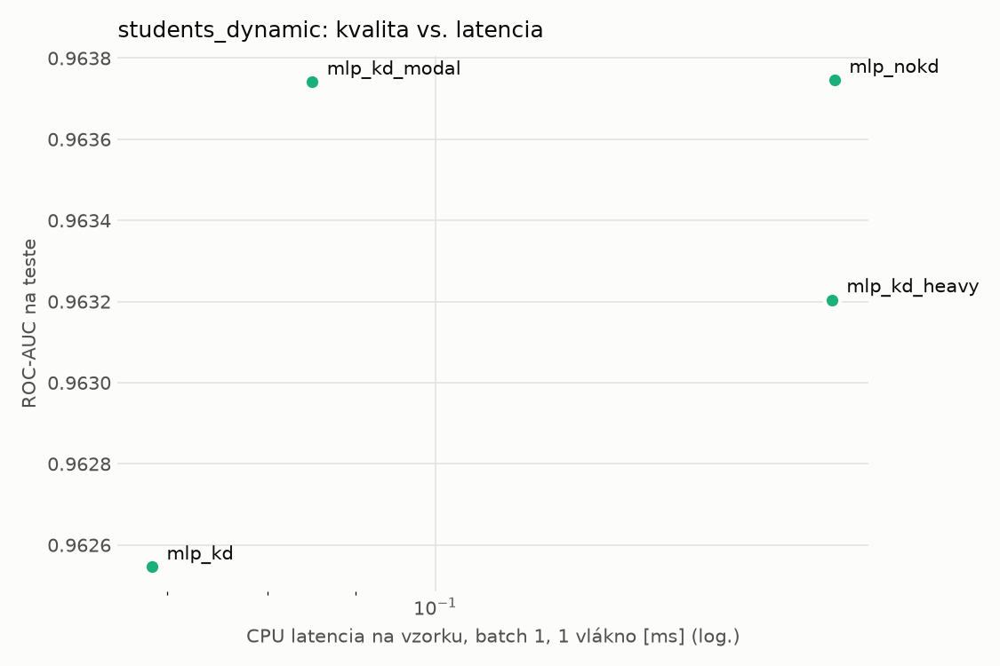
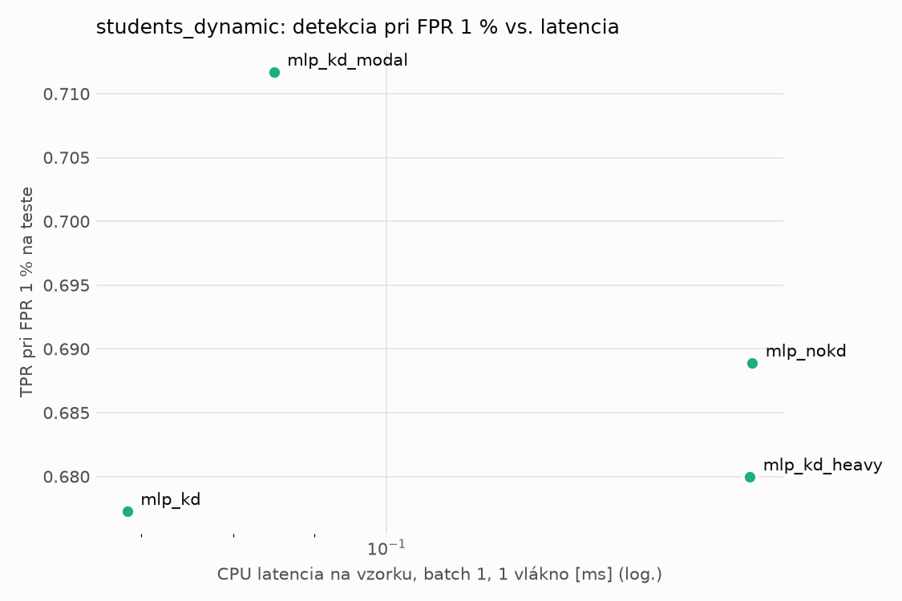
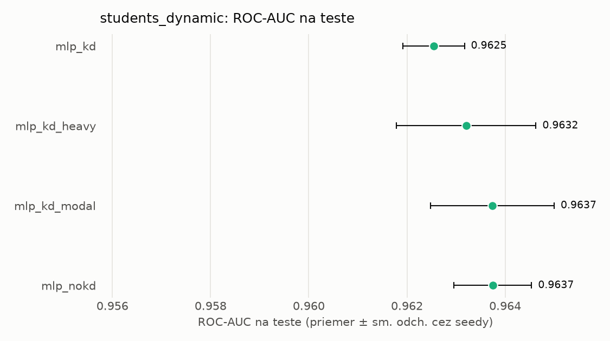
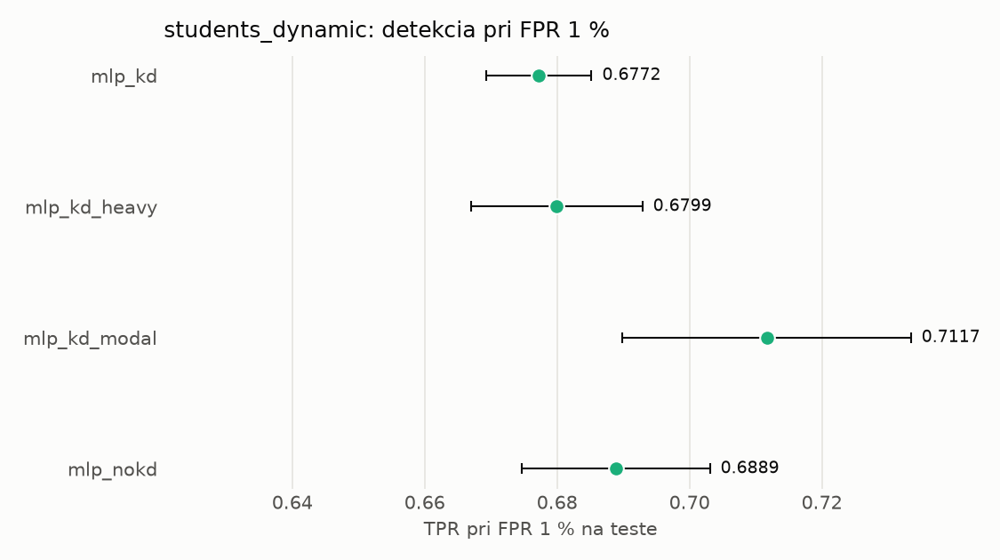

# Porovnanie modelov – students_dynamic

> Generované `src/evaluation/compare.py` (2026-11-23T18:40:58+01:00); použitý je posledný beh každého modelu.
> Metriky sú priemer cez seedy. \* = pri prahu určenom na validácii (FPR ≤ 1 %).
> CPU ms/vz. = medián latencie jednej vzorky na 1 vlákne vrátane transformácie vstupu (meranie hneď po tréningu,
> orientačné). Oficiálne merania spotreby sú v časti „Spotreba zdrojov pri inferencii“.

## Detekčná kvalita a orientačné časy
| model | ROC-AUC val | ROC-AUC test | TPR@FPR 1 % test | TPR@FPR 0,1 % test | F1 test* | FPR test* | gap train−val | CPU ms/vz. | CPU vz./s | GPU ms/vz. | parametre | MB | tréning s | ladenie min |
|---|---|---|---|---|---|---|---|---|---|---|---|---|---|---|
| [mlp_kd](../../students_dynamic/mlp_kd/20261123-183926/README.md) | 0.9613 | 0.9625 ± 0.0006 | 0.6772 | 0.4632 | 0.7835 | 0.0080 | 0.0102 | 0.069 | 6 889 119 | 0.266 | 8 129 | 0.04 | 4.5 | 0.0 |
| [mlp_kd_heavy](../../students_dynamic/mlp_kd_heavy/20261123-184042/README.md) | 0.9613 | 0.9632 ± 0.0014 | 0.6799 | 0.4611 | 0.7939 | 0.0088 | 0.0095 | 0.170 | 5 211 662 | 0.461 | 8 129 | 0.04 | 4.5 | 0.0 |
| [mlp_kd_modal](../../students_dynamic/mlp_kd_modal/20261123-184015/README.md) | 0.9613 | 0.9637 ± 0.0013 | 0.7117 | 0.4762 | 0.8061 | 0.0082 | 0.0068 | 0.085 | 5 637 919 | 0.452 | 8 129 | 0.04 | 8.6 | 0.0 |
| [mlp_nokd](../../students_dynamic/mlp_nokd/20261123-183942/README.md) | 0.9634 | 0.9637 ± 0.0008 | 0.6889 | 0.4409 | 0.7906 | 0.0085 | 0.0104 | 0.170 | 5 362 257 | 0.464 | 8 129 | 0.04 | 10.4 | 0.0 |

## Nízka prevalencia malvéru (test, prah z validácie)
| model | TPR | FPR | precision @ 1 % | falošné na 1 skutočný poplach @ 1 % | precision @ 0.1 % | falošné na 1 skutočný poplach @ 0.1 % |
|---|---|---|---|---|---|---|
| mlp_kd | 0.6504 | 0.0080 | 0.452 | 1.21 | 0.076 | 12.24 |
| mlp_kd_heavy | 0.6654 | 0.0088 | 0.432 | 1.31 | 0.070 | 13.26 |
| mlp_kd_modal | 0.6821 | 0.0082 | 0.456 | 1.19 | 0.077 | 12.02 |
| mlp_nokd | 0.6606 | 0.0085 | 0.440 | 1.27 | 0.072 | 12.85 |

Prepočet: TPR a FPR nezávisia od podielu malvéru, preto sa dajú preniesť na nízku prevalenciu (v reálnej prevádzke je malvéru ~1 % alebo menej; v teste 54 %). „Falošné na 1 skutočný poplach“ = koľko neškodných súborov je označených na každý zachytený malvér.

## Spotreba zdrojov pri inferencii (benchmark, testovacia množina)
_Benchmark zatiaľ nebol spustený (`python -m src.evaluation.benchmark --approach students_dynamic`)._

## Grafy

