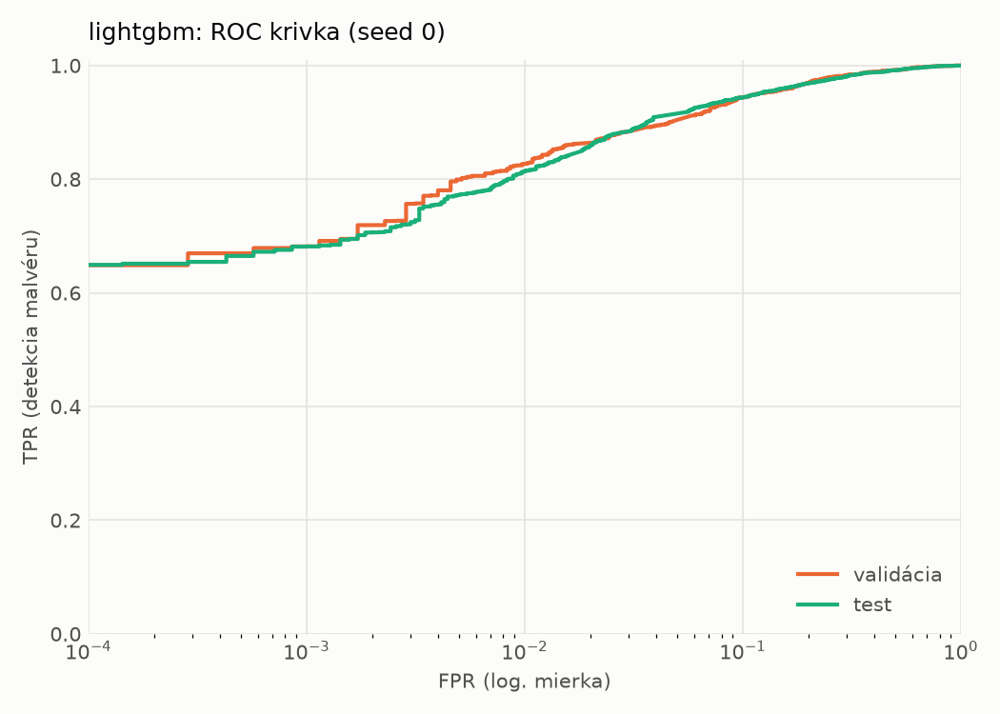
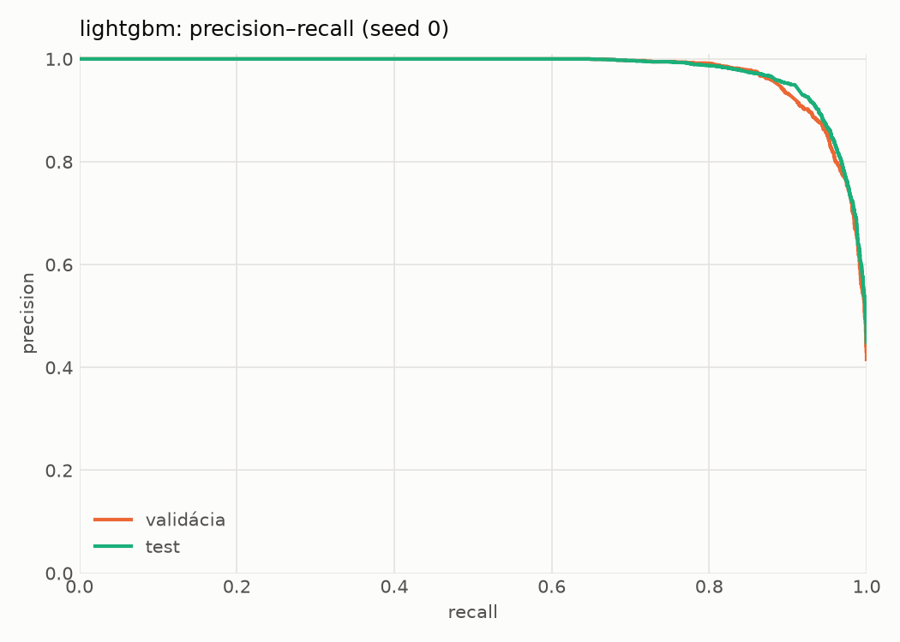
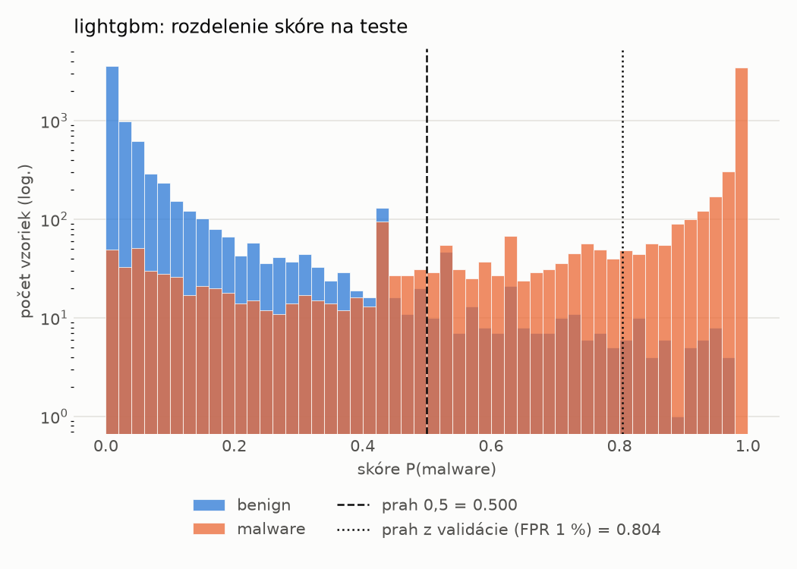
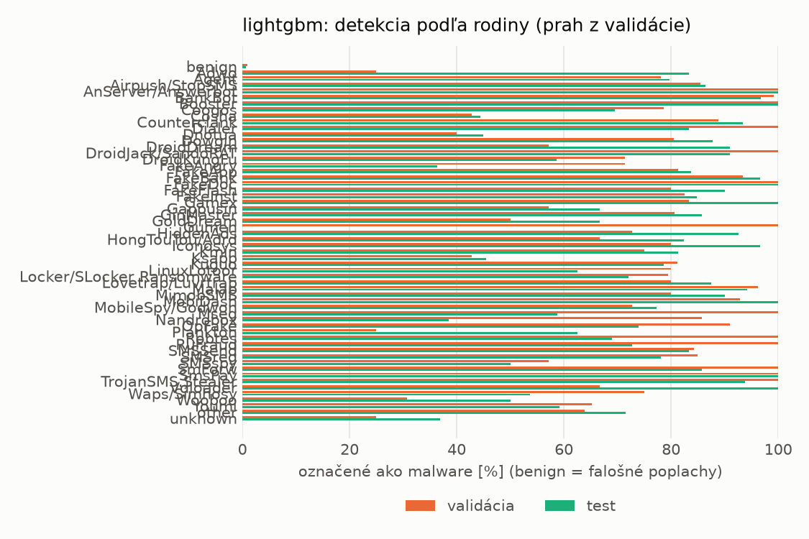
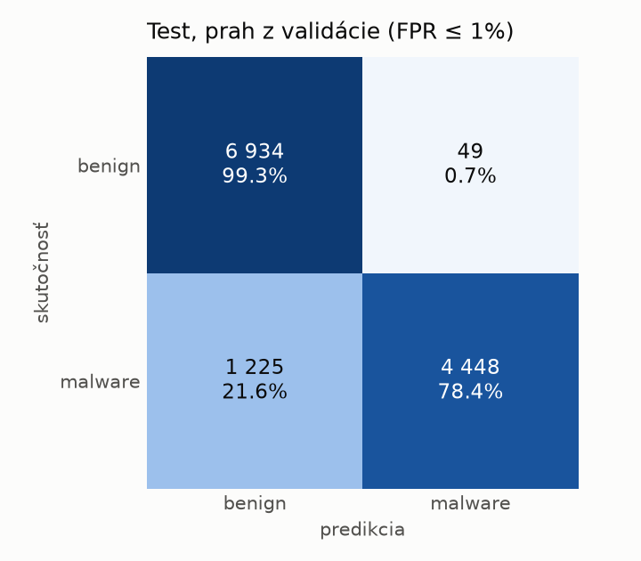
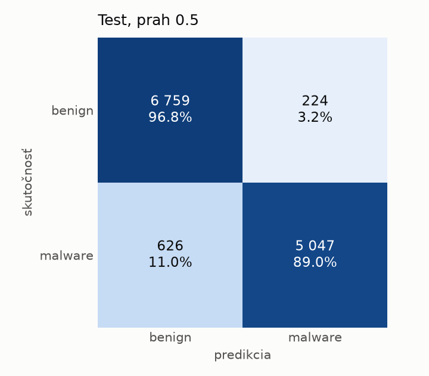
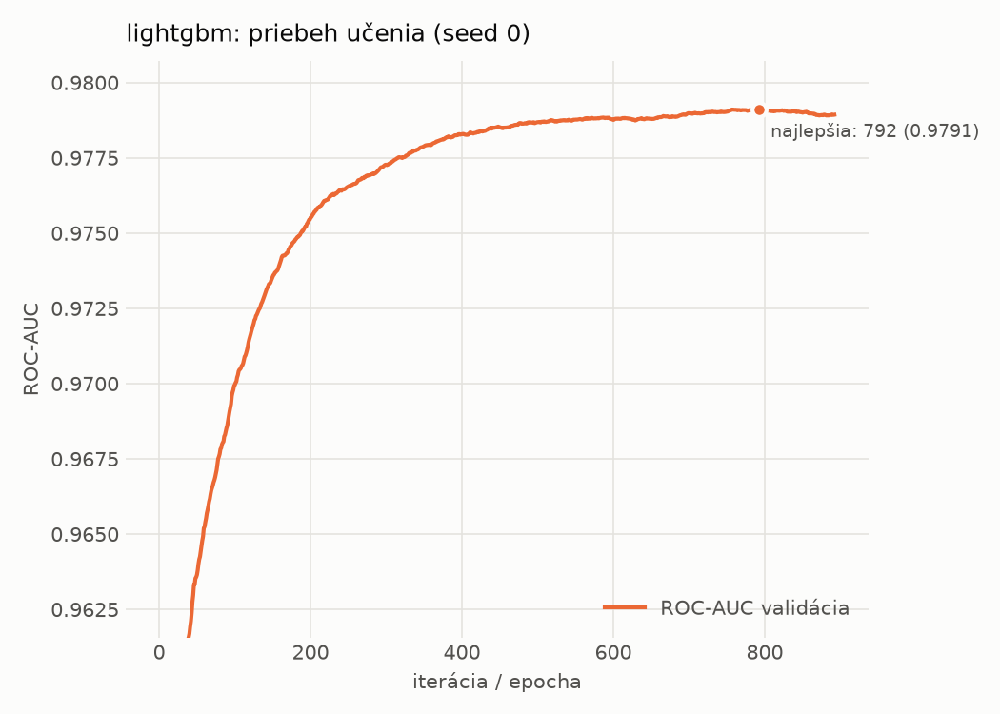

# dynamic/lightgbm – beh `20261123-183231`

> Automaticky generované (`src/training/run_tabular.py`). Konfigurácia: `config.yaml`, protokol: `protocol.yaml`.

- **Model:** `lightgbm` – LightGBM, gradient boosting stromov s early stopping na validácii (pôvodné hodnoty príznakov)
- **Ladenie:** bez ladenia – hyperparametre prevzaté z `runs_v4/real_p/full/dynamic/lightgbm/20261122-233440`
- **Finálne modely:** seedy [0, 1, 2]; hodnoty sú priemer ± smerodajná odchýlka cez seedy
- **Najlepšie hyperparametre:** `{"num_boost_round": 5000, "early_stopping_rounds": 100, "learning_rate": 0.027489744122517933, "num_leaves": 131, "min_child_samples": 30, "feature_fraction": 0.6013521321216351, "bagging_fraction": 0.9615246014341245, "lambda_l1": 3.231327066876444e-06, "lambda_l2": 0.000134433136248308}`

## Detekčná kvalita (bez prahu)
| metrika | train (podvzorka) | validácia | test |
|---|---|---|---|
| ROC-AUC | 0.9989 ± 0.0001 | 0.9792 ± 0.0001 | 0.9790 ± 0.0006 |
| PR-AUC | 0.9984 ± 0.0002 | 0.9774 ± 0.0001 | 0.9795 ± 0.0007 |
| TPR pri FPR 1 % | 0.9765 ± 0.0020 | 0.8324 ± 0.0050 | 0.8117 ± 0.0125 |
| TPR pri FPR 0,1 % | 0.9565 ± 0.0027 | 0.6847 ± 0.0073 | 0.6901 ± 0.0095 |
| log loss | 0.0545 ± 0.0042 | 0.1686 ± 0.0003 | 0.1767 ± 0.0038 |
| Brier skóre | 0.0129 ± 0.0009 | 0.0491 ± 0.0001 | 0.0510 ± 0.0017 |

Rozdiel ROC-AUC train − validácia: **0.0197** (veľký rozdiel = preučenie).

## Pri prahu z validácie (FPR ≤ 1% na validácii)
| metrika | train (podvzorka) | validácia | test |
|---|---|---|---|
| accuracy | 0.9762 ± 0.0019 | 0.9246 ± 0.0021 | 0.9015 ± 0.0041 |
| balanced accuracy | 0.9708 ± 0.0023 | 0.9113 ± 0.0025 | 0.8910 ± 0.0046 |
| precision | 0.9998 ± 0.0002 | 0.9838 ± 0.0001 | 0.9883 ± 0.0010 |
| recall (TPR) | 0.9417 ± 0.0045 | 0.8324 ± 0.0050 | 0.7896 ± 0.0091 |
| FPR | 0.0001 ± 0.0001 | 0.0097 ± 0.0000 | 0.0076 ± 0.0007 |
| F1 | 0.9699 ± 0.0024 | 0.9018 ± 0.0029 | 0.8779 ± 0.0057 |
| MCC | 0.9515 ± 0.0038 | 0.8491 ± 0.0040 | 0.8112 ± 0.0076 |

## Pri pevnom prahu 0.5
| metrika | train (podvzorka) | validácia | test |
|---|---|---|---|
| accuracy | 0.9843 ± 0.0005 | 0.9327 ± 0.0001 | 0.9333 ± 0.0044 |
| balanced accuracy | 0.9829 ± 0.0006 | 0.9273 ± 0.0003 | 0.9293 ± 0.0049 |
| precision | 0.9859 ± 0.0002 | 0.9403 ± 0.0010 | 0.9574 ± 0.0003 |
| recall (TPR) | 0.9754 ± 0.0011 | 0.8950 ± 0.0013 | 0.8907 ± 0.0099 |
| FPR | 0.0096 ± 0.0001 | 0.0404 ± 0.0008 | 0.0322 ± 0.0002 |
| F1 | 0.9806 ± 0.0006 | 0.9171 ± 0.0002 | 0.9228 ± 0.0054 |
| MCC | 0.9675 ± 0.0011 | 0.8613 ± 0.0002 | 0.8660 ± 0.0085 |

## Výpočtové nároky (seed 0, testovacia množina)
| meranie | hodnota |
|---|---|
| tréning finálneho modelu | 10.1 s (priemer cez seedy) |
| ladenie spolu | 0 s |
| počet parametrov / uzlov | 206 712 |
| veľkosť modelu na disku | 11.33 MB |
| CPU latencia modelu (batch 1, 1 vlákno) | 0.111 ms (p95 0.131) |
| CPU priepustnosť (24 vlákien) | 138 513 vzoriek/s |

## Grafy
| | |
|---|---|
|  |  |
|  |  |
|  |  |
|  |  |

## Súbory
`metrics.json` (všetky metriky po seedoch vrátane rodín), `timing.json`, `hpo_trials.csv`,
`predictions/<časť>_seed<N>.parquet` (sha256, family, label, score), `model/seed_<N>/`, `log.txt`.
