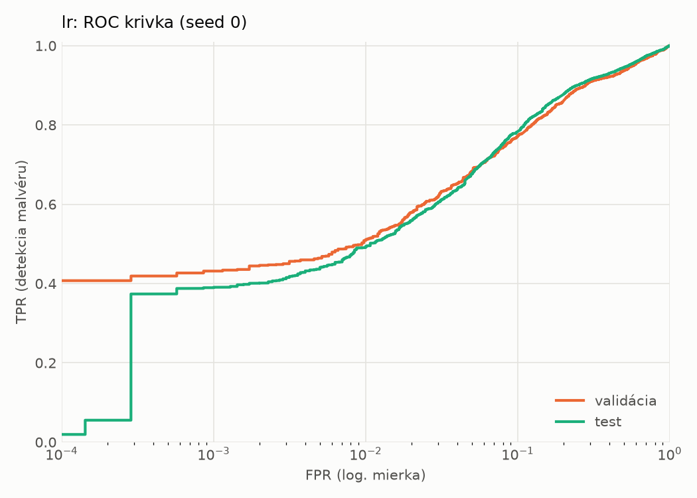
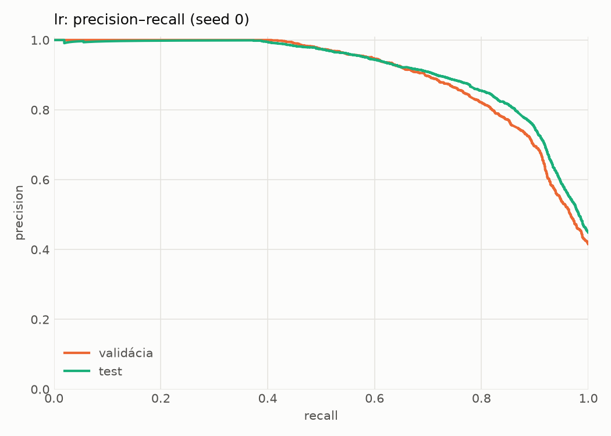
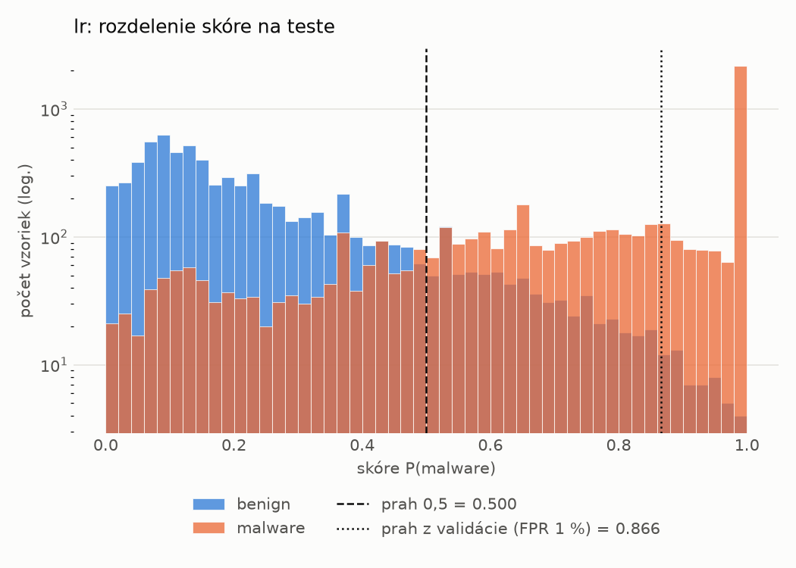
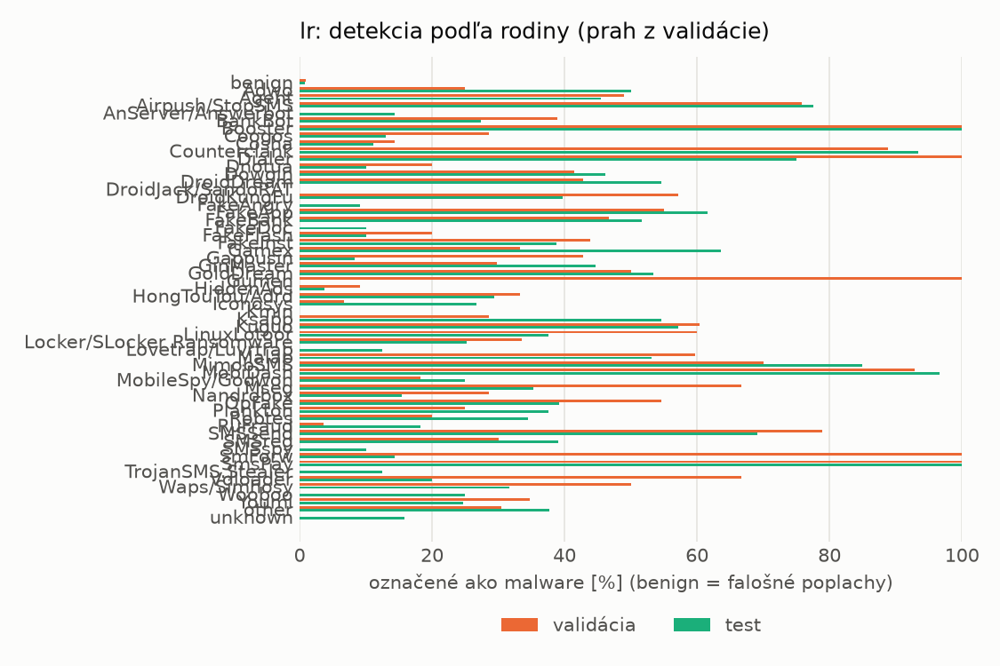
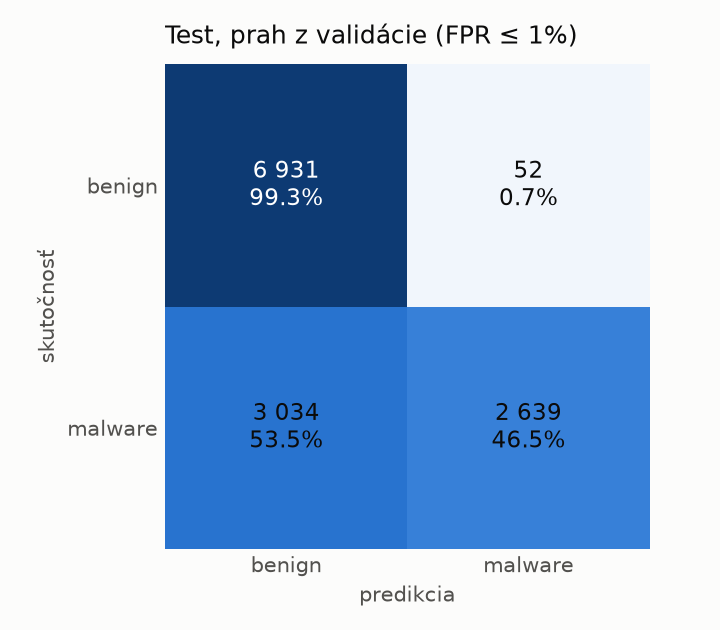
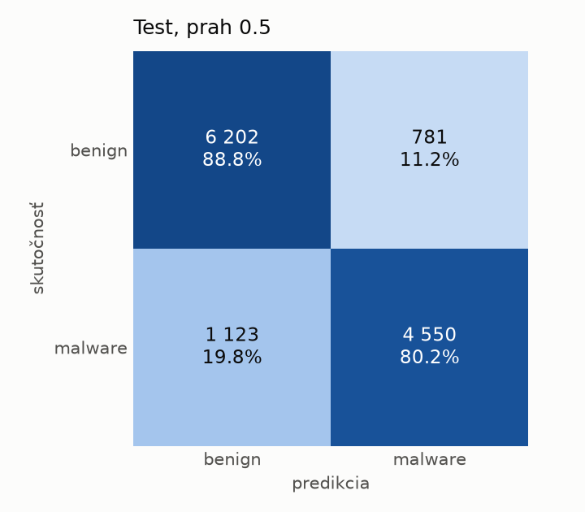

# dynamic/lr – beh `20261123-011748`

> Automaticky generované (`src/training/run_tabular.py`). Konfigurácia: `config.yaml`, protokol: `protocol.yaml`.

- **Model:** `logreg` – logistická regresia s L2 regularizáciou (vstup signed log1p + štandardizácia)
- **Ladenie:** bez ladenia – hyperparametre prevzaté z `runs_v4/real_p/full/dynamic/lr/20261122-233312`
- **Finálne modely:** seedy [0, 1, 2]; hodnoty sú priemer ± smerodajná odchýlka cez seedy
- **Najlepšie hyperparametre:** `{"max_iter": 2000, "C": 9.535095002298556}`

## Detekčná kvalita (bez prahu)
| metrika | train (podvzorka) | validácia | test |
|---|---|---|---|
| ROC-AUC | 0.9153 ± 0.0000 | 0.9073 ± 0.0000 | 0.9129 ± 0.0000 |
| PR-AUC | 0.9092 ± 0.0000 | 0.9048 ± 0.0000 | 0.9149 ± 0.0000 |
| TPR pri FPR 1 % | 0.5206 ± 0.0000 | 0.5085 ± 0.0000 | 0.4909 ± 0.0000 |
| TPR pri FPR 0,1 % | 0.4528 ± 0.0000 | 0.4315 ± 0.0000 | 0.3896 ± 0.0000 |
| log loss | 0.3524 ± 0.0000 | 0.3656 ± 0.0000 | 0.3669 ± 0.0000 |
| Brier skóre | 0.1091 ± 0.0000 | 0.1137 ± 0.0000 | 0.1131 ± 0.0000 |

Rozdiel ROC-AUC train − validácia: **0.0080** (veľký rozdiel = preučenie).

## Pri prahu z validácie (FPR ≤ 1% na validácii)
| metrika | train (podvzorka) | validácia | test |
|---|---|---|---|
| accuracy | 0.7996 ± 0.0000 | 0.7900 ± 0.0000 | 0.7562 ± 0.0000 |
| balanced accuracy | 0.7560 ± 0.0000 | 0.7494 ± 0.0000 | 0.7289 ± 0.0000 |
| precision | 0.9721 ± 0.0000 | 0.9738 ± 0.0000 | 0.9807 ± 0.0000 |
| recall (TPR) | 0.5224 ± 0.0000 | 0.5085 ± 0.0000 | 0.4652 ± 0.0000 |
| FPR | 0.0103 ± 0.0000 | 0.0097 ± 0.0000 | 0.0074 ± 0.0000 |
| F1 | 0.6796 ± 0.0000 | 0.6681 ± 0.0000 | 0.6310 ± 0.0000 |
| MCC | 0.6087 ± 0.0000 | 0.5962 ± 0.0000 | 0.5564 ± 0.0000 |

## Pri pevnom prahu 0.5
| metrika | train (podvzorka) | validácia | test |
|---|---|---|---|
| accuracy | 0.8550 ± 0.0000 | 0.8444 ± 0.0000 | 0.8496 ± 0.0000 |
| balanced accuracy | 0.8480 ± 0.0000 | 0.8379 ± 0.0000 | 0.8451 ± 0.0000 |
| precision | 0.8292 ± 0.0000 | 0.8218 ± 0.0000 | 0.8535 ± 0.0000 |
| recall (TPR) | 0.8105 ± 0.0000 | 0.7990 ± 0.0000 | 0.8020 ± 0.0000 |
| FPR | 0.1145 ± 0.0000 | 0.1232 ± 0.0000 | 0.1118 ± 0.0000 |
| F1 | 0.8197 ± 0.0000 | 0.8102 ± 0.0000 | 0.8270 ± 0.0000 |
| MCC | 0.6986 ± 0.0000 | 0.6786 ± 0.0000 | 0.6952 ± 0.0000 |

## Výpočtové nároky (seed 0, testovacia množina)
| meranie | hodnota |
|---|---|
| tréning finálneho modelu | 1.1 s (priemer cez seedy) |
| ladenie spolu | 0 s |
| počet parametrov / uzlov | 124 |
| veľkosť modelu na disku | 0.01 MB |
| transformácia vstupu – latencia (1 vlákno) | 0.014 ms |
| transformácia vstupu – priepustnosť | 674 612 vzoriek/s |
| CPU latencia modelu (batch 1, 1 vlákno) | 0.012 ms (p95 0.015) |
| CPU priepustnosť (24 vlákien) | 2 235 805 vzoriek/s |

## Grafy
| | |
|---|---|
|  |  |
|  |  |
|  |  |
|  |  |

## Súbory
`metrics.json` (všetky metriky po seedoch vrátane rodín), `timing.json`, `hpo_trials.csv`,
`predictions/<časť>_seed<N>.parquet` (sha256, family, label, score), `model/seed_<N>/`, `log.txt`.
