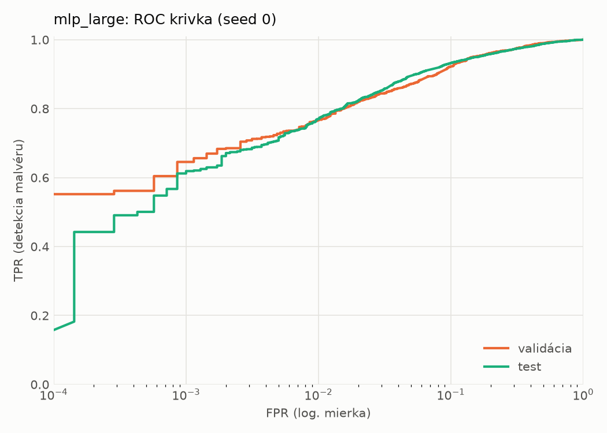
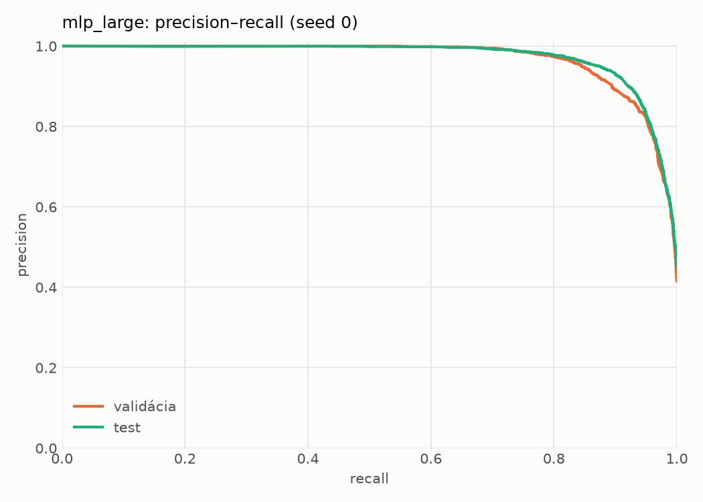
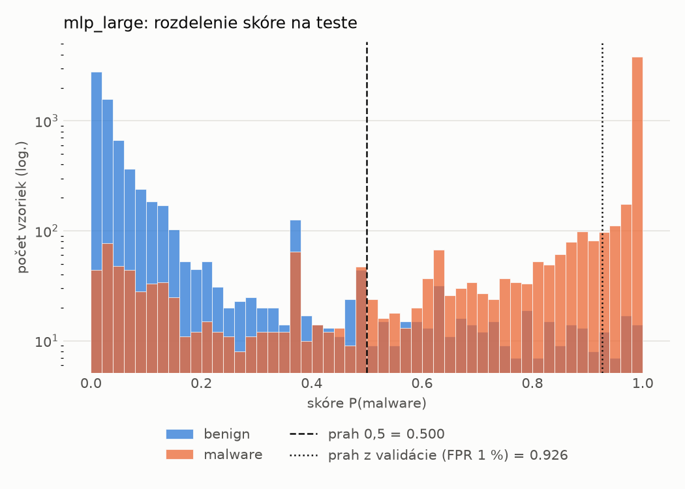
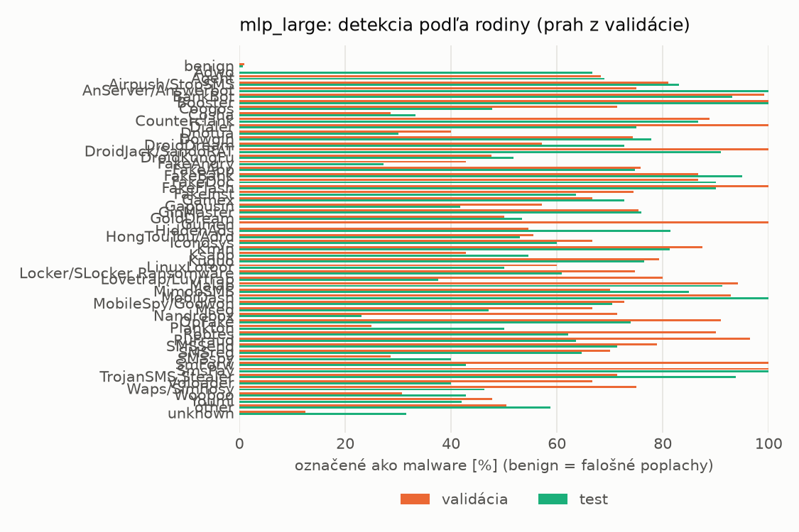
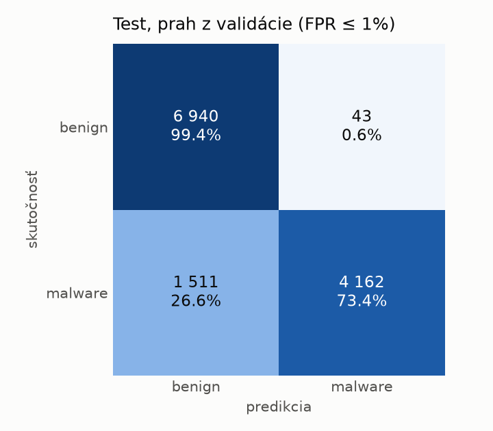
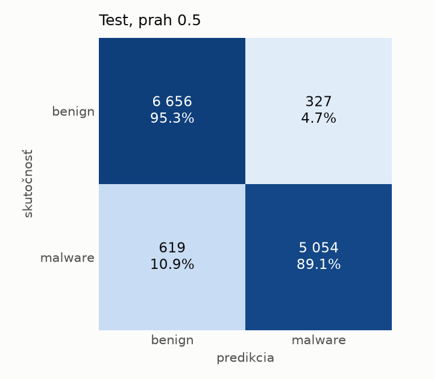
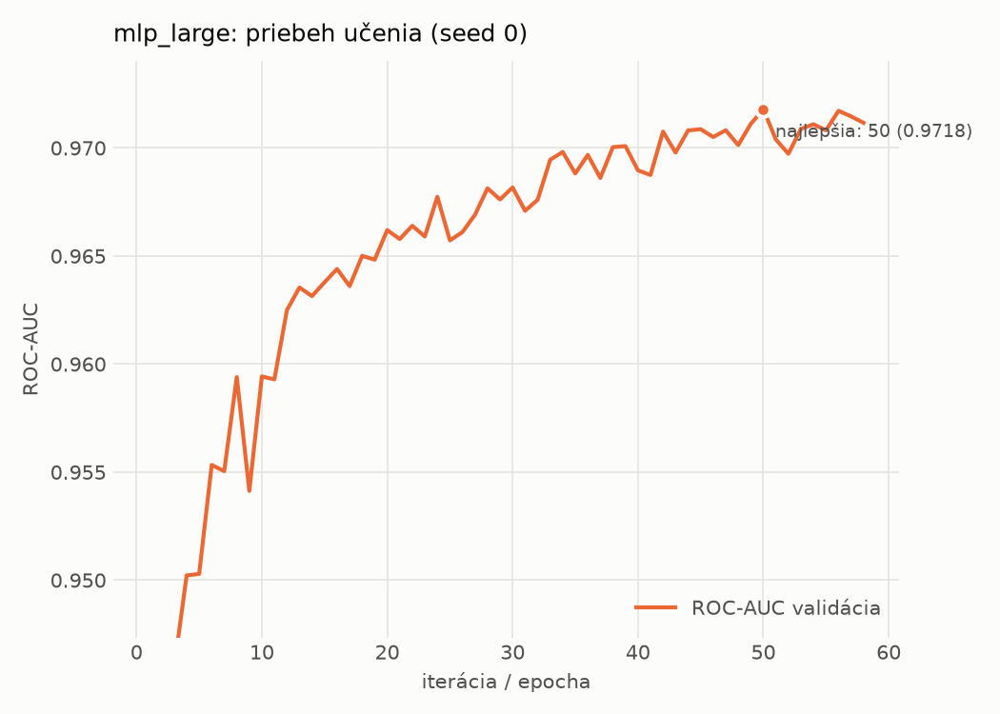

# dynamic/mlp_large – beh `20261123-183405`

> Automaticky generované (`src/training/run_tabular.py`). Konfigurácia: `config.yaml`, protokol: `protocol.yaml`.

- **Model:** `mlp` – veľká neurónová sieť (3–5 skrytých vrstiev, 512–2048 neurónov), kandidát na učiteľa
- **Ladenie:** bez ladenia – hyperparametre prevzaté z `runs_v4/real_p/full/dynamic/mlp_large/20261122-235153`
- **Finálne modely:** seedy [0, 1, 2]; hodnoty sú priemer ± smerodajná odchýlka cez seedy
- **Najlepšie hyperparametre:** `{"max_epochs": 100, "patience": 8, "hidden_layers": 5, "hidden_width": 512, "width_decay": 1.0, "dropout": 0.3998176791356432, "lr": 0.0024125104549951384, "weight_decay": 1.1960883604412328e-06, "batch_size": 1024}`

## Detekčná kvalita (bez prahu)
| metrika | train (podvzorka) | validácia | test |
|---|---|---|---|
| ROC-AUC | 0.9854 ± 0.0009 | 0.9718 ± 0.0002 | 0.9721 ± 0.0001 |
| PR-AUC | 0.9838 ± 0.0011 | 0.9695 ± 0.0005 | 0.9728 ± 0.0001 |
| TPR pri FPR 1 % | 0.8754 ± 0.0069 | 0.7669 ± 0.0024 | 0.7711 ± 0.0061 |
| TPR pri FPR 0,1 % | 0.7886 ± 0.0181 | 0.6159 ± 0.0275 | 0.5937 ± 0.0169 |
| log loss | 0.1379 ± 0.0045 | 0.2072 ± 0.0016 | 0.2030 ± 0.0003 |
| Brier skóre | 0.0396 ± 0.0012 | 0.0600 ± 0.0011 | 0.0577 ± 0.0002 |

Rozdiel ROC-AUC train − validácia: **0.0137** (veľký rozdiel = preučenie).

## Pri prahu z validácie (FPR ≤ 1% na validácii)
| metrika | train (podvzorka) | validácia | test |
|---|---|---|---|
| accuracy | 0.9136 ± 0.0023 | 0.8974 ± 0.0010 | 0.8781 ± 0.0016 |
| balanced accuracy | 0.8941 ± 0.0027 | 0.8786 ± 0.0012 | 0.8647 ± 0.0017 |
| precision | 0.9980 ± 0.0015 | 0.9824 ± 0.0001 | 0.9899 ± 0.0013 |
| recall (TPR) | 0.7892 ± 0.0047 | 0.7669 ± 0.0024 | 0.7355 ± 0.0027 |
| FPR | 0.0011 ± 0.0008 | 0.0097 ± 0.0000 | 0.0061 ± 0.0008 |
| F1 | 0.8814 ± 0.0034 | 0.8614 ± 0.0015 | 0.8440 ± 0.0022 |
| MCC | 0.8289 ± 0.0047 | 0.7970 ± 0.0019 | 0.7697 ± 0.0031 |

## Pri pevnom prahu 0.5
| metrika | train (podvzorka) | validácia | test |
|---|---|---|---|
| accuracy | 0.9492 ± 0.0015 | 0.9184 ± 0.0018 | 0.9257 ± 0.0004 |
| balanced accuracy | 0.9457 ± 0.0024 | 0.9146 ± 0.0024 | 0.9231 ± 0.0009 |
| precision | 0.9471 ± 0.0051 | 0.9097 ± 0.0059 | 0.9342 ± 0.0048 |
| recall (TPR) | 0.9268 ± 0.0082 | 0.8923 ± 0.0083 | 0.8975 ± 0.0062 |
| FPR | 0.0355 ± 0.0039 | 0.0631 ± 0.0050 | 0.0514 ± 0.0044 |
| F1 | 0.9368 ± 0.0021 | 0.9009 ± 0.0025 | 0.9155 ± 0.0009 |
| MCC | 0.8945 ± 0.0030 | 0.8317 ± 0.0037 | 0.8498 ± 0.0006 |

## Výpočtové nároky (seed 0, testovacia množina)
| meranie | hodnota |
|---|---|
| tréning finálneho modelu | 7.6 s (priemer cez seedy) |
| ladenie spolu | 0 s |
| počet parametrov / uzlov | 1 119 745 |
| veľkosť modelu na disku | 4.51 MB |
| transformácia vstupu – latencia (1 vlákno) | 0.015 ms |
| transformácia vstupu – priepustnosť | 748 451 vzoriek/s |
| CPU latencia modelu (batch 1, 1 vlákno) | 0.227 ms (p95 0.570) |
| CPU priepustnosť (24 vlákien) | 370 166 vzoriek/s |
| GPU latencia (batch 1) | 0.652 ms (p95 0.828) |
| GPU priepustnosť | 1 698 997 vzoriek/s |
| GPU špičková pamäť | 115 MB |

## Grafy
| | |
|---|---|
|  |  |
|  |  |
|  |  |
|  |  |

## Súbory
`metrics.json` (všetky metriky po seedoch vrátane rodín), `timing.json`, `hpo_trials.csv`,
`predictions/<časť>_seed<N>.parquet` (sha256, family, label, score), `model/seed_<N>/`, `log.txt`.
