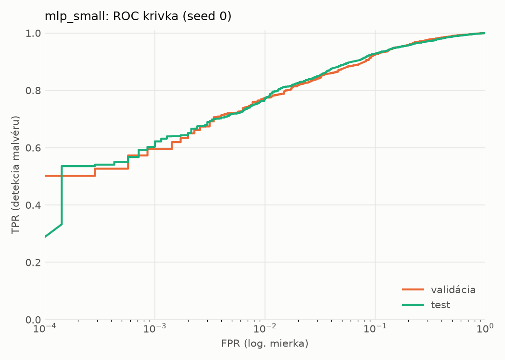
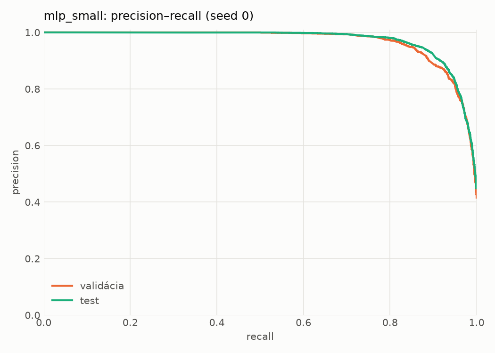
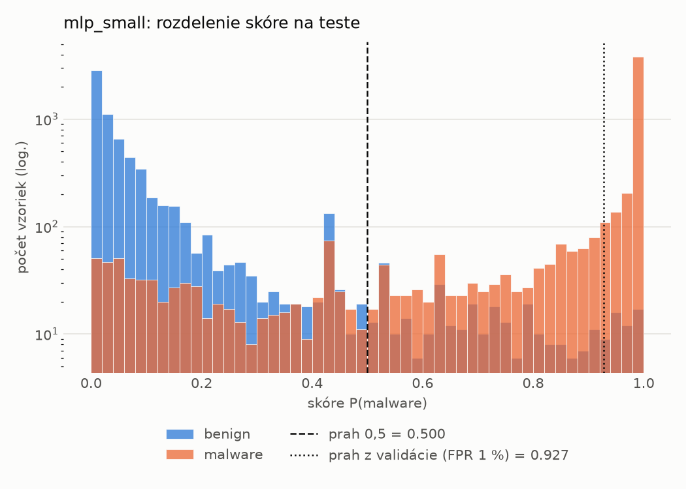
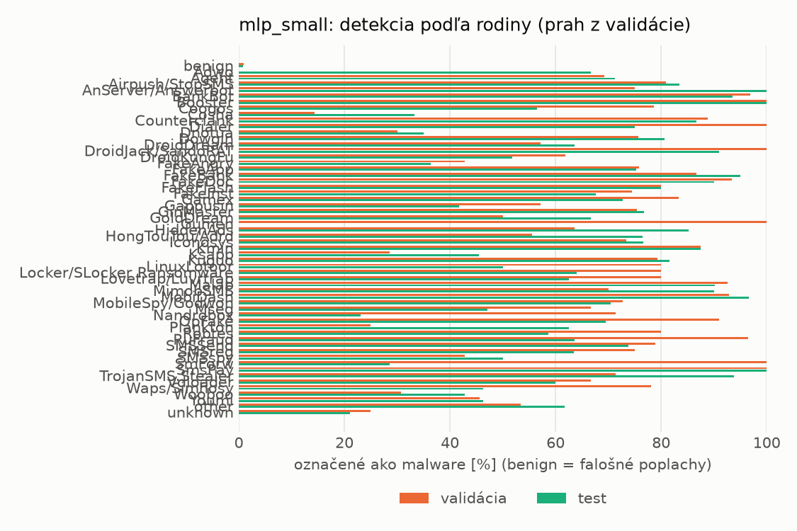
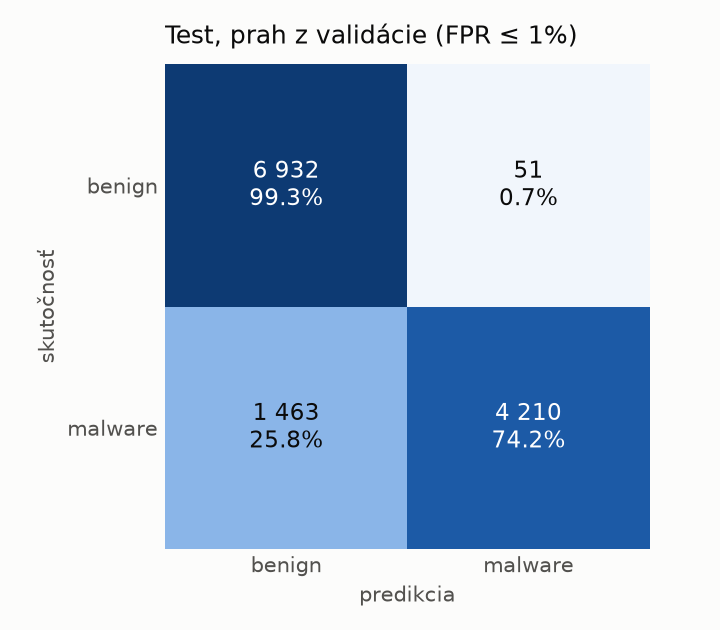
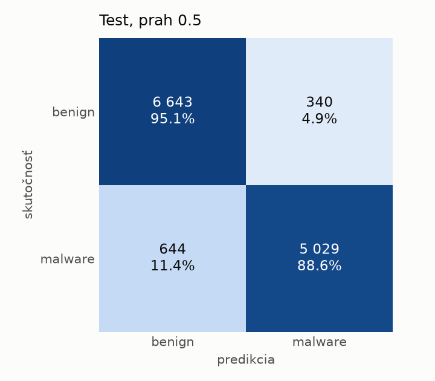
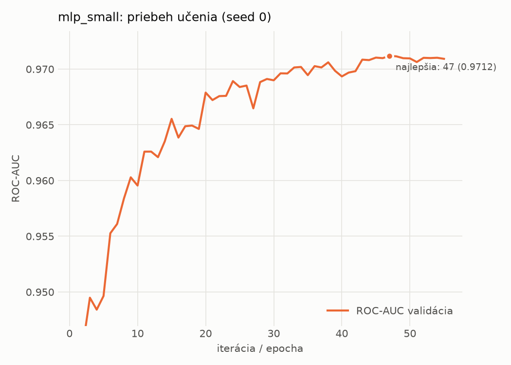

# dynamic/mlp_small – beh `20261123-183309`

> Automaticky generované (`src/training/run_tabular.py`). Konfigurácia: `config.yaml`, protokol: `protocol.yaml`.

- **Model:** `mlp` – malá neurónová sieť (1–2 skryté vrstvy), kandidát na ľahkého študenta
- **Ladenie:** bez ladenia – hyperparametre prevzaté z `runs_v4/real_p/full/dynamic/mlp_small/20261122-234317`
- **Finálne modely:** seedy [0, 1, 2]; hodnoty sú priemer ± smerodajná odchýlka cez seedy
- **Najlepšie hyperparametre:** `{"width_decay": 0.5, "max_epochs": 100, "patience": 8, "hidden_layers": 2, "hidden_width": 256, "dropout": 0.2449160262890371, "lr": 0.002872548733508973, "weight_decay": 4.509331245708397e-06, "batch_size": 256}`

## Detekčná kvalita (bez prahu)
| metrika | train (podvzorka) | validácia | test |
|---|---|---|---|
| ROC-AUC | 0.9858 ± 0.0010 | 0.9717 ± 0.0005 | 0.9718 ± 0.0009 |
| PR-AUC | 0.9841 ± 0.0011 | 0.9691 ± 0.0006 | 0.9729 ± 0.0009 |
| TPR pri FPR 1 % | 0.8710 ± 0.0091 | 0.7677 ± 0.0047 | 0.7753 ± 0.0083 |
| TPR pri FPR 0,1 % | 0.7788 ± 0.0064 | 0.6105 ± 0.0318 | 0.5863 ± 0.0163 |
| log loss | 0.1373 ± 0.0046 | 0.2088 ± 0.0028 | 0.2055 ± 0.0030 |
| Brier skóre | 0.0394 ± 0.0015 | 0.0602 ± 0.0007 | 0.0582 ± 0.0009 |

Rozdiel ROC-AUC train − validácia: **0.0141** (veľký rozdiel = preučenie).

## Pri prahu z validácie (FPR ≤ 1% na validácii)
| metrika | train (podvzorka) | validácia | test |
|---|---|---|---|
| accuracy | 0.9139 ± 0.0024 | 0.8977 ± 0.0019 | 0.8771 ± 0.0031 |
| balanced accuracy | 0.8944 ± 0.0029 | 0.8790 ± 0.0023 | 0.8635 ± 0.0037 |
| precision | 0.9979 ± 0.0004 | 0.9825 ± 0.0001 | 0.9910 ± 0.0030 |
| recall (TPR) | 0.7900 ± 0.0059 | 0.7677 ± 0.0047 | 0.7325 ± 0.0093 |
| FPR | 0.0011 ± 0.0002 | 0.0097 ± 0.0000 | 0.0054 ± 0.0019 |
| F1 | 0.8819 ± 0.0037 | 0.8619 ± 0.0030 | 0.8423 ± 0.0051 |
| MCC | 0.8294 ± 0.0045 | 0.7976 ± 0.0037 | 0.7682 ± 0.0048 |

## Pri pevnom prahu 0.5
| metrika | train (podvzorka) | validácia | test |
|---|---|---|---|
| accuracy | 0.9493 ± 0.0021 | 0.9172 ± 0.0014 | 0.9239 ± 0.0015 |
| balanced accuracy | 0.9453 ± 0.0018 | 0.9123 ± 0.0007 | 0.9206 ± 0.0015 |
| precision | 0.9502 ± 0.0078 | 0.9144 ± 0.0111 | 0.9388 ± 0.0063 |
| recall (TPR) | 0.9240 ± 0.0054 | 0.8836 ± 0.0095 | 0.8883 ± 0.0058 |
| FPR | 0.0333 ± 0.0056 | 0.0589 ± 0.0089 | 0.0471 ± 0.0054 |
| F1 | 0.9369 ± 0.0024 | 0.8987 ± 0.0009 | 0.9128 ± 0.0017 |
| MCC | 0.8948 ± 0.0044 | 0.8291 ± 0.0029 | 0.8465 ± 0.0032 |

## Výpočtové nároky (seed 0, testovacia množina)
| meranie | hodnota |
|---|---|
| tréning finálneho modelu | 17.8 s (priemer cez seedy) |
| ladenie spolu | 0 s |
| počet parametrov / uzlov | 65 537 |
| veľkosť modelu na disku | 0.27 MB |
| transformácia vstupu – latencia (1 vlákno) | 0.014 ms |
| transformácia vstupu – priepustnosť | 788 300 vzoriek/s |
| CPU latencia modelu (batch 1, 1 vlákno) | 0.081 ms (p95 0.229) |
| CPU priepustnosť (24 vlákien) | 2 929 358 vzoriek/s |
| GPU latencia (batch 1) | 0.635 ms (p95 0.672) |
| GPU priepustnosť | 1 543 226 vzoriek/s |
| GPU špičková pamäť | 65 MB |

## Grafy
| | |
|---|---|
|  |  |
|  |  |
|  |  |
|  |  |

## Súbory
`metrics.json` (všetky metriky po seedoch vrátane rodín), `timing.json`, `hpo_trials.csv`,
`predictions/<časť>_seed<N>.parquet` (sha256, family, label, score), `model/seed_<N>/`, `log.txt`.
