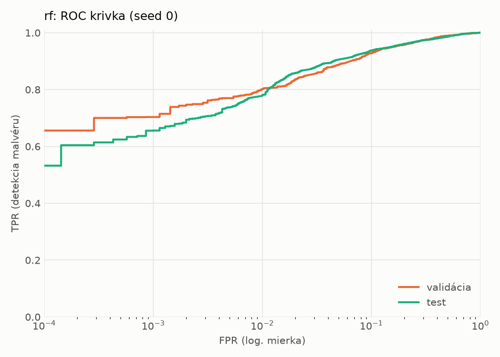
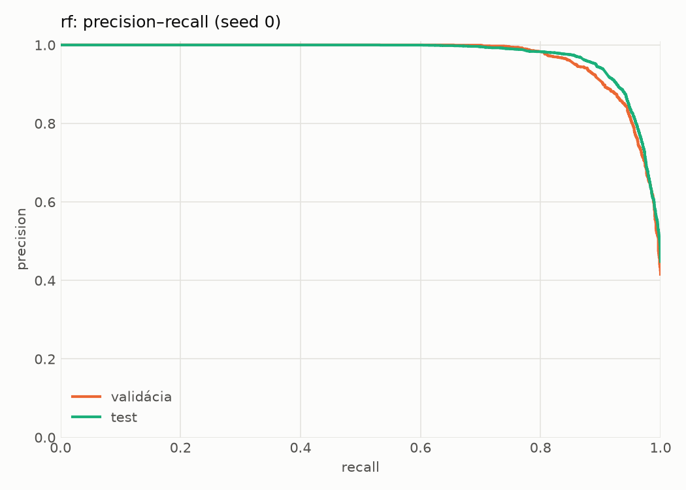
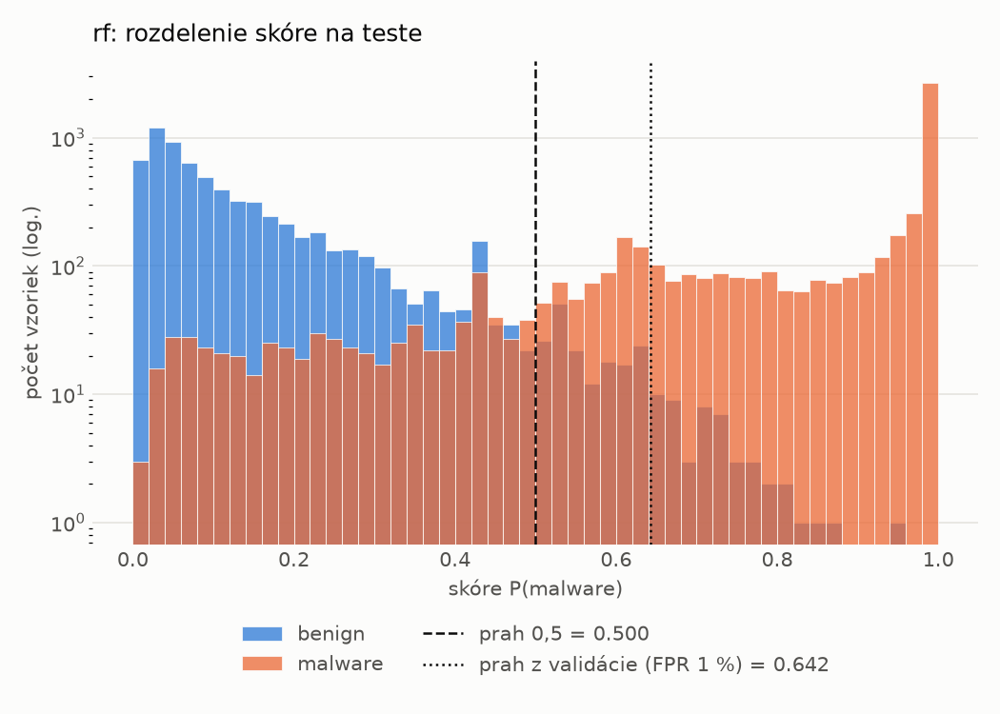
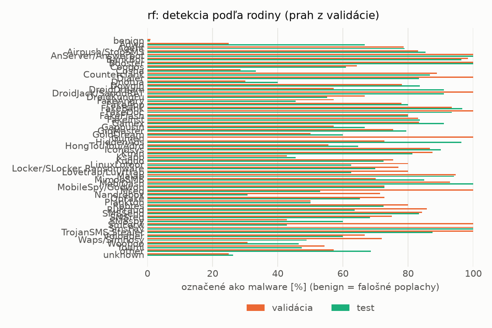
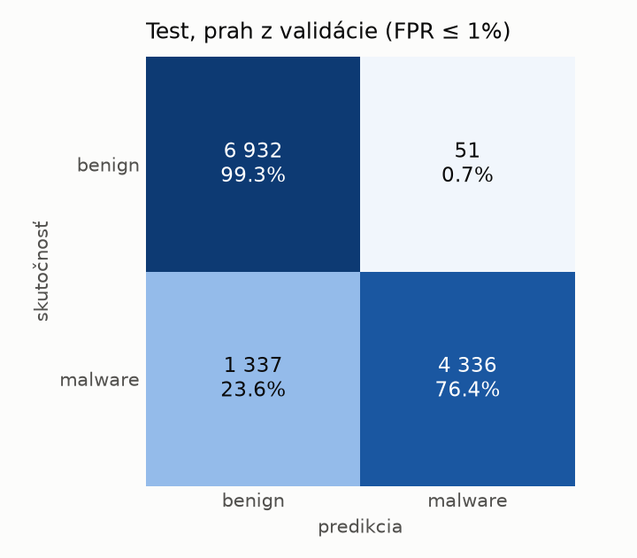
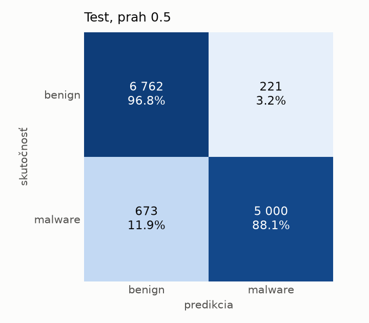

# dynamic/rf – beh `20261123-183213`

> Automaticky generované (`src/training/run_tabular.py`). Konfigurácia: `config.yaml`, protokol: `protocol.yaml`.

- **Model:** `random_forest` – Random Forest (pôvodné hodnoty príznakov)
- **Ladenie:** bez ladenia – hyperparametre prevzaté z `runs_v4/real_p/full/dynamic/rf/20261122-233325`
- **Finálne modely:** seedy [0, 1, 2]; hodnoty sú priemer ± smerodajná odchýlka cez seedy
- **Najlepšie hyperparametre:** `{"n_estimators": 500, "max_depth": 24, "min_samples_leaf": 1, "max_features": "sqrt"}`

## Detekčná kvalita (bez prahu)
| metrika | train (podvzorka) | validácia | test |
|---|---|---|---|
| ROC-AUC | 0.9980 ± 0.0000 | 0.9730 ± 0.0002 | 0.9738 ± 0.0001 |
| PR-AUC | 0.9976 ± 0.0000 | 0.9716 ± 0.0002 | 0.9753 ± 0.0001 |
| TPR pri FPR 1 % | 0.9730 ± 0.0008 | 0.8000 ± 0.0041 | 0.7807 ± 0.0089 |
| TPR pri FPR 0,1 % | 0.9421 ± 0.0006 | 0.7141 ± 0.0092 | 0.6531 ± 0.0020 |
| log loss | 0.0934 ± 0.0002 | 0.2077 ± 0.0005 | 0.2195 ± 0.0005 |
| Brier skóre | 0.0192 ± 0.0000 | 0.0597 ± 0.0001 | 0.0629 ± 0.0003 |

Rozdiel ROC-AUC train − validácia: **0.0250** (veľký rozdiel = preučenie).

## Pri prahu z validácie (FPR ≤ 1% na validácii)
| metrika | train (podvzorka) | validácia | test |
|---|---|---|---|
| accuracy | 0.9760 ± 0.0007 | 0.9112 ± 0.0016 | 0.8906 ± 0.0020 |
| balanced accuracy | 0.9705 ± 0.0008 | 0.8952 ± 0.0020 | 0.8788 ± 0.0022 |
| precision | 1.0000 ± 0.0000 | 0.9833 ± 0.0002 | 0.9891 ± 0.0006 |
| recall (TPR) | 0.9409 ± 0.0016 | 0.8000 ± 0.0041 | 0.7644 ± 0.0045 |
| FPR | 0.0000 ± 0.0000 | 0.0096 ± 0.0002 | 0.0069 ± 0.0004 |
| F1 | 0.9696 ± 0.0009 | 0.8823 ± 0.0024 | 0.8623 ± 0.0029 |
| MCC | 0.9509 ± 0.0013 | 0.8234 ± 0.0030 | 0.7917 ± 0.0036 |

## Pri pevnom prahu 0.5
| metrika | train (podvzorka) | validácia | test |
|---|---|---|---|
| accuracy | 0.9819 ± 0.0003 | 0.9240 ± 0.0006 | 0.9295 ± 0.0005 |
| balanced accuracy | 0.9796 ± 0.0003 | 0.9159 ± 0.0006 | 0.9251 ± 0.0006 |
| precision | 0.9879 ± 0.0004 | 0.9442 ± 0.0013 | 0.9578 ± 0.0003 |
| recall (TPR) | 0.9673 ± 0.0002 | 0.8684 ± 0.0008 | 0.8817 ± 0.0010 |
| FPR | 0.0081 ± 0.0003 | 0.0365 ± 0.0009 | 0.0316 ± 0.0002 |
| F1 | 0.9775 ± 0.0003 | 0.9047 ± 0.0007 | 0.9182 ± 0.0007 |
| MCC | 0.9625 ± 0.0005 | 0.8437 ± 0.0013 | 0.8588 ± 0.0011 |

## Výpočtové nároky (seed 0, testovacia množina)
| meranie | hodnota |
|---|---|
| tréning finálneho modelu | 2.3 s (priemer cez seedy) |
| ladenie spolu | 0 s |
| počet parametrov / uzlov | 3 211 352 |
| veľkosť modelu na disku | 257.28 MB |
| CPU latencia modelu (batch 1, 1 vlákno) | 14.609 ms (p95 15.076) |
| CPU priepustnosť (24 vlákien) | 100 130 vzoriek/s |

## Grafy
| | |
|---|---|
|  |  |
|  |  |
|  |  |
|  |  |

## Súbory
`metrics.json` (všetky metriky po seedoch vrátane rodín), `timing.json`, `hpo_trials.csv`,
`predictions/<časť>_seed<N>.parquet` (sha256, family, label, score), `model/seed_<N>/`, `log.txt`.
