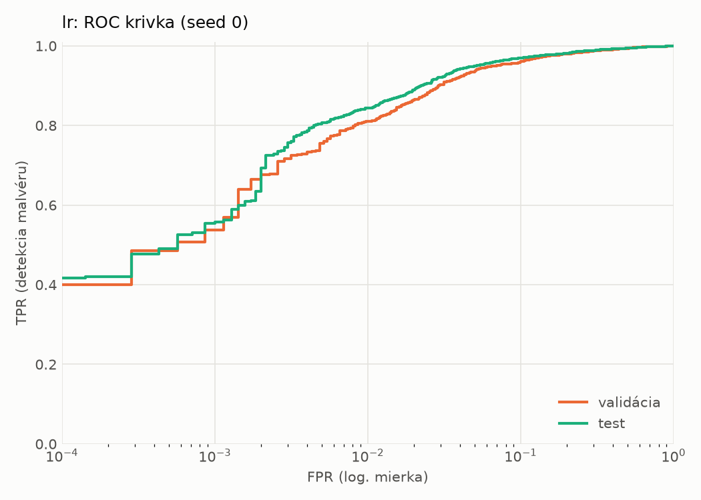
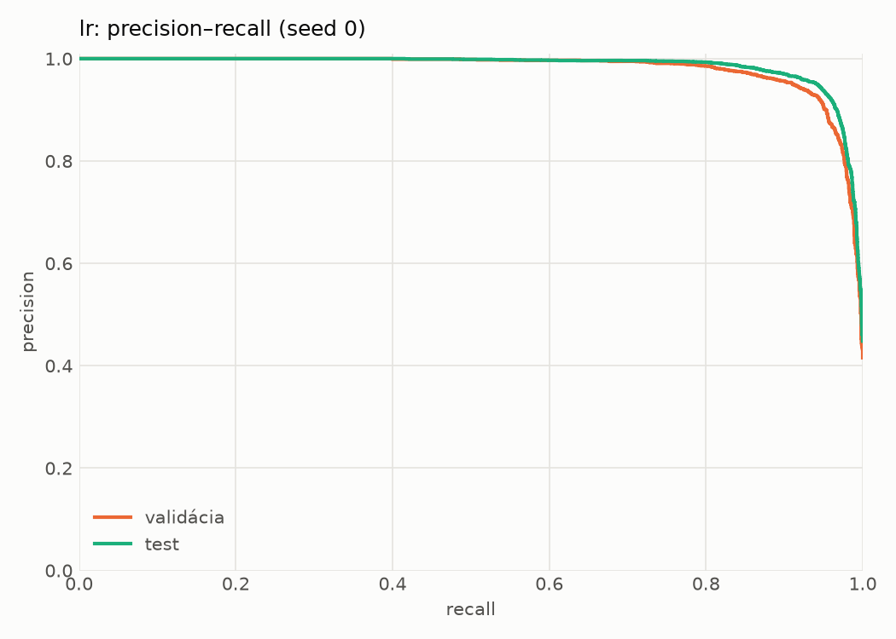
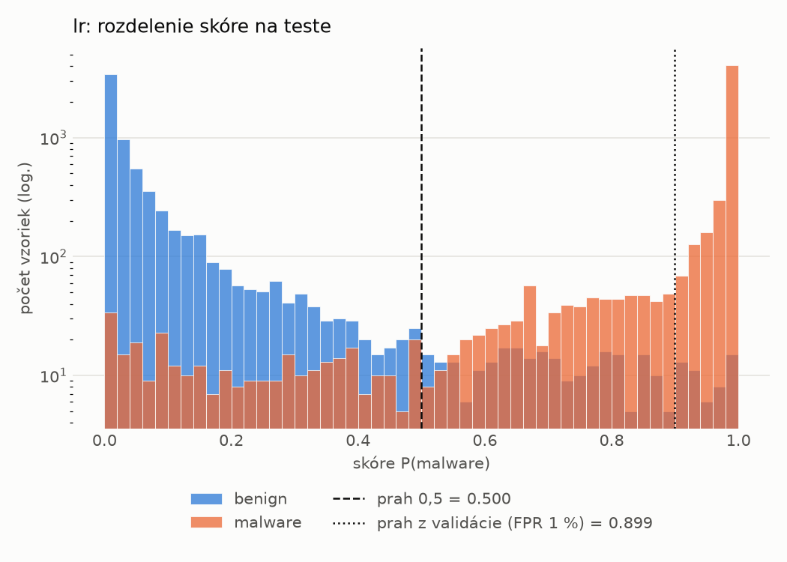
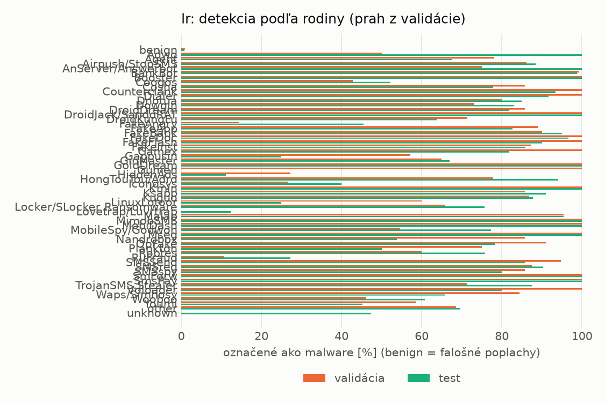
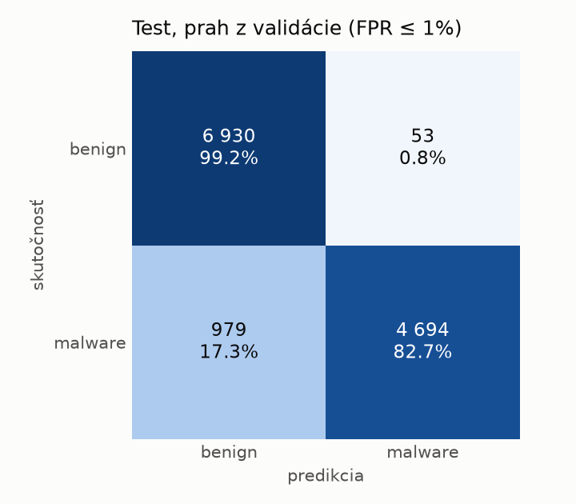
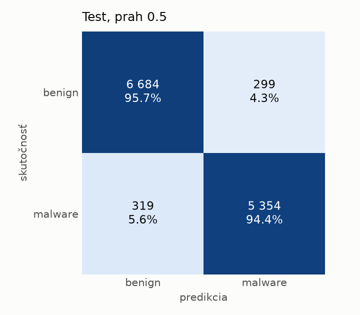

# hybrid/lr – beh `20261123-183433`

> Automaticky generované (`src/training/run_tabular.py`). Konfigurácia: `config.yaml`, protokol: `protocol.yaml`.

- **Model:** `logreg` – logistická regresia s L2 regularizáciou (vstup signed log1p + štandardizácia)
- **Ladenie:** bez ladenia – hyperparametre prevzaté z `runs_v4/real_p/full/hybrid/lr/20261122-235738`
- **Finálne modely:** seedy [0, 1, 2]; hodnoty sú priemer ± smerodajná odchýlka cez seedy
- **Najlepšie hyperparametre:** `{"max_iter": 2000, "C": 0.07124252843547843}`

## Detekčná kvalita (bez prahu)
| metrika | train (podvzorka) | validácia | test |
|---|---|---|---|
| ROC-AUC | 0.9855 ± 0.0000 | 0.9829 ± 0.0000 | 0.9855 ± 0.0000 |
| PR-AUC | 0.9837 ± 0.0000 | 0.9807 ± 0.0000 | 0.9856 ± 0.0000 |
| TPR pri FPR 1 % | 0.8451 ± 0.0000 | 0.8102 ± 0.0000 | 0.8433 ± 0.0000 |
| TPR pri FPR 0,1 % | 0.5996 ± 0.0000 | 0.5371 ± 0.0000 | 0.5544 ± 0.0000 |
| log loss | 0.1416 ± 0.0000 | 0.1576 ± 0.0000 | 0.1442 ± 0.0000 |
| Brier skóre | 0.0391 ± 0.0000 | 0.0437 ± 0.0000 | 0.0393 ± 0.0000 |

Rozdiel ROC-AUC train − validácia: **0.0027** (veľký rozdiel = preučenie).

## Pri prahu z validácie (FPR ≤ 1% na validácii)
| metrika | train (podvzorka) | validácia | test |
|---|---|---|---|
| accuracy | 0.9209 ± 0.0000 | 0.9154 ± 0.0000 | 0.9185 ± 0.0000 |
| balanced accuracy | 0.9043 ± 0.0000 | 0.9002 ± 0.0000 | 0.9099 ± 0.0000 |
| precision | 0.9881 ± 0.0000 | 0.9834 ± 0.0000 | 0.9888 ± 0.0000 |
| recall (TPR) | 0.8154 ± 0.0000 | 0.8102 ± 0.0000 | 0.8274 ± 0.0000 |
| FPR | 0.0067 ± 0.0000 | 0.0097 ± 0.0000 | 0.0076 ± 0.0000 |
| F1 | 0.8935 ± 0.0000 | 0.8884 ± 0.0000 | 0.9010 ± 0.0000 |
| MCC | 0.8412 ± 0.0000 | 0.8314 ± 0.0000 | 0.8421 ± 0.0000 |

## Pri pevnom prahu 0.5
| metrika | train (podvzorka) | validácia | test |
|---|---|---|---|
| accuracy | 0.9503 ± 0.0000 | 0.9447 ± 0.0000 | 0.9512 ± 0.0000 |
| balanced accuracy | 0.9483 ± 0.0000 | 0.9422 ± 0.0000 | 0.9505 ± 0.0000 |
| precision | 0.9401 ± 0.0000 | 0.9392 ± 0.0000 | 0.9471 ± 0.0000 |
| recall (TPR) | 0.9376 ± 0.0000 | 0.9271 ± 0.0000 | 0.9438 ± 0.0000 |
| FPR | 0.0410 ± 0.0000 | 0.0427 ± 0.0000 | 0.0428 ± 0.0000 |
| F1 | 0.9388 ± 0.0000 | 0.9331 ± 0.0000 | 0.9454 ± 0.0000 |
| MCC | 0.8970 ± 0.0000 | 0.8861 ± 0.0000 | 0.9013 ± 0.0000 |

## Výpočtové nároky (seed 0, testovacia množina)
| meranie | hodnota |
|---|---|
| tréning finálneho modelu | 0.2 s (priemer cez seedy) |
| ladenie spolu | 0 s |
| počet parametrov / uzlov | 287 |
| veľkosť modelu na disku | 0.01 MB |
| transformácia vstupu – latencia (1 vlákno) | 0.006 ms |
| transformácia vstupu – priepustnosť | 507 141 vzoriek/s |
| CPU latencia modelu (batch 1, 1 vlákno) | 0.004 ms (p95 0.004) |
| CPU priepustnosť (24 vlákien) | 2 297 957 vzoriek/s |

## Grafy
| | |
|---|---|
|  |  |
|  |  |
|  |  |
|  |  |

## Súbory
`metrics.json` (všetky metriky po seedoch vrátane rodín), `timing.json`, `hpo_trials.csv`,
`predictions/<časť>_seed<N>.parquet` (sha256, family, label, score), `model/seed_<N>/`, `log.txt`.
