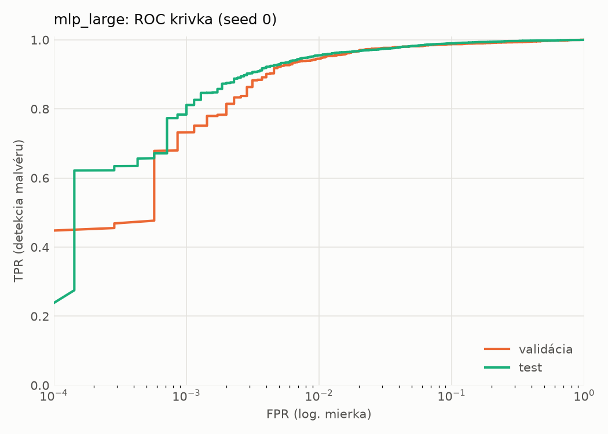
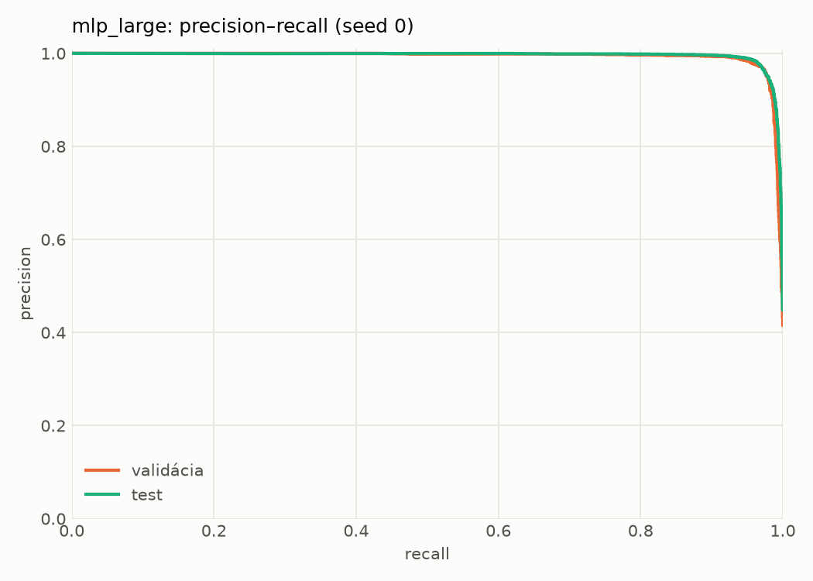
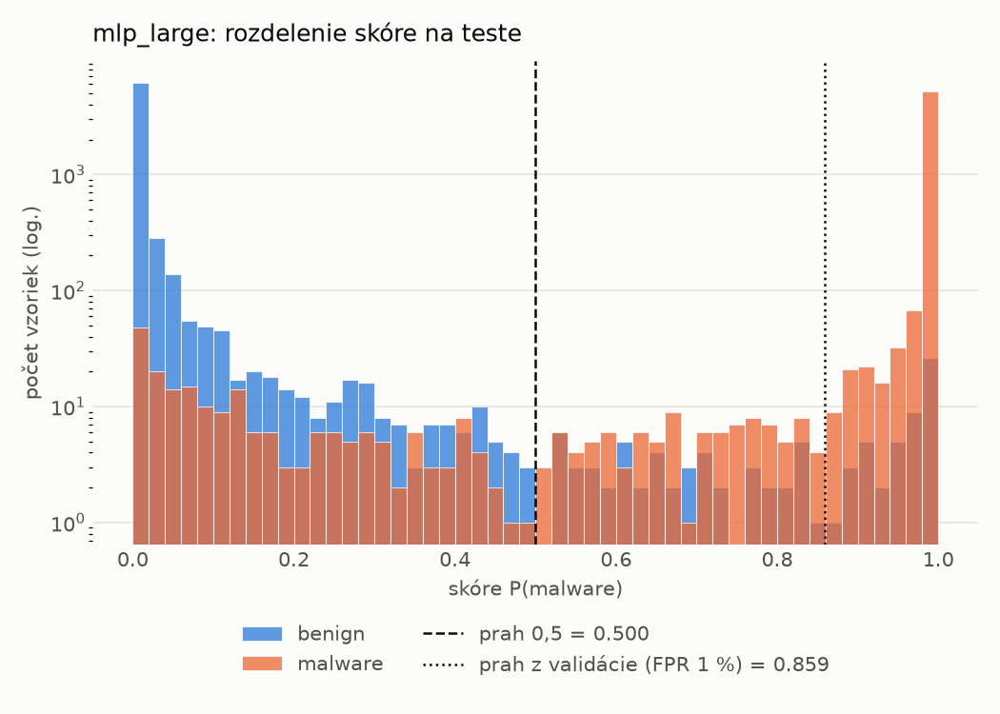
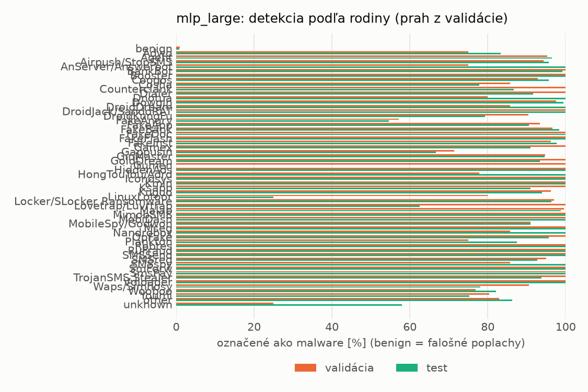
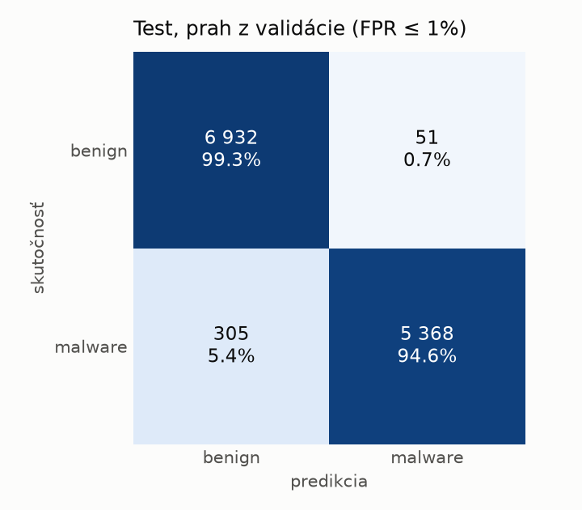
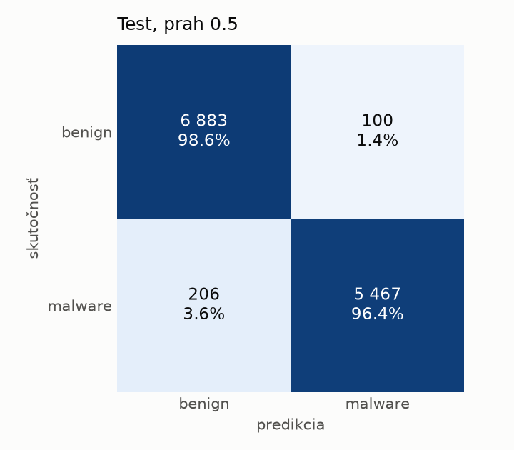
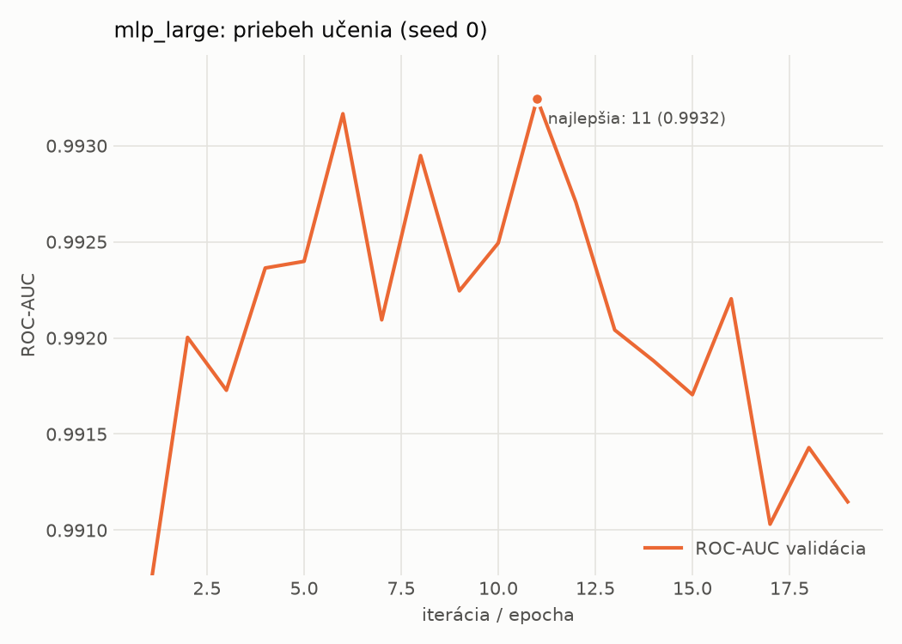

# hybrid/mlp_large – beh `20261123-183513`

> Automaticky generované (`src/training/run_tabular.py`). Konfigurácia: `config.yaml`, protokol: `protocol.yaml`.

- **Model:** `mlp` – veľká neurónová sieť (3–5 skrytých vrstiev, 512–2048 neurónov), kandidát na učiteľa
- **Ladenie:** bez ladenia – hyperparametre prevzaté z `runs_v4/real_p/full/hybrid/mlp_large/20261123-000809`
- **Finálne modely:** seedy [0, 1, 2]; hodnoty sú priemer ± smerodajná odchýlka cez seedy
- **Najlepšie hyperparametre:** `{"max_epochs": 100, "patience": 8, "hidden_layers": 3, "hidden_width": 1024, "width_decay": 1.0, "dropout": 0.11375540844608736, "lr": 0.0022038218939289885, "weight_decay": 1.0842262717330169e-05, "batch_size": 256}`

## Detekčná kvalita (bez prahu)
| metrika | train (podvzorka) | validácia | test |
|---|---|---|---|
| ROC-AUC | 0.9981 ± 0.0015 | 0.9932 ± 0.0001 | 0.9945 ± 0.0006 |
| PR-AUC | 0.9977 ± 0.0017 | 0.9926 ± 0.0004 | 0.9944 ± 0.0007 |
| TPR pri FPR 1 % | 0.9768 ± 0.0143 | 0.9304 ± 0.0173 | 0.9433 ± 0.0102 |
| TPR pri FPR 0,1 % | 0.9476 ± 0.0291 | 0.7483 ± 0.0247 | 0.7784 ± 0.0261 |
| log loss | 0.0446 ± 0.0191 | 0.0965 ± 0.0045 | 0.0866 ± 0.0037 |
| Brier skóre | 0.0119 ± 0.0055 | 0.0233 ± 0.0030 | 0.0220 ± 0.0018 |

Rozdiel ROC-AUC train − validácia: **0.0049** (veľký rozdiel = preučenie).

## Pri prahu z validácie (FPR ≤ 1% na validácii)
| metrika | train (podvzorka) | validácia | test |
|---|---|---|---|
| accuracy | 0.9786 ± 0.0092 | 0.9654 ± 0.0072 | 0.9654 ± 0.0057 |
| balanced accuracy | 0.9739 ± 0.0111 | 0.9603 ± 0.0087 | 0.9622 ± 0.0064 |
| precision | 0.9981 ± 0.0015 | 0.9855 ± 0.0003 | 0.9906 ± 0.0013 |
| recall (TPR) | 0.9491 ± 0.0212 | 0.9304 ± 0.0173 | 0.9316 ± 0.0131 |
| FPR | 0.0012 ± 0.0009 | 0.0097 ± 0.0000 | 0.0072 ± 0.0010 |
| F1 | 0.9729 ± 0.0119 | 0.9571 ± 0.0093 | 0.9602 ± 0.0068 |
| MCC | 0.9561 ± 0.0187 | 0.9293 ± 0.0144 | 0.9310 ± 0.0111 |

## Pri pevnom prahu 0.5
| metrika | train (podvzorka) | validácia | test |
|---|---|---|---|
| accuracy | 0.9847 ± 0.0076 | 0.9711 ± 0.0039 | 0.9728 ± 0.0030 |
| balanced accuracy | 0.9835 ± 0.0078 | 0.9697 ± 0.0036 | 0.9719 ± 0.0027 |
| precision | 0.9853 ± 0.0100 | 0.9688 ± 0.0073 | 0.9764 ± 0.0060 |
| recall (TPR) | 0.9771 ± 0.0087 | 0.9615 ± 0.0022 | 0.9627 ± 0.0008 |
| FPR | 0.0100 ± 0.0068 | 0.0221 ± 0.0053 | 0.0190 ± 0.0049 |
| F1 | 0.9812 ± 0.0094 | 0.9651 ± 0.0046 | 0.9695 ± 0.0032 |
| MCC | 0.9684 ± 0.0158 | 0.9404 ± 0.0080 | 0.9451 ± 0.0060 |

## Výpočtové nároky (seed 0, testovacia množina)
| meranie | hodnota |
|---|---|
| tréning finálneho modelu | 5.2 s (priemer cez seedy) |
| ladenie spolu | 0 s |
| počet parametrov / uzlov | 2 400 257 |
| veľkosť modelu na disku | 9.64 MB |
| transformácia vstupu – latencia (1 vlákno) | 0.017 ms |
| transformácia vstupu – priepustnosť | 284 654 vzoriek/s |
| CPU latencia modelu (batch 1, 1 vlákno) | 0.295 ms (p95 0.581) |
| CPU priepustnosť (24 vlákien) | 130 842 vzoriek/s |
| GPU latencia (batch 1) | 0.444 ms (p95 0.923) |
| GPU priepustnosť | 743 788 vzoriek/s |
| GPU špičková pamäť | 229 MB |

## Grafy
| | |
|---|---|
|  |  |
|  |  |
|  |  |
|  |  |

## Súbory
`metrics.json` (všetky metriky po seedoch vrátane rodín), `timing.json`, `hpo_trials.csv`,
`predictions/<časť>_seed<N>.parquet` (sha256, family, label, score), `model/seed_<N>/`, `log.txt`.
