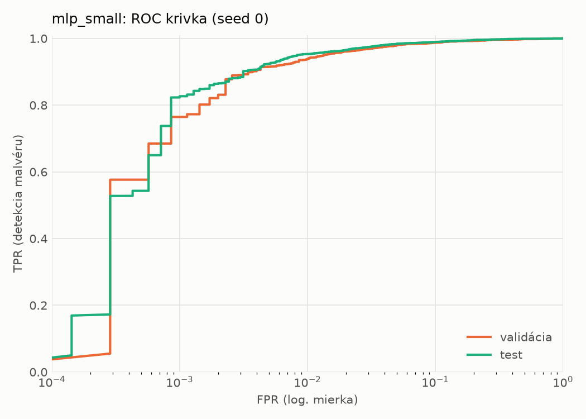
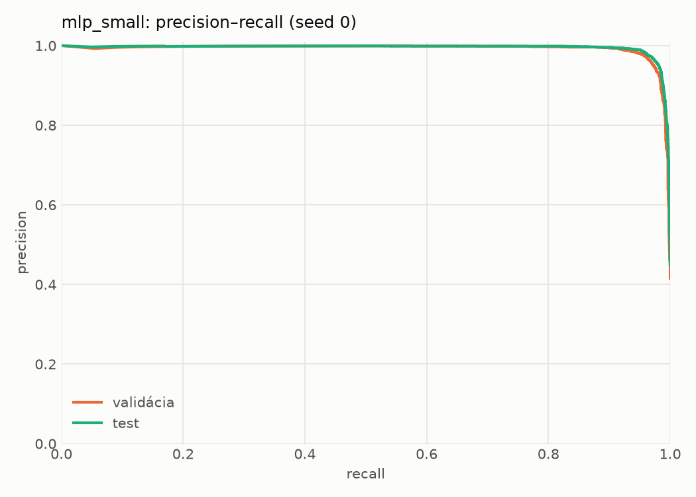
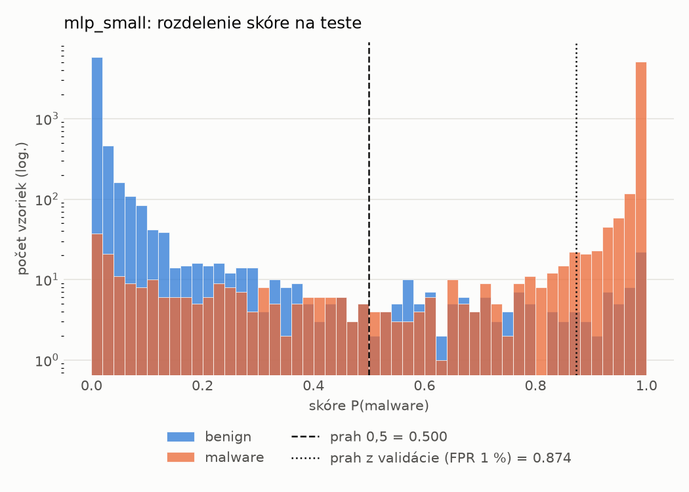
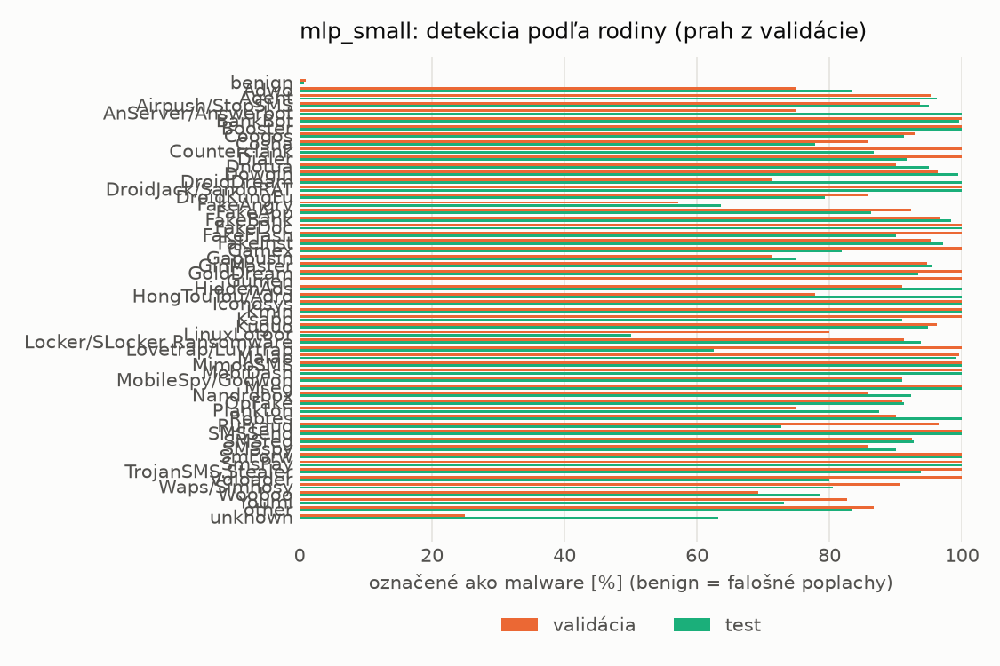
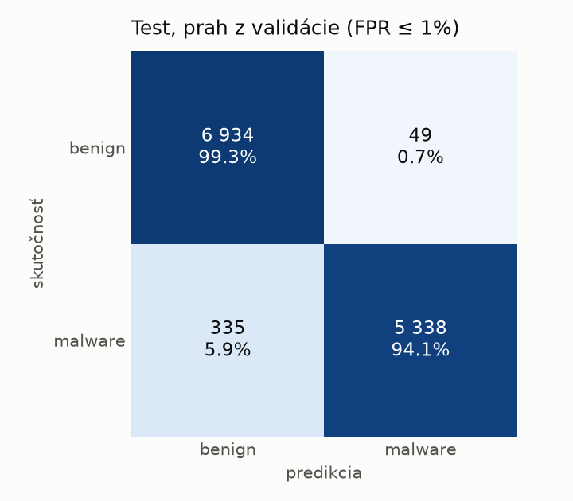
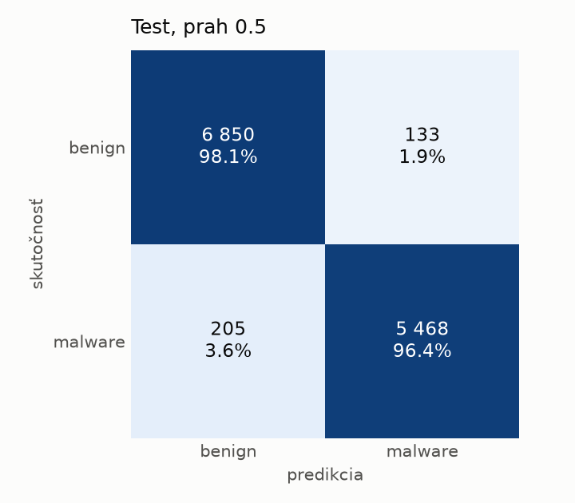
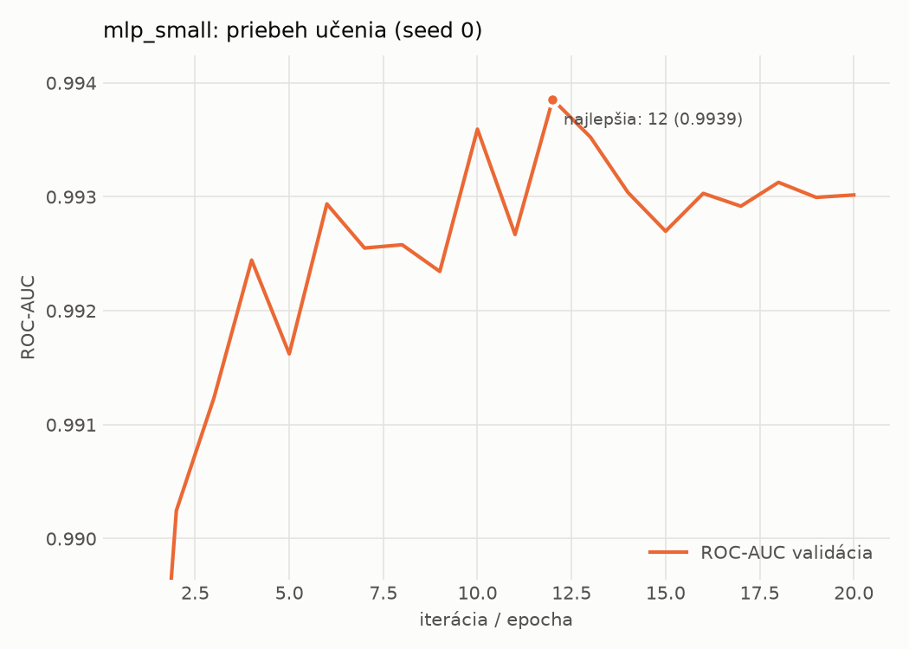

# hybrid/mlp_small – beh `20261123-183506`

> Automaticky generované (`src/training/run_tabular.py`). Konfigurácia: `config.yaml`, protokol: `protocol.yaml`.

- **Model:** `mlp` – malá neurónová sieť (1–2 skryté vrstvy), kandidát na ľahkého študenta
- **Ladenie:** bez ladenia – hyperparametre prevzaté z `runs_v4/real_p/full/hybrid/mlp_small/20261123-000512`
- **Finálne modely:** seedy [0, 1, 2]; hodnoty sú priemer ± smerodajná odchýlka cez seedy
- **Najlepšie hyperparametre:** `{"width_decay": 0.5, "max_epochs": 100, "patience": 8, "hidden_layers": 2, "hidden_width": 256, "dropout": 0.17059205009500078, "lr": 0.0013906274900964423, "weight_decay": 9.337519104222036e-06, "batch_size": 1024}`

## Detekčná kvalita (bez prahu)
| metrika | train (podvzorka) | validácia | test |
|---|---|---|---|
| ROC-AUC | 0.9988 ± 0.0003 | 0.9936 ± 0.0004 | 0.9953 ± 0.0001 |
| PR-AUC | 0.9985 ± 0.0004 | 0.9924 ± 0.0002 | 0.9951 ± 0.0005 |
| TPR pri FPR 1 % | 0.9841 ± 0.0046 | 0.9406 ± 0.0034 | 0.9516 ± 0.0022 |
| TPR pri FPR 0,1 % | 0.9642 ± 0.0136 | 0.6949 ± 0.0614 | 0.7975 ± 0.0303 |
| log loss | 0.0348 ± 0.0056 | 0.0910 ± 0.0011 | 0.0786 ± 0.0018 |
| Brier skóre | 0.0089 ± 0.0017 | 0.0222 ± 0.0006 | 0.0199 ± 0.0003 |

Rozdiel ROC-AUC train − validácia: **0.0052** (veľký rozdiel = preučenie).

## Pri prahu z validácie (FPR ≤ 1% na validácii)
| metrika | train (podvzorka) | validácia | test |
|---|---|---|---|
| accuracy | 0.9834 ± 0.0026 | 0.9696 ± 0.0014 | 0.9688 ± 0.0013 |
| balanced accuracy | 0.9798 ± 0.0031 | 0.9654 ± 0.0017 | 0.9661 ± 0.0015 |
| precision | 0.9989 ± 0.0005 | 0.9856 ± 0.0001 | 0.9902 ± 0.0007 |
| recall (TPR) | 0.9603 ± 0.0059 | 0.9406 ± 0.0034 | 0.9398 ± 0.0032 |
| FPR | 0.0007 ± 0.0004 | 0.0097 ± 0.0000 | 0.0075 ± 0.0006 |
| F1 | 0.9792 ± 0.0033 | 0.9626 ± 0.0018 | 0.9643 ± 0.0016 |
| MCC | 0.9659 ± 0.0053 | 0.9378 ± 0.0029 | 0.9377 ± 0.0026 |

## Pri pevnom prahu 0.5
| metrika | train (podvzorka) | validácia | test |
|---|---|---|---|
| accuracy | 0.9892 ± 0.0022 | 0.9719 ± 0.0010 | 0.9749 ± 0.0014 |
| balanced accuracy | 0.9879 ± 0.0026 | 0.9707 ± 0.0010 | 0.9740 ± 0.0014 |
| precision | 0.9920 ± 0.0010 | 0.9683 ± 0.0019 | 0.9785 ± 0.0020 |
| recall (TPR) | 0.9813 ± 0.0045 | 0.9639 ± 0.0008 | 0.9652 ± 0.0011 |
| FPR | 0.0055 ± 0.0006 | 0.0225 ± 0.0014 | 0.0172 ± 0.0016 |
| F1 | 0.9866 ± 0.0027 | 0.9661 ± 0.0012 | 0.9718 ± 0.0015 |
| MCC | 0.9776 ± 0.0046 | 0.9421 ± 0.0021 | 0.9492 ± 0.0028 |

## Výpočtové nároky (seed 0, testovacia množina)
| meranie | hodnota |
|---|---|
| tréning finálneho modelu | 1.8 s (priemer cez seedy) |
| ladenie spolu | 0 s |
| počet parametrov / uzlov | 107 265 |
| veľkosť modelu na disku | 0.45 MB |
| transformácia vstupu – latencia (1 vlákno) | 0.017 ms |
| transformácia vstupu – priepustnosť | 477 320 vzoriek/s |
| CPU latencia modelu (batch 1, 1 vlákno) | 0.087 ms (p95 0.234) |
| CPU priepustnosť (24 vlákien) | 1 389 975 vzoriek/s |
| GPU latencia (batch 1) | 0.664 ms (p95 0.721) |
| GPU priepustnosť | 1 411 319 vzoriek/s |
| GPU špičková pamäť | 104 MB |

## Grafy
| | |
|---|---|
|  |  |
|  |  |
|  |  |
|  |  |

## Súbory
`metrics.json` (všetky metriky po seedoch vrátane rodín), `timing.json`, `hpo_trials.csv`,
`predictions/<časť>_seed<N>.parquet` (sha256, family, label, score), `model/seed_<N>/`, `log.txt`.
