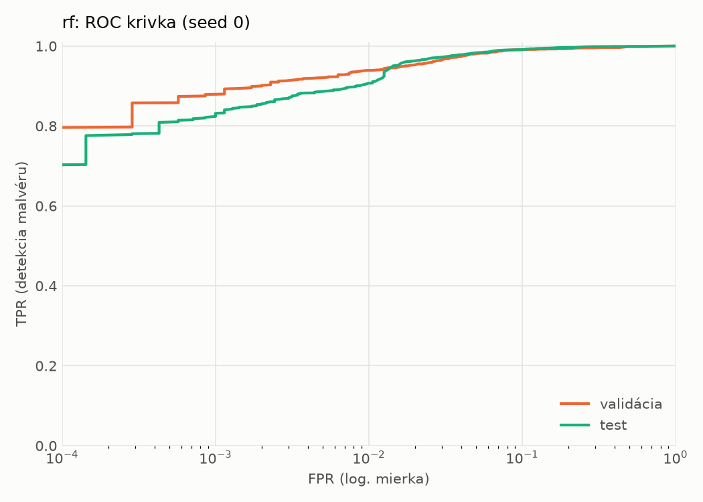
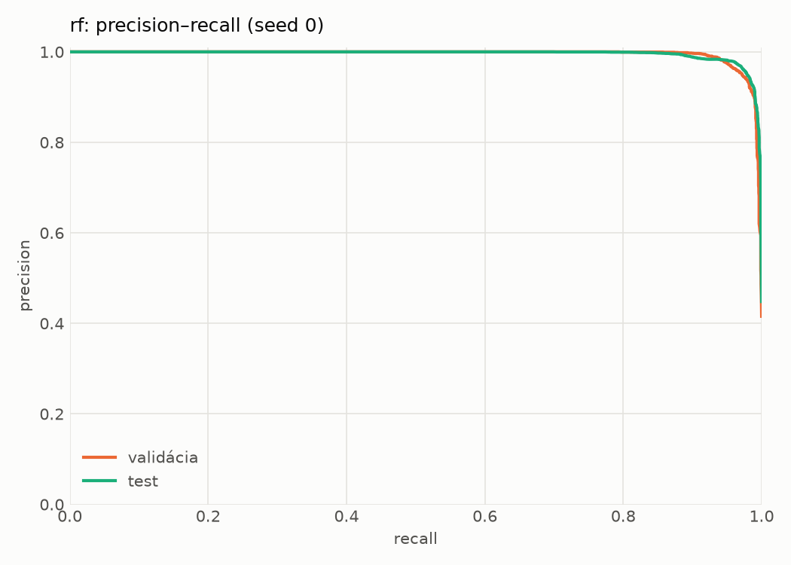
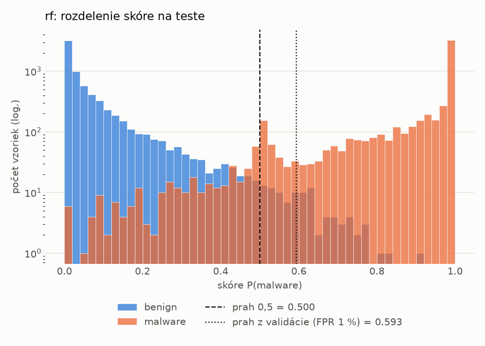
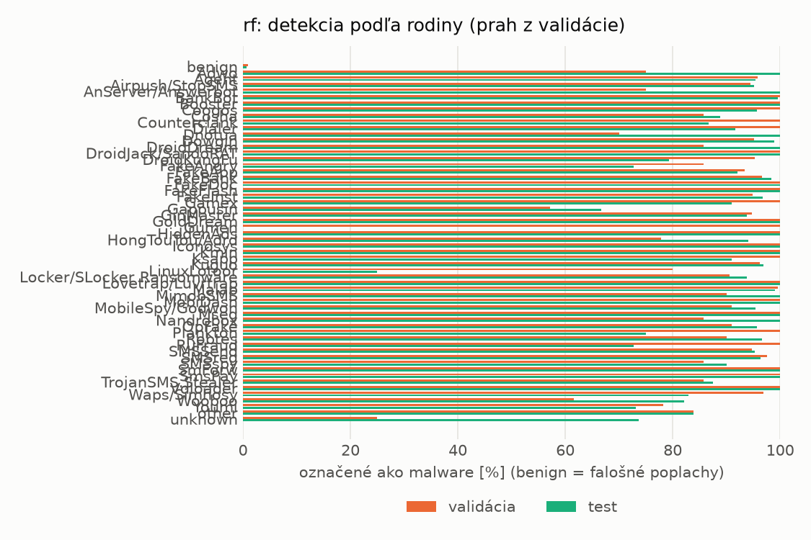
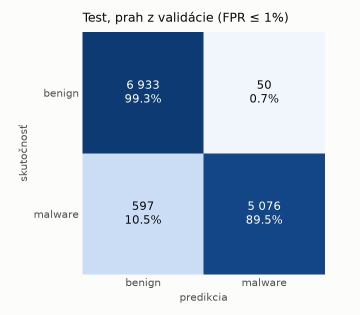
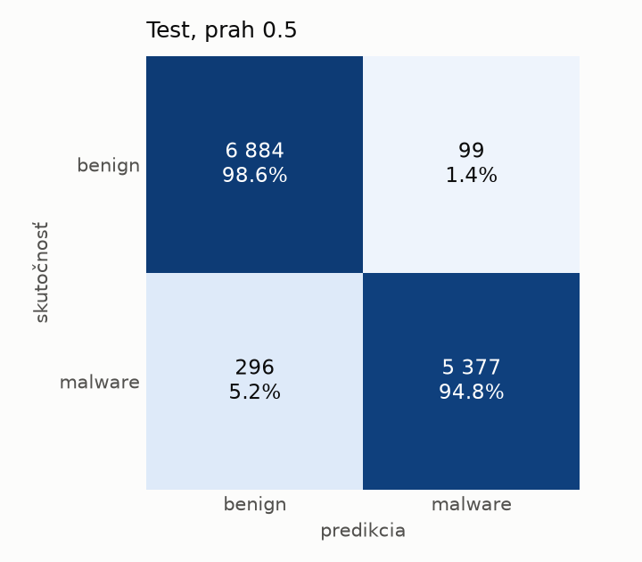

# hybrid/rf – beh `20261123-183436`

> Automaticky generované (`src/training/run_tabular.py`). Konfigurácia: `config.yaml`, protokol: `protocol.yaml`.

- **Model:** `random_forest` – Random Forest (pôvodné hodnoty príznakov)
- **Ladenie:** bez ladenia – hyperparametre prevzaté z `runs_v4/real_p/full/hybrid/rf/20261122-235747`
- **Finálne modely:** seedy [0, 1, 2]; hodnoty sú priemer ± smerodajná odchýlka cez seedy
- **Najlepšie hyperparametre:** `{"n_estimators": 400, "max_depth": null, "min_samples_leaf": 1, "max_features": "sqrt"}`

## Detekčná kvalita (bez prahu)
| metrika | train (podvzorka) | validácia | test |
|---|---|---|---|
| ROC-AUC | 1.0000 ± 0.0000 | 0.9948 ± 0.0000 | 0.9957 ± 0.0001 |
| PR-AUC | 1.0000 ± 0.0000 | 0.9943 ± 0.0001 | 0.9954 ± 0.0001 |
| TPR pri FPR 1 % | 1.0000 ± 0.0000 | 0.9381 ± 0.0019 | 0.9240 ± 0.0150 |
| TPR pri FPR 0,1 % | 1.0000 ± 0.0000 | 0.8775 ± 0.0079 | 0.8259 ± 0.0080 |
| log loss | 0.0280 ± 0.0002 | 0.1028 ± 0.0013 | 0.1143 ± 0.0019 |
| Brier skóre | 0.0030 ± 0.0000 | 0.0255 ± 0.0002 | 0.0295 ± 0.0005 |

Rozdiel ROC-AUC train − validácia: **0.0052** (veľký rozdiel = preučenie).

## Pri prahu z validácie (FPR ≤ 1% na validácii)
| metrika | train (podvzorka) | validácia | test |
|---|---|---|---|
| accuracy | 1.0000 ± 0.0000 | 0.9686 ± 0.0008 | 0.9495 ± 0.0006 |
| balanced accuracy | 1.0000 ± 0.0000 | 0.9642 ± 0.0009 | 0.9444 ± 0.0007 |
| precision | 1.0000 ± 0.0000 | 0.9856 ± 0.0000 | 0.9910 ± 0.0008 |
| recall (TPR) | 1.0000 ± 0.0000 | 0.9381 ± 0.0019 | 0.8955 ± 0.0014 |
| FPR | 0.0000 ± 0.0000 | 0.0097 ± 0.0000 | 0.0066 ± 0.0006 |
| F1 | 1.0000 ± 0.0000 | 0.9613 ± 0.0010 | 0.9408 ± 0.0008 |
| MCC | 1.0000 ± 0.0000 | 0.9357 ± 0.0016 | 0.9004 ± 0.0012 |

## Pri pevnom prahu 0.5
| metrika | train (podvzorka) | validácia | test |
|---|---|---|---|
| accuracy | 1.0000 ± 0.0000 | 0.9682 ± 0.0004 | 0.9711 ± 0.0020 |
| balanced accuracy | 1.0000 ± 0.0000 | 0.9661 ± 0.0003 | 0.9695 ± 0.0023 |
| precision | 1.0000 ± 0.0000 | 0.9697 ± 0.0014 | 0.9818 ± 0.0004 |
| recall (TPR) | 1.0000 ± 0.0000 | 0.9534 ± 0.0005 | 0.9532 ± 0.0047 |
| FPR | 0.0000 ± 0.0000 | 0.0212 ± 0.0010 | 0.0143 ± 0.0004 |
| F1 | 1.0000 ± 0.0000 | 0.9615 ± 0.0005 | 0.9673 ± 0.0024 |
| MCC | 1.0000 ± 0.0000 | 0.9346 ± 0.0009 | 0.9418 ± 0.0040 |

## Výpočtové nároky (seed 0, testovacia množina)
| meranie | hodnota |
|---|---|
| tréning finálneho modelu | 2.4 s (priemer cez seedy) |
| ladenie spolu | 0 s |
| počet parametrov / uzlov | 1 891 210 |
| veľkosť modelu na disku | 151.63 MB |
| CPU latencia modelu (batch 1, 1 vlákno) | 11.612 ms (p95 12.088) |
| CPU priepustnosť (24 vlákien) | 119 365 vzoriek/s |

## Grafy
| | |
|---|---|
|  |  |
|  |  |
|  |  |
|  |  |

## Súbory
`metrics.json` (všetky metriky po seedoch vrátane rodín), `timing.json`, `hpo_trials.csv`,
`predictions/<časť>_seed<N>.parquet` (sha256, family, label, score), `model/seed_<N>/`, `log.txt`.
