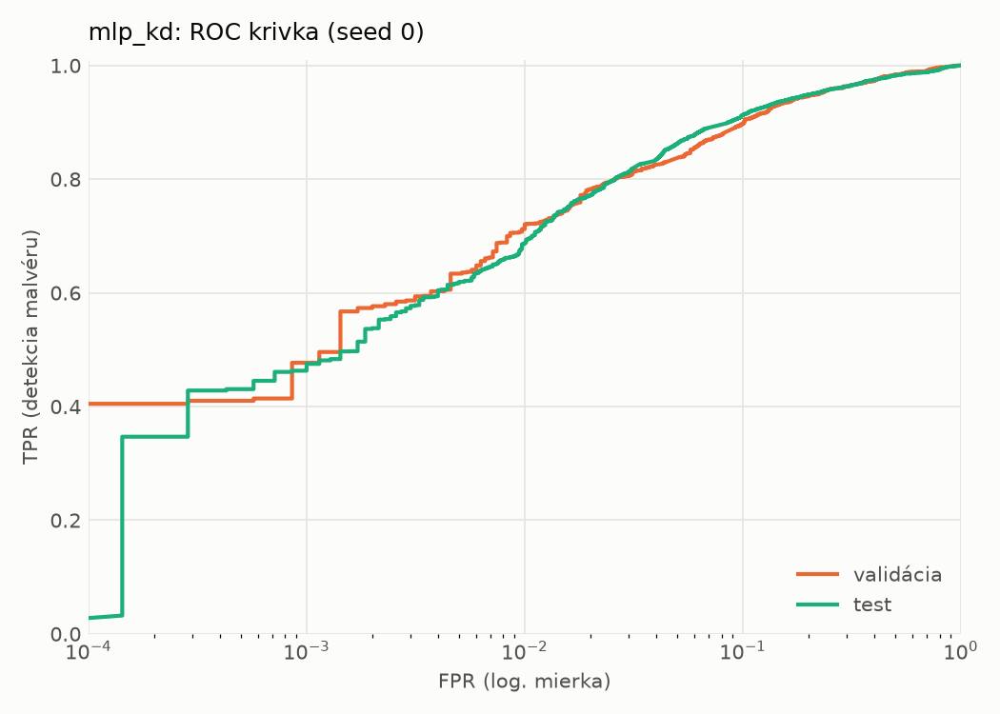
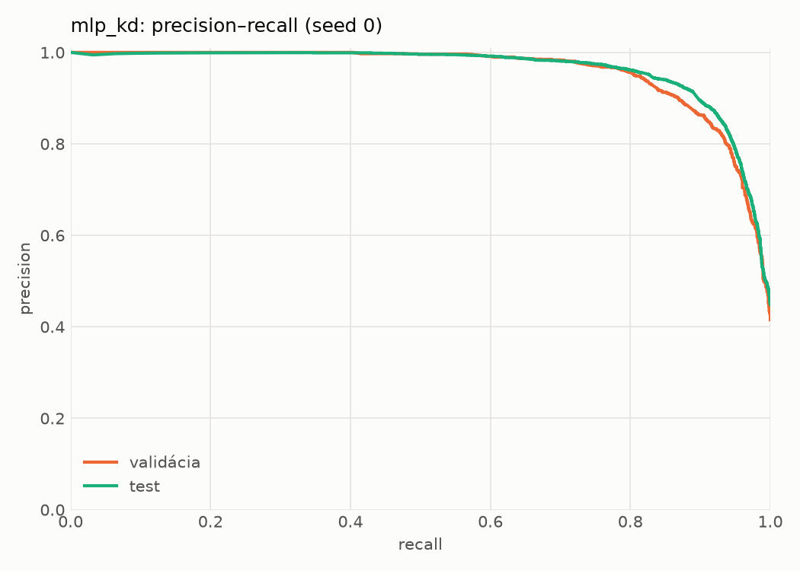
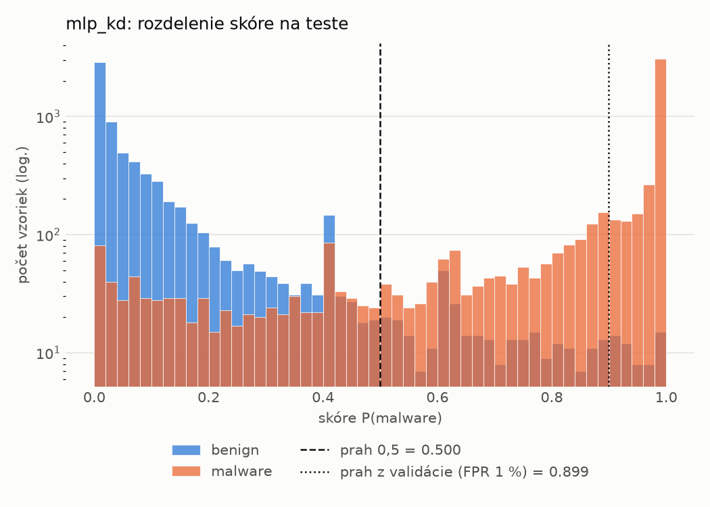
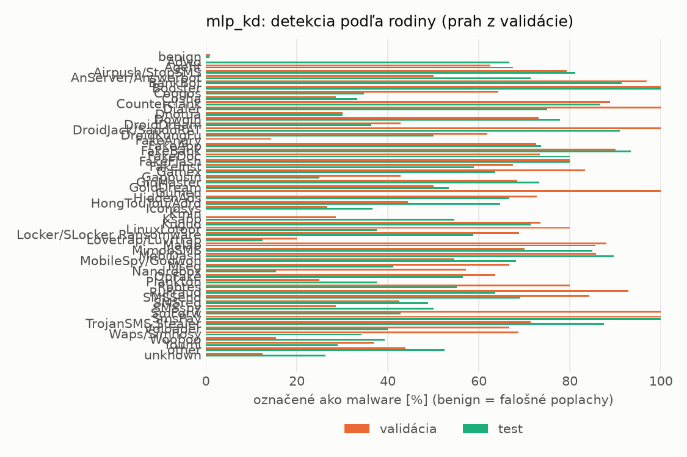
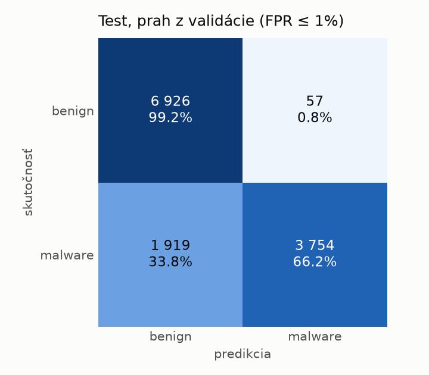
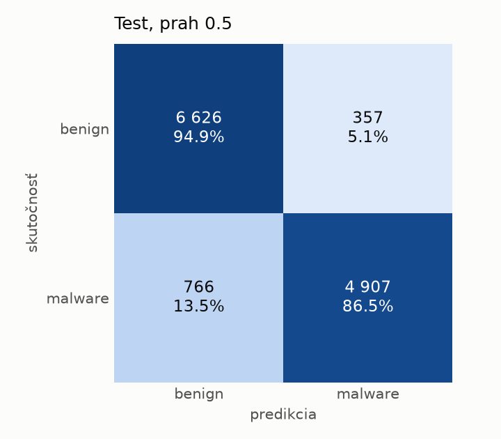
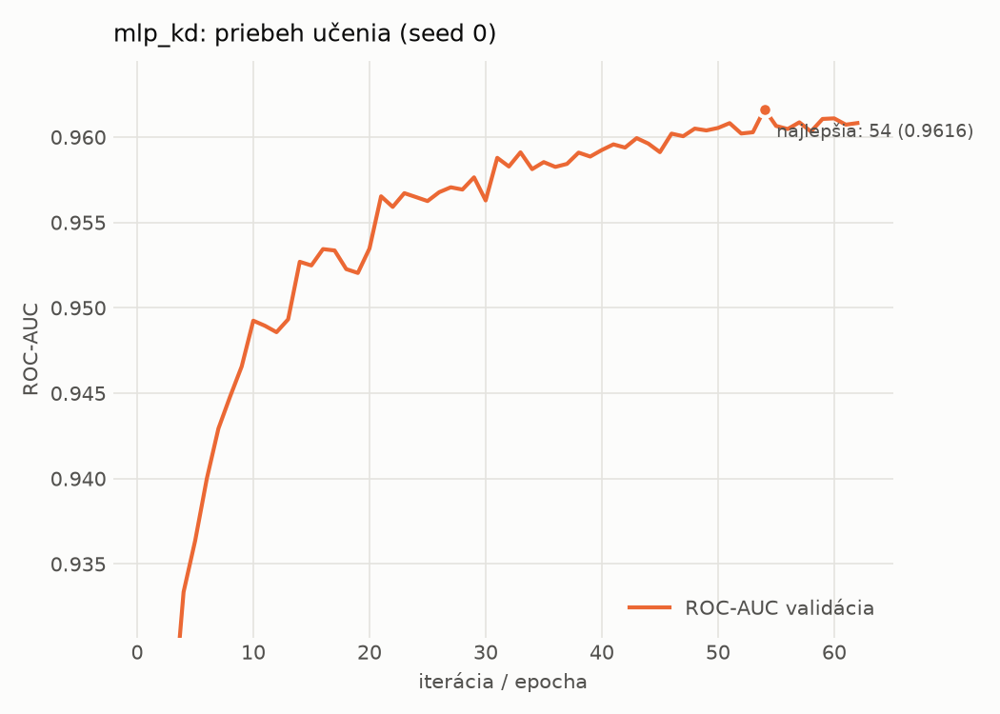

# dynamic/mlp_kd – beh `20261123-183926`

> Automaticky generované (`src/training/run_tabular.py`). Konfigurácia: `config.yaml`, protokol: `protocol.yaml`.

- **Model:** `mlp` – študent – malé MLP učené destiláciou z hybridného učiteľa
- **Ladenie:** bez ladenia – hyperparametre prevzaté z `runs_v4/real_p/full/students_dynamic/mlp_kd/20261123-003616`
- **Finálne modely:** seedy [0, 1, 2]; hodnoty sú priemer ± smerodajná odchýlka cez seedy
- **Najlepšie hyperparametre:** `{"hidden_layers": 1, "max_epochs": 100, "patience": 8, "hidden_width": 64, "dropout": 0.008718220633742228, "lr": 0.002354362488135847, "weight_decay": 3.1986204696979587e-06, "batch_size": 1024, "kd_alpha": 0.2022752781289341, "kd_temperature": 1.263446759011441}`

## Detekčná kvalita (bez prahu)
| metrika | train (podvzorka) | validácia | test |
|---|---|---|---|
| ROC-AUC | 0.9715 ± 0.0010 | 0.9613 ± 0.0011 | 0.9625 ± 0.0006 |
| PR-AUC | 0.9700 ± 0.0010 | 0.9584 ± 0.0010 | 0.9626 ± 0.0009 |
| TPR pri FPR 1 % | 0.7992 ± 0.0079 | 0.7063 ± 0.0070 | 0.6772 ± 0.0080 |
| TPR pri FPR 0,1 % | 0.6436 ± 0.0188 | 0.5098 ± 0.0326 | 0.4632 ± 0.0056 |
| log loss | 0.1943 ± 0.0036 | 0.2413 ± 0.0036 | 0.2418 ± 0.0015 |
| Brier skóre | 0.0550 ± 0.0010 | 0.0698 ± 0.0013 | 0.0683 ± 0.0004 |

Rozdiel ROC-AUC train − validácia: **0.0102** (veľký rozdiel = preučenie).

## Pri prahu z validácie (FPR ≤ 1% na validácii)
| metrika | train (podvzorka) | validácia | test |
|---|---|---|---|
| accuracy | 0.8847 ± 0.0017 | 0.8722 ± 0.0029 | 0.8389 ± 0.0044 |
| balanced accuracy | 0.8592 ± 0.0022 | 0.8483 ± 0.0035 | 0.8212 ± 0.0049 |
| precision | 0.9920 ± 0.0014 | 0.9810 ± 0.0002 | 0.9851 ± 0.0011 |
| recall (TPR) | 0.7223 ± 0.0049 | 0.7063 ± 0.0070 | 0.6504 ± 0.0099 |
| FPR | 0.0040 ± 0.0007 | 0.0097 ± 0.0000 | 0.0080 ± 0.0006 |
| F1 | 0.8359 ± 0.0030 | 0.8213 ± 0.0048 | 0.7835 ± 0.0071 |
| MCC | 0.7728 ± 0.0030 | 0.7496 ± 0.0054 | 0.6999 ± 0.0076 |

## Pri pevnom prahu 0.5
| metrika | train (podvzorka) | validácia | test |
|---|---|---|---|
| accuracy | 0.9296 ± 0.0014 | 0.9054 ± 0.0019 | 0.9101 ± 0.0013 |
| balanced accuracy | 0.9240 ± 0.0017 | 0.8997 ± 0.0018 | 0.9059 ± 0.0012 |
| precision | 0.9307 ± 0.0012 | 0.9023 ± 0.0040 | 0.9299 ± 0.0025 |
| recall (TPR) | 0.8936 ± 0.0030 | 0.8661 ± 0.0026 | 0.8647 ± 0.0004 |
| FPR | 0.0456 ± 0.0008 | 0.0667 ± 0.0031 | 0.0529 ± 0.0020 |
| F1 | 0.9117 ± 0.0019 | 0.8838 ± 0.0022 | 0.8961 ± 0.0014 |
| MCC | 0.8538 ± 0.0030 | 0.8046 ± 0.0040 | 0.8188 ± 0.0027 |

## Výpočtové nároky (seed 0, testovacia množina)
| meranie | hodnota |
|---|---|
| tréning finálneho modelu | 4.5 s (priemer cez seedy) |
| ladenie spolu | 0 s |
| počet parametrov / uzlov | 8 129 |
| veľkosť modelu na disku | 0.04 MB |
| transformácia vstupu – latencia (1 vlákno) | 0.005 ms |
| transformácia vstupu – priepustnosť | 1 158 698 vzoriek/s |
| CPU latencia modelu (batch 1, 1 vlákno) | 0.063 ms (p95 0.152) |
| CPU priepustnosť (24 vlákien) | 6 889 119 vzoriek/s |
| GPU latencia (batch 1) | 0.266 ms (p95 0.300) |
| GPU priepustnosť | 2 202 346 vzoriek/s |
| GPU špičková pamäť | 52 MB |

## Grafy
| | |
|---|---|
|  |  |
|  |  |
|  |  |
|  |  |

## Súbory
`metrics.json` (všetky metriky po seedoch vrátane rodín), `timing.json`, `hpo_trials.csv`,
`predictions/<časť>_seed<N>.parquet` (sha256, family, label, score), `model/seed_<N>/`, `log.txt`.
