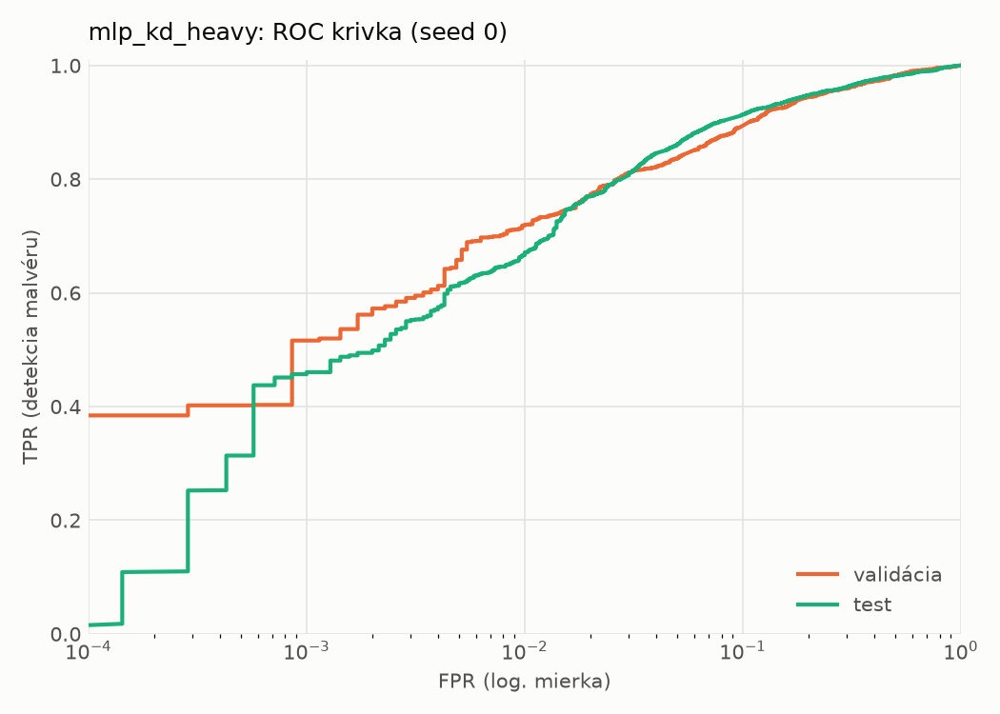
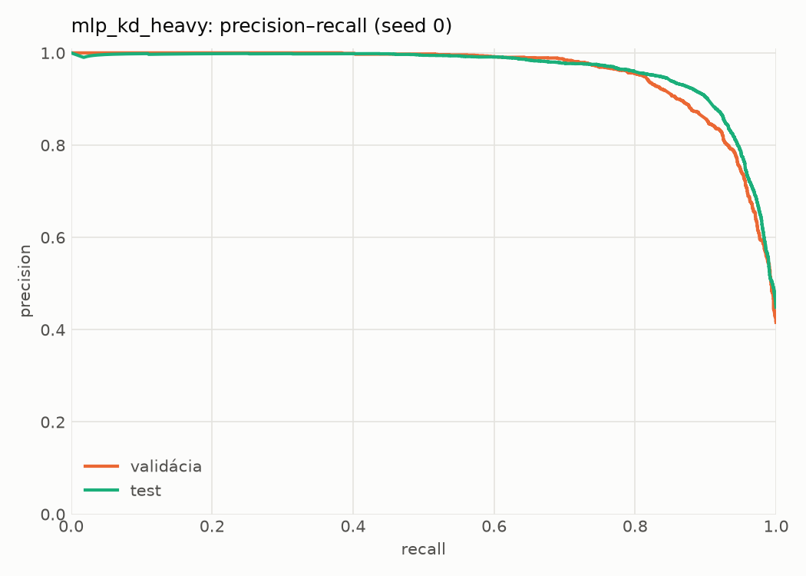
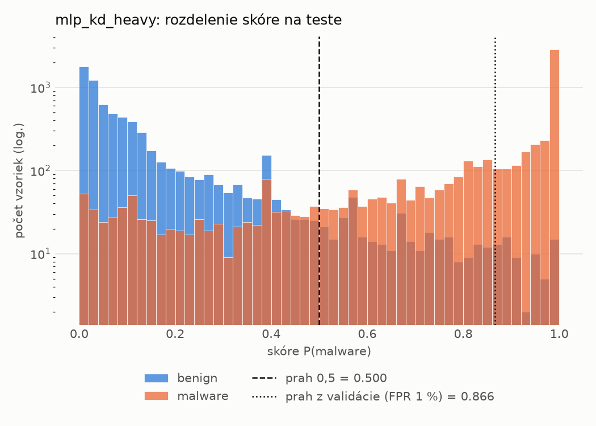
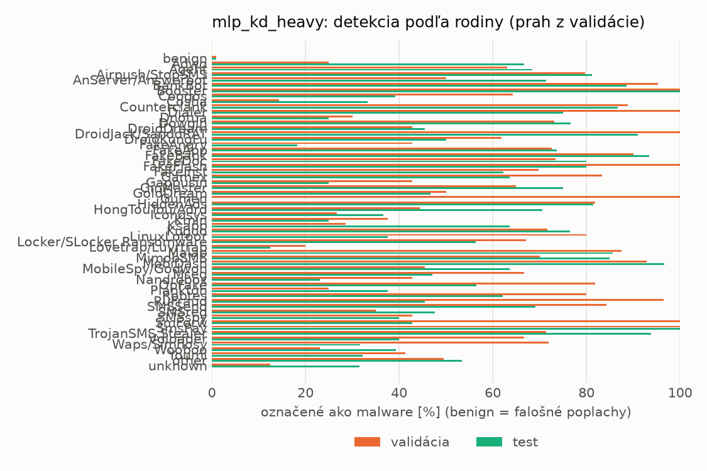
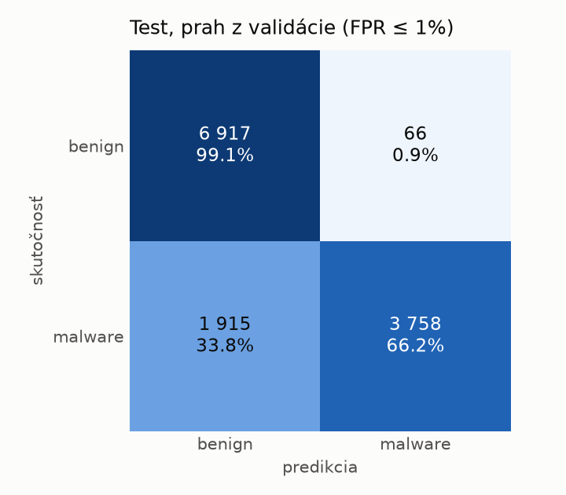
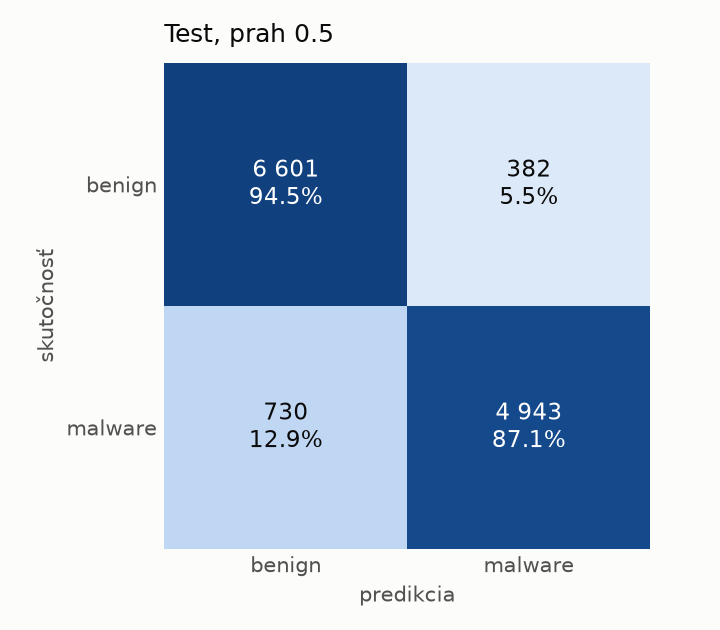
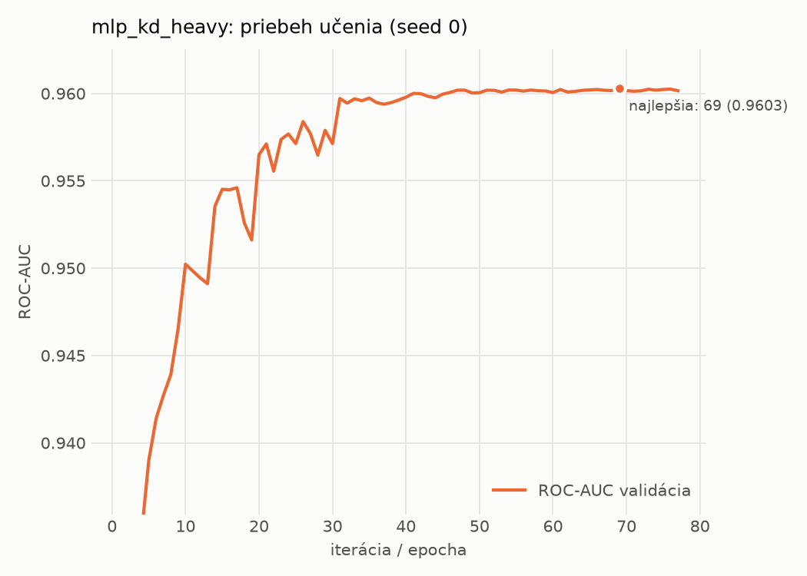

# dynamic/mlp_kd_heavy – beh `20261123-184042`

> Automaticky generované (`src/training/run_tabular.py`). Konfigurácia: `config.yaml`, protokol: `protocol.yaml`.

- **Model:** `mlp` – študent – malé MLP učené destiláciou z mlp_large hybridu (V4)
- **Ladenie:** bez ladenia – hyperparametre prevzaté z `runs_v4/real_p/full/students_dynamic/mlp_kd_heavy/20261123-005328`
- **Finálne modely:** seedy [0, 1, 2]; hodnoty sú priemer ± smerodajná odchýlka cez seedy
- **Najlepšie hyperparametre:** `{"hidden_layers": 1, "max_epochs": 100, "patience": 8, "hidden_width": 64, "dropout": 0.020410116354877387, "lr": 0.0023709262856920267, "weight_decay": 2.3924155608522853e-05, "batch_size": 1024, "kd_alpha": 0.37221474320301356, "kd_temperature": 1.1598739057164045}`

## Detekčná kvalita (bez prahu)
| metrika | train (podvzorka) | validácia | test |
|---|---|---|---|
| ROC-AUC | 0.9708 ± 0.0013 | 0.9613 ± 0.0012 | 0.9632 ± 0.0014 |
| PR-AUC | 0.9692 ± 0.0011 | 0.9583 ± 0.0009 | 0.9635 ± 0.0013 |
| TPR pri FPR 1 % | 0.7928 ± 0.0105 | 0.7177 ± 0.0039 | 0.6799 ± 0.0129 |
| TPR pri FPR 0,1 % | 0.6326 ± 0.0177 | 0.5192 ± 0.0075 | 0.4611 ± 0.0097 |
| log loss | 0.1993 ± 0.0039 | 0.2371 ± 0.0028 | 0.2363 ± 0.0041 |
| Brier skóre | 0.0570 ± 0.0011 | 0.0697 ± 0.0008 | 0.0676 ± 0.0011 |

Rozdiel ROC-AUC train − validácia: **0.0095** (veľký rozdiel = preučenie).

## Pri prahu z validácie (FPR ≤ 1% na validácii)
| metrika | train (podvzorka) | validácia | test |
|---|---|---|---|
| accuracy | 0.8872 ± 0.0005 | 0.8770 ± 0.0016 | 0.8451 ± 0.0027 |
| balanced accuracy | 0.8625 ± 0.0004 | 0.8540 ± 0.0019 | 0.8283 ± 0.0030 |
| precision | 0.9909 ± 0.0018 | 0.9813 ± 0.0001 | 0.9839 ± 0.0011 |
| recall (TPR) | 0.7295 ± 0.0007 | 0.7177 ± 0.0039 | 0.6654 ± 0.0059 |
| FPR | 0.0046 ± 0.0009 | 0.0097 ± 0.0000 | 0.0088 ± 0.0006 |
| F1 | 0.8403 ± 0.0005 | 0.8290 ± 0.0026 | 0.7939 ± 0.0043 |
| MCC | 0.7774 ± 0.0012 | 0.7585 ± 0.0030 | 0.7104 ± 0.0047 |

## Pri pevnom prahu 0.5
| metrika | train (podvzorka) | validácia | test |
|---|---|---|---|
| accuracy | 0.9269 ± 0.0020 | 0.9041 ± 0.0010 | 0.9138 ± 0.0021 |
| balanced accuracy | 0.9215 ± 0.0020 | 0.8987 ± 0.0010 | 0.9101 ± 0.0023 |
| precision | 0.9249 ± 0.0030 | 0.8989 ± 0.0017 | 0.9288 ± 0.0010 |
| recall (TPR) | 0.8927 ± 0.0024 | 0.8668 ± 0.0014 | 0.8747 ± 0.0041 |
| FPR | 0.0497 ± 0.0020 | 0.0694 ± 0.0012 | 0.0545 ± 0.0006 |
| F1 | 0.9085 ± 0.0024 | 0.8825 ± 0.0011 | 0.9009 ± 0.0026 |
| MCC | 0.8480 ± 0.0041 | 0.8019 ± 0.0020 | 0.8259 ± 0.0042 |

## Výpočtové nároky (seed 0, testovacia množina)
| meranie | hodnota |
|---|---|
| tréning finálneho modelu | 4.5 s (priemer cez seedy) |
| ladenie spolu | 0 s |
| počet parametrov / uzlov | 8 129 |
| veľkosť modelu na disku | 0.04 MB |
| transformácia vstupu – latencia (1 vlákno) | 0.015 ms |
| transformácia vstupu – priepustnosť | 775 699 vzoriek/s |
| CPU latencia modelu (batch 1, 1 vlákno) | 0.155 ms (p95 0.166) |
| CPU priepustnosť (24 vlákien) | 5 211 662 vzoriek/s |
| GPU latencia (batch 1) | 0.461 ms (p95 0.497) |
| GPU priepustnosť | 3 257 071 vzoriek/s |
| GPU špičková pamäť | 76 MB |

## Grafy
| | |
|---|---|
|  |  |
|  |  |
|  |  |
|  |  |

## Súbory
`metrics.json` (všetky metriky po seedoch vrátane rodín), `timing.json`, `hpo_trials.csv`,
`predictions/<časť>_seed<N>.parquet` (sha256, family, label, score), `model/seed_<N>/`, `log.txt`.
