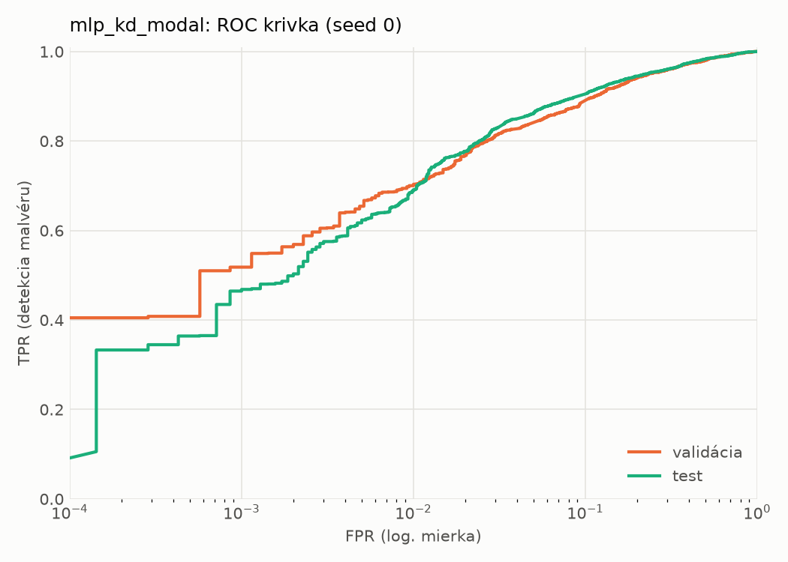
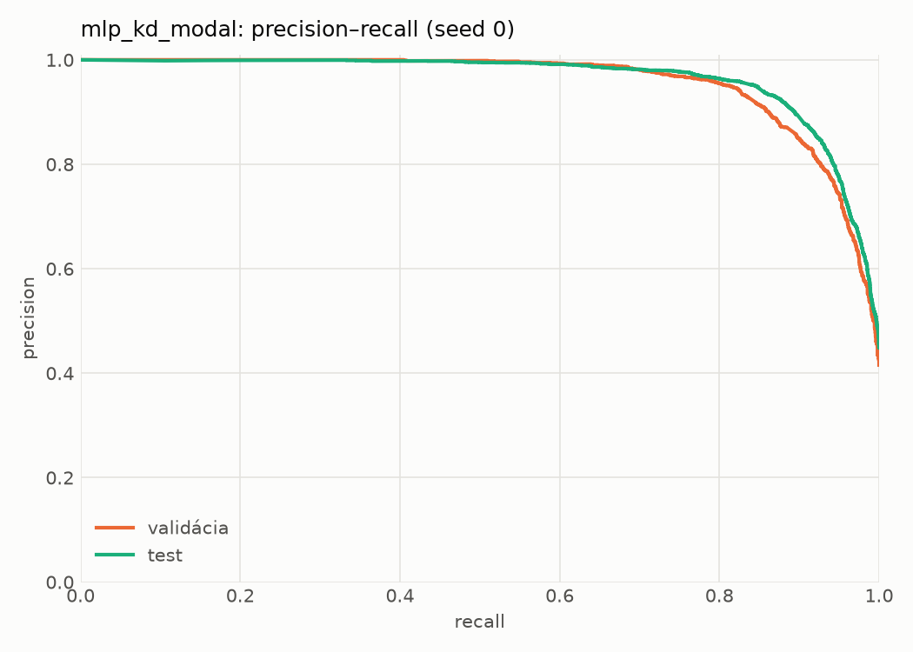
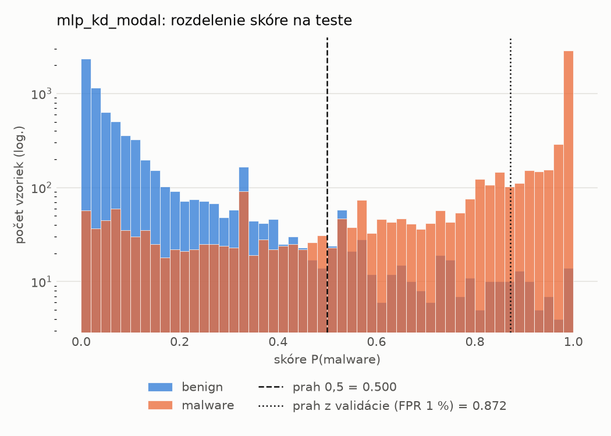
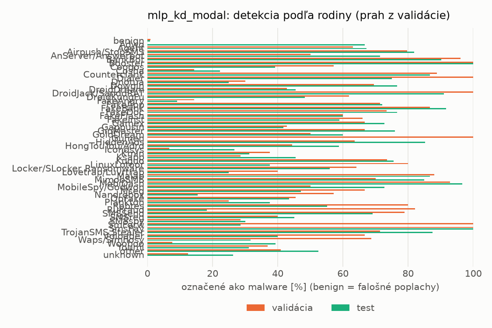
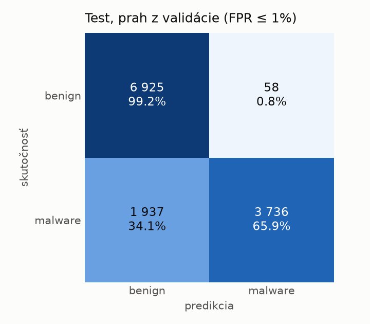
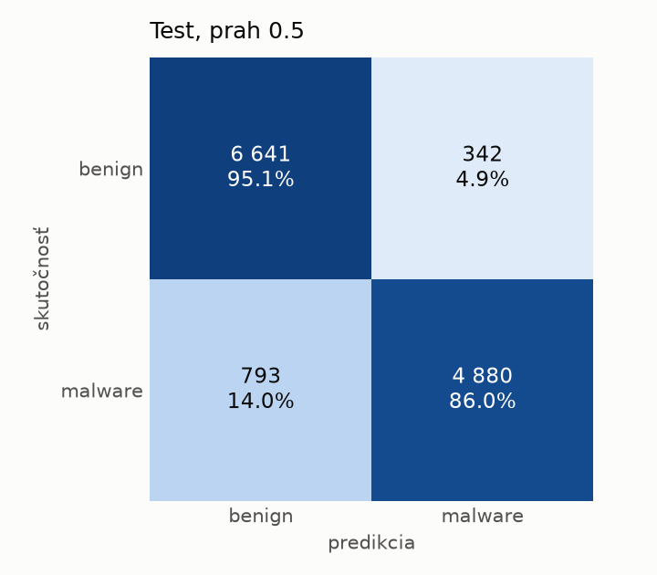
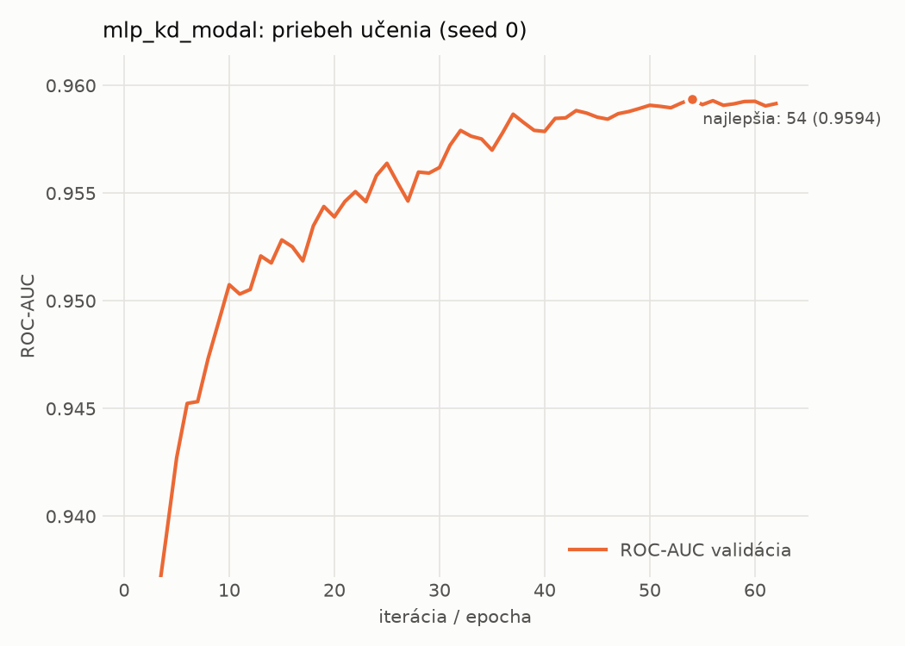

# dynamic/mlp_kd_modal – beh `20261123-184015`

> Automaticky generované (`src/training/run_tabular.py`). Konfigurácia: `config.yaml`, protokol: `protocol.yaml`.

- **Model:** `mlp` – študent – malé MLP učené destiláciou z učiteľa rovnakej modality (variant A)
- **Ladenie:** bez ladenia – hyperparametre prevzaté z `runs_v4/real_p/full/students_dynamic/mlp_kd_modal/20261123-004749`
- **Finálne modely:** seedy [0, 1, 2]; hodnoty sú priemer ± smerodajná odchýlka cez seedy
- **Najlepšie hyperparametre:** `{"hidden_layers": 1, "max_epochs": 100, "patience": 8, "hidden_width": 64, "dropout": 0.23306226533454044, "lr": 0.0029211055962699408, "weight_decay": 1.2442051354380418e-06, "batch_size": 512, "kd_alpha": 0.38098578248234166, "kd_temperature": 1.6615545083860346}`

## Detekčná kvalita (bez prahu)
| metrika | train (podvzorka) | validácia | test |
|---|---|---|---|
| ROC-AUC | 0.9682 ± 0.0008 | 0.9613 ± 0.0018 | 0.9637 ± 0.0013 |
| PR-AUC | 0.9668 ± 0.0008 | 0.9583 ± 0.0015 | 0.9646 ± 0.0014 |
| TPR pri FPR 1 % | 0.7802 ± 0.0030 | 0.7066 ± 0.0080 | 0.7117 ± 0.0218 |
| TPR pri FPR 0,1 % | 0.6381 ± 0.0140 | 0.5337 ± 0.0164 | 0.4762 ± 0.0254 |
| log loss | 0.2038 ± 0.0028 | 0.2359 ± 0.0042 | 0.2337 ± 0.0052 |
| Brier skóre | 0.0584 ± 0.0009 | 0.0697 ± 0.0012 | 0.0674 ± 0.0013 |

Rozdiel ROC-AUC train − validácia: **0.0068** (veľký rozdiel = preučenie).

## Pri prahu z validácie (FPR ≤ 1% na validácii)
| metrika | train (podvzorka) | validácia | test |
|---|---|---|---|
| accuracy | 0.8854 ± 0.0042 | 0.8724 ± 0.0032 | 0.8530 ± 0.0093 |
| balanced accuracy | 0.8603 ± 0.0051 | 0.8485 ± 0.0039 | 0.8370 ± 0.0103 |
| precision | 0.9898 ± 0.0011 | 0.9813 ± 0.0001 | 0.9854 ± 0.0011 |
| recall (TPR) | 0.7257 ± 0.0101 | 0.7066 ± 0.0080 | 0.6821 ± 0.0207 |
| FPR | 0.0051 ± 0.0005 | 0.0096 ± 0.0002 | 0.0082 ± 0.0006 |
| F1 | 0.8374 ± 0.0068 | 0.8216 ± 0.0054 | 0.8061 ± 0.0147 |
| MCC | 0.7737 ± 0.0079 | 0.7501 ± 0.0060 | 0.7245 ± 0.0163 |

## Pri pevnom prahu 0.5
| metrika | train (podvzorka) | validácia | test |
|---|---|---|---|
| accuracy | 0.9246 ± 0.0020 | 0.9048 ± 0.0006 | 0.9128 ± 0.0021 |
| balanced accuracy | 0.9174 ± 0.0025 | 0.8977 ± 0.0009 | 0.9082 ± 0.0023 |
| precision | 0.9323 ± 0.0010 | 0.9099 ± 0.0011 | 0.9362 ± 0.0019 |
| recall (TPR) | 0.8786 ± 0.0049 | 0.8556 ± 0.0028 | 0.8643 ± 0.0038 |
| FPR | 0.0438 ± 0.0007 | 0.0603 ± 0.0010 | 0.0478 ± 0.0014 |
| F1 | 0.9046 ± 0.0028 | 0.8819 ± 0.0010 | 0.8988 ± 0.0026 |
| MCC | 0.8434 ± 0.0042 | 0.8033 ± 0.0012 | 0.8245 ± 0.0043 |

## Výpočtové nároky (seed 0, testovacia množina)
| meranie | hodnota |
|---|---|
| tréning finálneho modelu | 8.6 s (priemer cez seedy) |
| ladenie spolu | 0 s |
| počet parametrov / uzlov | 8 129 |
| veľkosť modelu na disku | 0.04 MB |
| transformácia vstupu – latencia (1 vlákno) | 0.015 ms |
| transformácia vstupu – priepustnosť | 1 032 797 vzoriek/s |
| CPU latencia modelu (batch 1, 1 vlákno) | 0.070 ms (p95 0.080) |
| CPU priepustnosť (24 vlákien) | 5 637 919 vzoriek/s |
| GPU latencia (batch 1) | 0.452 ms (p95 0.487) |
| GPU priepustnosť | 1 252 350 vzoriek/s |
| GPU špičková pamäť | 52 MB |

## Grafy
| | |
|---|---|
|  |  |
|  |  |
|  |  |
|  |  |

## Súbory
`metrics.json` (všetky metriky po seedoch vrátane rodín), `timing.json`, `hpo_trials.csv`,
`predictions/<časť>_seed<N>.parquet` (sha256, family, label, score), `model/seed_<N>/`, `log.txt`.
