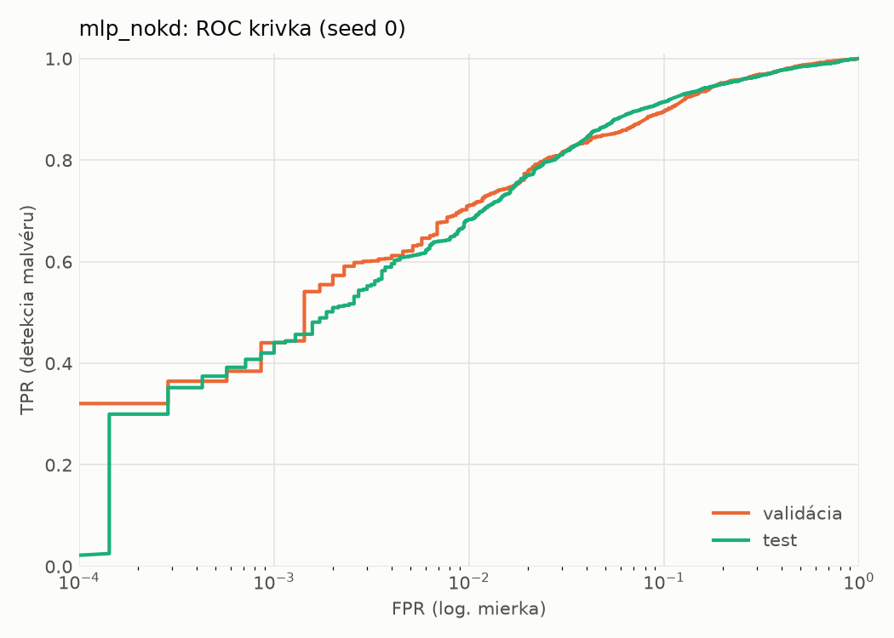
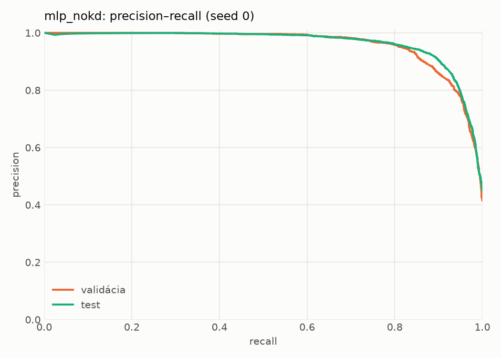
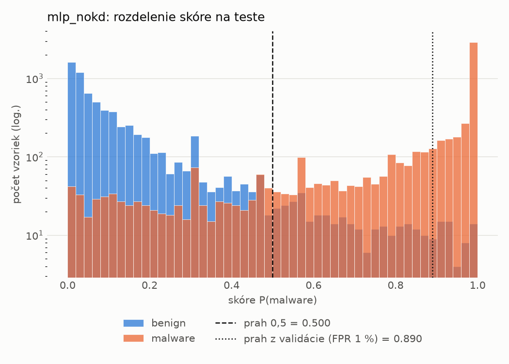
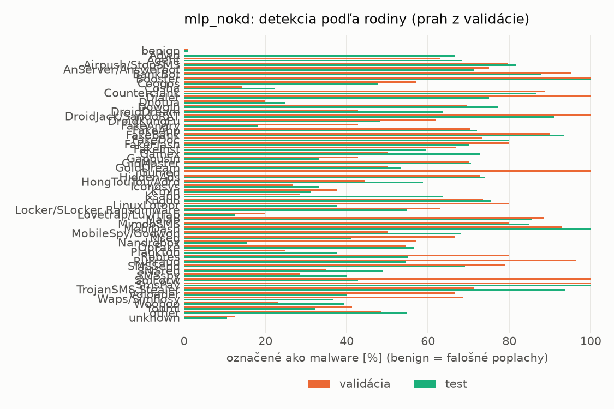
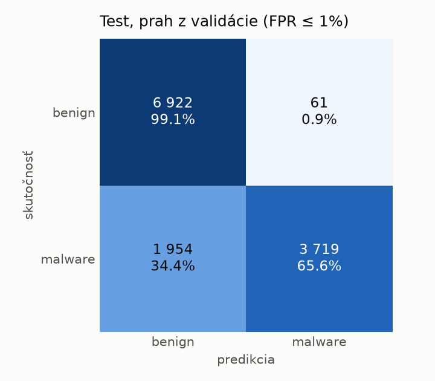
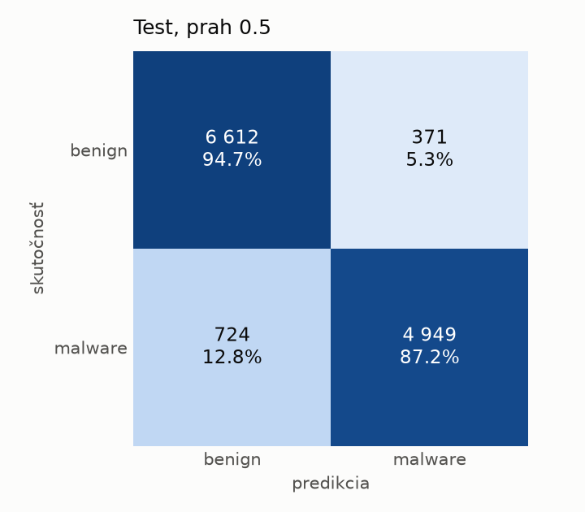
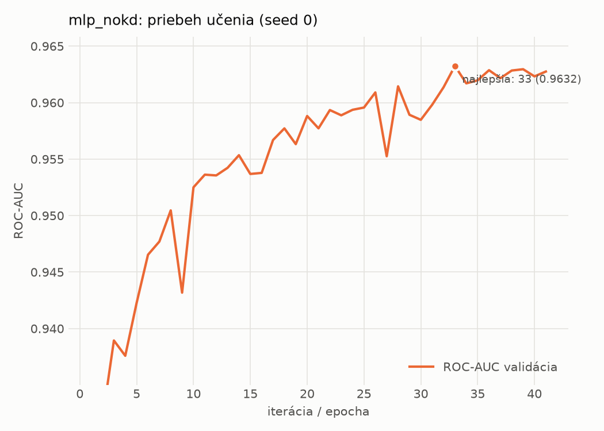

# dynamic/mlp_nokd – beh `20261123-183942`

> Automaticky generované (`src/training/run_tabular.py`). Konfigurácia: `config.yaml`, protokol: `protocol.yaml`.

- **Model:** `mlp` – kontrola – rovnaké malé MLP bez destilácie (iba skutočné označenia)
- **Ladenie:** bez ladenia – hyperparametre prevzaté z `runs_v4/real_p/full/students_dynamic/mlp_nokd/20261123-004046`
- **Finálne modely:** seedy [0, 1, 2]; hodnoty sú priemer ± smerodajná odchýlka cez seedy
- **Najlepšie hyperparametre:** `{"hidden_layers": 1, "max_epochs": 100, "patience": 8, "hidden_width": 64, "dropout": 0.01960392869507369, "lr": 0.0014251751351833603, "weight_decay": 1.336267730425129e-05, "batch_size": 256}`

## Detekčná kvalita (bez prahu)
| metrika | train (podvzorka) | validácia | test |
|---|---|---|---|
| ROC-AUC | 0.9738 ± 0.0022 | 0.9634 ± 0.0006 | 0.9637 ± 0.0008 |
| PR-AUC | 0.9722 ± 0.0021 | 0.9601 ± 0.0009 | 0.9640 ± 0.0009 |
| TPR pri FPR 1 % | 0.8104 ± 0.0165 | 0.7149 ± 0.0047 | 0.6889 ± 0.0142 |
| TPR pri FPR 0,1 % | 0.6394 ± 0.0059 | 0.5077 ± 0.0583 | 0.4409 ± 0.0231 |
| log loss | 0.1912 ± 0.0089 | 0.2356 ± 0.0015 | 0.2359 ± 0.0032 |
| Brier skóre | 0.0544 ± 0.0027 | 0.0685 ± 0.0008 | 0.0670 ± 0.0012 |

Rozdiel ROC-AUC train − validácia: **0.0104** (veľký rozdiel = preučenie).

## Pri prahu z validácie (FPR ≤ 1% na validácii)
| metrika | train (podvzorka) | validácia | test |
|---|---|---|---|
| accuracy | 0.8882 ± 0.0013 | 0.8758 ± 0.0019 | 0.8432 ± 0.0021 |
| balanced accuracy | 0.8636 ± 0.0016 | 0.8526 ± 0.0023 | 0.8260 ± 0.0024 |
| precision | 0.9918 ± 0.0014 | 0.9812 ± 0.0001 | 0.9844 ± 0.0019 |
| recall (TPR) | 0.7313 ± 0.0035 | 0.7149 ± 0.0047 | 0.6606 ± 0.0050 |
| FPR | 0.0042 ± 0.0007 | 0.0097 ± 0.0000 | 0.0085 ± 0.0011 |
| F1 | 0.8419 ± 0.0022 | 0.8271 ± 0.0032 | 0.7906 ± 0.0035 |
| MCC | 0.7795 ± 0.0024 | 0.7563 ± 0.0036 | 0.7071 ± 0.0037 |

## Pri pevnom prahu 0.5
| metrika | train (podvzorka) | validácia | test |
|---|---|---|---|
| accuracy | 0.9310 ± 0.0031 | 0.9060 ± 0.0016 | 0.9157 ± 0.0023 |
| balanced accuracy | 0.9266 ± 0.0036 | 0.9013 ± 0.0024 | 0.9124 ± 0.0028 |
| precision | 0.9256 ± 0.0055 | 0.8983 ± 0.0026 | 0.9281 ± 0.0021 |
| recall (TPR) | 0.9030 ± 0.0079 | 0.8728 ± 0.0074 | 0.8803 ± 0.0071 |
| FPR | 0.0498 ± 0.0042 | 0.0703 ± 0.0026 | 0.0554 ± 0.0021 |
| F1 | 0.9141 ± 0.0040 | 0.8854 ± 0.0026 | 0.9035 ± 0.0031 |
| MCC | 0.8567 ± 0.0065 | 0.8061 ± 0.0034 | 0.8298 ± 0.0046 |

## Výpočtové nároky (seed 0, testovacia množina)
| meranie | hodnota |
|---|---|
| tréning finálneho modelu | 10.4 s (priemer cez seedy) |
| ladenie spolu | 0 s |
| počet parametrov / uzlov | 8 129 |
| veľkosť modelu na disku | 0.04 MB |
| transformácia vstupu – latencia (1 vlákno) | 0.015 ms |
| transformácia vstupu – priepustnosť | 774 745 vzoriek/s |
| CPU latencia modelu (batch 1, 1 vlákno) | 0.155 ms (p95 0.166) |
| CPU priepustnosť (24 vlákien) | 5 362 257 vzoriek/s |
| GPU latencia (batch 1) | 0.464 ms (p95 0.505) |
| GPU priepustnosť | 2 986 385 vzoriek/s |
| GPU špičková pamäť | 76 MB |

## Grafy
| | |
|---|---|
|  |  |
|  |  |
|  |  |
|  |  |

## Súbory
`metrics.json` (všetky metriky po seedoch vrátane rodín), `timing.json`, `hpo_trials.csv`,
`predictions/<časť>_seed<N>.parquet` (sha256, family, label, score), `model/seed_<N>/`, `log.txt`.
