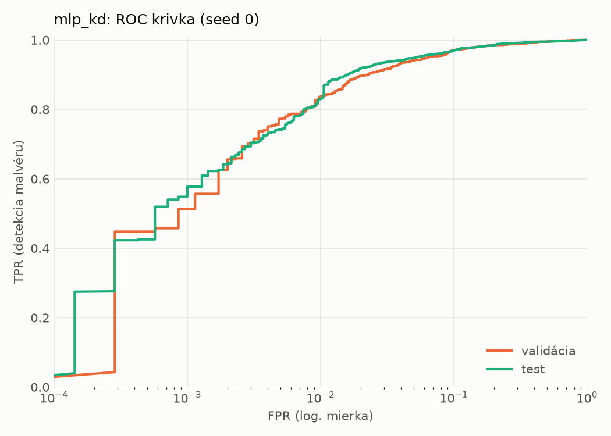
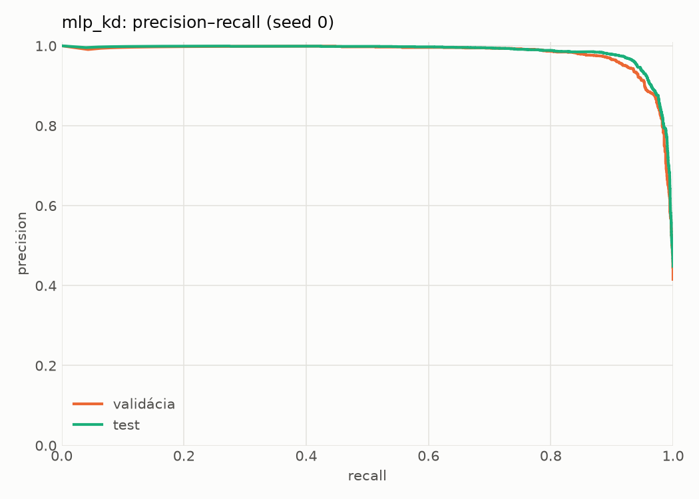
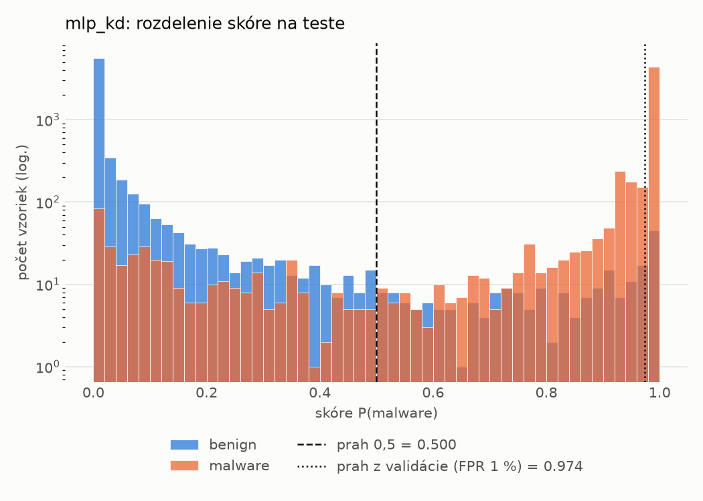
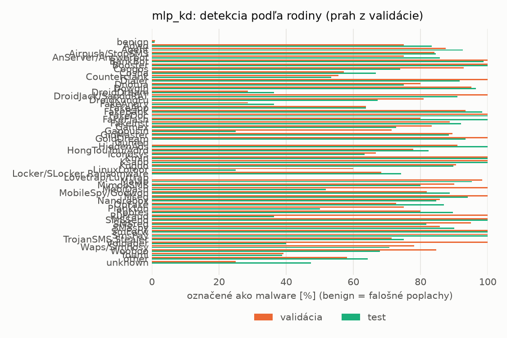
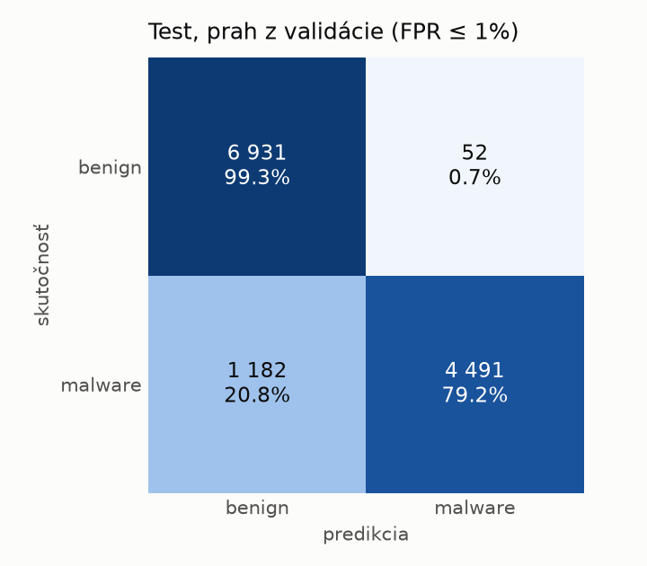
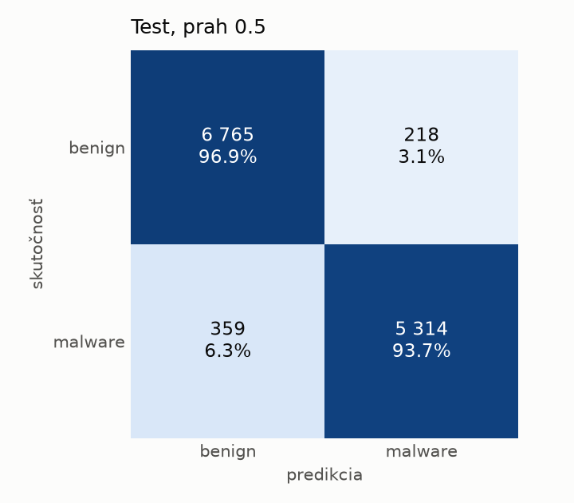
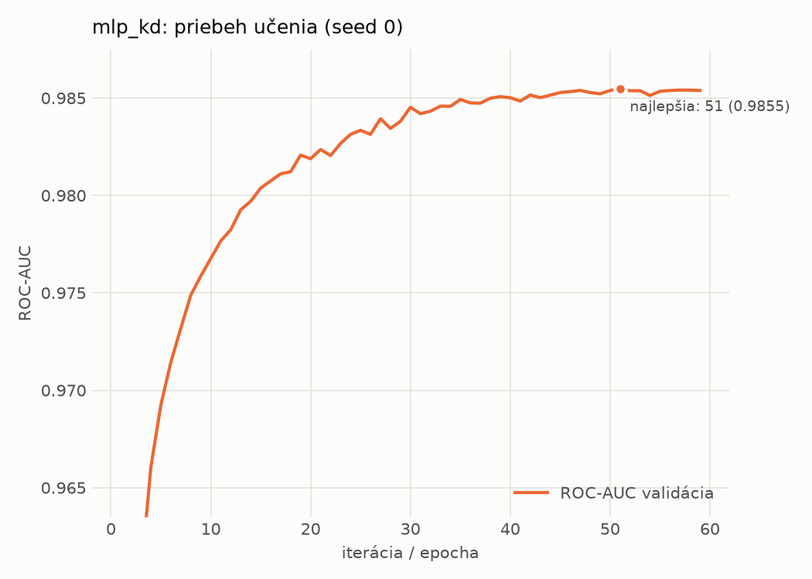

# static/mlp_kd – beh `20261123-183817`

> Automaticky generované (`src/training/run_tabular.py`). Konfigurácia: `config.yaml`, protokol: `protocol.yaml`.

- **Model:** `mlp` – študent – malé MLP učené destiláciou z hybridného učiteľa
- **Ladenie:** bez ladenia – hyperparametre prevzaté z `runs_v4/real_p/full/students_static/mlp_kd/20261123-002115`
- **Finálne modely:** seedy [0, 1, 2]; hodnoty sú priemer ± smerodajná odchýlka cez seedy
- **Najlepšie hyperparametre:** `{"hidden_layers": 1, "max_epochs": 100, "patience": 8, "hidden_width": 64, "dropout": 0.0632721567978865, "lr": 0.0009421311632910299, "weight_decay": 0.0003612082656275497, "batch_size": 1024, "kd_alpha": 0.17546922159086176, "kd_temperature": 1.684481613505065}`

## Detekčná kvalita (bez prahu)
| metrika | train (podvzorka) | validácia | test |
|---|---|---|---|
| ROC-AUC | 0.9895 ± 0.0005 | 0.9858 ± 0.0002 | 0.9869 ± 0.0003 |
| PR-AUC | 0.9884 ± 0.0005 | 0.9821 ± 0.0001 | 0.9859 ± 0.0002 |
| TPR pri FPR 1 % | 0.8961 ± 0.0037 | 0.8266 ± 0.0139 | 0.8414 ± 0.0178 |
| TPR pri FPR 0,1 % | 0.7170 ± 0.0087 | 0.5105 ± 0.0369 | 0.5387 ± 0.0094 |
| log loss | 0.1275 ± 0.0025 | 0.1694 ± 0.0019 | 0.1531 ± 0.0020 |
| Brier skóre | 0.0320 ± 0.0005 | 0.0418 ± 0.0006 | 0.0375 ± 0.0005 |

Rozdiel ROC-AUC train − validácia: **0.0037** (veľký rozdiel = preučenie).

## Pri prahu z validácie (FPR ≤ 1% na validácii)
| metrika | train (podvzorka) | validácia | test |
|---|---|---|---|
| accuracy | 0.9312 ± 0.0060 | 0.9223 ± 0.0058 | 0.8934 ± 0.0129 |
| balanced accuracy | 0.9165 ± 0.0077 | 0.9085 ± 0.0070 | 0.8818 ± 0.0145 |
| precision | 0.9924 ± 0.0026 | 0.9839 ± 0.0005 | 0.9898 ± 0.0011 |
| recall (TPR) | 0.8374 ± 0.0169 | 0.8266 ± 0.0139 | 0.7701 ± 0.0298 |
| FPR | 0.0044 ± 0.0016 | 0.0096 ± 0.0002 | 0.0064 ± 0.0009 |
| F1 | 0.9083 ± 0.0090 | 0.8984 ± 0.0084 | 0.8660 ± 0.0187 |
| MCC | 0.8619 ± 0.0113 | 0.8446 ± 0.0112 | 0.7970 ± 0.0228 |

## Pri pevnom prahu 0.5
| metrika | train (podvzorka) | validácia | test |
|---|---|---|---|
| accuracy | 0.9594 ± 0.0005 | 0.9494 ± 0.0003 | 0.9540 ± 0.0014 |
| balanced accuracy | 0.9561 ± 0.0004 | 0.9471 ± 0.0002 | 0.9523 ± 0.0014 |
| precision | 0.9611 ± 0.0015 | 0.9440 ± 0.0012 | 0.9610 ± 0.0013 |
| recall (TPR) | 0.9382 ± 0.0004 | 0.9335 ± 0.0004 | 0.9354 ± 0.0021 |
| FPR | 0.0261 ± 0.0011 | 0.0394 ± 0.0009 | 0.0308 ± 0.0011 |
| F1 | 0.9495 ± 0.0006 | 0.9388 ± 0.0004 | 0.9480 ± 0.0016 |
| MCC | 0.9157 ± 0.0011 | 0.8956 ± 0.0007 | 0.9071 ± 0.0028 |

## Výpočtové nároky (seed 0, testovacia množina)
| meranie | hodnota |
|---|---|
| tréning finálneho modelu | 3.8 s (priemer cez seedy) |
| ladenie spolu | 0 s |
| počet parametrov / uzlov | 10 689 |
| veľkosť modelu na disku | 0.05 MB |
| transformácia vstupu – latencia (1 vlákno) | 0.007 ms |
| transformácia vstupu – priepustnosť | 936 642 vzoriek/s |
| CPU latencia modelu (batch 1, 1 vlákno) | 0.069 ms (p95 0.163) |
| CPU priepustnosť (24 vlákien) | 3 859 596 vzoriek/s |
| GPU latencia (batch 1) | 0.290 ms (p95 0.311) |
| GPU priepustnosť | 1 329 677 vzoriek/s |
| GPU špičková pamäť | 61 MB |

## Grafy
| | |
|---|---|
|  |  |
|  |  |
|  |  |
|  |  |

## Súbory
`metrics.json` (všetky metriky po seedoch vrátane rodín), `timing.json`, `hpo_trials.csv`,
`predictions/<časť>_seed<N>.parquet` (sha256, family, label, score), `model/seed_<N>/`, `log.txt`.
