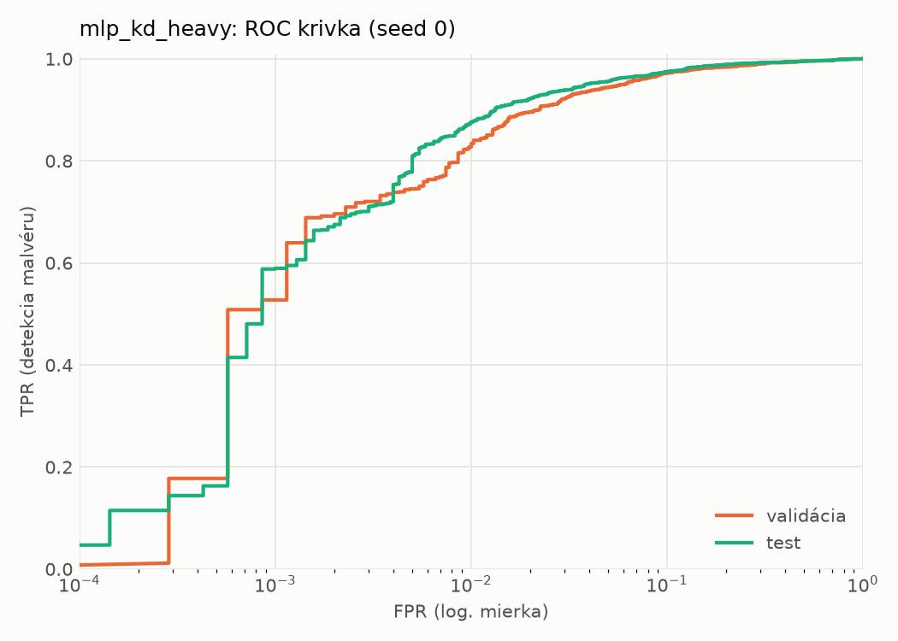
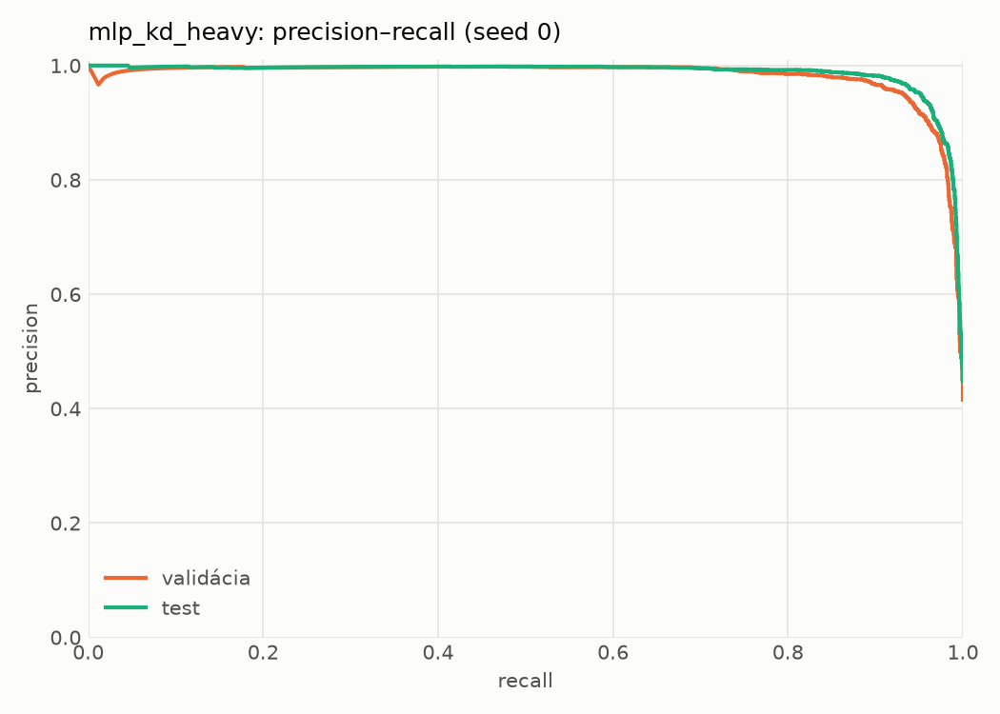
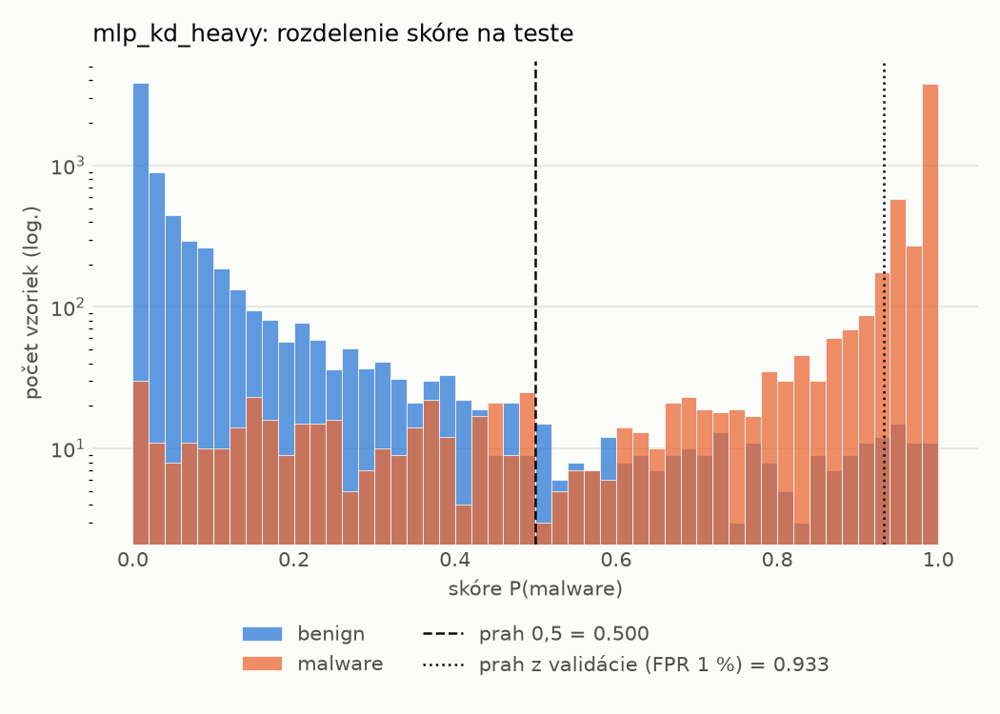
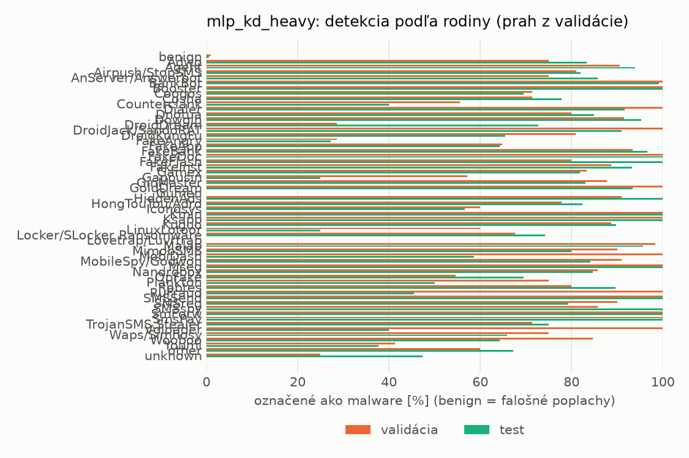
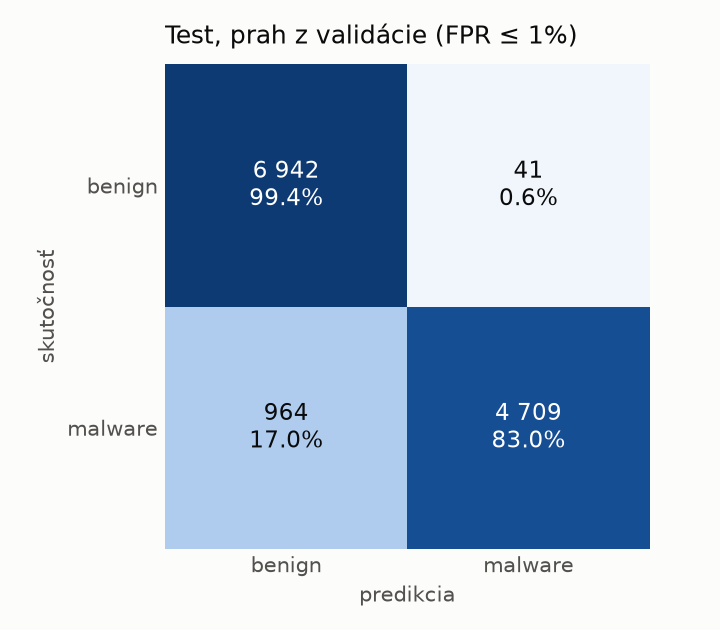
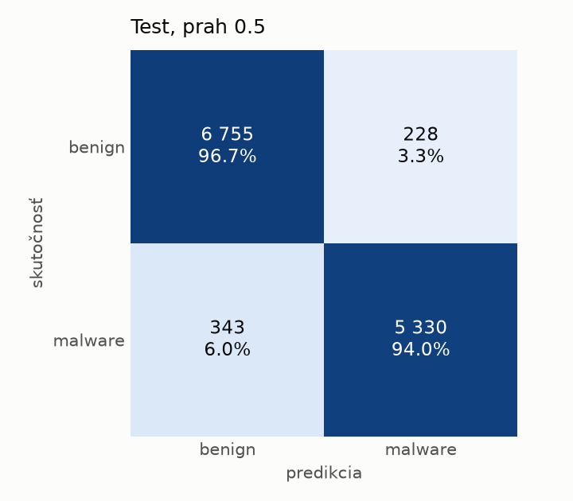
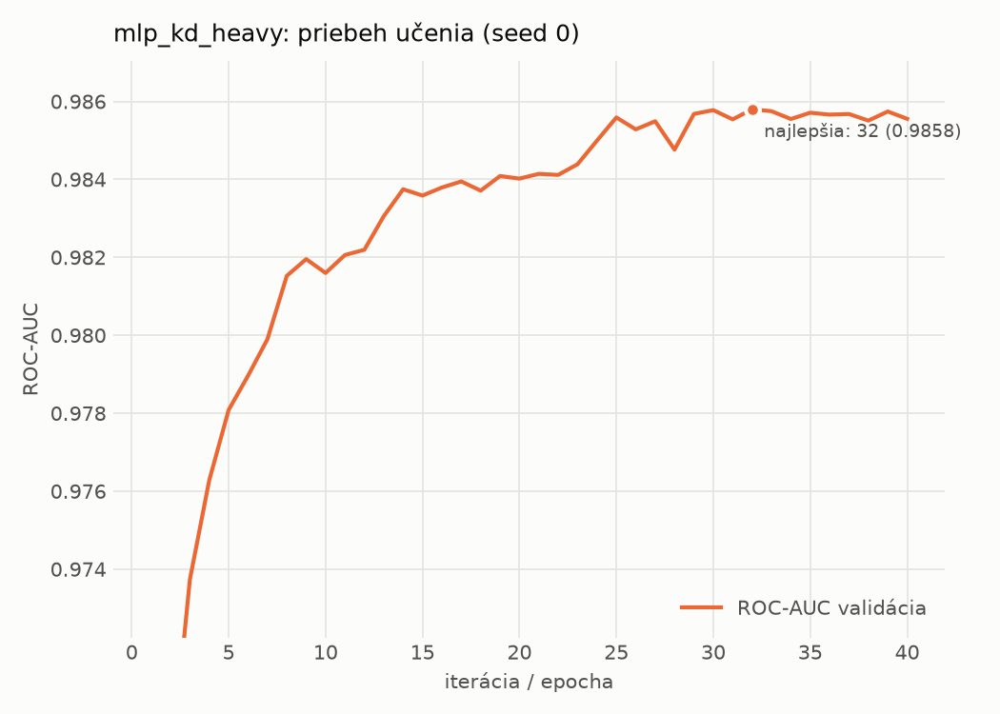

# static/mlp_kd_heavy – beh `20261123-183913`

> Automaticky generované (`src/training/run_tabular.py`). Konfigurácia: `config.yaml`, protokol: `protocol.yaml`.

- **Model:** `mlp` – študent – malé MLP učené destiláciou z mlp_large hybridu (V4)
- **Ladenie:** bez ladenia – hyperparametre prevzaté z `runs_v4/real_p/full/students_static/mlp_kd_heavy/20261123-003302`
- **Finálne modely:** seedy [0, 1, 2]; hodnoty sú priemer ± smerodajná odchýlka cez seedy
- **Najlepšie hyperparametre:** `{"hidden_layers": 1, "max_epochs": 100, "patience": 8, "hidden_width": 64, "dropout": 0.09027280410892091, "lr": 0.002542283406985367, "weight_decay": 5.0021287493134016e-05, "batch_size": 1024, "kd_alpha": 0.49398181049265616, "kd_temperature": 1.0496155846554518}`

## Detekčná kvalita (bez prahu)
| metrika | train (podvzorka) | validácia | test |
|---|---|---|---|
| ROC-AUC | 0.9918 ± 0.0002 | 0.9857 ± 0.0002 | 0.9873 ± 0.0009 |
| PR-AUC | 0.9906 ± 0.0002 | 0.9818 ± 0.0005 | 0.9866 ± 0.0007 |
| TPR pri FPR 1 % | 0.9067 ± 0.0021 | 0.8323 ± 0.0047 | 0.8750 ± 0.0022 |
| TPR pri FPR 0,1 % | 0.7326 ± 0.0219 | 0.5062 ± 0.0273 | 0.5498 ± 0.0331 |
| log loss | 0.1053 ± 0.0008 | 0.1450 ± 0.0010 | 0.1331 ± 0.0033 |
| Brier skóre | 0.0285 ± 0.0001 | 0.0391 ± 0.0002 | 0.0350 ± 0.0006 |

Rozdiel ROC-AUC train − validácia: **0.0061** (veľký rozdiel = preučenie).

## Pri prahu z validácie (FPR ≤ 1% na validácii)
| metrika | train (podvzorka) | validácia | test |
|---|---|---|---|
| accuracy | 0.9330 ± 0.0009 | 0.9246 ± 0.0020 | 0.9213 ± 0.0014 |
| balanced accuracy | 0.9186 ± 0.0011 | 0.9113 ± 0.0024 | 0.9129 ± 0.0015 |
| precision | 0.9933 ± 0.0005 | 0.9838 ± 0.0001 | 0.9909 ± 0.0005 |
| recall (TPR) | 0.8410 ± 0.0023 | 0.8323 ± 0.0047 | 0.8320 ± 0.0031 |
| FPR | 0.0039 ± 0.0003 | 0.0097 ± 0.0000 | 0.0062 ± 0.0004 |
| F1 | 0.9109 ± 0.0013 | 0.9017 ± 0.0028 | 0.9045 ± 0.0018 |
| MCC | 0.8654 ± 0.0018 | 0.8490 ± 0.0038 | 0.8477 ± 0.0026 |

## Pri pevnom prahu 0.5
| metrika | train (podvzorka) | validácia | test |
|---|---|---|---|
| accuracy | 0.9637 ± 0.0010 | 0.9498 ± 0.0006 | 0.9552 ± 0.0005 |
| balanced accuracy | 0.9613 ± 0.0011 | 0.9482 ± 0.0006 | 0.9538 ± 0.0005 |
| precision | 0.9623 ± 0.0008 | 0.9400 ± 0.0006 | 0.9589 ± 0.0003 |
| recall (TPR) | 0.9480 ± 0.0019 | 0.9390 ± 0.0009 | 0.9404 ± 0.0014 |
| FPR | 0.0255 ± 0.0005 | 0.0426 ± 0.0004 | 0.0327 ± 0.0003 |
| F1 | 0.9551 ± 0.0012 | 0.9395 ± 0.0007 | 0.9496 ± 0.0006 |
| MCC | 0.9248 ± 0.0021 | 0.8966 ± 0.0012 | 0.9095 ± 0.0009 |

## Výpočtové nároky (seed 0, testovacia množina)
| meranie | hodnota |
|---|---|
| tréning finálneho modelu | 2.7 s (priemer cez seedy) |
| ladenie spolu | 0 s |
| počet parametrov / uzlov | 10 689 |
| veľkosť modelu na disku | 0.05 MB |
| transformácia vstupu – latencia (1 vlákno) | 0.015 ms |
| transformácia vstupu – priepustnosť | 731 751 vzoriek/s |
| CPU latencia modelu (batch 1, 1 vlákno) | 0.155 ms (p95 0.167) |
| CPU priepustnosť (24 vlákien) | 4 750 216 vzoriek/s |
| GPU latencia (batch 1) | 0.476 ms (p95 0.510) |
| GPU priepustnosť | 3 800 144 vzoriek/s |
| GPU špičková pamäť | 92 MB |

## Grafy
| | |
|---|---|
|  |  |
|  |  |
|  |  |
|  |  |

## Súbory
`metrics.json` (všetky metriky po seedoch vrátane rodín), `timing.json`, `hpo_trials.csv`,
`predictions/<časť>_seed<N>.parquet` (sha256, family, label, score), `model/seed_<N>/`, `log.txt`.
