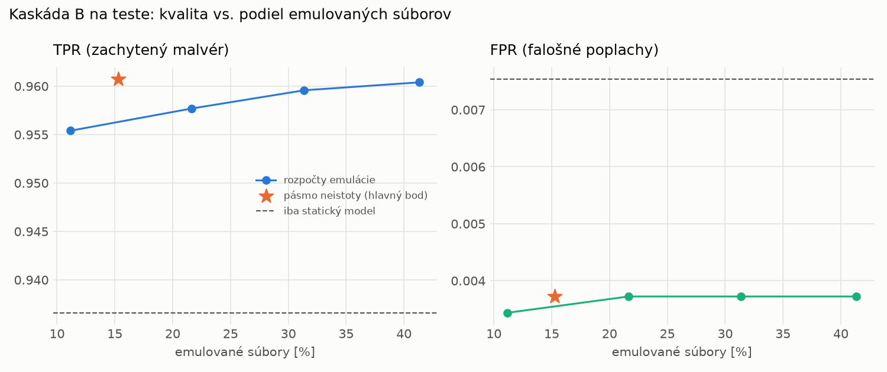

# Kaskáda B `b_baselines` – beh `20261123-185319`

> Generované `src/cascade/evaluate_b.py` (2026-11-23T18:53:19+01:00). Seedy: [0, 1, 2]; hodnoty = priemer ± sm. odchýlka.
> Všetky prahy a pásmo neistoty sú z validácie; test sa na nič nenastavuje. Postup: `docs/09_plan_v2.md`.

| rola | beh |
|---|---|
| static | `runs_v4/real_p/lofo/FakeInst/static/lightgbm/20261123-184203` |
| dynamic | `runs_v4/real_p/lofo/FakeInst/dynamic/lightgbm/20261123-184401` |
| hybrid | `runs_v4/real_p/lofo/FakeInst/hybrid/lightgbm/20261123-184633` |

Druhý stupeň: **dynamic**. Pásmo neistoty statického modelu: FPR ≤ 0.1% nad `hi`,
najviac 1% malvéru validácie pod `lo` (seed 0: lo = 0.0102, hi = 0.9941, seed 1: lo = 0.0038, hi = 0.9990, seed 2: lo = 0.0038, hi = 0.9992).

## Test
| prístup | accuracy | balanced_accuracy | precision | recall_tpr | fpr | f1 | mcc |
|---|---|---|---|---|---|---|---|
| kaskáda B | 0.9804 ± 0.0002 | 0.9785 ± 0.0003 | 0.9953 ± 0.0012 | 0.9607 ± 0.0016 | 0.0037 ± 0.0009 | 0.9777 ± 0.0003 | 0.9606 ± 0.0003 |
| statický | 0.9674 ± 0.0009 | 0.9645 ± 0.0011 | 0.9902 ± 0.0018 | 0.9366 ± 0.0033 | 0.0075 ± 0.0014 | 0.9626 ± 0.0011 | 0.9349 ± 0.0017 |
| dynamický | 0.9177 ± 0.0010 | 0.9090 ± 0.0012 | 0.9899 ± 0.0005 | 0.8249 ± 0.0027 | 0.0068 ± 0.0004 | 0.8999 ± 0.0014 | 0.8410 ± 0.0018 |
| hybrid (každá vzorka) | 0.9827 ± 0.0008 | 0.9815 ± 0.0008 | 0.9915 ± 0.0014 | 0.9698 ± 0.0006 | 0.0068 ± 0.0011 | 0.9805 ± 0.0009 | 0.9652 ± 0.0017 |

- **emulované súbory: 15.28%** (ostatné rozhodne iba statický model); na hybrid ide 3.66% súborov
- chyby pri istom rozhodnutí statického modelu (seed 0): 47
- validácia: emulované 14.17%, na hybrid 3.03%

## Validácia
| prístup | accuracy | balanced_accuracy | precision | recall_tpr | fpr | f1 | mcc |
|---|---|---|---|---|---|---|---|
| kaskáda B | 0.9819 ± 0.0001 | 0.9797 ± 0.0001 | 0.9936 ± 0.0002 | 0.9640 ± 0.0002 | 0.0047 ± 0.0002 | 0.9786 ± 0.0001 | 0.9632 ± 0.0002 |
| statický | 0.9720 ± 0.0011 | 0.9689 ± 0.0013 | 0.9865 ± 0.0000 | 0.9476 ± 0.0026 | 0.0097 ± 0.0000 | 0.9667 ± 0.0014 | 0.9431 ± 0.0022 |
| dynamický | 0.9281 ± 0.0017 | 0.9178 ± 0.0020 | 0.9852 ± 0.0002 | 0.8452 ± 0.0041 | 0.0096 ± 0.0002 | 0.9098 ± 0.0023 | 0.8576 ± 0.0032 |
| hybrid (každá vzorka) | 0.9813 ± 0.0001 | 0.9798 ± 0.0001 | 0.9869 ± 0.0002 | 0.9692 ± 0.0004 | 0.0096 ± 0.0002 | 0.9780 ± 0.0001 | 0.9619 ± 0.0002 |

## Januárové vzorky vynechanej rodiny (iba malvér → TPR)
| prístup | TPR |
|---|---|
| kaskáda B | 0.8981 ± 0.0040 |
| statický | 0.8246 ± 0.0157 |
| dynamický | 0.5583 ± 0.0101 |
| hybrid (každá vzorka) | 0.9418 ± 0.0054 |

Podiel emulovaných: 31.76%

## Krivka rozpočtu emulácie (test, priemer cez seedy)
| budget_val | emulation_rate | hybrid_rate | recall_tpr | fpr | f1 |
|---|---|---|---|---|---|
| 0.1000 | 0.1117 | 0.0366 | 0.9554 | 0.0034 | 0.9751 |
| 0.2000 | 0.2164 | 0.0553 | 0.9577 | 0.0037 | 0.9761 |
| 0.3000 | 0.3137 | 0.0634 | 0.9596 | 0.0037 | 0.9771 |
| 0.4000 | 0.4133 | 0.0705 | 0.9604 | 0.0037 | 0.9775 |

## Výpočtové nároky
Čas dynamickej analýzy (beh v emulátore alebo na zariadení) dataset neuvádza, preto sa neodhaduje. Úspora kaskády B = podiel súborov s dynamickou analýzou: **15.28%** (ostatné prístupy 100 %).

_Chýba benchmark niektorého komponentu (v zero-day behoch sa nemeria)._

