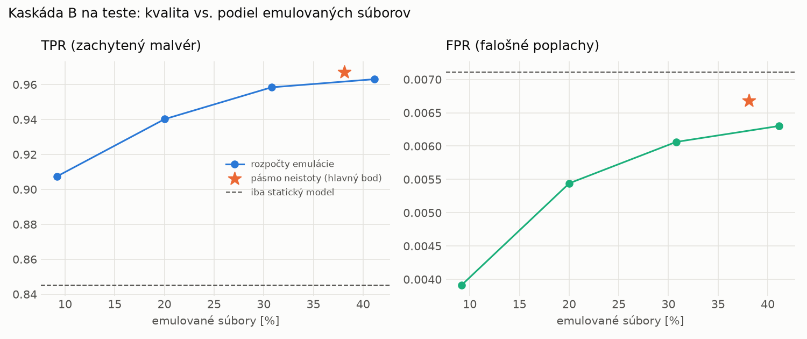

# Kaskáda B `b_direct` – beh `20261123-185315`

> Generované `src/cascade/evaluate_b.py` (2026-11-23T18:53:15+01:00). Seedy: [0, 1, 2]; hodnoty = priemer ± sm. odchýlka.
> Všetky prahy a pásmo neistoty sú z validácie; test sa na nič nenastavuje. Postup: `docs/09_plan_v2.md`.

| rola | beh |
|---|---|
| static | `runs_v4/real_p/lofo/FakeInst/students_static/mlp_kd/20261123-184951` |
| hybrid | `runs_v4/real_p/lofo/FakeInst/hybrid/lightgbm/20261123-184633` |

Druhý stupeň: **hybrid**. Pásmo neistoty statického modelu: FPR ≤ 0.1% nad `hi`,
najviac 1% malvéru validácie pod `lo` (seed 0: lo = 0.0044, hi = 0.9998, seed 1: lo = 0.0050, hi = 0.9999, seed 2: lo = 0.0051, hi = 0.9999).

## Test
| prístup | accuracy | balanced_accuracy | precision | recall_tpr | fpr | f1 | mcc |
|---|---|---|---|---|---|---|---|
| kaskáda B | 0.9816 ± 0.0012 | 0.9803 ± 0.0013 | 0.9916 ± 0.0012 | 0.9672 ± 0.0017 | 0.0067 ± 0.0009 | 0.9792 ± 0.0014 | 0.9630 ± 0.0025 |
| statický | 0.9267 ± 0.0012 | 0.9191 ± 0.0014 | 0.9898 ± 0.0008 | 0.8452 ± 0.0033 | 0.0071 ± 0.0006 | 0.9118 ± 0.0016 | 0.8575 ± 0.0021 |
| hybrid (každá vzorka) | 0.9827 ± 0.0008 | 0.9815 ± 0.0008 | 0.9915 ± 0.0014 | 0.9698 ± 0.0006 | 0.0068 ± 0.0011 | 0.9805 ± 0.0009 | 0.9652 ± 0.0017 |

- **emulované súbory: 38.10%** (ostatné rozhodne iba statický model); na hybrid ide 38.10% súborov
- chyby pri istom rozhodnutí statického modelu (seed 0): 60
- validácia: emulované 37.65%, na hybrid 37.65%

## Validácia
| prístup | accuracy | balanced_accuracy | precision | recall_tpr | fpr | f1 | mcc |
|---|---|---|---|---|---|---|---|
| kaskáda B | 0.9797 ± 0.0003 | 0.9780 ± 0.0004 | 0.9866 ± 0.0004 | 0.9658 ± 0.0009 | 0.0098 ± 0.0003 | 0.9761 ± 0.0004 | 0.9586 ± 0.0007 |
| statický | 0.9293 ± 0.0016 | 0.9193 ± 0.0018 | 0.9849 ± 0.0001 | 0.8483 ± 0.0036 | 0.0097 ± 0.0000 | 0.9115 ± 0.0021 | 0.8598 ± 0.0030 |
| hybrid (každá vzorka) | 0.9813 ± 0.0001 | 0.9798 ± 0.0001 | 0.9869 ± 0.0002 | 0.9692 ± 0.0004 | 0.0096 ± 0.0002 | 0.9780 ± 0.0001 | 0.9619 ± 0.0002 |

## Januárové vzorky vynechanej rodiny (iba malvér → TPR)
| prístup | TPR |
|---|---|
| kaskáda B | 0.9436 ± 0.0039 |
| statický | 0.7856 ± 0.0018 |
| hybrid (každá vzorka) | 0.9418 ± 0.0054 |

Podiel emulovaných: 47.65%

## Krivka rozpočtu emulácie (test, priemer cez seedy)
| budget_val | emulation_rate | hybrid_rate | recall_tpr | fpr | f1 |
|---|---|---|---|---|---|
| 0.1000 | 0.0918 | 0.0918 | 0.9074 | 0.0039 | 0.9491 |
| 0.2000 | 0.2002 | 0.2002 | 0.9402 | 0.0054 | 0.9658 |
| 0.3000 | 0.3079 | 0.3079 | 0.9584 | 0.0061 | 0.9750 |
| 0.4000 | 0.4113 | 0.4113 | 0.9630 | 0.0063 | 0.9773 |

## Výpočtové nároky
Čas dynamickej analýzy (beh v emulátore alebo na zariadení) dataset neuvádza, preto sa neodhaduje. Úspora kaskády B = podiel súborov s dynamickou analýzou: **38.10%** (ostatné prístupy 100 %).

_Chýba benchmark niektorého komponentu (v zero-day behoch sa nemeria)._

