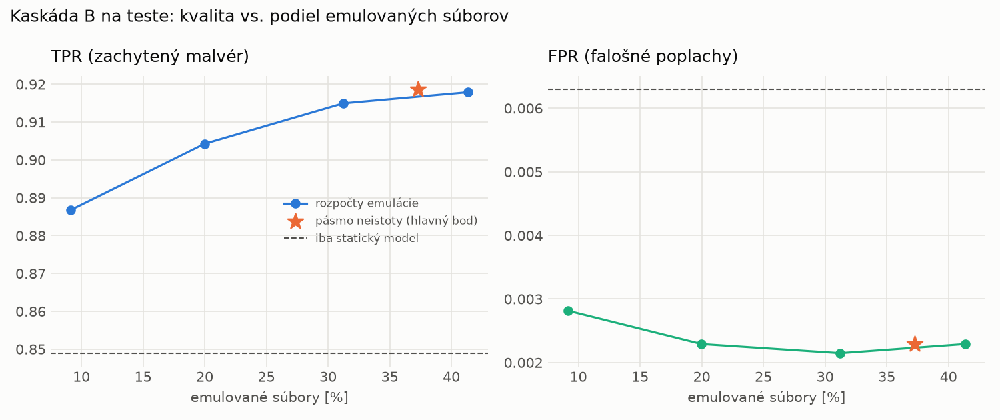

# Kaskáda B `b_heavyteacher` – beh `20261123-185323`

> Generované `src/cascade/evaluate_b.py` (2026-11-23T18:53:23+01:00). Seedy: [0, 1, 2]; hodnoty = priemer ± sm. odchýlka.
> Všetky prahy a pásmo neistoty sú z validácie; test sa na nič nenastavuje. Postup: `docs/09_plan_v2.md`.

| rola | beh |
|---|---|
| static | `runs_v4/real_p/lofo/FakeInst/students_static/mlp_kd_heavy/20261123-185053` |
| dynamic | `runs_v4/real_p/lofo/FakeInst/students_dynamic/mlp_kd_heavy/20261123-185240` |
| hybrid | `runs_v4/real_p/lofo/FakeInst/hybrid/lightgbm/20261123-184633` |

Druhý stupeň: **dynamic**. Pásmo neistoty statického modelu: FPR ≤ 0.1% nad `hi`,
najviac 1% malvéru validácie pod `lo` (seed 0: lo = 0.0440, hi = 0.9971, seed 1: lo = 0.0410, hi = 0.9991, seed 2: lo = 0.0464, hi = 0.9988).

## Test
| prístup | accuracy | balanced_accuracy | precision | recall_tpr | fpr | f1 | mcc |
|---|---|---|---|---|---|---|---|
| kaskáda B | 0.9623 ± 0.0003 | 0.9582 ± 0.0003 | 0.9969 ± 0.0003 | 0.9187 ± 0.0009 | 0.0023 ± 0.0002 | 0.9562 ± 0.0004 | 0.9256 ± 0.0005 |
| statický | 0.9288 ± 0.0010 | 0.9213 ± 0.0012 | 0.9909 ± 0.0010 | 0.8489 ± 0.0032 | 0.0063 ± 0.0008 | 0.9145 ± 0.0014 | 0.8616 ± 0.0017 |
| dynamický | 0.8653 ± 0.0037 | 0.8508 ± 0.0041 | 0.9841 ± 0.0003 | 0.7110 ± 0.0082 | 0.0094 ± 0.0001 | 0.8255 ± 0.0057 | 0.7457 ± 0.0066 |
| hybrid (každá vzorka) | 0.9827 ± 0.0008 | 0.9815 ± 0.0008 | 0.9915 ± 0.0014 | 0.9698 ± 0.0006 | 0.0068 ± 0.0011 | 0.9805 ± 0.0009 | 0.9652 ± 0.0017 |

- **emulované súbory: 37.29%** (ostatné rozhodne iba statický model); na hybrid ide 8.57% súborov
- chyby pri istom rozhodnutí statického modelu (seed 0): 50
- validácia: emulované 36.73%, na hybrid 9.08%

## Validácia
| prístup | accuracy | balanced_accuracy | precision | recall_tpr | fpr | f1 | mcc |
|---|---|---|---|---|---|---|---|
| kaskáda B | 0.9641 ± 0.0013 | 0.9589 ± 0.0015 | 0.9934 ± 0.0004 | 0.9225 ± 0.0032 | 0.0046 ± 0.0003 | 0.9566 ± 0.0016 | 0.9280 ± 0.0025 |
| statický | 0.9266 ± 0.0011 | 0.9161 ± 0.0013 | 0.9848 ± 0.0000 | 0.8419 ± 0.0025 | 0.0097 ± 0.0000 | 0.9078 ± 0.0015 | 0.8546 ± 0.0021 |
| dynamický | 0.8753 ± 0.0009 | 0.8564 ± 0.0010 | 0.9824 ± 0.0000 | 0.7225 ± 0.0020 | 0.0097 ± 0.0000 | 0.8326 ± 0.0013 | 0.7590 ± 0.0016 |
| hybrid (každá vzorka) | 0.9813 ± 0.0001 | 0.9798 ± 0.0001 | 0.9869 ± 0.0002 | 0.9692 ± 0.0004 | 0.0096 ± 0.0002 | 0.9780 ± 0.0001 | 0.9619 ± 0.0002 |

## Januárové vzorky vynechanej rodiny (iba malvér → TPR)
| prístup | TPR |
|---|---|
| kaskáda B | 0.8177 ± 0.0112 |
| statický | 0.7935 ± 0.0021 |
| dynamický | 0.3697 ± 0.0300 |
| hybrid (každá vzorka) | 0.9418 ± 0.0054 |

Podiel emulovaných: 51.37%

## Krivka rozpočtu emulácie (test, priemer cez seedy)
| budget_val | emulation_rate | hybrid_rate | recall_tpr | fpr | f1 |
|---|---|---|---|---|---|
| 0.1000 | 0.0914 | 0.0382 | 0.8868 | 0.0028 | 0.9383 |
| 0.2000 | 0.1999 | 0.0689 | 0.9043 | 0.0023 | 0.9483 |
| 0.3000 | 0.3124 | 0.0878 | 0.9150 | 0.0021 | 0.9543 |
| 0.4000 | 0.4136 | 0.0990 | 0.9179 | 0.0023 | 0.9558 |

## Výpočtové nároky
Čas dynamickej analýzy (beh v emulátore alebo na zariadení) dataset neuvádza, preto sa neodhaduje. Úspora kaskády B = podiel súborov s dynamickou analýzou: **37.29%** (ostatné prístupy 100 %).

_Chýba benchmark niektorého komponentu (v zero-day behoch sa nemeria)._

