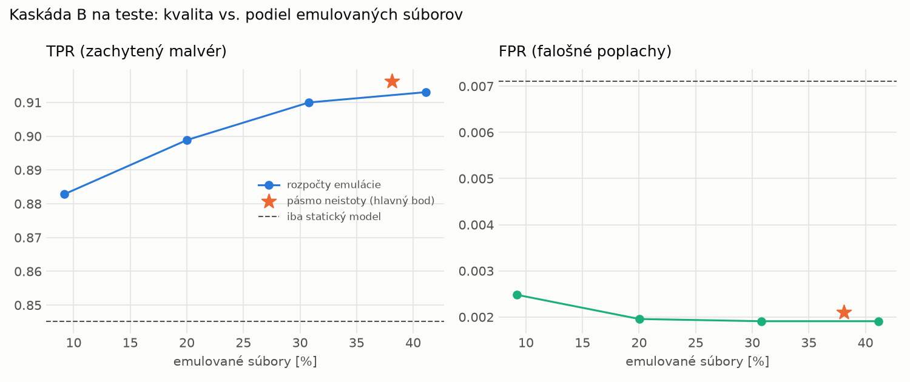

# Kaskáda B `b_main` – beh `20261123-185313`

> Generované `src/cascade/evaluate_b.py` (2026-11-23T18:53:14+01:00). Seedy: [0, 1, 2]; hodnoty = priemer ± sm. odchýlka.
> Všetky prahy a pásmo neistoty sú z validácie; test sa na nič nenastavuje. Postup: `docs/09_plan_v2.md`.

| rola | beh |
|---|---|
| static | `runs_v4/real_p/lofo/FakeInst/students_static/mlp_kd/20261123-184951` |
| dynamic | `runs_v4/real_p/lofo/FakeInst/students_dynamic/mlp_kd/20261123-185107` |
| hybrid | `runs_v4/real_p/lofo/FakeInst/hybrid/lightgbm/20261123-184633` |

Druhý stupeň: **dynamic**. Pásmo neistoty statického modelu: FPR ≤ 0.1% nad `hi`,
najviac 1% malvéru validácie pod `lo` (seed 0: lo = 0.0044, hi = 0.9998, seed 1: lo = 0.0050, hi = 0.9999, seed 2: lo = 0.0051, hi = 0.9999).

## Test
| prístup | accuracy | balanced_accuracy | precision | recall_tpr | fpr | f1 | mcc |
|---|---|---|---|---|---|---|---|
| kaskáda B | 0.9613 ± 0.0012 | 0.9571 ± 0.0014 | 0.9972 ± 0.0001 | 0.9163 ± 0.0027 | 0.0021 ± 0.0001 | 0.9550 ± 0.0015 | 0.9238 ± 0.0024 |
| statický | 0.9267 ± 0.0012 | 0.9191 ± 0.0014 | 0.9898 ± 0.0008 | 0.8452 ± 0.0033 | 0.0071 ± 0.0006 | 0.9118 ± 0.0016 | 0.8575 ± 0.0021 |
| dynamický | 0.8623 ± 0.0054 | 0.8475 ± 0.0061 | 0.9838 ± 0.0017 | 0.7044 ± 0.0129 | 0.0094 ± 0.0011 | 0.8210 ± 0.0084 | 0.7404 ± 0.0092 |
| hybrid (každá vzorka) | 0.9827 ± 0.0008 | 0.9815 ± 0.0008 | 0.9915 ± 0.0014 | 0.9698 ± 0.0006 | 0.0068 ± 0.0011 | 0.9805 ± 0.0009 | 0.9652 ± 0.0017 |

- **emulované súbory: 38.10%** (ostatné rozhodne iba statický model); na hybrid ide 8.74% súborov
- chyby pri istom rozhodnutí statického modelu (seed 0): 60
- validácia: emulované 37.65%, na hybrid 8.99%

## Validácia
| prístup | accuracy | balanced_accuracy | precision | recall_tpr | fpr | f1 | mcc |
|---|---|---|---|---|---|---|---|
| kaskáda B | 0.9647 ± 0.0016 | 0.9596 ± 0.0019 | 0.9936 ± 0.0009 | 0.9238 ± 0.0044 | 0.0045 ± 0.0007 | 0.9574 ± 0.0020 | 0.9291 ± 0.0031 |
| statický | 0.9293 ± 0.0016 | 0.9193 ± 0.0018 | 0.9849 ± 0.0001 | 0.8483 ± 0.0036 | 0.0097 ± 0.0000 | 0.9115 ± 0.0021 | 0.8598 ± 0.0030 |
| dynamický | 0.8752 ± 0.0051 | 0.8562 ± 0.0059 | 0.9824 ± 0.0003 | 0.7222 ± 0.0119 | 0.0097 ± 0.0000 | 0.8324 ± 0.0079 | 0.7588 ± 0.0093 |
| hybrid (každá vzorka) | 0.9813 ± 0.0001 | 0.9798 ± 0.0001 | 0.9869 ± 0.0002 | 0.9692 ± 0.0004 | 0.0096 ± 0.0002 | 0.9780 ± 0.0001 | 0.9619 ± 0.0002 |

## Januárové vzorky vynechanej rodiny (iba malvér → TPR)
| prístup | TPR |
|---|---|
| kaskáda B | 0.8110 ± 0.0075 |
| statický | 0.7856 ± 0.0018 |
| dynamický | 0.3664 ± 0.0350 |
| hybrid (každá vzorka) | 0.9418 ± 0.0054 |

Podiel emulovaných: 47.65%

## Krivka rozpočtu emulácie (test, priemer cez seedy)
| budget_val | emulation_rate | hybrid_rate | recall_tpr | fpr | f1 |
|---|---|---|---|---|---|
| 0.1000 | 0.0918 | 0.0396 | 0.8828 | 0.0025 | 0.9363 |
| 0.2000 | 0.2002 | 0.0710 | 0.8989 | 0.0020 | 0.9455 |
| 0.3000 | 0.3079 | 0.0943 | 0.9100 | 0.0019 | 0.9517 |
| 0.4000 | 0.4113 | 0.1071 | 0.9130 | 0.0019 | 0.9534 |

## Výpočtové nároky
Čas dynamickej analýzy (beh v emulátore alebo na zariadení) dataset neuvádza, preto sa neodhaduje. Úspora kaskády B = podiel súborov s dynamickou analýzou: **38.10%** (ostatné prístupy 100 %).

_Chýba benchmark niektorého komponentu (v zero-day behoch sa nemeria)._

