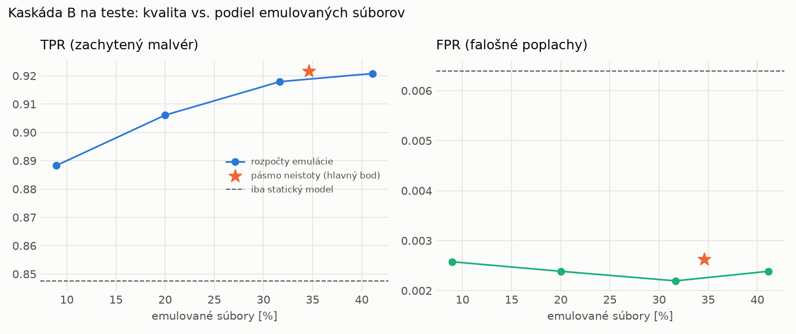

# Kaskáda B `b_nokd` – beh `20261123-185321`

> Generované `src/cascade/evaluate_b.py` (2026-11-23T18:53:21+01:00). Seedy: [0, 1, 2]; hodnoty = priemer ± sm. odchýlka.
> Všetky prahy a pásmo neistoty sú z validácie; test sa na nič nenastavuje. Postup: `docs/09_plan_v2.md`.

| rola | beh |
|---|---|
| static | `runs_v4/real_p/lofo/FakeInst/students_static/mlp_nokd/20261123-185007` |
| dynamic | `runs_v4/real_p/lofo/FakeInst/students_dynamic/mlp_nokd/20261123-185126` |
| hybrid | `runs_v4/real_p/lofo/FakeInst/hybrid/lightgbm/20261123-184633` |

Druhý stupeň: **dynamic**. Pásmo neistoty statického modelu: FPR ≤ 0.1% nad `hi`,
najviac 1% malvéru validácie pod `lo` (seed 0: lo = 0.0297, hi = 0.9991, seed 1: lo = 0.0369, hi = 0.9990, seed 2: lo = 0.0338, hi = 0.9982).

## Test
| prístup | accuracy | balanced_accuracy | precision | recall_tpr | fpr | f1 | mcc |
|---|---|---|---|---|---|---|---|
| kaskáda B | 0.9635 ± 0.0007 | 0.9596 ± 0.0008 | 0.9965 ± 0.0002 | 0.9217 ± 0.0017 | 0.0026 ± 0.0002 | 0.9577 ± 0.0008 | 0.9278 ± 0.0013 |
| statický | 0.9282 ± 0.0029 | 0.9206 ± 0.0034 | 0.9908 ± 0.0015 | 0.8476 ± 0.0076 | 0.0064 ± 0.0011 | 0.9136 ± 0.0039 | 0.8604 ± 0.0052 |
| dynamický | 0.8656 ± 0.0023 | 0.8510 ± 0.0026 | 0.9869 ± 0.0012 | 0.7096 ± 0.0060 | 0.0076 ± 0.0008 | 0.8256 ± 0.0037 | 0.7469 ± 0.0037 |
| hybrid (každá vzorka) | 0.9827 ± 0.0008 | 0.9815 ± 0.0008 | 0.9915 ± 0.0014 | 0.9698 ± 0.0006 | 0.0068 ± 0.0011 | 0.9805 ± 0.0009 | 0.9652 ± 0.0017 |

- **emulované súbory: 34.61%** (ostatné rozhodne iba statický model); na hybrid ide 7.69% súborov
- chyby pri istom rozhodnutí statického modelu (seed 0): 58
- validácia: emulované 34.48%, na hybrid 8.13%

## Validácia
| prístup | accuracy | balanced_accuracy | precision | recall_tpr | fpr | f1 | mcc |
|---|---|---|---|---|---|---|---|
| kaskáda B | 0.9667 ± 0.0006 | 0.9620 ± 0.0007 | 0.9931 ± 0.0004 | 0.9288 ± 0.0012 | 0.0049 ± 0.0003 | 0.9599 ± 0.0008 | 0.9330 ± 0.0012 |
| statický | 0.9299 ± 0.0004 | 0.9199 ± 0.0005 | 0.9851 ± 0.0002 | 0.8494 ± 0.0010 | 0.0096 ± 0.0002 | 0.9122 ± 0.0005 | 0.8609 ± 0.0007 |
| dynamický | 0.8779 ± 0.0030 | 0.8594 ± 0.0035 | 0.9825 ± 0.0002 | 0.7286 ± 0.0070 | 0.0097 ± 0.0000 | 0.8367 ± 0.0047 | 0.7638 ± 0.0055 |
| hybrid (každá vzorka) | 0.9813 ± 0.0001 | 0.9798 ± 0.0001 | 0.9869 ± 0.0002 | 0.9692 ± 0.0004 | 0.0096 ± 0.0002 | 0.9780 ± 0.0001 | 0.9619 ± 0.0002 |

## Januárové vzorky vynechanej rodiny (iba malvér → TPR)
| prístup | TPR |
|---|---|
| kaskáda B | 0.8271 ± 0.0043 |
| statický | 0.7921 ± 0.0106 |
| dynamický | 0.3921 ± 0.0097 |
| hybrid (každá vzorka) | 0.9418 ± 0.0054 |

Podiel emulovaných: 38.43%

## Krivka rozpočtu emulácie (test, priemer cez seedy)
| budget_val | emulation_rate | hybrid_rate | recall_tpr | fpr | f1 |
|---|---|---|---|---|---|
| 0.1000 | 0.0893 | 0.0377 | 0.8883 | 0.0026 | 0.9393 |
| 0.2000 | 0.2000 | 0.0676 | 0.9061 | 0.0024 | 0.9493 |
| 0.3000 | 0.3167 | 0.0875 | 0.9179 | 0.0022 | 0.9559 |
| 0.4000 | 0.4111 | 0.0962 | 0.9208 | 0.0024 | 0.9573 |

## Výpočtové nároky
Čas dynamickej analýzy (beh v emulátore alebo na zariadení) dataset neuvádza, preto sa neodhaduje. Úspora kaskády B = podiel súborov s dynamickou analýzou: **34.61%** (ostatné prístupy 100 %).

_Chýba benchmark niektorého komponentu (v zero-day behoch sa nemeria)._

