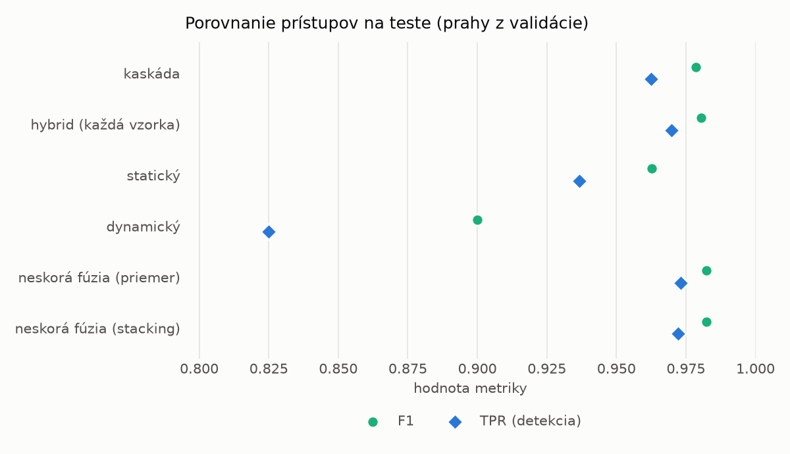
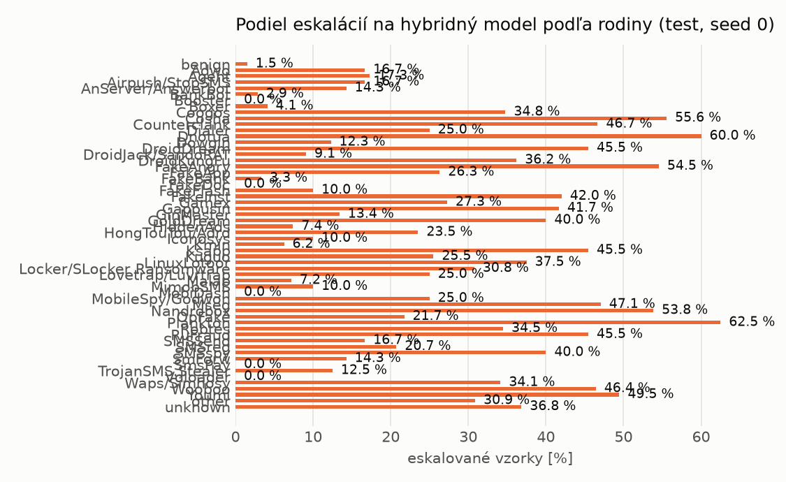

# Kaskáda `baselines` – beh `20261123-185309`

> Generované `src/cascade/evaluate.py` (2026-11-23T18:53:09+01:00). Seedy: [0, 1, 2]; hodnoty = priemer ± sm. odchýlka.
> Všetky prahy sú určené na validácii (FPR ≤ 1 %); test sa na nič nenastavuje.

| rola | beh |
|---|---|
| static | `runs_v4/real_p/lofo/FakeInst/static/lightgbm/20261123-184203` |
| dynamic | `runs_v4/real_p/lofo/FakeInst/dynamic/lightgbm/20261123-184401` |
| hybrid | `runs_v4/real_p/lofo/FakeInst/hybrid/lightgbm/20261123-184633` |

## Test
| prístup | accuracy | balanced_accuracy | precision | recall_tpr | fpr | f1 | mcc |
|---|---|---|---|---|---|---|---|
| kaskáda | 0.9811 ± 0.0005 | 0.9793 ± 0.0006 | 0.9953 ± 0.0012 | 0.9624 ± 0.0017 | 0.0037 ± 0.0009 | 0.9786 ± 0.0006 | 0.9621 ± 0.0010 |
| hybrid (každá vzorka) | 0.9827 ± 0.0008 | 0.9815 ± 0.0008 | 0.9915 ± 0.0014 | 0.9698 ± 0.0006 | 0.0068 ± 0.0011 | 0.9805 ± 0.0009 | 0.9652 ± 0.0017 |
| statický | 0.9674 ± 0.0009 | 0.9645 ± 0.0011 | 0.9902 ± 0.0018 | 0.9366 ± 0.0033 | 0.0075 ± 0.0014 | 0.9626 ± 0.0011 | 0.9349 ± 0.0017 |
| dynamický | 0.9177 ± 0.0010 | 0.9090 ± 0.0012 | 0.9899 ± 0.0005 | 0.8249 ± 0.0027 | 0.0068 ± 0.0004 | 0.8999 ± 0.0014 | 0.8410 ± 0.0018 |
| neskorá fúzia (priemer) | 0.9843 ± 0.0008 | 0.9833 ± 0.0008 | 0.9917 ± 0.0003 | 0.9731 ± 0.0015 | 0.0066 ± 0.0002 | 0.9823 ± 0.0009 | 0.9684 ± 0.0015 |
| neskorá fúzia (stacking) | 0.9844 ± 0.0006 | 0.9833 ± 0.0008 | 0.9930 ± 0.0009 | 0.9721 ± 0.0023 | 0.0055 ± 0.0007 | 0.9825 ± 0.0008 | 0.9686 ± 0.0013 |

## Validácia
| prístup | accuracy | balanced_accuracy | precision | recall_tpr | fpr | f1 | mcc |
|---|---|---|---|---|---|---|---|
| kaskáda | 0.9829 ± 0.0002 | 0.9808 ± 0.0002 | 0.9936 ± 0.0002 | 0.9663 ± 0.0002 | 0.0047 ± 0.0002 | 0.9798 ± 0.0002 | 0.9652 ± 0.0004 |
| hybrid (každá vzorka) | 0.9813 ± 0.0001 | 0.9798 ± 0.0001 | 0.9869 ± 0.0002 | 0.9692 ± 0.0004 | 0.0096 ± 0.0002 | 0.9780 ± 0.0001 | 0.9619 ± 0.0002 |
| statický | 0.9720 ± 0.0011 | 0.9689 ± 0.0013 | 0.9865 ± 0.0000 | 0.9476 ± 0.0026 | 0.0097 ± 0.0000 | 0.9667 ± 0.0014 | 0.9431 ± 0.0022 |
| dynamický | 0.9281 ± 0.0017 | 0.9178 ± 0.0020 | 0.9852 ± 0.0002 | 0.8452 ± 0.0041 | 0.0096 ± 0.0002 | 0.9098 ± 0.0023 | 0.8576 ± 0.0032 |
| neskorá fúzia (priemer) | 0.9843 ± 0.0009 | 0.9833 ± 0.0010 | 0.9870 ± 0.0002 | 0.9762 ± 0.0019 | 0.0096 ± 0.0002 | 0.9816 ± 0.0010 | 0.9679 ± 0.0018 |
| neskorá fúzia (stacking) | 0.9845 ± 0.0003 | 0.9835 ± 0.0004 | 0.9873 ± 0.0004 | 0.9765 ± 0.0011 | 0.0095 ± 0.0003 | 0.9819 ± 0.0004 | 0.9684 ± 0.0007 |

## Správanie kaskády (test, seed 0)
- podiel eskalácií na hybrid: **9.38%** (1187 vzoriek)
- chyby pri zhode študentov (kaskáda ich nemôže opraviť): **139**
  (1.212% zo zhôd; FP 1, FN 138)
- úspešnosť na eskalovaných vzorkách: hybrid 0.9123841617523167, statický 0.7641112047177759,
  dynamický 0.2358887952822241  → prínos hybridu pri nezhode

## Výpočtové nároky (odhad z benchmarkov komponentov)
_Chýba benchmark niektorého komponentu (`python -m src.evaluation.benchmark`)._

