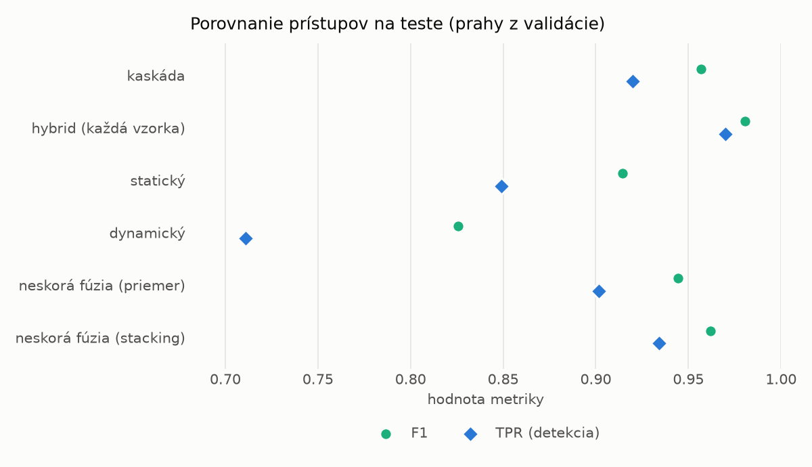
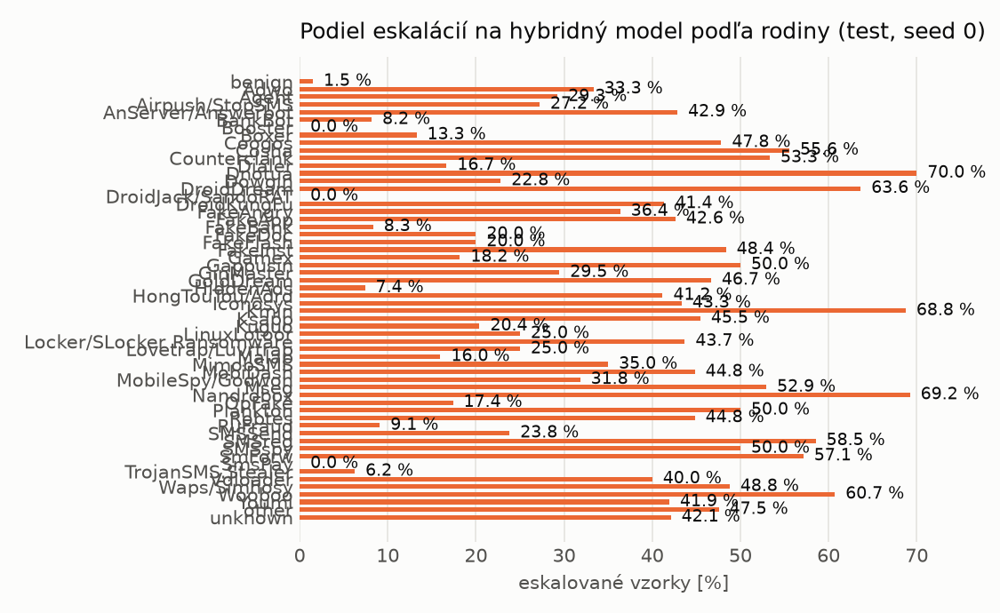

# Kaskáda `heavyteacher` – beh `20261123-185311`

> Generované `src/cascade/evaluate.py` (2026-11-23T18:53:12+01:00). Seedy: [0, 1, 2]; hodnoty = priemer ± sm. odchýlka.
> Všetky prahy sú určené na validácii (FPR ≤ 1 %); test sa na nič nenastavuje.

| rola | beh |
|---|---|
| static | `runs_v4/real_p/lofo/FakeInst/students_static/mlp_kd_heavy/20261123-185053` |
| dynamic | `runs_v4/real_p/lofo/FakeInst/students_dynamic/mlp_kd_heavy/20261123-185240` |
| hybrid | `runs_v4/real_p/lofo/FakeInst/hybrid/lightgbm/20261123-184633` |

## Test
| prístup | accuracy | balanced_accuracy | precision | recall_tpr | fpr | f1 | mcc |
|---|---|---|---|---|---|---|---|
| kaskáda | 0.9629 ± 0.0002 | 0.9589 ± 0.0002 | 0.9971 ± 0.0003 | 0.9199 ± 0.0005 | 0.0022 ± 0.0002 | 0.9569 ± 0.0002 | 0.9267 ± 0.0003 |
| hybrid (každá vzorka) | 0.9827 ± 0.0008 | 0.9815 ± 0.0008 | 0.9915 ± 0.0014 | 0.9698 ± 0.0006 | 0.0068 ± 0.0011 | 0.9805 ± 0.0009 | 0.9652 ± 0.0017 |
| statický | 0.9288 ± 0.0010 | 0.9213 ± 0.0012 | 0.9909 ± 0.0010 | 0.8489 ± 0.0032 | 0.0063 ± 0.0008 | 0.9145 ± 0.0014 | 0.8616 ± 0.0017 |
| dynamický | 0.8653 ± 0.0037 | 0.8508 ± 0.0041 | 0.9841 ± 0.0003 | 0.7110 ± 0.0082 | 0.0094 ± 0.0001 | 0.8255 ± 0.0057 | 0.7457 ± 0.0066 |
| neskorá fúzia (priemer) | 0.9524 ± 0.0018 | 0.9476 ± 0.0021 | 0.9914 ± 0.0014 | 0.9016 ± 0.0052 | 0.0063 ± 0.0011 | 0.9444 ± 0.0023 | 0.9061 ± 0.0033 |
| neskorá fúzia (stacking) | 0.9668 ± 0.0021 | 0.9637 ± 0.0023 | 0.9912 ± 0.0005 | 0.9341 ± 0.0047 | 0.0067 ± 0.0004 | 0.9618 ± 0.0025 | 0.9337 ± 0.0041 |

## Validácia
| prístup | accuracy | balanced_accuracy | precision | recall_tpr | fpr | f1 | mcc |
|---|---|---|---|---|---|---|---|
| kaskáda | 0.9656 ± 0.0012 | 0.9606 ± 0.0015 | 0.9944 ± 0.0005 | 0.9250 ± 0.0031 | 0.0039 ± 0.0003 | 0.9585 ± 0.0016 | 0.9309 ± 0.0024 |
| hybrid (každá vzorka) | 0.9813 ± 0.0001 | 0.9798 ± 0.0001 | 0.9869 ± 0.0002 | 0.9692 ± 0.0004 | 0.0096 ± 0.0002 | 0.9780 ± 0.0001 | 0.9619 ± 0.0002 |
| statický | 0.9266 ± 0.0011 | 0.9161 ± 0.0013 | 0.9848 ± 0.0000 | 0.8419 ± 0.0025 | 0.0097 ± 0.0000 | 0.9078 ± 0.0015 | 0.8546 ± 0.0021 |
| dynamický | 0.8753 ± 0.0009 | 0.8564 ± 0.0010 | 0.9824 ± 0.0000 | 0.7225 ± 0.0020 | 0.0097 ± 0.0000 | 0.8326 ± 0.0013 | 0.7590 ± 0.0016 |
| neskorá fúzia (priemer) | 0.9559 ± 0.0042 | 0.9502 ± 0.0048 | 0.9861 ± 0.0003 | 0.9100 ± 0.0096 | 0.0096 ± 0.0002 | 0.9465 ± 0.0053 | 0.9112 ± 0.0082 |
| neskorá fúzia (stacking) | 0.9682 ± 0.0021 | 0.9645 ± 0.0024 | 0.9866 ± 0.0005 | 0.9386 ± 0.0048 | 0.0096 ± 0.0003 | 0.9620 ± 0.0026 | 0.9356 ± 0.0041 |

## Správanie kaskády (test, seed 0)
- podiel eskalácií na hybrid: **13.95%** (1766 vzoriek)
- chyby pri zhode študentov (kaskáda ich nemôže opraviť): **409**
  (3.756% zo zhôd; FP 1, FN 408)
- úspešnosť na eskalovaných vzorkách: hybrid 0.9665911664779162, statický 0.7168742921857305,
  dynamický 0.28312570781426954  → prínos hybridu pri nezhode

## Výpočtové nároky (odhad z benchmarkov komponentov)
_Chýba benchmark niektorého komponentu (`python -m src.evaluation.benchmark`)._

