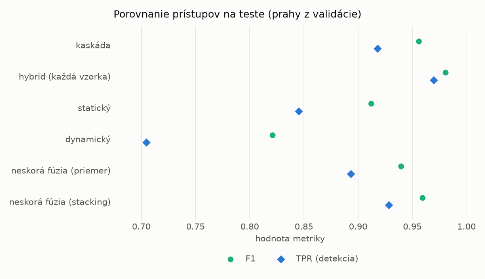
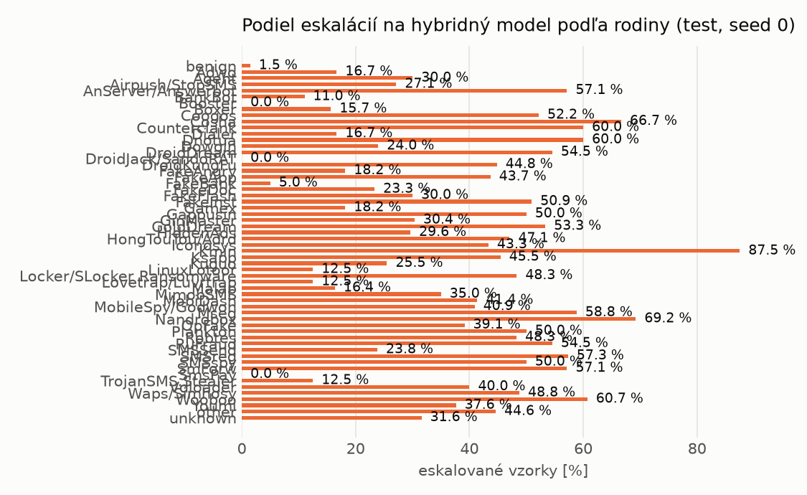

# Kaskáda `main` – beh `20261123-185300`

> Generované `src/cascade/evaluate.py` (2026-11-23T18:53:00+01:00). Seedy: [0, 1, 2]; hodnoty = priemer ± sm. odchýlka.
> Všetky prahy sú určené na validácii (FPR ≤ 1 %); test sa na nič nenastavuje.

| rola | beh |
|---|---|
| static | `runs_v4/real_p/lofo/FakeInst/students_static/mlp_kd/20261123-184951` |
| dynamic | `runs_v4/real_p/lofo/FakeInst/students_dynamic/mlp_kd/20261123-185107` |
| hybrid | `runs_v4/real_p/lofo/FakeInst/hybrid/lightgbm/20261123-184633` |

## Test
| prístup | accuracy | balanced_accuracy | precision | recall_tpr | fpr | f1 | mcc |
|---|---|---|---|---|---|---|---|
| kaskáda | 0.9620 ± 0.0009 | 0.9579 ± 0.0010 | 0.9973 ± 0.0001 | 0.9178 ± 0.0019 | 0.0021 ± 0.0001 | 0.9559 ± 0.0011 | 0.9251 ± 0.0017 |
| hybrid (každá vzorka) | 0.9827 ± 0.0008 | 0.9815 ± 0.0008 | 0.9915 ± 0.0014 | 0.9698 ± 0.0006 | 0.0068 ± 0.0011 | 0.9805 ± 0.0009 | 0.9652 ± 0.0017 |
| statický | 0.9267 ± 0.0012 | 0.9191 ± 0.0014 | 0.9898 ± 0.0008 | 0.8452 ± 0.0033 | 0.0071 ± 0.0006 | 0.9118 ± 0.0016 | 0.8575 ± 0.0021 |
| dynamický | 0.8623 ± 0.0054 | 0.8475 ± 0.0061 | 0.9838 ± 0.0017 | 0.7044 ± 0.0129 | 0.0094 ± 0.0011 | 0.8210 ± 0.0084 | 0.7404 ± 0.0092 |
| neskorá fúzia (priemer) | 0.9486 ± 0.0014 | 0.9434 ± 0.0016 | 0.9911 ± 0.0005 | 0.8934 ± 0.0034 | 0.0065 ± 0.0004 | 0.9397 ± 0.0018 | 0.8988 ± 0.0027 |
| neskorá fúzia (stacking) | 0.9646 ± 0.0011 | 0.9612 ± 0.0012 | 0.9923 ± 0.0006 | 0.9281 ± 0.0029 | 0.0058 ± 0.0005 | 0.9592 ± 0.0013 | 0.9296 ± 0.0020 |

## Validácia
| prístup | accuracy | balanced_accuracy | precision | recall_tpr | fpr | f1 | mcc |
|---|---|---|---|---|---|---|---|
| kaskáda | 0.9662 ± 0.0017 | 0.9613 ± 0.0020 | 0.9944 ± 0.0006 | 0.9264 ± 0.0041 | 0.0039 ± 0.0004 | 0.9592 ± 0.0021 | 0.9321 ± 0.0033 |
| hybrid (každá vzorka) | 0.9813 ± 0.0001 | 0.9798 ± 0.0001 | 0.9869 ± 0.0002 | 0.9692 ± 0.0004 | 0.0096 ± 0.0002 | 0.9780 ± 0.0001 | 0.9619 ± 0.0002 |
| statický | 0.9293 ± 0.0016 | 0.9193 ± 0.0018 | 0.9849 ± 0.0001 | 0.8483 ± 0.0036 | 0.0097 ± 0.0000 | 0.9115 ± 0.0021 | 0.8598 ± 0.0030 |
| dynamický | 0.8752 ± 0.0051 | 0.8562 ± 0.0059 | 0.9824 ± 0.0003 | 0.7222 ± 0.0119 | 0.0097 ± 0.0000 | 0.8324 ± 0.0079 | 0.7588 ± 0.0093 |
| neskorá fúzia (priemer) | 0.9499 ± 0.0021 | 0.9432 ± 0.0025 | 0.9857 ± 0.0001 | 0.8962 ± 0.0050 | 0.0097 ± 0.0000 | 0.9388 ± 0.0028 | 0.8995 ± 0.0042 |
| neskorá fúzia (stacking) | 0.9660 ± 0.0012 | 0.9619 ± 0.0014 | 0.9864 ± 0.0003 | 0.9335 ± 0.0027 | 0.0096 ± 0.0002 | 0.9593 ± 0.0015 | 0.9311 ± 0.0025 |

## Správanie kaskády (test, seed 0)
- podiel eskalácií na hybrid: **14.54%** (1840 vzoriek)
- chyby pri zhode študentov (kaskáda ich nemôže opraviť): **442**
  (4.087% zo zhôd; FP 0, FN 442)
- úspešnosť na eskalovaných vzorkách: hybrid 0.9728260869565217, statický 0.7266304347826087,
  dynamický 0.2733695652173913  → prínos hybridu pri nezhode

## Výpočtové nároky (odhad z benchmarkov komponentov)
_Chýba benchmark niektorého komponentu (`python -m src.evaluation.benchmark`)._

