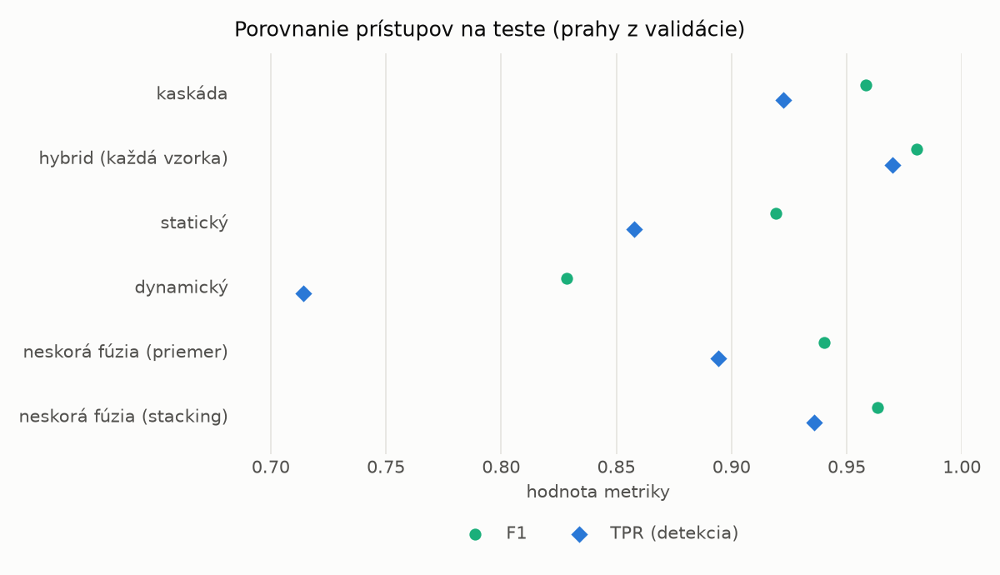
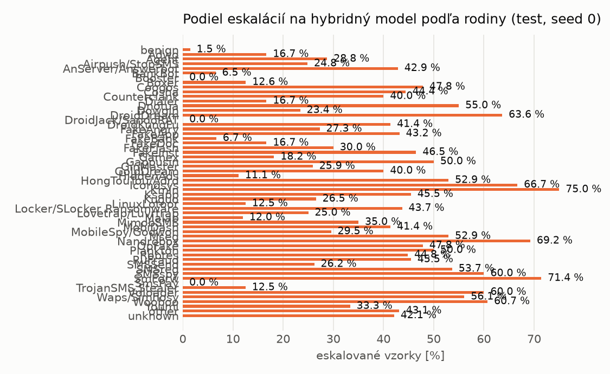

# Kaskáda `modal` – beh `20261123-185304`

> Generované `src/cascade/evaluate.py` (2026-11-23T18:53:05+01:00). Seedy: [0, 1, 2]; hodnoty = priemer ± sm. odchýlka.
> Všetky prahy sú určené na validácii (FPR ≤ 1 %); test sa na nič nenastavuje.

| rola | beh |
|---|---|
| static | `runs_v4/real_p/lofo/FakeInst/students_static/mlp_kd_modal/20261123-185031` |
| dynamic | `runs_v4/real_p/lofo/FakeInst/students_dynamic/mlp_kd_modal/20261123-185207` |
| hybrid | `runs_v4/real_p/lofo/FakeInst/hybrid/lightgbm/20261123-184633` |

## Test
| prístup | accuracy | balanced_accuracy | precision | recall_tpr | fpr | f1 | mcc |
|---|---|---|---|---|---|---|---|
| kaskáda | 0.9641 ± 0.0015 | 0.9602 ± 0.0017 | 0.9973 ± 0.0002 | 0.9224 ± 0.0035 | 0.0020 ± 0.0001 | 0.9584 ± 0.0018 | 0.9291 ± 0.0028 |
| hybrid (každá vzorka) | 0.9827 ± 0.0008 | 0.9815 ± 0.0008 | 0.9915 ± 0.0014 | 0.9698 ± 0.0006 | 0.0068 ± 0.0011 | 0.9805 ± 0.0009 | 0.9652 ± 0.0017 |
| statický | 0.9325 ± 0.0029 | 0.9255 ± 0.0032 | 0.9904 ± 0.0005 | 0.8577 ± 0.0061 | 0.0067 ± 0.0003 | 0.9193 ± 0.0037 | 0.8684 ± 0.0054 |
| dynamický | 0.8674 ± 0.0022 | 0.8530 ± 0.0025 | 0.9863 ± 0.0005 | 0.7141 ± 0.0053 | 0.0081 ± 0.0003 | 0.8284 ± 0.0034 | 0.7500 ± 0.0038 |
| neskorá fúzia (priemer) | 0.9491 ± 0.0040 | 0.9439 ± 0.0045 | 0.9913 ± 0.0009 | 0.8942 ± 0.0093 | 0.0063 ± 0.0007 | 0.9403 ± 0.0049 | 0.8998 ± 0.0075 |
| neskorá fúzia (stacking) | 0.9681 ± 0.0013 | 0.9651 ± 0.0015 | 0.9926 ± 0.0004 | 0.9358 ± 0.0031 | 0.0057 ± 0.0003 | 0.9634 ± 0.0016 | 0.9364 ± 0.0026 |

## Validácia
| prístup | accuracy | balanced_accuracy | precision | recall_tpr | fpr | f1 | mcc |
|---|---|---|---|---|---|---|---|
| kaskáda | 0.9677 ± 0.0026 | 0.9629 ± 0.0030 | 0.9952 ± 0.0005 | 0.9292 ± 0.0057 | 0.0033 ± 0.0003 | 0.9611 ± 0.0033 | 0.9352 ± 0.0052 |
| hybrid (každá vzorka) | 0.9813 ± 0.0001 | 0.9798 ± 0.0001 | 0.9869 ± 0.0002 | 0.9692 ± 0.0004 | 0.0096 ± 0.0002 | 0.9780 ± 0.0001 | 0.9619 ± 0.0002 |
| statický | 0.9358 ± 0.0046 | 0.9268 ± 0.0053 | 0.9853 ± 0.0004 | 0.8633 ± 0.0105 | 0.0096 ± 0.0002 | 0.9203 ± 0.0061 | 0.8723 ± 0.0088 |
| dynamický | 0.8779 ± 0.0030 | 0.8593 ± 0.0035 | 0.9825 ± 0.0002 | 0.7284 ± 0.0071 | 0.0097 ± 0.0000 | 0.8366 ± 0.0047 | 0.7637 ± 0.0056 |
| neskorá fúzia (priemer) | 0.9499 ± 0.0044 | 0.9433 ± 0.0052 | 0.9857 ± 0.0002 | 0.8963 ± 0.0103 | 0.0097 ± 0.0000 | 0.9389 ± 0.0057 | 0.8996 ± 0.0086 |
| neskorá fúzia (stacking) | 0.9686 ± 0.0010 | 0.9650 ± 0.0012 | 0.9864 ± 0.0000 | 0.9398 ± 0.0024 | 0.0097 ± 0.0000 | 0.9625 ± 0.0013 | 0.9363 ± 0.0020 |

## Správanie kaskády (test, seed 0)
- podiel eskalácií na hybrid: **13.38%** (1693 vzoriek)
- chyby pri zhode študentov (kaskáda ich nemôže opraviť): **386**
  (3.521% zo zhôd; FP 1, FN 385)
- úspešnosť na eskalovaných vzorkách: hybrid 0.9716479621972829, statický 0.7477849970466627,
  dynamický 0.25221500295333726  → prínos hybridu pri nezhode

## Výpočtové nároky (odhad z benchmarkov komponentov)
_Chýba benchmark niektorého komponentu (`python -m src.evaluation.benchmark`)._

