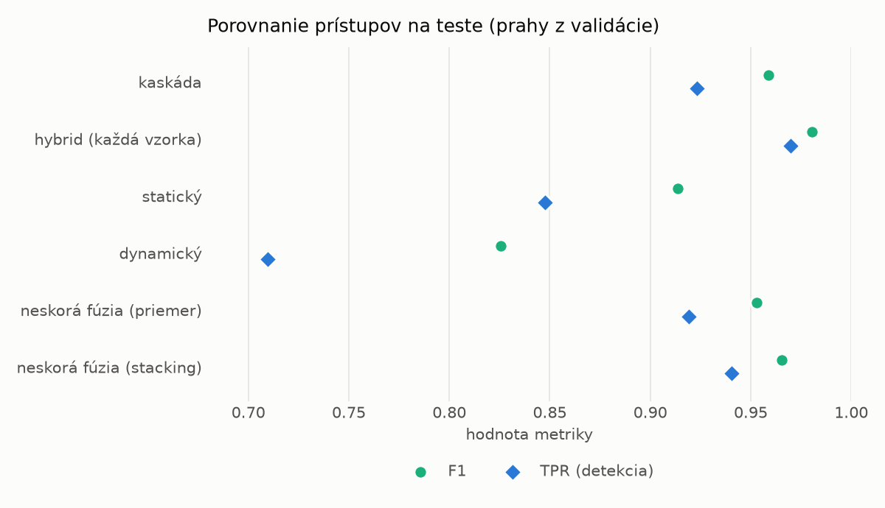
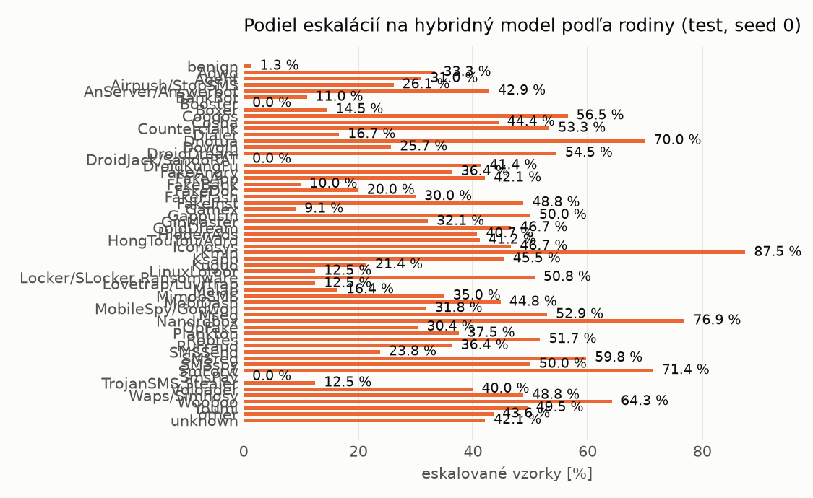

# Kaskáda `nokd` – beh `20261123-185302`

> Generované `src/cascade/evaluate.py` (2026-11-23T18:53:02+01:00). Seedy: [0, 1, 2]; hodnoty = priemer ± sm. odchýlka.
> Všetky prahy sú určené na validácii (FPR ≤ 1 %); test sa na nič nenastavuje.

| rola | beh |
|---|---|
| static | `runs_v4/real_p/lofo/FakeInst/students_static/mlp_nokd/20261123-185007` |
| dynamic | `runs_v4/real_p/lofo/FakeInst/students_dynamic/mlp_nokd/20261123-185126` |
| hybrid | `runs_v4/real_p/lofo/FakeInst/hybrid/lightgbm/20261123-184633` |

## Test
| prístup | accuracy | balanced_accuracy | precision | recall_tpr | fpr | f1 | mcc |
|---|---|---|---|---|---|---|---|
| kaskáda | 0.9644 ± 0.0005 | 0.9605 ± 0.0007 | 0.9971 ± 0.0006 | 0.9231 ± 0.0017 | 0.0021 ± 0.0004 | 0.9587 ± 0.0007 | 0.9296 ± 0.0010 |
| hybrid (každá vzorka) | 0.9827 ± 0.0008 | 0.9815 ± 0.0008 | 0.9915 ± 0.0014 | 0.9698 ± 0.0006 | 0.0068 ± 0.0011 | 0.9805 ± 0.0009 | 0.9652 ± 0.0017 |
| statický | 0.9282 ± 0.0029 | 0.9206 ± 0.0034 | 0.9908 ± 0.0015 | 0.8476 ± 0.0076 | 0.0064 ± 0.0011 | 0.9136 ± 0.0039 | 0.8604 ± 0.0052 |
| dynamický | 0.8656 ± 0.0023 | 0.8510 ± 0.0026 | 0.9869 ± 0.0012 | 0.7096 ± 0.0060 | 0.0076 ± 0.0008 | 0.8256 ± 0.0037 | 0.7469 ± 0.0037 |
| neskorá fúzia (priemer) | 0.9594 ± 0.0034 | 0.9556 ± 0.0038 | 0.9895 ± 0.0011 | 0.9192 ± 0.0076 | 0.0079 ± 0.0008 | 0.9530 ± 0.0041 | 0.9193 ± 0.0066 |
| neskorá fúzia (stacking) | 0.9698 ± 0.0015 | 0.9671 ± 0.0017 | 0.9916 ± 0.0006 | 0.9406 ± 0.0034 | 0.0065 ± 0.0004 | 0.9654 ± 0.0018 | 0.9397 ± 0.0029 |

## Validácia
| prístup | accuracy | balanced_accuracy | precision | recall_tpr | fpr | f1 | mcc |
|---|---|---|---|---|---|---|---|
| kaskáda | 0.9683 ± 0.0007 | 0.9637 ± 0.0007 | 0.9939 ± 0.0007 | 0.9318 ± 0.0010 | 0.0043 ± 0.0005 | 0.9618 ± 0.0009 | 0.9361 ± 0.0015 |
| hybrid (každá vzorka) | 0.9813 ± 0.0001 | 0.9798 ± 0.0001 | 0.9869 ± 0.0002 | 0.9692 ± 0.0004 | 0.0096 ± 0.0002 | 0.9780 ± 0.0001 | 0.9619 ± 0.0002 |
| statický | 0.9299 ± 0.0004 | 0.9199 ± 0.0005 | 0.9851 ± 0.0002 | 0.8494 ± 0.0010 | 0.0096 ± 0.0002 | 0.9122 ± 0.0005 | 0.8609 ± 0.0007 |
| dynamický | 0.8779 ± 0.0030 | 0.8594 ± 0.0035 | 0.9825 ± 0.0002 | 0.7286 ± 0.0070 | 0.0097 ± 0.0000 | 0.8367 ± 0.0047 | 0.7638 ± 0.0055 |
| neskorá fúzia (priemer) | 0.9641 ± 0.0039 | 0.9598 ± 0.0045 | 0.9862 ± 0.0001 | 0.9293 ± 0.0091 | 0.0097 ± 0.0000 | 0.9569 ± 0.0049 | 0.9274 ± 0.0077 |
| neskorá fúzia (stacking) | 0.9712 ± 0.0023 | 0.9680 ± 0.0027 | 0.9866 ± 0.0003 | 0.9457 ± 0.0053 | 0.0096 ± 0.0002 | 0.9657 ± 0.0029 | 0.9416 ± 0.0046 |

## Správanie kaskády (test, seed 0)
- podiel eskalácií na hybrid: **14.39%** (1821 vzoriek)
- chyby pri zhode študentov (kaskáda ich nemôže opraviť): **392**
  (3.618% zo zhôd; FP 0, FN 392)
- úspešnosť na eskalovaných vzorkách: hybrid 0.9697968149368479, statický 0.7320153761669412,
  dynamický 0.26798462383305877  → prínos hybridu pri nezhode

## Výpočtové nároky (odhad z benchmarkov komponentov)
_Chýba benchmark niektorého komponentu (`python -m src.evaluation.benchmark`)._

