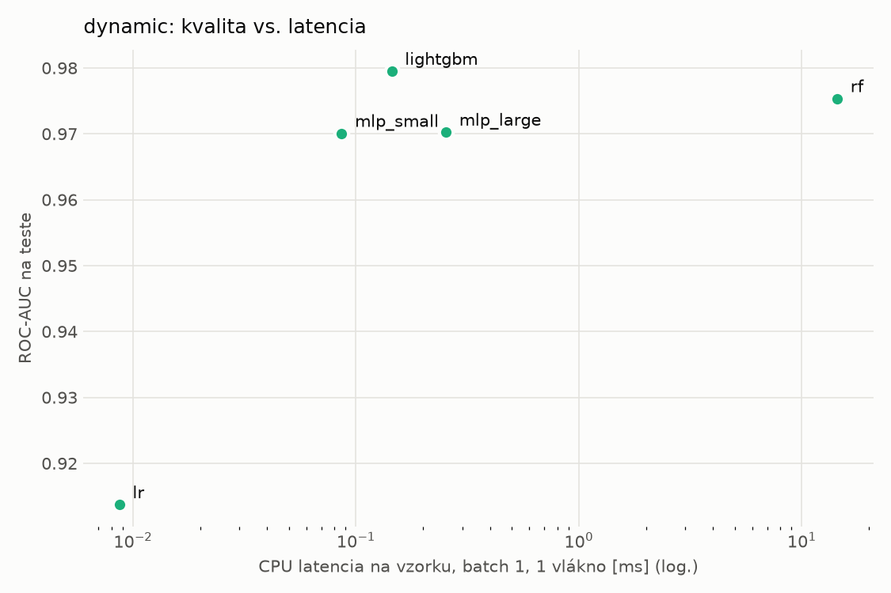
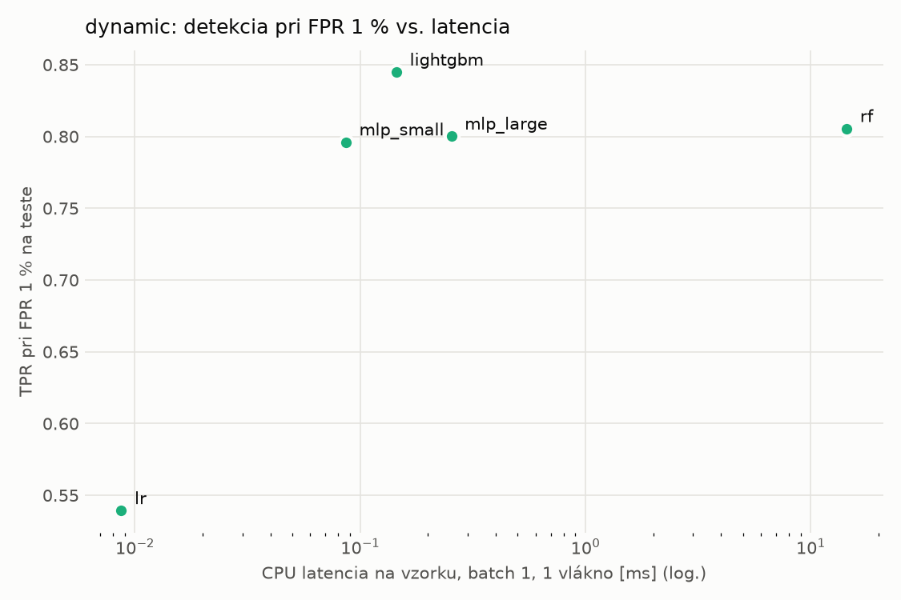
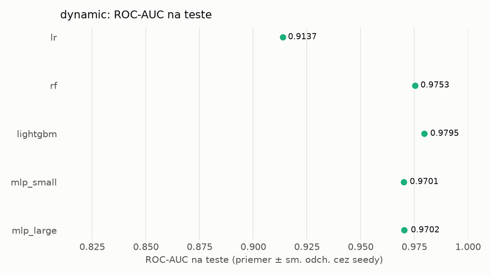
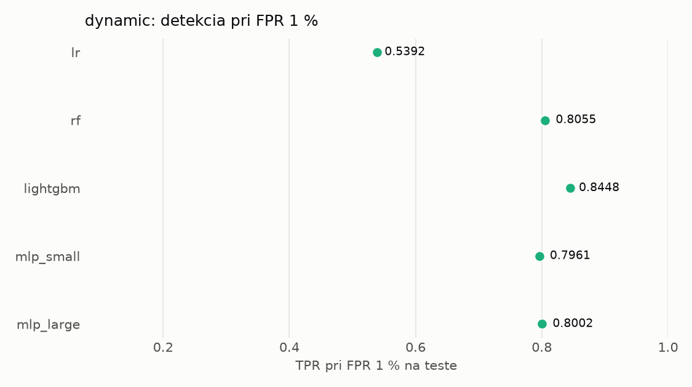

# Porovnanie modelov – dynamic

> Generované `src/evaluation/compare.py` (2026-11-23T18:46:12+01:00); použitý je posledný beh každého modelu.
> Metriky sú priemer cez seedy. \* = pri prahu určenom na validácii (FPR ≤ 1 %).
> CPU ms/vz. = medián latencie jednej vzorky na 1 vlákne vrátane transformácie vstupu (meranie hneď po tréningu,
> orientačné). Oficiálne merania spotreby sú v časti „Spotreba zdrojov pri inferencii“.

## Detekčná kvalita a orientačné časy
| model | ROC-AUC val | ROC-AUC test | TPR@FPR 1 % test | TPR@FPR 0,1 % test | F1 test* | FPR test* | gap train−val | CPU ms/vz. | CPU vz./s | GPU ms/vz. | parametre | MB | tréning s | ladenie min |
|---|---|---|---|---|---|---|---|---|---|---|---|---|---|---|
| [lr](../../dynamic/lr/20261123-184342/README.md) | 0.9126 | 0.9137 ± 0.0000 | 0.5392 | 0.3878 | 0.6834 | 0.0083 | 0.0083 | 0.009 | 3 873 772 | – | 124 | 0.01 | 0.3 | 0.0 |
| [rf](../../dynamic/rf/20261123-184344/README.md) | 0.9749 | 0.9753 ± 0.0001 | 0.8055 | 0.7181 | 0.8852 | 0.0076 | 0.0239 | 14.428 | 111 390 | – | 3 201 346 | 256.48 | 2.4 | 0.0 |
| [lightgbm](../../dynamic/lightgbm/20261123-184401/README.md) | 0.9812 | 0.9795 ± 0.0004 | 0.8448 | 0.7468 | 0.8999 | 0.0068 | 0.0181 | 0.145 | 98 011 | – | 285 534 | 15.69 | 11.8 | 0.0 |
| [mlp_small](../../dynamic/mlp_small/20261123-184446/README.md) | 0.9728 | 0.9701 ± 0.0003 | 0.7961 | 0.6393 | 0.8603 | 0.0068 | 0.0152 | 0.086 | 2 406 770 | 0.397 | 65 537 | 0.27 | 19.3 | 0.0 |
| [mlp_large](../../dynamic/mlp_large/20261123-184545/README.md) | 0.9733 | 0.9702 ± 0.0006 | 0.8002 | 0.6314 | 0.8679 | 0.0070 | 0.0150 | 0.254 | 360 454 | 0.601 | 1 119 745 | 4.51 | 7.9 | 0.0 |

## Nízka prevalencia malvéru (test, prah z validácie)
| model | TPR | FPR | precision @ 1 % | falošné na 1 skutočný poplach @ 1 % | precision @ 0.1 % | falošné na 1 skutočný poplach @ 0.1 % |
|---|---|---|---|---|---|---|
| lr | 0.5244 | 0.0083 | 0.389 | 1.57 | 0.059 | 15.82 |
| rf | 0.8016 | 0.0076 | 0.515 | 0.94 | 0.095 | 9.52 |
| lightgbm | 0.8249 | 0.0068 | 0.550 | 0.82 | 0.108 | 8.27 |
| mlp_small | 0.7613 | 0.0068 | 0.531 | 0.88 | 0.101 | 8.90 |
| mlp_large | 0.7733 | 0.0070 | 0.527 | 0.90 | 0.099 | 9.07 |

Prepočet: TPR a FPR nezávisia od podielu malvéru, preto sa dajú preniesť na nízku prevalenciu (v reálnej prevádzke je malvéru ~1 % alebo menej; v teste 54 %). „Falošné na 1 skutočný poplach“ = koľko neškodných súborov je označených na každý zachytený malvér.

## Spotreba zdrojov pri inferencii (benchmark, testovacia množina)
_Benchmark zatiaľ nebol spustený (`python -m src.evaluation.benchmark --approach dynamic`)._

## Grafy

