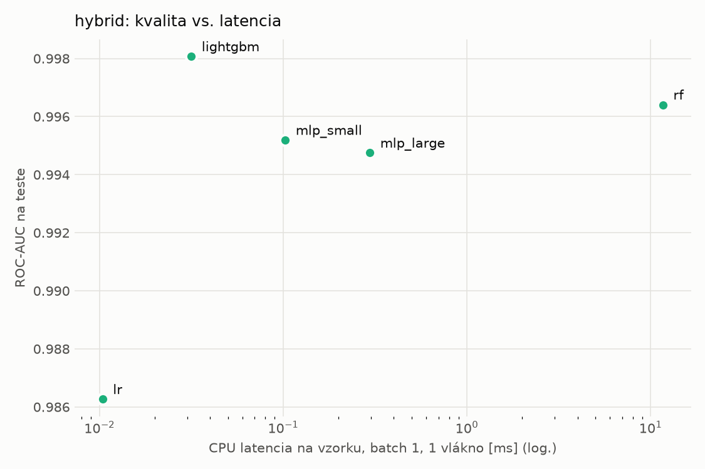
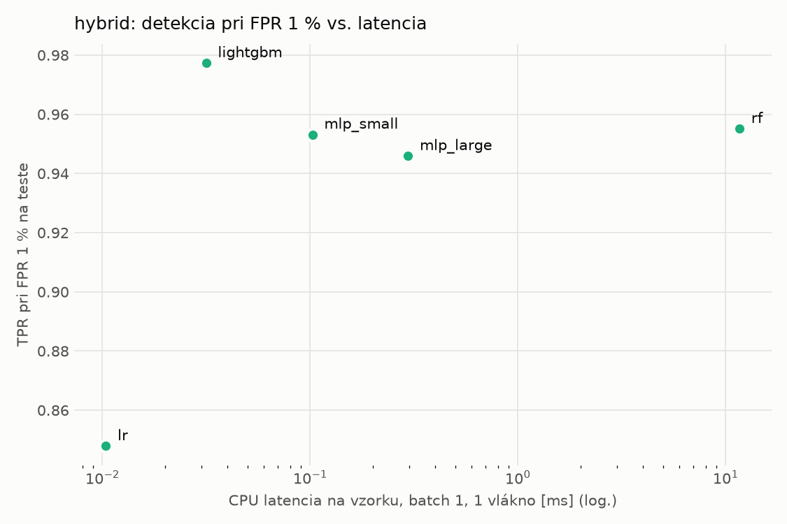
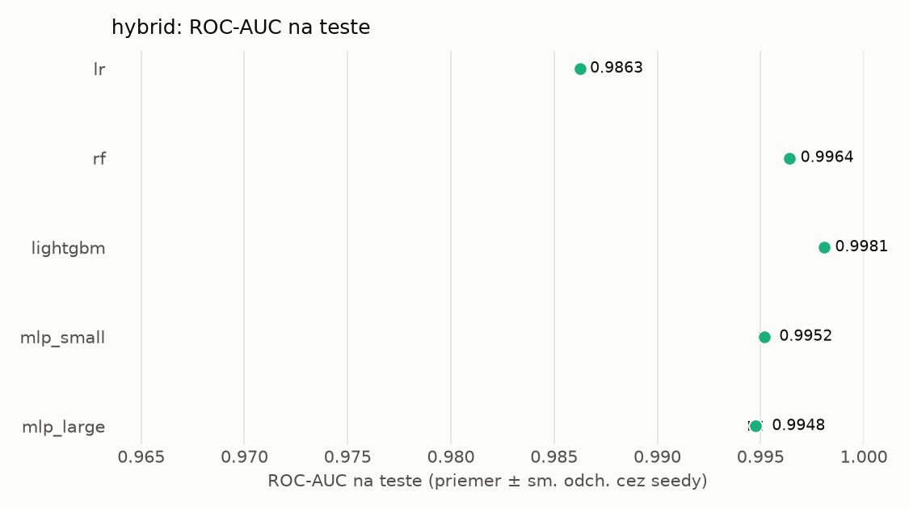
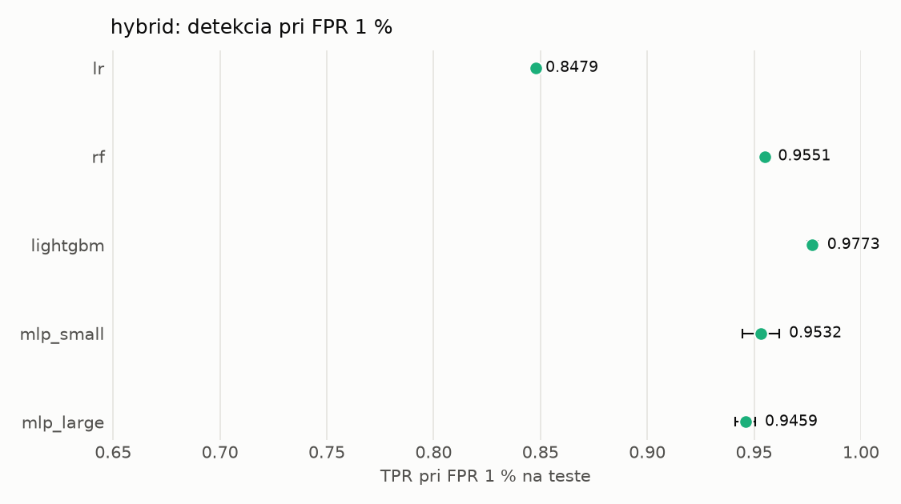

# Porovnanie modelov – hybrid

> Generované `src/evaluation/compare.py` (2026-11-23T18:47:14+01:00); použitý je posledný beh každého modelu.
> Metriky sú priemer cez seedy. \* = pri prahu určenom na validácii (FPR ≤ 1 %).
> CPU ms/vz. = medián latencie jednej vzorky na 1 vlákne vrátane transformácie vstupu (meranie hneď po tréningu,
> orientačné). Oficiálne merania spotreby sú v časti „Spotreba zdrojov pri inferencii“.

## Detekčná kvalita a orientačné časy
| model | ROC-AUC val | ROC-AUC test | TPR@FPR 1 % test | TPR@FPR 0,1 % test | F1 test* | FPR test* | gap train−val | CPU ms/vz. | CPU vz./s | GPU ms/vz. | parametre | MB | tréning s | ladenie min |
|---|---|---|---|---|---|---|---|---|---|---|---|---|---|---|
| [lr](../../hybrid/lr/20261123-184615/README.md) | 0.9835 | 0.9863 ± 0.0000 | 0.8479 | 0.5923 | 0.9023 | 0.0067 | 0.0039 | 0.010 | 2 298 083 | – | 287 | 0.01 | 0.2 | 0.0 |
| [rf](../../hybrid/rf/20261123-184617/README.md) | 0.9952 | 0.9964 ± 0.0001 | 0.9551 | 0.8847 | 0.9666 | 0.0063 | 0.0048 | 11.667 | 134 852 | – | 1 849 376 | 148.28 | 2.4 | 0.0 |
| [lightgbm](../../hybrid/lightgbm/20261123-184633/README.md) | 0.9967 | 0.9981 ± 0.0001 | 0.9773 | 0.9184 | 0.9805 | 0.0068 | 0.0033 | 0.032 | 626 817 | – | 31 017 | 1.73 | 4.0 | 0.0 |
| [mlp_small](../../hybrid/mlp_small/20261123-184647/README.md) | 0.9941 | 0.9952 ± 0.0002 | 0.9532 | 0.8465 | 0.9661 | 0.0074 | 0.0044 | 0.103 | 1 295 513 | 0.535 | 107 265 | 0.45 | 1.5 | 0.0 |
| [mlp_large](../../hybrid/mlp_large/20261123-184654/README.md) | 0.9941 | 0.9948 ± 0.0003 | 0.9459 | 0.8371 | 0.9648 | 0.0088 | 0.0044 | 0.296 | 119 688 | 0.426 | 2 400 257 | 9.64 | 5.6 | 0.0 |

## Nízka prevalencia malvéru (test, prah z validácie)
| model | TPR | FPR | precision @ 1 % | falošné na 1 skutočný poplach @ 1 % | precision @ 0.1 % | falošné na 1 skutočný poplach @ 0.1 % |
|---|---|---|---|---|---|---|
| lr | 0.8288 | 0.0067 | 0.554 | 0.80 | 0.110 | 8.11 |
| rf | 0.9426 | 0.0063 | 0.602 | 0.66 | 0.130 | 6.68 |
| lightgbm | 0.9698 | 0.0068 | 0.591 | 0.69 | 0.125 | 6.98 |
| mlp_small | 0.9430 | 0.0074 | 0.561 | 0.78 | 0.113 | 7.89 |
| mlp_large | 0.9420 | 0.0088 | 0.520 | 0.92 | 0.097 | 9.31 |

Prepočet: TPR a FPR nezávisia od podielu malvéru, preto sa dajú preniesť na nízku prevalenciu (v reálnej prevádzke je malvéru ~1 % alebo menej; v teste 54 %). „Falošné na 1 skutočný poplach“ = koľko neškodných súborov je označených na každý zachytený malvér.

## Spotreba zdrojov pri inferencii (benchmark, testovacia množina)
_Benchmark zatiaľ nebol spustený (`python -m src.evaluation.benchmark --approach hybrid`)._

## Grafy

