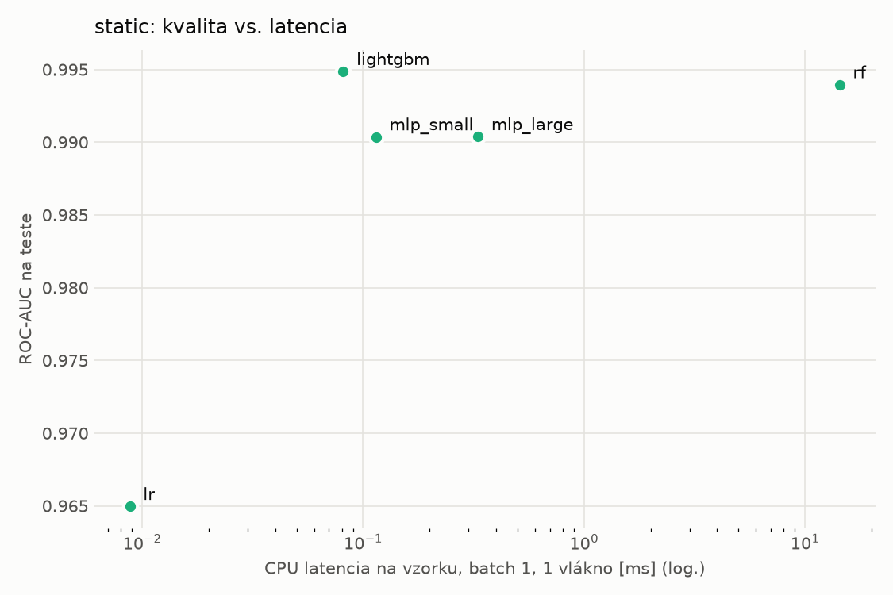
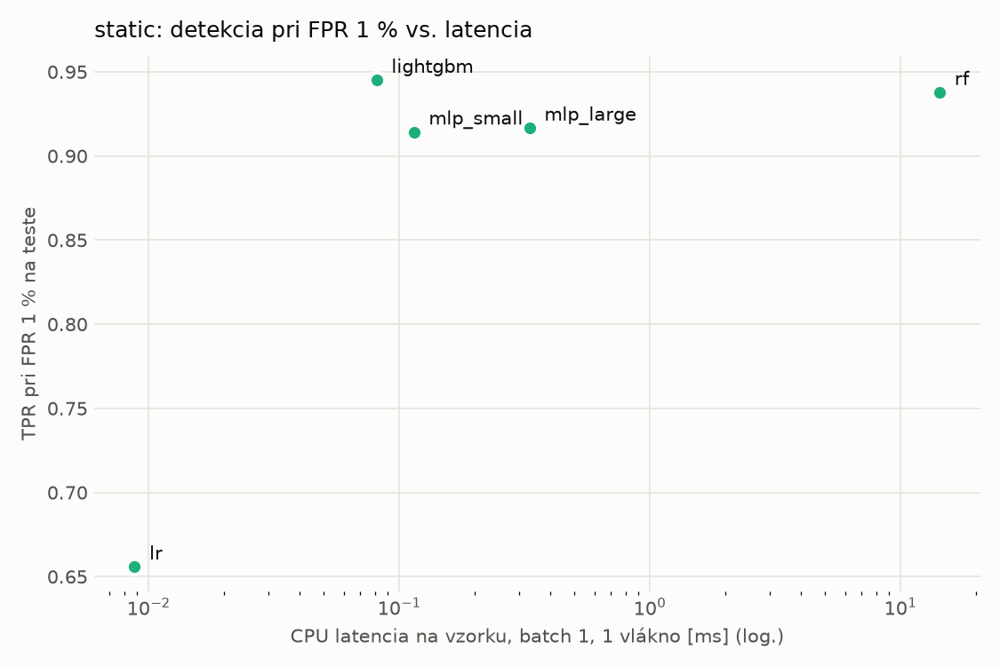
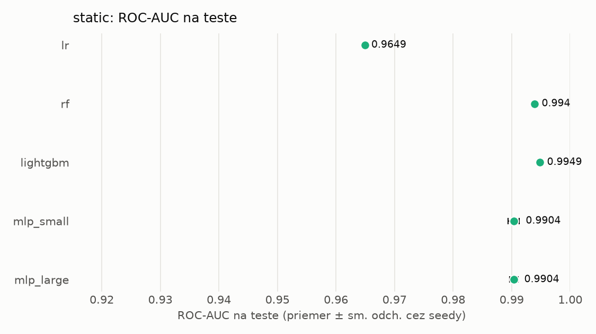
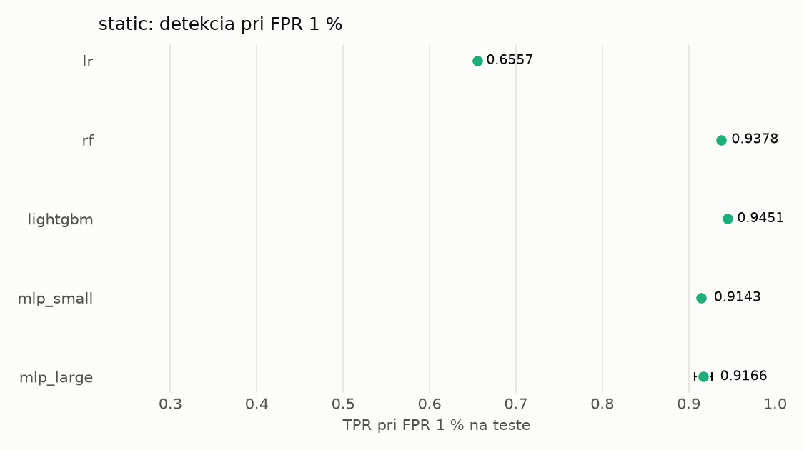

# Porovnanie modelov – static

> Generované `src/evaluation/compare.py` (2026-11-23T18:43:39+01:00); použitý je posledný beh každého modelu.
> Metriky sú priemer cez seedy. \* = pri prahu určenom na validácii (FPR ≤ 1 %).
> CPU ms/vz. = medián latencie jednej vzorky na 1 vlákne vrátane transformácie vstupu (meranie hneď po tréningu,
> orientačné). Oficiálne merania spotreby sú v časti „Spotreba zdrojov pri inferencii“.

## Detekčná kvalita a orientačné časy
| model | ROC-AUC val | ROC-AUC test | TPR@FPR 1 % test | TPR@FPR 0,1 % test | F1 test* | FPR test* | gap train−val | CPU ms/vz. | CPU vz./s | GPU ms/vz. | parametre | MB | tréning s | ladenie min |
|---|---|---|---|---|---|---|---|---|---|---|---|---|---|---|
| [lr](../../static/lr/20261123-184147/README.md) | 0.9617 | 0.9649 ± 0.0000 | 0.6557 | 0.1576 | 0.7543 | 0.0084 | 0.0039 | 0.009 | 3 389 939 | – | 164 | 0.01 | 0.1 | 0.0 |
| [rf](../../static/rf/20261123-184149/README.md) | 0.9931 | 0.9940 ± 0.0001 | 0.9378 | 0.8326 | 0.9540 | 0.0072 | 0.0069 | 14.338 | 113 048 | – | 2 992 084 | 239.74 | 1.5 | 0.0 |
| [lightgbm](../../static/lightgbm/20261123-184203/README.md) | 0.9940 | 0.9949 ± 0.0001 | 0.9451 | 0.8626 | 0.9626 | 0.0075 | 0.0060 | 0.081 | 159 528 | – | 206 449 | 11.47 | 7.6 | 0.0 |
| [mlp_small](../../static/mlp_small/20261123-184236/README.md) | 0.9903 | 0.9904 ± 0.0010 | 0.9143 | 0.6851 | 0.9422 | 0.0077 | 0.0062 | 0.115 | 2 138 344 | 0.646 | 75 777 | 0.32 | 8.8 | 0.0 |
| [mlp_large](../../static/mlp_large/20261123-184304/README.md) | 0.9902 | 0.9904 ± 0.0007 | 0.9166 | 0.6622 | 0.9396 | 0.0058 | 0.0073 | 0.331 | 101 865 | 0.523 | 2 966 529 | 11.91 | 10.5 | 0.0 |

## Nízka prevalencia malvéru (test, prah z validácie)
| model | TPR | FPR | precision @ 1 % | falošné na 1 skutočný poplach @ 1 % | precision @ 0.1 % | falošné na 1 skutočný poplach @ 0.1 % |
|---|---|---|---|---|---|---|
| lr | 0.6118 | 0.0084 | 0.422 | 1.37 | 0.068 | 13.80 |
| rf | 0.9200 | 0.0072 | 0.565 | 0.77 | 0.114 | 7.77 |
| lightgbm | 0.9366 | 0.0075 | 0.556 | 0.80 | 0.111 | 8.04 |
| mlp_small | 0.8991 | 0.0077 | 0.542 | 0.85 | 0.105 | 8.54 |
| mlp_large | 0.8925 | 0.0058 | 0.609 | 0.64 | 0.134 | 6.47 |

Prepočet: TPR a FPR nezávisia od podielu malvéru, preto sa dajú preniesť na nízku prevalenciu (v reálnej prevádzke je malvéru ~1 % alebo menej; v teste 54 %). „Falošné na 1 skutočný poplach“ = koľko neškodných súborov je označených na každý zachytený malvér.

## Spotreba zdrojov pri inferencii (benchmark, testovacia množina)
_Benchmark zatiaľ nebol spustený (`python -m src.evaluation.benchmark --approach static`)._

## Grafy

