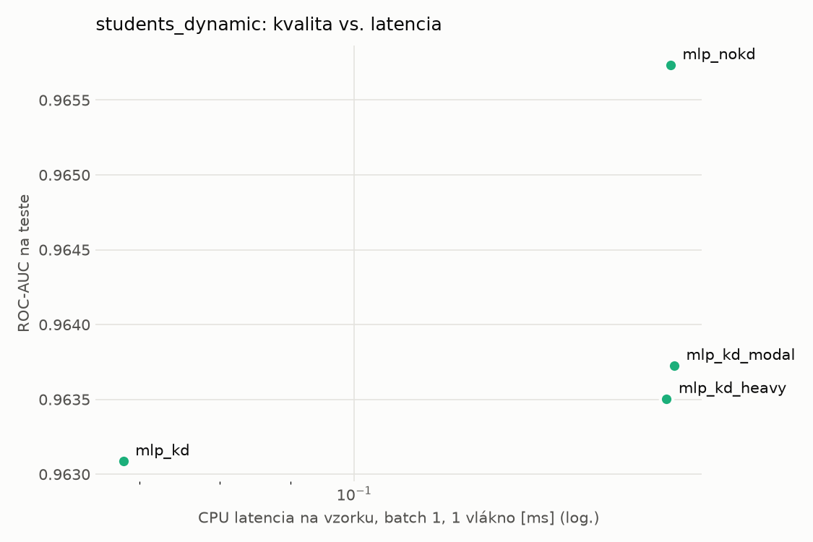
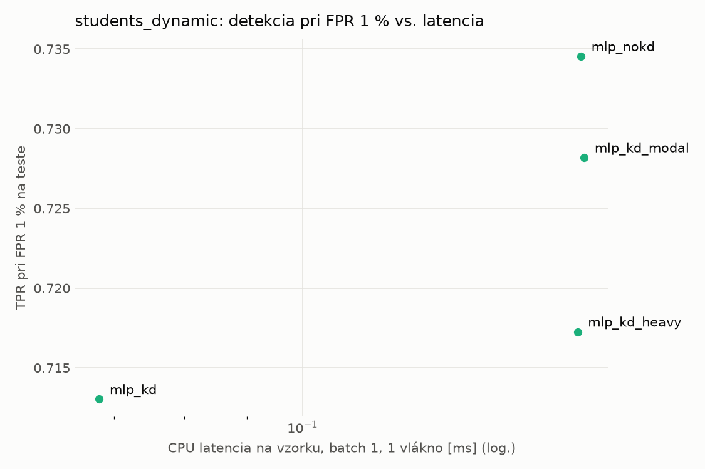
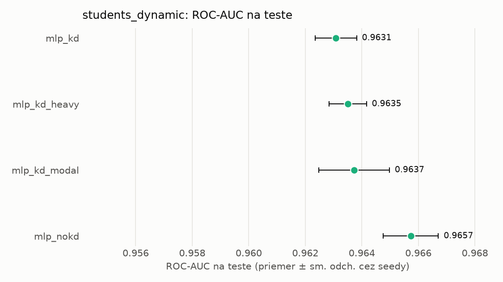
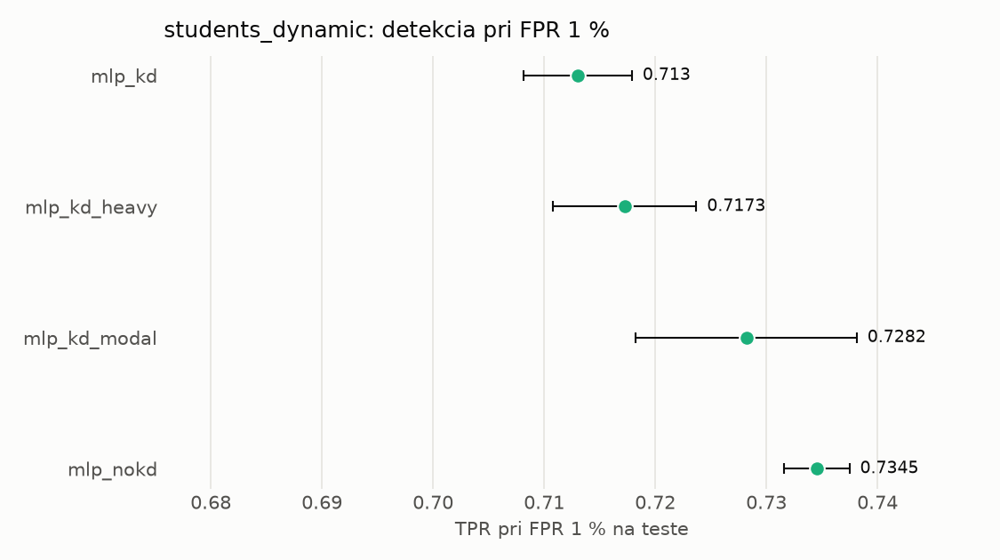

# Porovnanie modelov – students_dynamic

> Generované `src/evaluation/compare.py` (2026-11-23T18:52:57+01:00); použitý je posledný beh každého modelu.
> Metriky sú priemer cez seedy. \* = pri prahu určenom na validácii (FPR ≤ 1 %).
> CPU ms/vz. = medián latencie jednej vzorky na 1 vlákne vrátane transformácie vstupu (meranie hneď po tréningu,
> orientačné). Oficiálne merania spotreby sú v časti „Spotreba zdrojov pri inferencii“.

## Detekčná kvalita a orientačné časy
| model | ROC-AUC val | ROC-AUC test | TPR@FPR 1 % test | TPR@FPR 0,1 % test | F1 test* | FPR test* | gap train−val | CPU ms/vz. | CPU vz./s | GPU ms/vz. | parametre | MB | tréning s | ladenie min |
|---|---|---|---|---|---|---|---|---|---|---|---|---|---|---|
| [mlp_kd](../../students_dynamic/mlp_kd/20261123-185107/README.md) | 0.9635 | 0.9631 ± 0.0007 | 0.7130 | 0.5070 | 0.8210 | 0.0094 | 0.0105 | 0.068 | 6 631 038 | 0.259 | 8 129 | 0.04 | 5.7 | 0.0 |
| [mlp_kd_heavy](../../students_dynamic/mlp_kd_heavy/20261123-185240/README.md) | 0.9644 | 0.9635 ± 0.0007 | 0.7173 | 0.4991 | 0.8255 | 0.0094 | 0.0111 | 0.168 | 4 626 238 | 0.481 | 8 129 | 0.04 | 5.0 | 0.0 |
| [mlp_kd_modal](../../students_dynamic/mlp_kd_modal/20261123-185207/README.md) | 0.9646 | 0.9637 ± 0.0013 | 0.7282 | 0.5170 | 0.8284 | 0.0081 | 0.0072 | 0.170 | 5 235 160 | 0.479 | 8 129 | 0.04 | 10.4 | 0.0 |
| [mlp_nokd](../../students_dynamic/mlp_nokd/20261123-185126/README.md) | 0.9671 | 0.9657 ± 0.0010 | 0.7345 | 0.4956 | 0.8256 | 0.0076 | 0.0117 | 0.169 | 4 933 536 | 0.459 | 8 129 | 0.04 | 13.0 | 0.0 |

## Nízka prevalencia malvéru (test, prah z validácie)
| model | TPR | FPR | precision @ 1 % | falošné na 1 skutočný poplach @ 1 % | precision @ 0.1 % | falošné na 1 skutočný poplach @ 0.1 % |
|---|---|---|---|---|---|---|
| mlp_kd | 0.7044 | 0.0094 | 0.431 | 1.32 | 0.070 | 13.34 |
| mlp_kd_heavy | 0.7110 | 0.0094 | 0.434 | 1.30 | 0.071 | 13.15 |
| mlp_kd_modal | 0.7141 | 0.0081 | 0.472 | 1.12 | 0.081 | 11.29 |
| mlp_nokd | 0.7096 | 0.0076 | 0.484 | 1.07 | 0.085 | 10.75 |

Prepočet: TPR a FPR nezávisia od podielu malvéru, preto sa dajú preniesť na nízku prevalenciu (v reálnej prevádzke je malvéru ~1 % alebo menej; v teste 54 %). „Falošné na 1 skutočný poplach“ = koľko neškodných súborov je označených na každý zachytený malvér.

## Spotreba zdrojov pri inferencii (benchmark, testovacia množina)
_Benchmark zatiaľ nebol spustený (`python -m src.evaluation.benchmark --approach students_dynamic`)._

## Grafy

