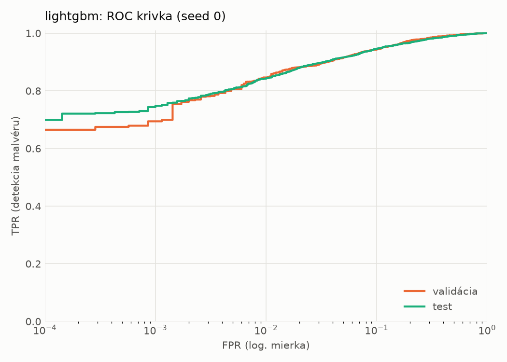
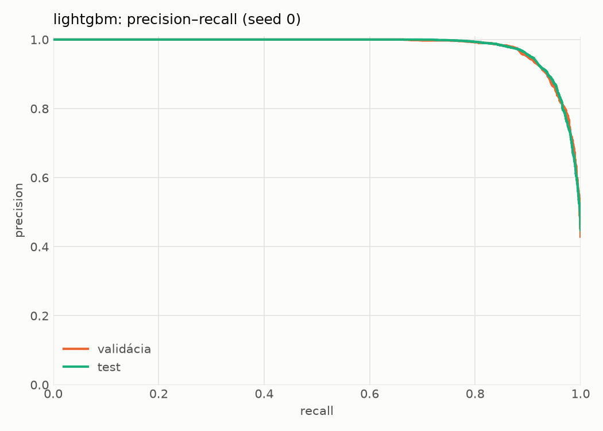
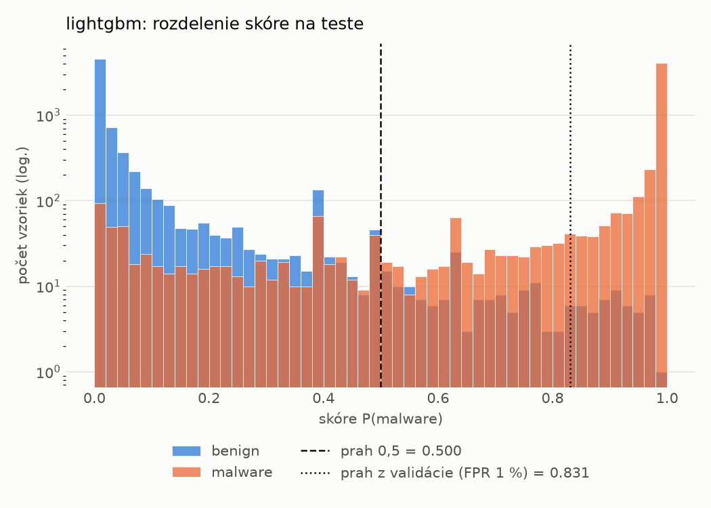
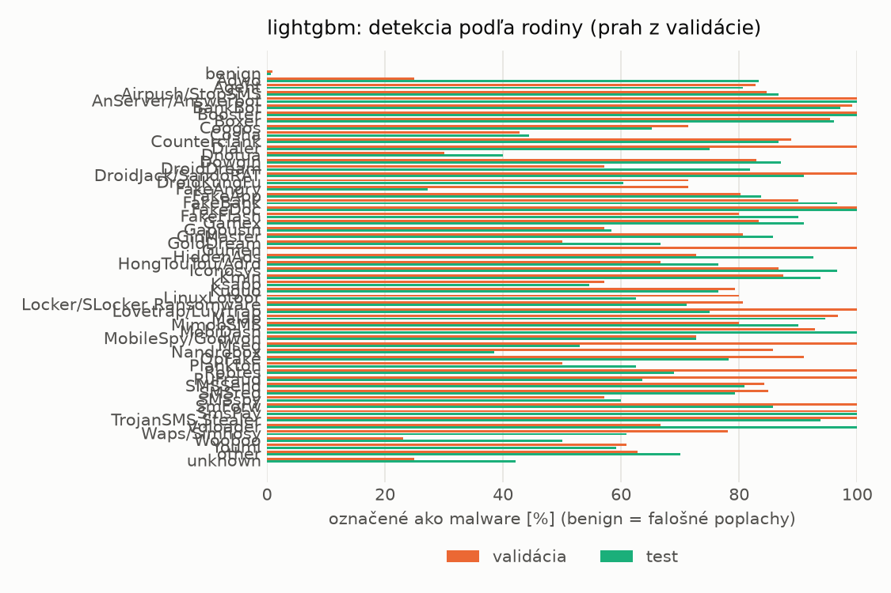
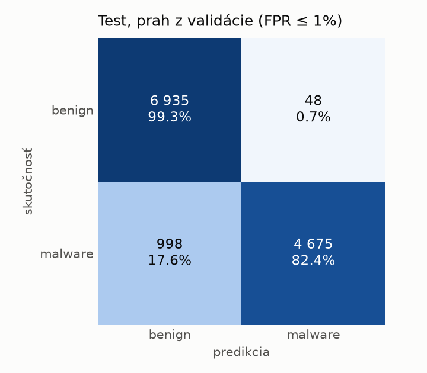
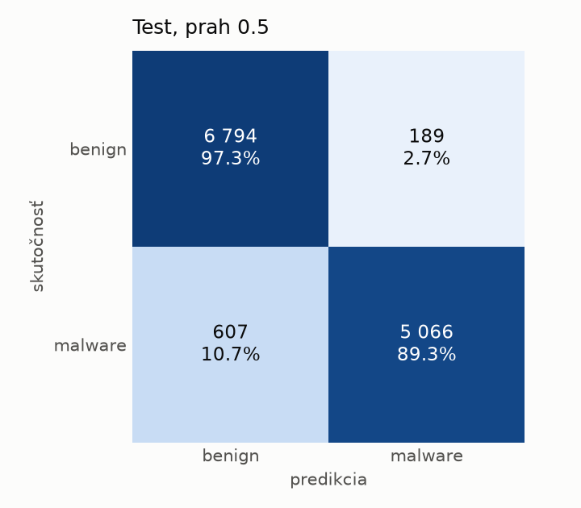
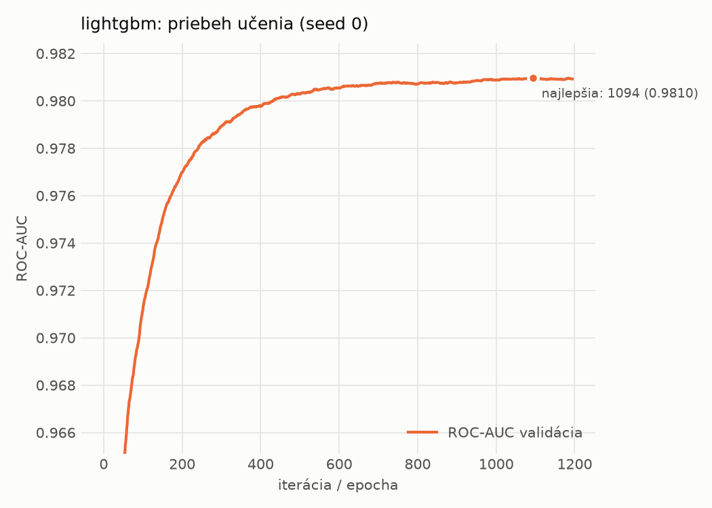

# dynamic/lightgbm – beh `20261123-184401`

> Automaticky generované (`src/training/run_tabular.py`). Konfigurácia: `config.yaml`, protokol: `protocol.yaml`.

- **Model:** `lightgbm` – LightGBM, gradient boosting stromov s early stopping na validácii (pôvodné hodnoty príznakov)
- **Ladenie:** bez ladenia – hyperparametre prevzaté z `runs_v4/real_p/full/dynamic/lightgbm/20261122-233440`
- **Finálne modely:** seedy [0, 1, 2]; hodnoty sú priemer ± smerodajná odchýlka cez seedy
- **Najlepšie hyperparametre:** `{"num_boost_round": 5000, "early_stopping_rounds": 100, "learning_rate": 0.027489744122517933, "num_leaves": 131, "min_child_samples": 30, "feature_fraction": 0.6013521321216351, "bagging_fraction": 0.9615246014341245, "lambda_l1": 3.231327066876444e-06, "lambda_l2": 0.000134433136248308}`

## Detekčná kvalita (bez prahu)
| metrika | train (podvzorka) | validácia | test |
|---|---|---|---|
| ROC-AUC | 0.9993 ± 0.0003 | 0.9812 ± 0.0003 | 0.9795 ± 0.0004 |
| PR-AUC | 0.9989 ± 0.0003 | 0.9804 ± 0.0001 | 0.9807 ± 0.0003 |
| TPR pri FPR 1 % | 0.9720 ± 0.0062 | 0.8452 ± 0.0041 | 0.8448 ± 0.0022 |
| TPR pri FPR 0,1 % | 0.9628 ± 0.0038 | 0.6916 ± 0.0050 | 0.7468 ± 0.0059 |
| log loss | 0.0456 ± 0.0089 | 0.1634 ± 0.0024 | 0.1707 ± 0.0041 |
| Brier skóre | 0.0110 ± 0.0019 | 0.0470 ± 0.0002 | 0.0481 ± 0.0006 |

Rozdiel ROC-AUC train − validácia: **0.0181** (veľký rozdiel = preučenie).

## Pri prahu z validácie (FPR ≤ 1% na validácii)
| metrika | train (podvzorka) | validácia | test |
|---|---|---|---|
| accuracy | 0.9788 ± 0.0033 | 0.9281 ± 0.0017 | 0.9177 ± 0.0010 |
| balanced accuracy | 0.9748 ± 0.0039 | 0.9178 ± 0.0020 | 0.9090 ± 0.0012 |
| precision | 1.0000 ± 0.0000 | 0.9852 ± 0.0002 | 0.9899 ± 0.0005 |
| recall (TPR) | 0.9496 ± 0.0078 | 0.8452 ± 0.0041 | 0.8249 ± 0.0027 |
| FPR | 0.0000 ± 0.0000 | 0.0096 ± 0.0002 | 0.0068 ± 0.0004 |
| F1 | 0.9742 ± 0.0041 | 0.9098 ± 0.0023 | 0.8999 ± 0.0014 |
| MCC | 0.9571 ± 0.0066 | 0.8576 ± 0.0032 | 0.8410 ± 0.0018 |

## Pri pevnom prahu 0.5
| metrika | train (podvzorka) | validácia | test |
|---|---|---|---|
| accuracy | 0.9846 ± 0.0014 | 0.9374 ± 0.0007 | 0.9374 ± 0.0003 |
| balanced accuracy | 0.9829 ± 0.0017 | 0.9327 ± 0.0012 | 0.9335 ± 0.0005 |
| precision | 0.9915 ± 0.0049 | 0.9522 ± 0.0052 | 0.9618 ± 0.0026 |
| recall (TPR) | 0.9718 ± 0.0056 | 0.8995 ± 0.0061 | 0.8960 ± 0.0029 |
| FPR | 0.0061 ± 0.0036 | 0.0340 ± 0.0041 | 0.0289 ± 0.0021 |
| F1 | 0.9815 ± 0.0017 | 0.9250 ± 0.0011 | 0.9277 ± 0.0005 |
| MCC | 0.9685 ± 0.0029 | 0.8725 ± 0.0014 | 0.8744 ± 0.0006 |

## Výpočtové nároky (seed 0, testovacia množina)
| meranie | hodnota |
|---|---|
| tréning finálneho modelu | 11.8 s (priemer cez seedy) |
| ladenie spolu | 0 s |
| počet parametrov / uzlov | 285 534 |
| veľkosť modelu na disku | 15.69 MB |
| CPU latencia modelu (batch 1, 1 vlákno) | 0.145 ms (p95 0.159) |
| CPU priepustnosť (24 vlákien) | 98 011 vzoriek/s |

## Grafy
| | |
|---|---|
|  |  |
|  |  |
|  |  |
|  |  |

## Súbory
`metrics.json` (všetky metriky po seedoch vrátane rodín), `timing.json`, `hpo_trials.csv`,
`predictions/<časť>_seed<N>.parquet` (sha256, family, label, score), `model/seed_<N>/`, `log.txt`.
