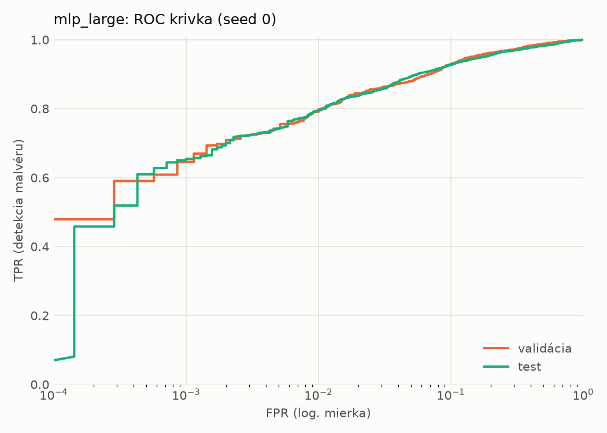
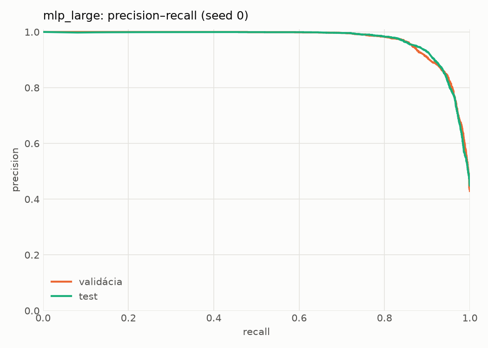
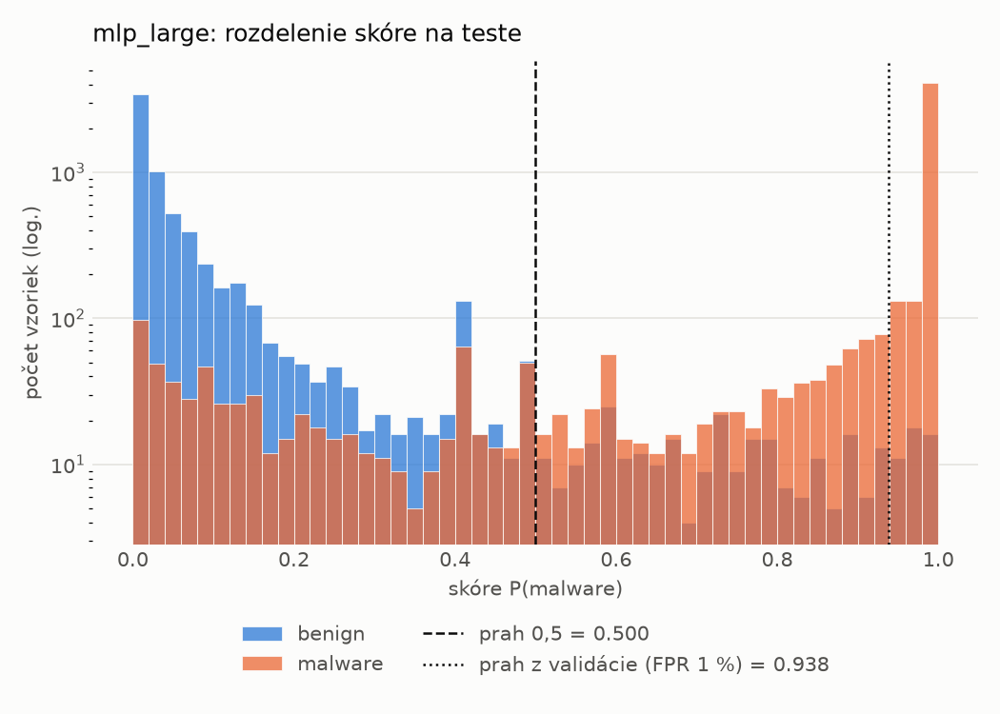
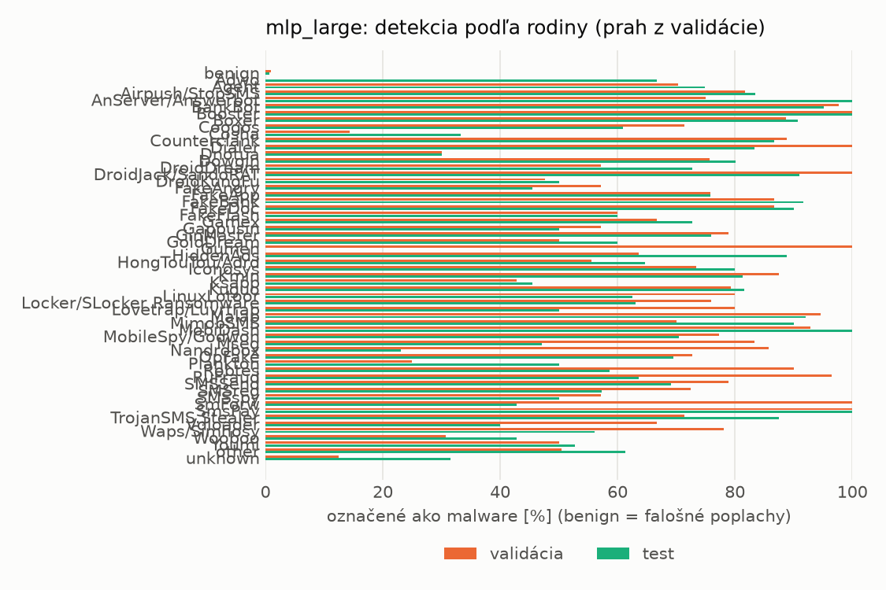
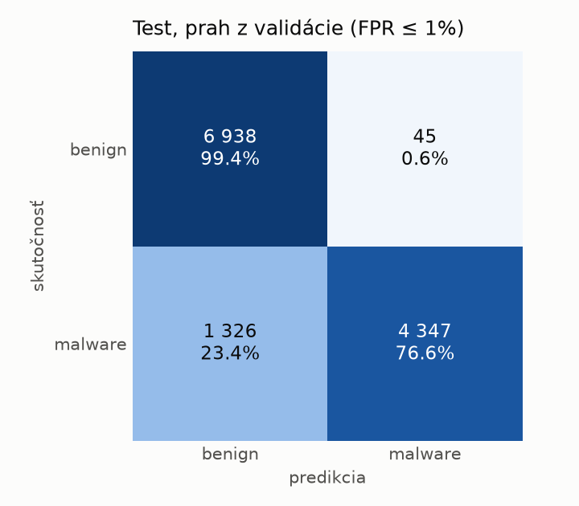
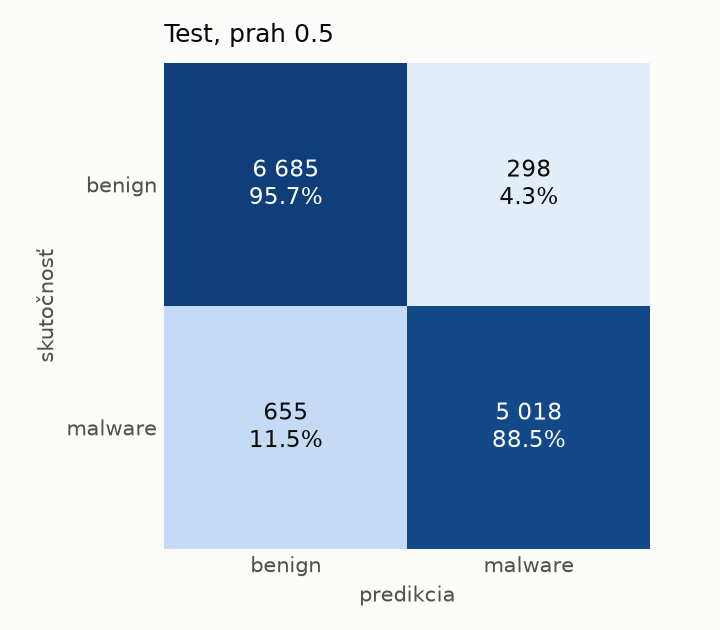
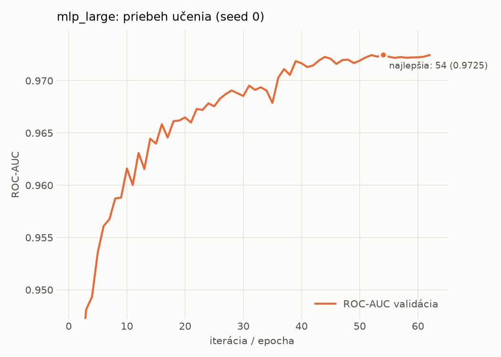

# dynamic/mlp_large – beh `20261123-184545`

> Automaticky generované (`src/training/run_tabular.py`). Konfigurácia: `config.yaml`, protokol: `protocol.yaml`.

- **Model:** `mlp` – veľká neurónová sieť (3–5 skrytých vrstiev, 512–2048 neurónov), kandidát na učiteľa
- **Ladenie:** bez ladenia – hyperparametre prevzaté z `runs_v4/real_p/full/dynamic/mlp_large/20261122-235153`
- **Finálne modely:** seedy [0, 1, 2]; hodnoty sú priemer ± smerodajná odchýlka cez seedy
- **Najlepšie hyperparametre:** `{"max_epochs": 100, "patience": 8, "hidden_layers": 5, "hidden_width": 512, "width_decay": 1.0, "dropout": 0.3998176791356432, "lr": 0.0024125104549951384, "weight_decay": 1.1960883604412328e-06, "batch_size": 1024}`

## Detekčná kvalita (bez prahu)
| metrika | train (podvzorka) | validácia | test |
|---|---|---|---|
| ROC-AUC | 0.9883 ± 0.0004 | 0.9733 ± 0.0007 | 0.9702 ± 0.0006 |
| PR-AUC | 0.9871 ± 0.0005 | 0.9729 ± 0.0007 | 0.9723 ± 0.0004 |
| TPR pri FPR 1 % | 0.8890 ± 0.0045 | 0.7940 ± 0.0030 | 0.8002 ± 0.0052 |
| TPR pri FPR 0,1 % | 0.8026 ± 0.0185 | 0.6379 ± 0.0392 | 0.6314 ± 0.0180 |
| log loss | 0.1253 ± 0.0024 | 0.2001 ± 0.0029 | 0.2070 ± 0.0025 |
| Brier skóre | 0.0364 ± 0.0008 | 0.0570 ± 0.0011 | 0.0574 ± 0.0008 |

Rozdiel ROC-AUC train − validácia: **0.0150** (veľký rozdiel = preučenie).

## Pri prahu z validácie (FPR ≤ 1% na validácii)
| metrika | train (podvzorka) | validácia | test |
|---|---|---|---|
| accuracy | 0.9269 ± 0.0014 | 0.9061 ± 0.0013 | 0.8945 ± 0.0025 |
| balanced accuracy | 0.9134 ± 0.0017 | 0.8922 ± 0.0015 | 0.8831 ± 0.0029 |
| precision | 0.9972 ± 0.0004 | 0.9841 ± 0.0003 | 0.9890 ± 0.0011 |
| recall (TPR) | 0.8285 ± 0.0035 | 0.7940 ± 0.0030 | 0.7733 ± 0.0064 |
| FPR | 0.0017 ± 0.0003 | 0.0096 ± 0.0002 | 0.0070 ± 0.0008 |
| F1 | 0.9051 ± 0.0020 | 0.8789 ± 0.0019 | 0.8679 ± 0.0037 |
| MCC | 0.8561 ± 0.0027 | 0.8160 ± 0.0025 | 0.7987 ± 0.0043 |

## Pri pevnom prahu 0.5
| metrika | train (podvzorka) | validácia | test |
|---|---|---|---|
| accuracy | 0.9502 ± 0.0007 | 0.9228 ± 0.0026 | 0.9252 ± 0.0006 |
| balanced accuracy | 0.9466 ± 0.0006 | 0.9189 ± 0.0028 | 0.9217 ± 0.0009 |
| precision | 0.9564 ± 0.0045 | 0.9261 ± 0.0050 | 0.9422 ± 0.0024 |
| recall (TPR) | 0.9239 ± 0.0038 | 0.8913 ± 0.0061 | 0.8877 ± 0.0040 |
| FPR | 0.0306 ± 0.0035 | 0.0535 ± 0.0040 | 0.0443 ± 0.0021 |
| F1 | 0.9399 ± 0.0007 | 0.9084 ± 0.0032 | 0.9141 ± 0.0010 |
| MCC | 0.8978 ± 0.0014 | 0.8422 ± 0.0054 | 0.8492 ± 0.0011 |

## Výpočtové nároky (seed 0, testovacia množina)
| meranie | hodnota |
|---|---|
| tréning finálneho modelu | 7.9 s (priemer cez seedy) |
| ladenie spolu | 0 s |
| počet parametrov / uzlov | 1 119 745 |
| veľkosť modelu na disku | 4.51 MB |
| transformácia vstupu – latencia (1 vlákno) | 0.015 ms |
| transformácia vstupu – priepustnosť | 773 514 vzoriek/s |
| CPU latencia modelu (batch 1, 1 vlákno) | 0.239 ms (p95 0.573) |
| CPU priepustnosť (24 vlákien) | 360 454 vzoriek/s |
| GPU latencia (batch 1) | 0.601 ms (p95 1.389) |
| GPU priepustnosť | 1 682 062 vzoriek/s |
| GPU špičková pamäť | 115 MB |

## Grafy
| | |
|---|---|
|  |  |
|  |  |
|  |  |
|  |  |

## Súbory
`metrics.json` (všetky metriky po seedoch vrátane rodín), `timing.json`, `hpo_trials.csv`,
`predictions/<časť>_seed<N>.parquet` (sha256, family, label, score), `model/seed_<N>/`, `log.txt`.
