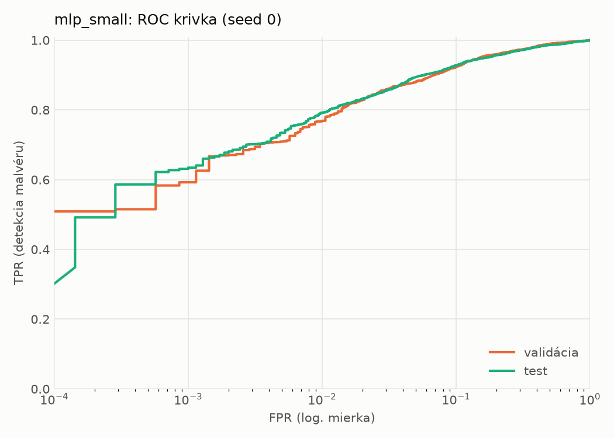
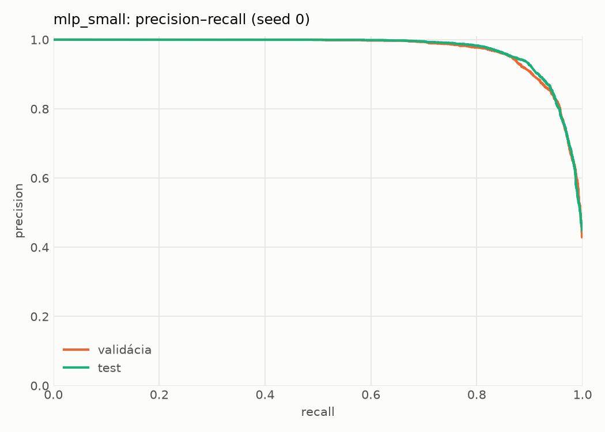
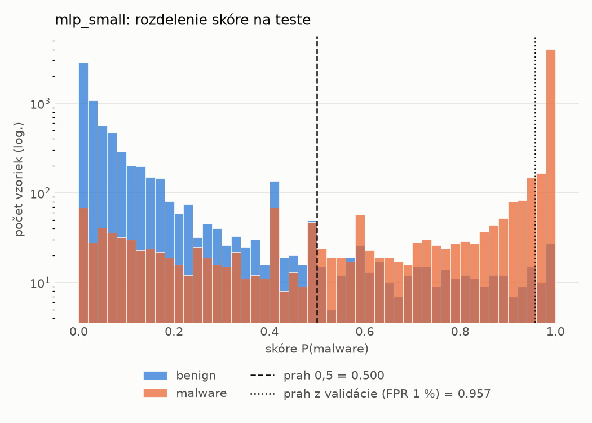
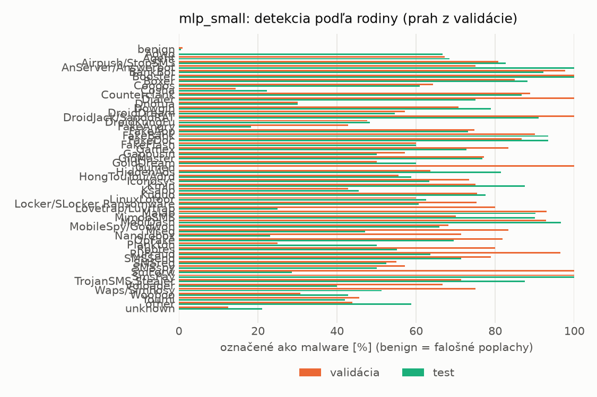
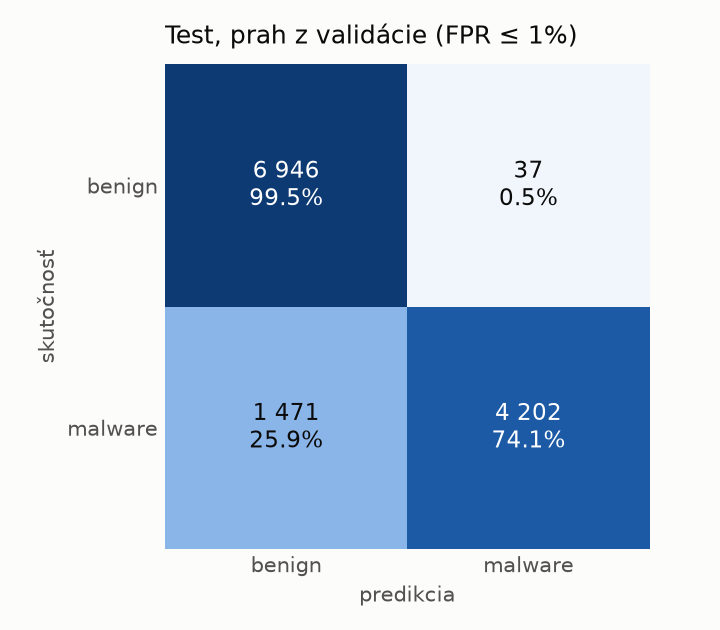
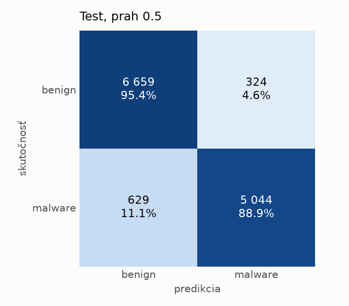
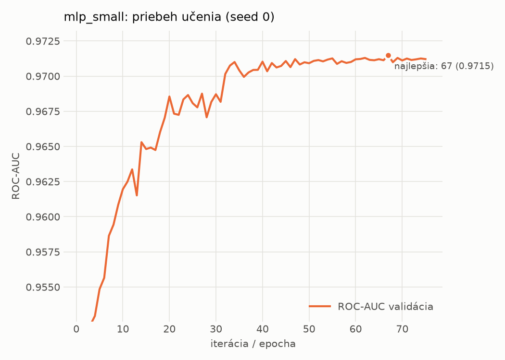

# dynamic/mlp_small – beh `20261123-184446`

> Automaticky generované (`src/training/run_tabular.py`). Konfigurácia: `config.yaml`, protokol: `protocol.yaml`.

- **Model:** `mlp` – malá neurónová sieť (1–2 skryté vrstvy), kandidát na ľahkého študenta
- **Ladenie:** bez ladenia – hyperparametre prevzaté z `runs_v4/real_p/full/dynamic/mlp_small/20261122-234317`
- **Finálne modely:** seedy [0, 1, 2]; hodnoty sú priemer ± smerodajná odchýlka cez seedy
- **Najlepšie hyperparametre:** `{"width_decay": 0.5, "max_epochs": 100, "patience": 8, "hidden_layers": 2, "hidden_width": 256, "dropout": 0.2449160262890371, "lr": 0.002872548733508973, "weight_decay": 4.509331245708397e-06, "batch_size": 256}`

## Detekčná kvalita (bez prahu)
| metrika | train (podvzorka) | validácia | test |
|---|---|---|---|
| ROC-AUC | 0.9880 ± 0.0008 | 0.9728 ± 0.0012 | 0.9701 ± 0.0003 |
| PR-AUC | 0.9867 ± 0.0008 | 0.9722 ± 0.0013 | 0.9723 ± 0.0004 |
| TPR pri FPR 1 % | 0.8826 ± 0.0056 | 0.7903 ± 0.0195 | 0.7961 ± 0.0049 |
| TPR pri FPR 0,1 % | 0.7930 ± 0.0105 | 0.5965 ± 0.0047 | 0.6393 ± 0.0169 |
| log loss | 0.1296 ± 0.0043 | 0.2043 ± 0.0083 | 0.2108 ± 0.0012 |
| Brier skóre | 0.0374 ± 0.0013 | 0.0575 ± 0.0019 | 0.0582 ± 0.0007 |

Rozdiel ROC-AUC train − validácia: **0.0152** (veľký rozdiel = preučenie).

## Pri prahu z validácie (FPR ≤ 1% na validácii)
| metrika | train (podvzorka) | validácia | test |
|---|---|---|---|
| accuracy | 0.9244 ± 0.0077 | 0.9045 ± 0.0084 | 0.8892 ± 0.0073 |
| balanced accuracy | 0.9105 ± 0.0091 | 0.8903 ± 0.0097 | 0.8772 ± 0.0083 |
| precision | 0.9973 ± 0.0004 | 0.9839 ± 0.0004 | 0.9892 ± 0.0020 |
| recall (TPR) | 0.8227 ± 0.0185 | 0.7903 ± 0.0195 | 0.7613 ± 0.0180 |
| FPR | 0.0016 ± 0.0003 | 0.0097 ± 0.0000 | 0.0068 ± 0.0014 |
| F1 | 0.9015 ± 0.0111 | 0.8764 ± 0.0122 | 0.8603 ± 0.0108 |
| MCC | 0.8515 ± 0.0144 | 0.8129 ± 0.0156 | 0.7894 ± 0.0126 |

## Pri pevnom prahu 0.5
| metrika | train (podvzorka) | validácia | test |
|---|---|---|---|
| accuracy | 0.9496 ± 0.0019 | 0.9215 ± 0.0025 | 0.9239 ± 0.0015 |
| balanced accuracy | 0.9460 ± 0.0018 | 0.9174 ± 0.0023 | 0.9202 ± 0.0018 |
| precision | 0.9554 ± 0.0033 | 0.9250 ± 0.0051 | 0.9422 ± 0.0023 |
| recall (TPR) | 0.9233 ± 0.0021 | 0.8891 ± 0.0019 | 0.8846 ± 0.0048 |
| FPR | 0.0313 ± 0.0024 | 0.0542 ± 0.0040 | 0.0441 ± 0.0020 |
| F1 | 0.9391 ± 0.0022 | 0.9067 ± 0.0028 | 0.9125 ± 0.0020 |
| MCC | 0.8965 ± 0.0038 | 0.8394 ± 0.0052 | 0.8467 ± 0.0030 |

## Výpočtové nároky (seed 0, testovacia množina)
| meranie | hodnota |
|---|---|
| tréning finálneho modelu | 19.3 s (priemer cez seedy) |
| ladenie spolu | 0 s |
| počet parametrov / uzlov | 65 537 |
| veľkosť modelu na disku | 0.27 MB |
| transformácia vstupu – latencia (1 vlákno) | 0.008 ms |
| transformácia vstupu – priepustnosť | 1 107 727 vzoriek/s |
| CPU latencia modelu (batch 1, 1 vlákno) | 0.079 ms (p95 0.091) |
| CPU priepustnosť (24 vlákien) | 2 406 770 vzoriek/s |
| GPU latencia (batch 1) | 0.397 ms (p95 0.692) |
| GPU priepustnosť | 1 537 994 vzoriek/s |
| GPU špičková pamäť | 66 MB |

## Grafy
| | |
|---|---|
|  |  |
|  |  |
|  |  |
|  |  |

## Súbory
`metrics.json` (všetky metriky po seedoch vrátane rodín), `timing.json`, `hpo_trials.csv`,
`predictions/<časť>_seed<N>.parquet` (sha256, family, label, score), `model/seed_<N>/`, `log.txt`.
