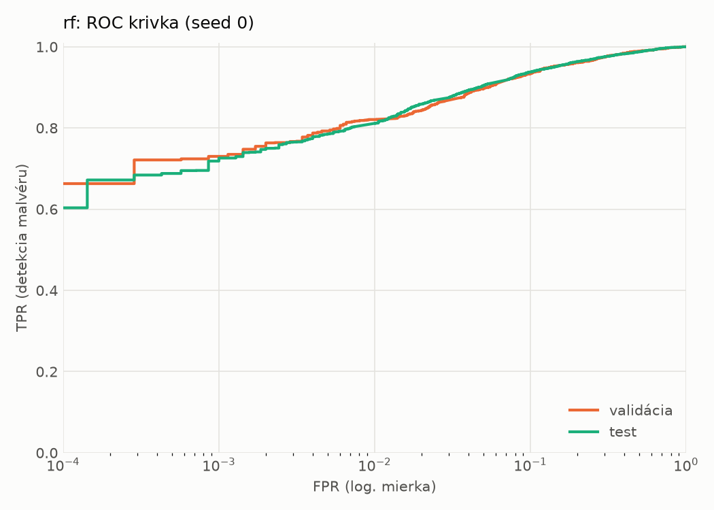
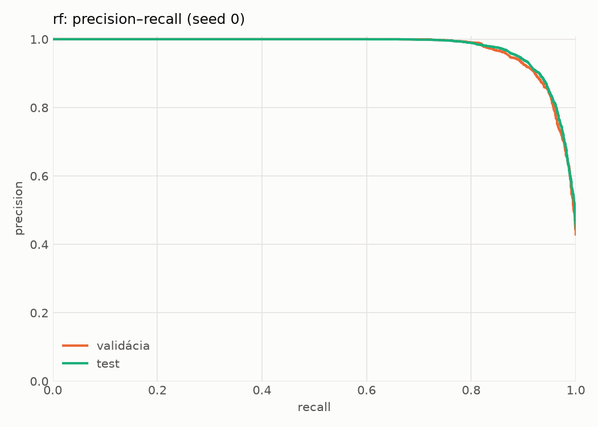
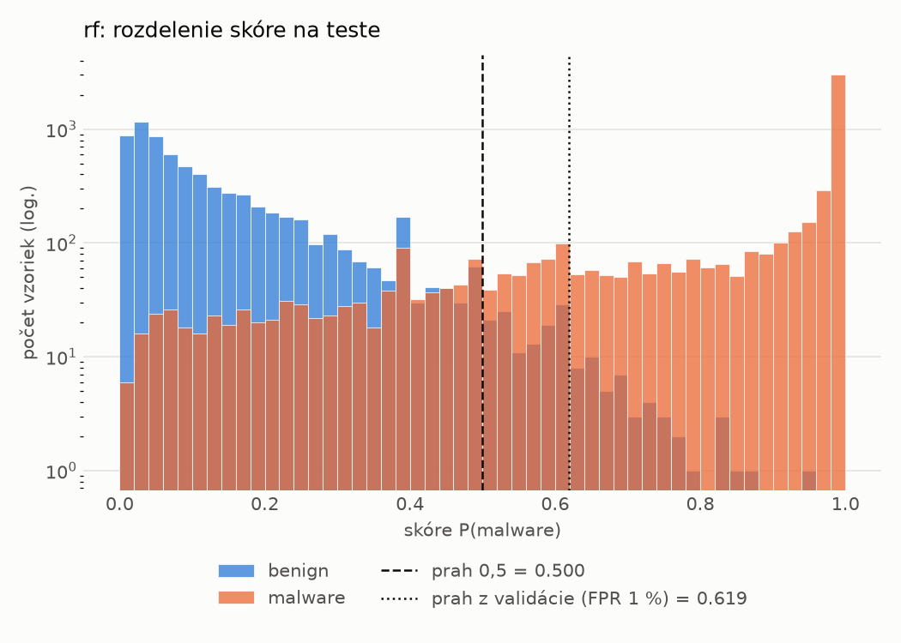
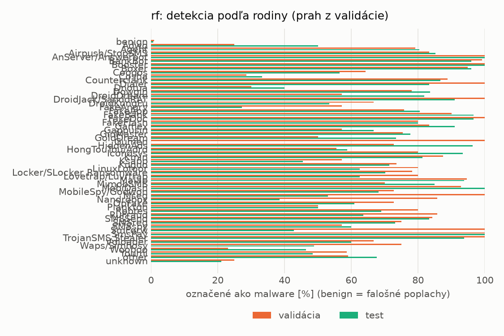
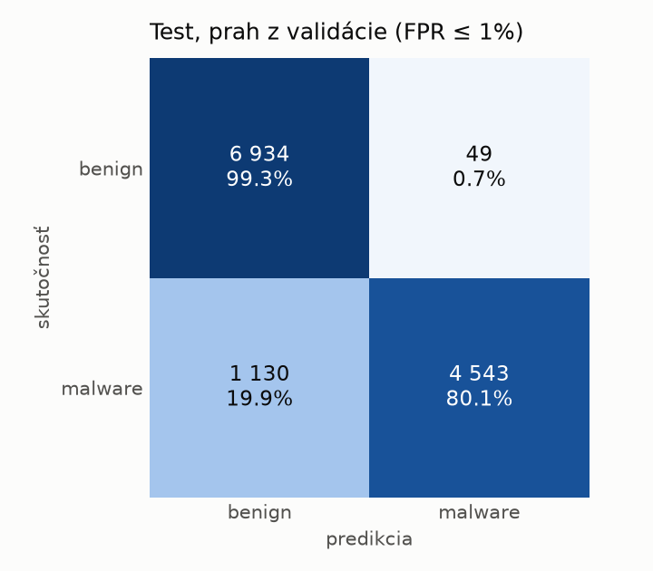
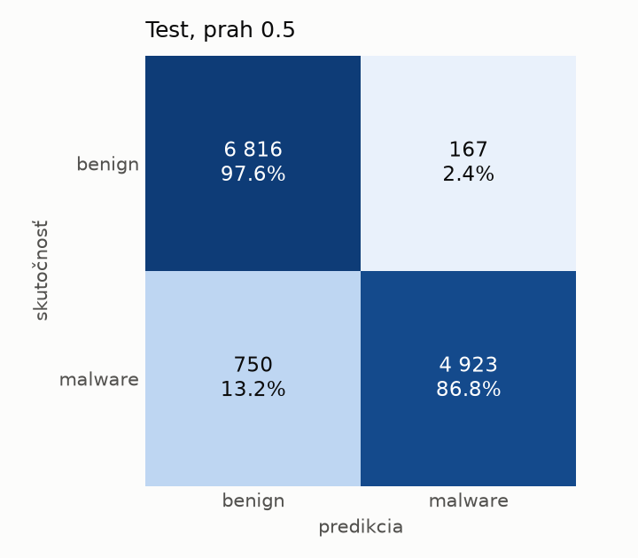

# dynamic/rf – beh `20261123-184344`

> Automaticky generované (`src/training/run_tabular.py`). Konfigurácia: `config.yaml`, protokol: `protocol.yaml`.

- **Model:** `random_forest` – Random Forest (pôvodné hodnoty príznakov)
- **Ladenie:** bez ladenia – hyperparametre prevzaté z `runs_v4/real_p/full/dynamic/rf/20261122-233325`
- **Finálne modely:** seedy [0, 1, 2]; hodnoty sú priemer ± smerodajná odchýlka cez seedy
- **Najlepšie hyperparametre:** `{"n_estimators": 500, "max_depth": 24, "min_samples_leaf": 1, "max_features": "sqrt"}`

## Detekčná kvalita (bez prahu)
| metrika | train (podvzorka) | validácia | test |
|---|---|---|---|
| ROC-AUC | 0.9988 ± 0.0000 | 0.9749 ± 0.0001 | 0.9753 ± 0.0001 |
| PR-AUC | 0.9984 ± 0.0000 | 0.9749 ± 0.0001 | 0.9768 ± 0.0001 |
| TPR pri FPR 1 % | 0.9675 ± 0.0039 | 0.8227 ± 0.0019 | 0.8055 ± 0.0049 |
| TPR pri FPR 0,1 % | 0.9518 ± 0.0001 | 0.7320 ± 0.0019 | 0.7181 ± 0.0054 |
| log loss | 0.0874 ± 0.0004 | 0.2006 ± 0.0005 | 0.2054 ± 0.0001 |
| Brier skóre | 0.0178 ± 0.0001 | 0.0574 ± 0.0001 | 0.0590 ± 0.0001 |

Rozdiel ROC-AUC train − validácia: **0.0239** (veľký rozdiel = preučenie).

## Pri prahu z validácie (FPR ≤ 1% na validácii)
| metrika | train (podvzorka) | validácia | test |
|---|---|---|---|
| accuracy | 0.9796 ± 0.0002 | 0.9187 ± 0.0008 | 0.9068 ± 0.0001 |
| balanced accuracy | 0.9758 ± 0.0002 | 0.9068 ± 0.0010 | 0.8970 ± 0.0001 |
| precision | 1.0000 ± 0.0000 | 0.9854 ± 0.0000 | 0.9884 ± 0.0009 |
| recall (TPR) | 0.9515 ± 0.0005 | 0.8227 ± 0.0019 | 0.8016 ± 0.0007 |
| FPR | 0.0000 ± 0.0000 | 0.0092 ± 0.0000 | 0.0076 ± 0.0006 |
| F1 | 0.9752 ± 0.0002 | 0.8967 ± 0.0011 | 0.8852 ± 0.0001 |
| MCC | 0.9587 ± 0.0004 | 0.8398 ± 0.0015 | 0.8208 ± 0.0003 |

## Pri pevnom prahu 0.5
| metrika | train (podvzorka) | validácia | test |
|---|---|---|---|
| accuracy | 0.9831 ± 0.0003 | 0.9261 ± 0.0005 | 0.9272 ± 0.0004 |
| balanced accuracy | 0.9806 ± 0.0003 | 0.9184 ± 0.0005 | 0.9217 ± 0.0004 |
| precision | 0.9945 ± 0.0003 | 0.9595 ± 0.0005 | 0.9661 ± 0.0010 |
| recall (TPR) | 0.9652 ± 0.0005 | 0.8643 ± 0.0008 | 0.8681 ± 0.0009 |
| FPR | 0.0039 ± 0.0002 | 0.0274 ± 0.0003 | 0.0248 ± 0.0008 |
| F1 | 0.9796 ± 0.0003 | 0.9094 ± 0.0006 | 0.9145 ± 0.0005 |
| MCC | 0.9655 ± 0.0005 | 0.8506 ± 0.0010 | 0.8552 ± 0.0009 |

## Výpočtové nároky (seed 0, testovacia množina)
| meranie | hodnota |
|---|---|
| tréning finálneho modelu | 2.4 s (priemer cez seedy) |
| ladenie spolu | 0 s |
| počet parametrov / uzlov | 3 201 346 |
| veľkosť modelu na disku | 256.48 MB |
| CPU latencia modelu (batch 1, 1 vlákno) | 14.428 ms (p95 15.073) |
| CPU priepustnosť (24 vlákien) | 111 390 vzoriek/s |

## Grafy
| | |
|---|---|
|  |  |
|  |  |
|  |  |
|  |  |

## Súbory
`metrics.json` (všetky metriky po seedoch vrátane rodín), `timing.json`, `hpo_trials.csv`,
`predictions/<časť>_seed<N>.parquet` (sha256, family, label, score), `model/seed_<N>/`, `log.txt`.
