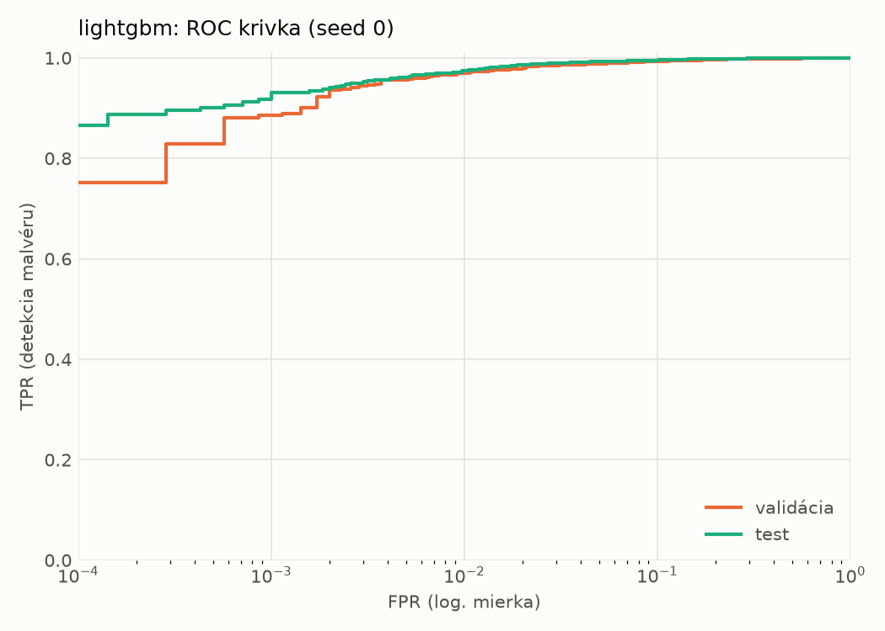
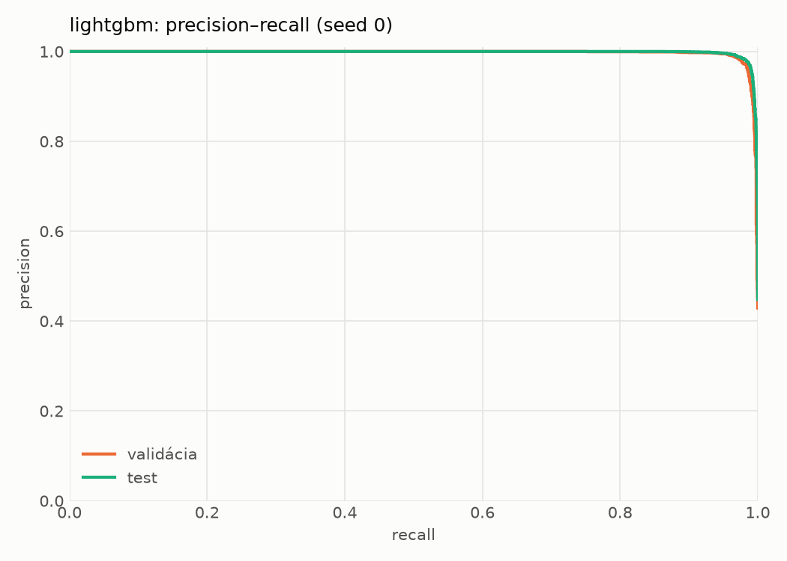
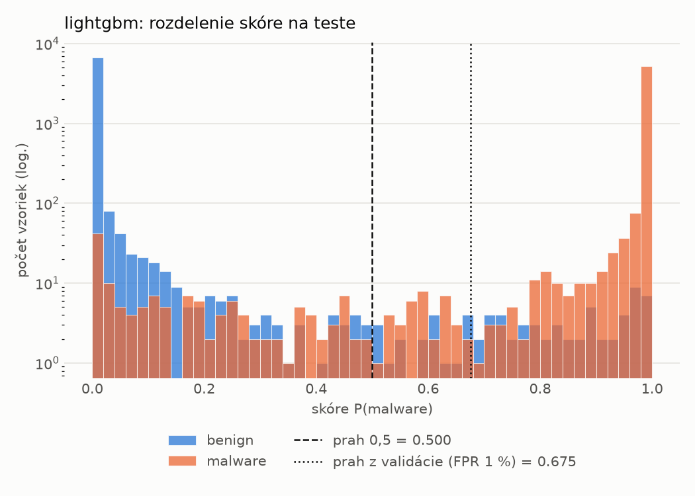
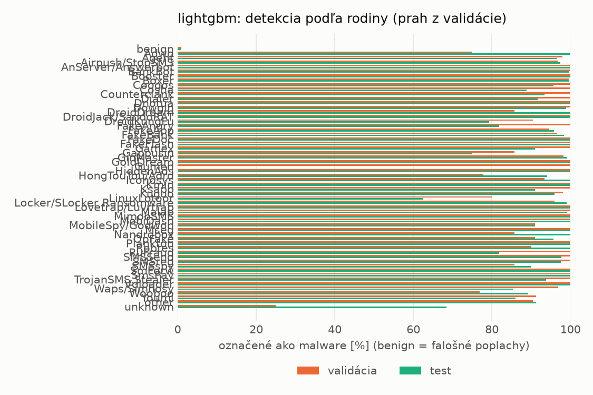
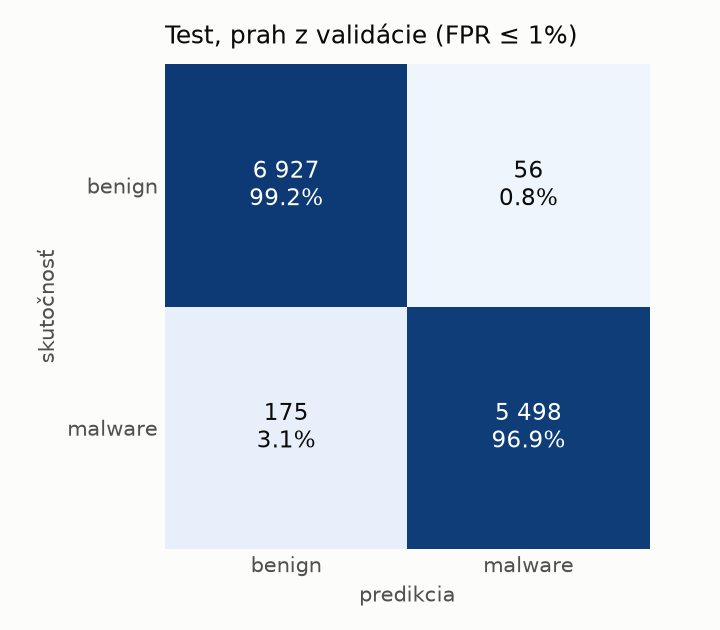
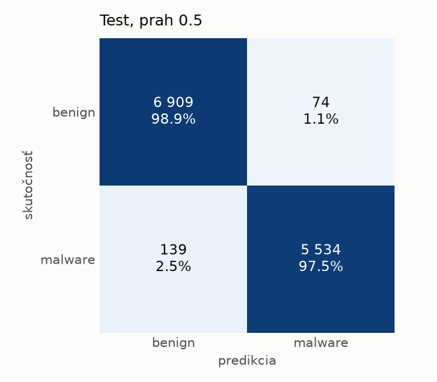
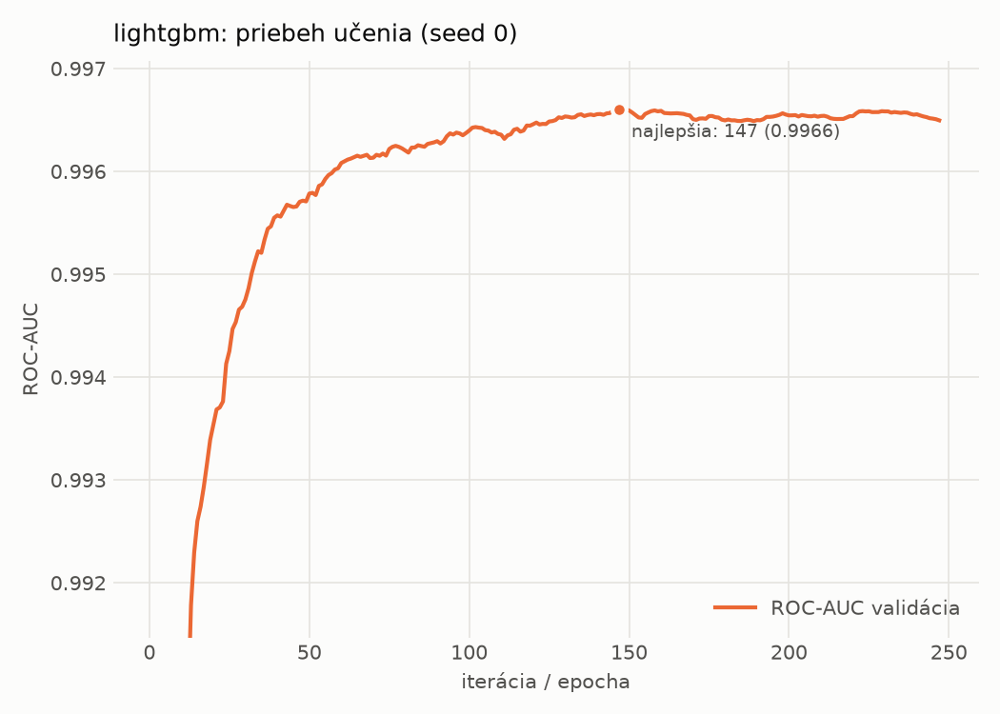

# hybrid/lightgbm – beh `20261123-184633`

> Automaticky generované (`src/training/run_tabular.py`). Konfigurácia: `config.yaml`, protokol: `protocol.yaml`.

- **Model:** `lightgbm` – LightGBM, gradient boosting stromov s early stopping na validácii (pôvodné hodnoty príznakov)
- **Ladenie:** bez ladenia – hyperparametre prevzaté z `runs_v4/real_p/full/hybrid/lightgbm/20261122-235912`
- **Finálne modely:** seedy [0, 1, 2]; hodnoty sú priemer ± smerodajná odchýlka cez seedy
- **Najlepšie hyperparametre:** `{"num_boost_round": 5000, "early_stopping_rounds": 100, "learning_rate": 0.156156388281821, "num_leaves": 106, "min_child_samples": 12, "feature_fraction": 0.9629001596575603, "bagging_fraction": 0.9482638746669452, "lambda_l1": 1.6337309047659264e-08, "lambda_l2": 0.01636800654484922}`

## Detekčná kvalita (bez prahu)
| metrika | train (podvzorka) | validácia | test |
|---|---|---|---|
| ROC-AUC | 1.0000 ± 0.0000 | 0.9967 ± 0.0001 | 0.9981 ± 0.0001 |
| PR-AUC | 1.0000 ± 0.0000 | 0.9968 ± 0.0001 | 0.9981 ± 0.0001 |
| TPR pri FPR 1 % | 1.0000 ± 0.0000 | 0.9692 ± 0.0004 | 0.9773 ± 0.0024 |
| TPR pri FPR 0,1 % | 1.0000 ± 0.0000 | 0.8769 ± 0.0076 | 0.9184 ± 0.0011 |
| log loss | 0.0005 ± 0.0004 | 0.0732 ± 0.0072 | 0.0572 ± 0.0042 |
| Brier skóre | 0.0000 ± 0.0000 | 0.0153 ± 0.0003 | 0.0129 ± 0.0003 |

Rozdiel ROC-AUC train − validácia: **0.0033** (veľký rozdiel = preučenie).

## Pri prahu z validácie (FPR ≤ 1% na validácii)
| metrika | train (podvzorka) | validácia | test |
|---|---|---|---|
| accuracy | 1.0000 ± 0.0000 | 0.9813 ± 0.0001 | 0.9827 ± 0.0008 |
| balanced accuracy | 1.0000 ± 0.0000 | 0.9798 ± 0.0001 | 0.9815 ± 0.0008 |
| precision | 1.0000 ± 0.0000 | 0.9869 ± 0.0002 | 0.9915 ± 0.0014 |
| recall (TPR) | 1.0000 ± 0.0000 | 0.9692 ± 0.0004 | 0.9698 ± 0.0006 |
| FPR | 0.0000 ± 0.0000 | 0.0096 ± 0.0002 | 0.0068 ± 0.0011 |
| F1 | 1.0000 ± 0.0000 | 0.9780 ± 0.0001 | 0.9805 ± 0.0009 |
| MCC | 1.0000 ± 0.0000 | 0.9619 ± 0.0002 | 0.9652 ± 0.0017 |

## Pri pevnom prahu 0.5
| metrika | train (podvzorka) | validácia | test |
|---|---|---|---|
| accuracy | 1.0000 ± 0.0000 | 0.9808 ± 0.0004 | 0.9842 ± 0.0009 |
| balanced accuracy | 1.0000 ± 0.0000 | 0.9800 ± 0.0003 | 0.9835 ± 0.0009 |
| precision | 1.0000 ± 0.0000 | 0.9807 ± 0.0017 | 0.9881 ± 0.0011 |
| recall (TPR) | 1.0000 ± 0.0000 | 0.9745 ± 0.0008 | 0.9766 ± 0.0011 |
| FPR | 0.0000 ± 0.0000 | 0.0144 ± 0.0013 | 0.0096 ± 0.0009 |
| F1 | 1.0000 ± 0.0000 | 0.9776 ± 0.0005 | 0.9823 ± 0.0010 |
| MCC | 1.0000 ± 0.0000 | 0.9608 ± 0.0008 | 0.9681 ± 0.0018 |

## Výpočtové nároky (seed 0, testovacia množina)
| meranie | hodnota |
|---|---|
| tréning finálneho modelu | 4.0 s (priemer cez seedy) |
| ladenie spolu | 0 s |
| počet parametrov / uzlov | 31 017 |
| veľkosť modelu na disku | 1.73 MB |
| CPU latencia modelu (batch 1, 1 vlákno) | 0.032 ms (p95 0.040) |
| CPU priepustnosť (24 vlákien) | 626 817 vzoriek/s |

## Grafy
| | |
|---|---|
|  |  |
|  |  |
|  |  |
|  |  |

## Súbory
`metrics.json` (všetky metriky po seedoch vrátane rodín), `timing.json`, `hpo_trials.csv`,
`predictions/<časť>_seed<N>.parquet` (sha256, family, label, score), `model/seed_<N>/`, `log.txt`.
