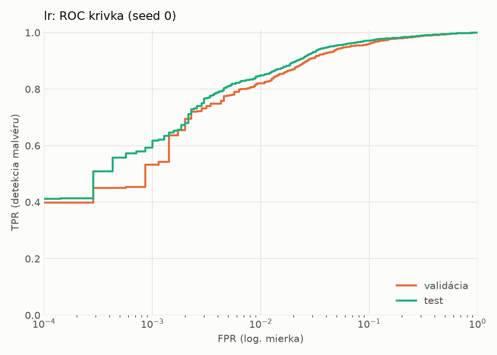
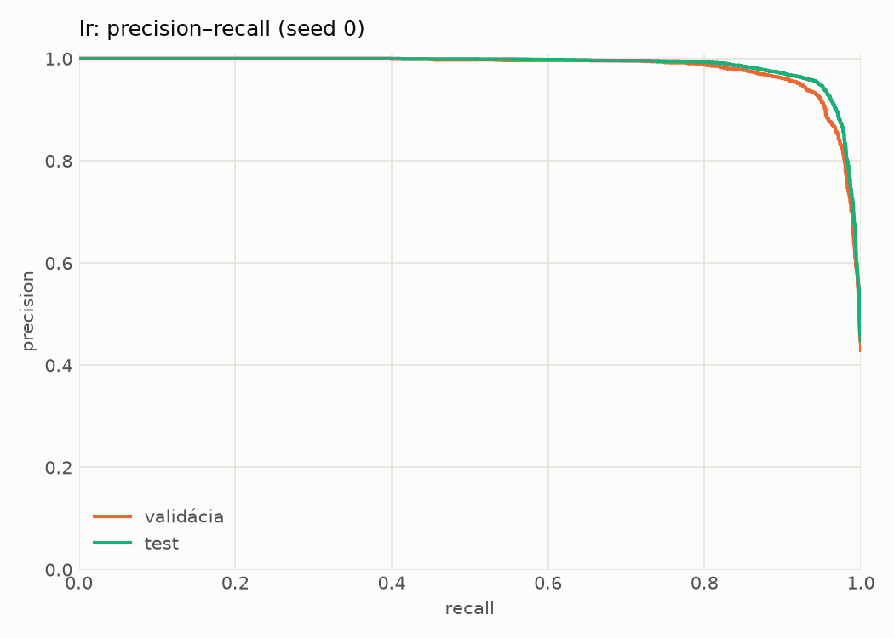
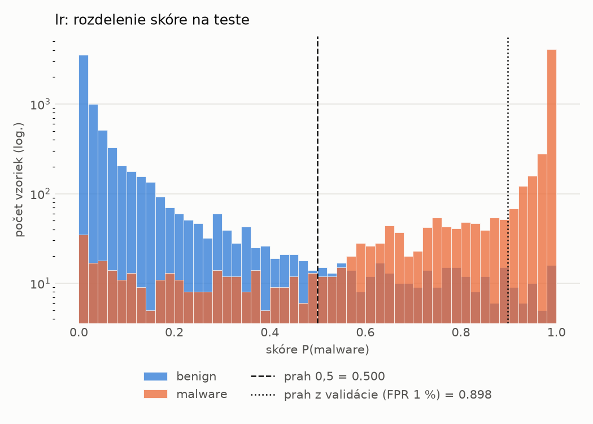
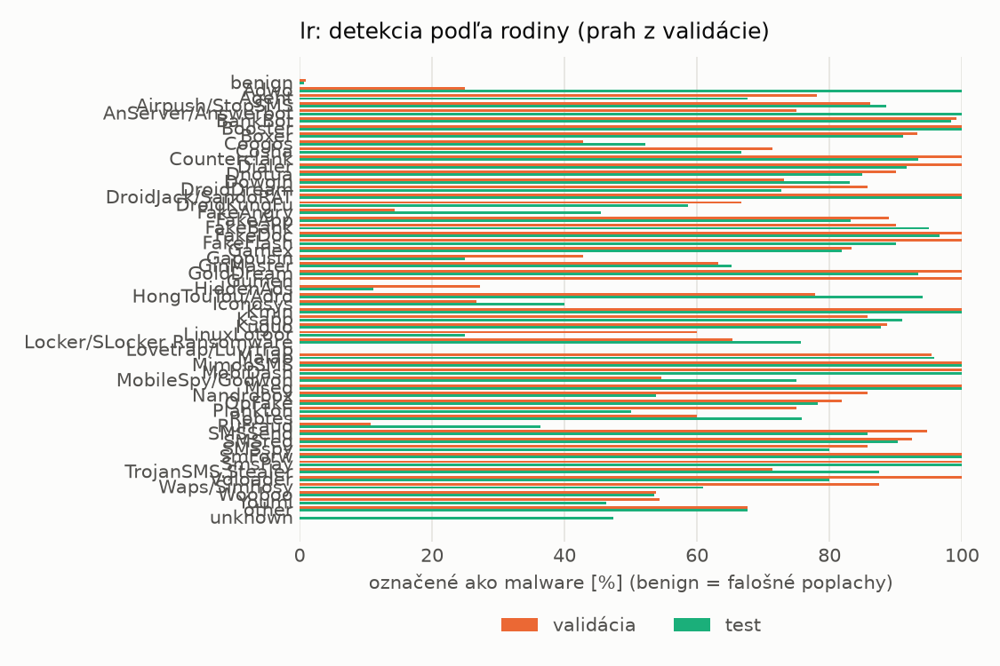
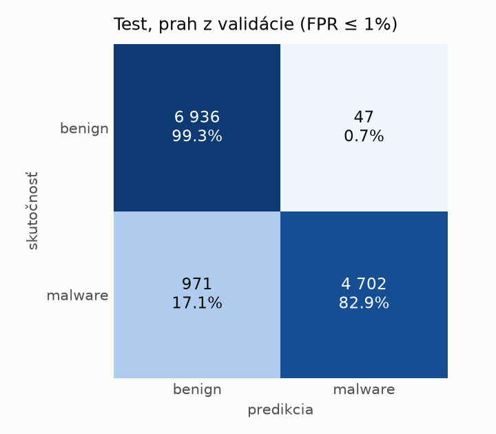
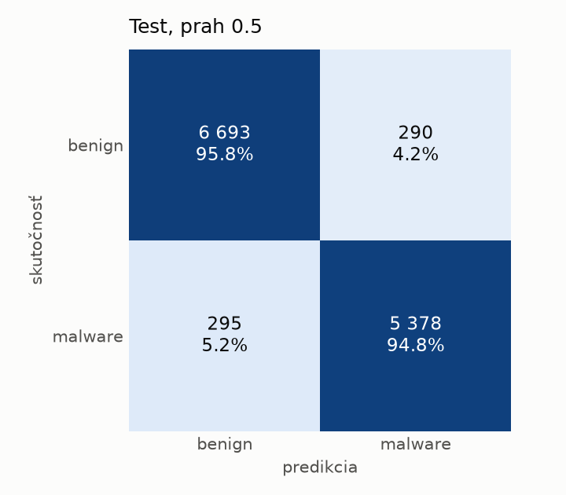

# hybrid/lr – beh `20261123-184615`

> Automaticky generované (`src/training/run_tabular.py`). Konfigurácia: `config.yaml`, protokol: `protocol.yaml`.

- **Model:** `logreg` – logistická regresia s L2 regularizáciou (vstup signed log1p + štandardizácia)
- **Ladenie:** bez ladenia – hyperparametre prevzaté z `runs_v4/real_p/full/hybrid/lr/20261122-235738`
- **Finálne modely:** seedy [0, 1, 2]; hodnoty sú priemer ± smerodajná odchýlka cez seedy
- **Najlepšie hyperparametre:** `{"max_iter": 2000, "C": 0.07124252843547843}`

## Detekčná kvalita (bez prahu)
| metrika | train (podvzorka) | validácia | test |
|---|---|---|---|
| ROC-AUC | 0.9874 ± 0.0000 | 0.9835 ± 0.0000 | 0.9863 ± 0.0000 |
| PR-AUC | 0.9863 ± 0.0000 | 0.9823 ± 0.0000 | 0.9864 ± 0.0000 |
| TPR pri FPR 1 % | 0.8679 ± 0.0000 | 0.8197 ± 0.0000 | 0.8479 ± 0.0000 |
| TPR pri FPR 0,1 % | 0.5769 ± 0.0000 | 0.5330 ± 0.0000 | 0.5923 ± 0.0000 |
| log loss | 0.1319 ± 0.0000 | 0.1535 ± 0.0000 | 0.1399 ± 0.0000 |
| Brier skóre | 0.0361 ± 0.0000 | 0.0427 ± 0.0000 | 0.0378 ± 0.0000 |

Rozdiel ROC-AUC train − validácia: **0.0039** (veľký rozdiel = preučenie).

## Pri prahu z validácie (FPR ≤ 1% na validácii)
| metrika | train (podvzorka) | validácia | test |
|---|---|---|---|
| accuracy | 0.9257 ± 0.0000 | 0.9172 ± 0.0000 | 0.9196 ± 0.0000 |
| balanced accuracy | 0.9129 ± 0.0000 | 0.9051 ± 0.0000 | 0.9111 ± 0.0000 |
| precision | 0.9898 ± 0.0000 | 0.9849 ± 0.0000 | 0.9901 ± 0.0000 |
| recall (TPR) | 0.8320 ± 0.0000 | 0.8197 ± 0.0000 | 0.8288 ± 0.0000 |
| FPR | 0.0062 ± 0.0000 | 0.0095 ± 0.0000 | 0.0067 ± 0.0000 |
| F1 | 0.9041 ± 0.0000 | 0.8947 ± 0.0000 | 0.9023 ± 0.0000 |
| MCC | 0.8527 ± 0.0000 | 0.8369 ± 0.0000 | 0.8444 ± 0.0000 |

## Pri pevnom prahu 0.5
| metrika | train (podvzorka) | validácia | test |
|---|---|---|---|
| accuracy | 0.9548 ± 0.0000 | 0.9455 ± 0.0000 | 0.9538 ± 0.0000 |
| balanced accuracy | 0.9536 ± 0.0000 | 0.9435 ± 0.0000 | 0.9532 ± 0.0000 |
| precision | 0.9467 ± 0.0000 | 0.9431 ± 0.0000 | 0.9488 ± 0.0000 |
| recall (TPR) | 0.9458 ± 0.0000 | 0.9291 ± 0.0000 | 0.9480 ± 0.0000 |
| FPR | 0.0387 ± 0.0000 | 0.0421 ± 0.0000 | 0.0415 ± 0.0000 |
| F1 | 0.9463 ± 0.0000 | 0.9360 ± 0.0000 | 0.9484 ± 0.0000 |
| MCC | 0.9073 ± 0.0000 | 0.8887 ± 0.0000 | 0.9065 ± 0.0000 |

## Výpočtové nároky (seed 0, testovacia množina)
| meranie | hodnota |
|---|---|
| tréning finálneho modelu | 0.2 s (priemer cez seedy) |
| ladenie spolu | 0 s |
| počet parametrov / uzlov | 287 |
| veľkosť modelu na disku | 0.01 MB |
| transformácia vstupu – latencia (1 vlákno) | 0.006 ms |
| transformácia vstupu – priepustnosť | 495 422 vzoriek/s |
| CPU latencia modelu (batch 1, 1 vlákno) | 0.004 ms (p95 0.005) |
| CPU priepustnosť (24 vlákien) | 2 298 083 vzoriek/s |

## Grafy
| | |
|---|---|
|  |  |
|  |  |
|  |  |
|  |  |

## Súbory
`metrics.json` (všetky metriky po seedoch vrátane rodín), `timing.json`, `hpo_trials.csv`,
`predictions/<časť>_seed<N>.parquet` (sha256, family, label, score), `model/seed_<N>/`, `log.txt`.
