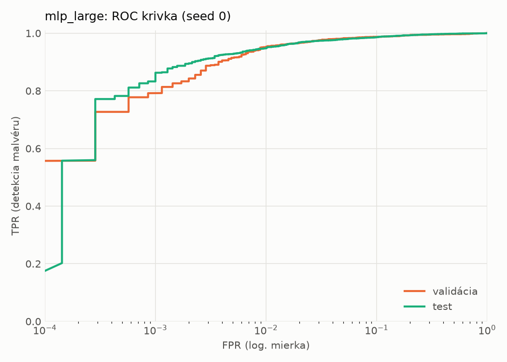
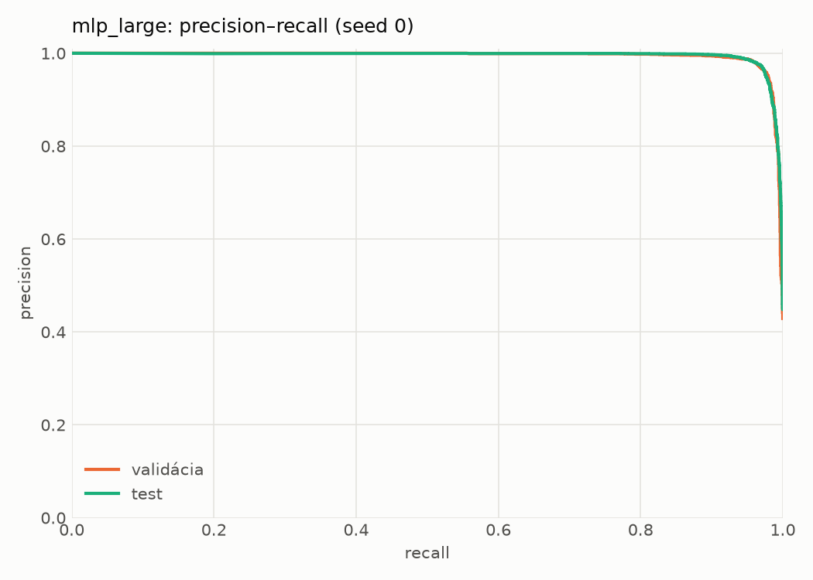
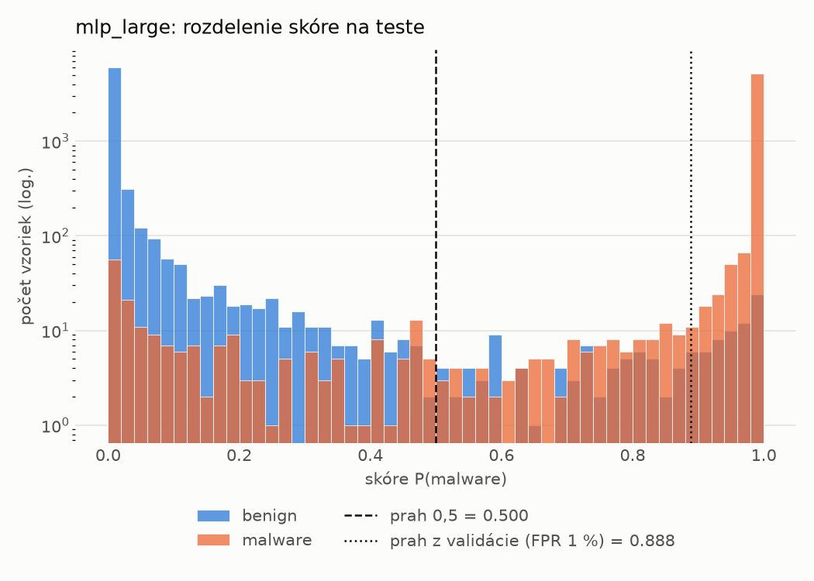
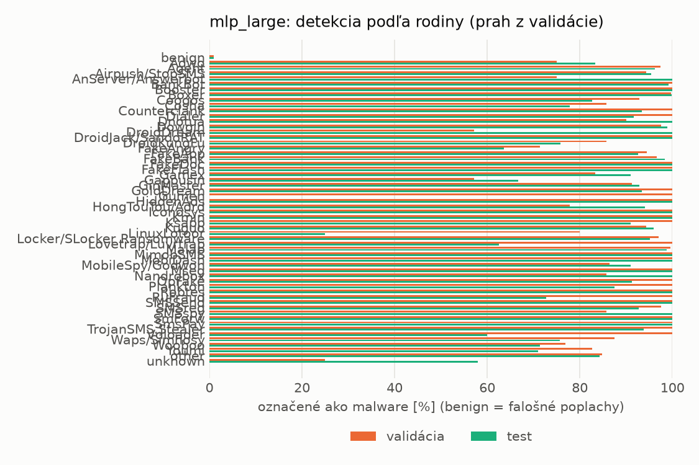
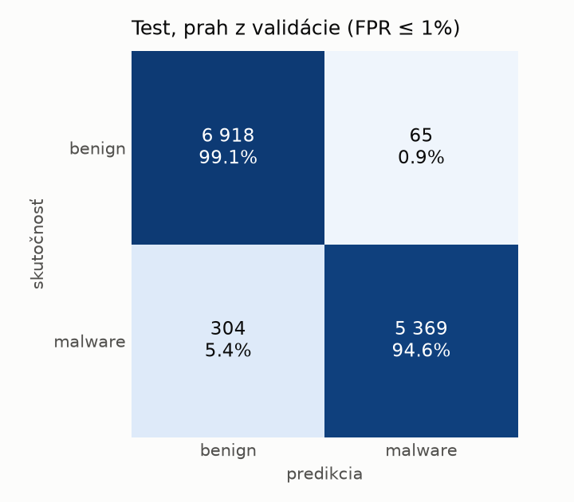
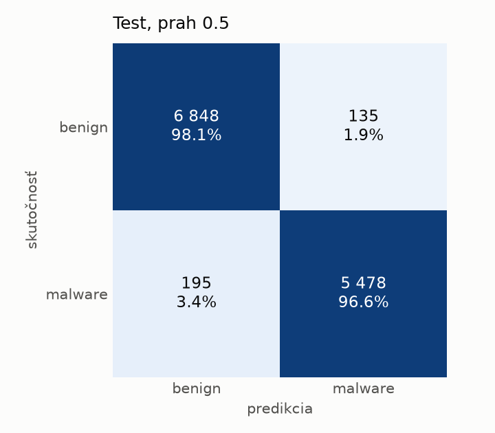
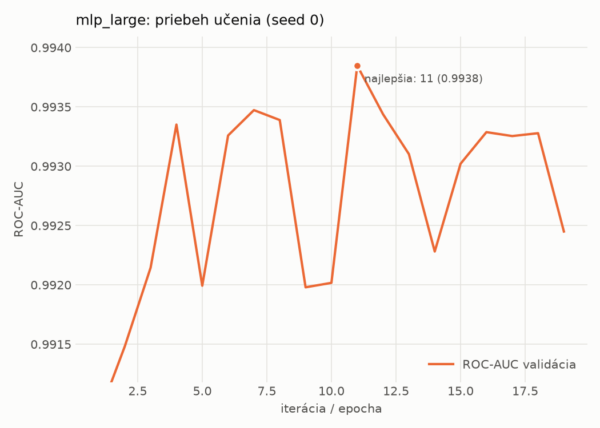

# hybrid/mlp_large – beh `20261123-184654`

> Automaticky generované (`src/training/run_tabular.py`). Konfigurácia: `config.yaml`, protokol: `protocol.yaml`.

- **Model:** `mlp` – veľká neurónová sieť (3–5 skrytých vrstiev, 512–2048 neurónov), kandidát na učiteľa
- **Ladenie:** bez ladenia – hyperparametre prevzaté z `runs_v4/real_p/full/hybrid/mlp_large/20261123-000809`
- **Finálne modely:** seedy [0, 1, 2]; hodnoty sú priemer ± smerodajná odchýlka cez seedy
- **Najlepšie hyperparametre:** `{"max_epochs": 100, "patience": 8, "hidden_layers": 3, "hidden_width": 1024, "width_decay": 1.0, "dropout": 0.11375540844608736, "lr": 0.0022038218939289885, "weight_decay": 1.0842262717330169e-05, "batch_size": 256}`

## Detekčná kvalita (bez prahu)
| metrika | train (podvzorka) | validácia | test |
|---|---|---|---|
| ROC-AUC | 0.9984 ± 0.0007 | 0.9941 ± 0.0002 | 0.9948 ± 0.0003 |
| PR-AUC | 0.9982 ± 0.0007 | 0.9939 ± 0.0003 | 0.9946 ± 0.0004 |
| TPR pri FPR 1 % | 0.9805 ± 0.0070 | 0.9433 ± 0.0072 | 0.9459 ± 0.0046 |
| TPR pri FPR 0,1 % | 0.9549 ± 0.0134 | 0.7962 ± 0.0451 | 0.8371 ± 0.0063 |
| log loss | 0.0414 ± 0.0096 | 0.0918 ± 0.0029 | 0.0863 ± 0.0039 |
| Brier skóre | 0.0109 ± 0.0026 | 0.0220 ± 0.0009 | 0.0219 ± 0.0006 |

Rozdiel ROC-AUC train − validácia: **0.0044** (veľký rozdiel = preučenie).

## Pri prahu z validácie (FPR ≤ 1% na validácii)
| metrika | train (podvzorka) | validácia | test |
|---|---|---|---|
| accuracy | 0.9818 ± 0.0038 | 0.9702 ± 0.0031 | 0.9692 ± 0.0028 |
| balanced accuracy | 0.9786 ± 0.0045 | 0.9669 ± 0.0036 | 0.9666 ± 0.0031 |
| precision | 0.9984 ± 0.0009 | 0.9867 ± 0.0003 | 0.9887 ± 0.0005 |
| recall (TPR) | 0.9584 ± 0.0091 | 0.9433 ± 0.0072 | 0.9420 ± 0.0066 |
| FPR | 0.0012 ± 0.0007 | 0.0096 ± 0.0002 | 0.0088 ± 0.0005 |
| F1 | 0.9780 ± 0.0047 | 0.9645 ± 0.0039 | 0.9648 ± 0.0033 |
| MCC | 0.9631 ± 0.0077 | 0.9396 ± 0.0063 | 0.9382 ± 0.0054 |

## Pri pevnom prahu 0.5
| metrika | train (podvzorka) | validácia | test |
|---|---|---|---|
| accuracy | 0.9864 ± 0.0037 | 0.9727 ± 0.0008 | 0.9725 ± 0.0013 |
| balanced accuracy | 0.9857 ± 0.0039 | 0.9722 ± 0.0005 | 0.9718 ± 0.0011 |
| precision | 0.9860 ± 0.0058 | 0.9679 ± 0.0033 | 0.9728 ± 0.0041 |
| recall (TPR) | 0.9815 ± 0.0068 | 0.9686 ± 0.0019 | 0.9656 ± 0.0026 |
| FPR | 0.0101 ± 0.0042 | 0.0242 ± 0.0026 | 0.0220 ± 0.0035 |
| F1 | 0.9838 ± 0.0044 | 0.9682 ± 0.0008 | 0.9692 ± 0.0014 |
| MCC | 0.9720 ± 0.0075 | 0.9444 ± 0.0015 | 0.9444 ± 0.0026 |

## Výpočtové nároky (seed 0, testovacia množina)
| meranie | hodnota |
|---|---|
| tréning finálneho modelu | 5.6 s (priemer cez seedy) |
| ladenie spolu | 0 s |
| počet parametrov / uzlov | 2 400 257 |
| veľkosť modelu na disku | 9.64 MB |
| transformácia vstupu – latencia (1 vlákno) | 0.017 ms |
| transformácia vstupu – priepustnosť | 286 783 vzoriek/s |
| CPU latencia modelu (batch 1, 1 vlákno) | 0.279 ms (p95 0.584) |
| CPU priepustnosť (24 vlákien) | 119 688 vzoriek/s |
| GPU latencia (batch 1) | 0.426 ms (p95 0.923) |
| GPU priepustnosť | 750 706 vzoriek/s |
| GPU špičková pamäť | 230 MB |

## Grafy
| | |
|---|---|
|  |  |
|  |  |
|  |  |
|  |  |

## Súbory
`metrics.json` (všetky metriky po seedoch vrátane rodín), `timing.json`, `hpo_trials.csv`,
`predictions/<časť>_seed<N>.parquet` (sha256, family, label, score), `model/seed_<N>/`, `log.txt`.
