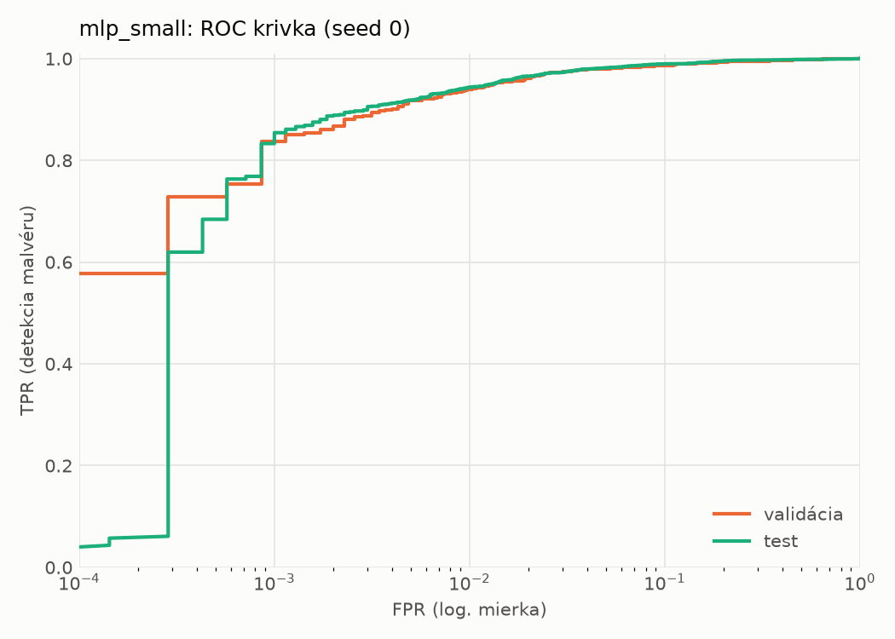
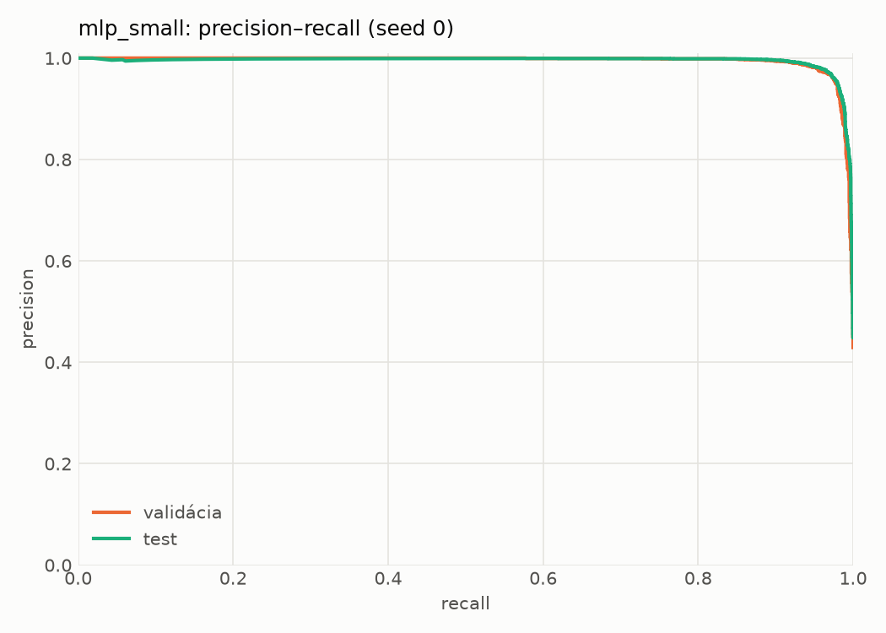
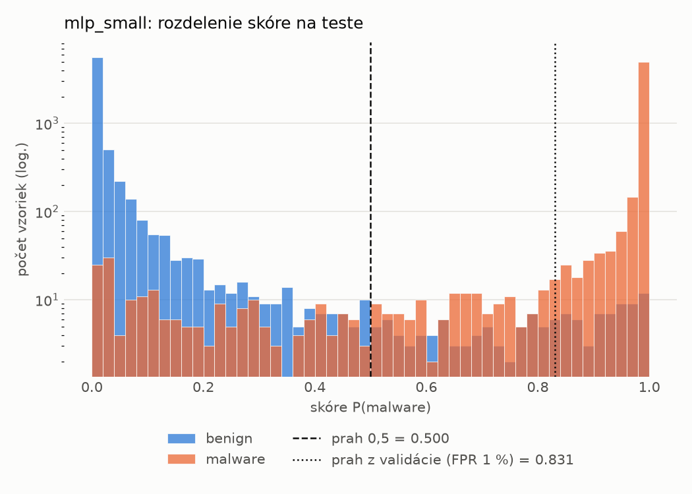
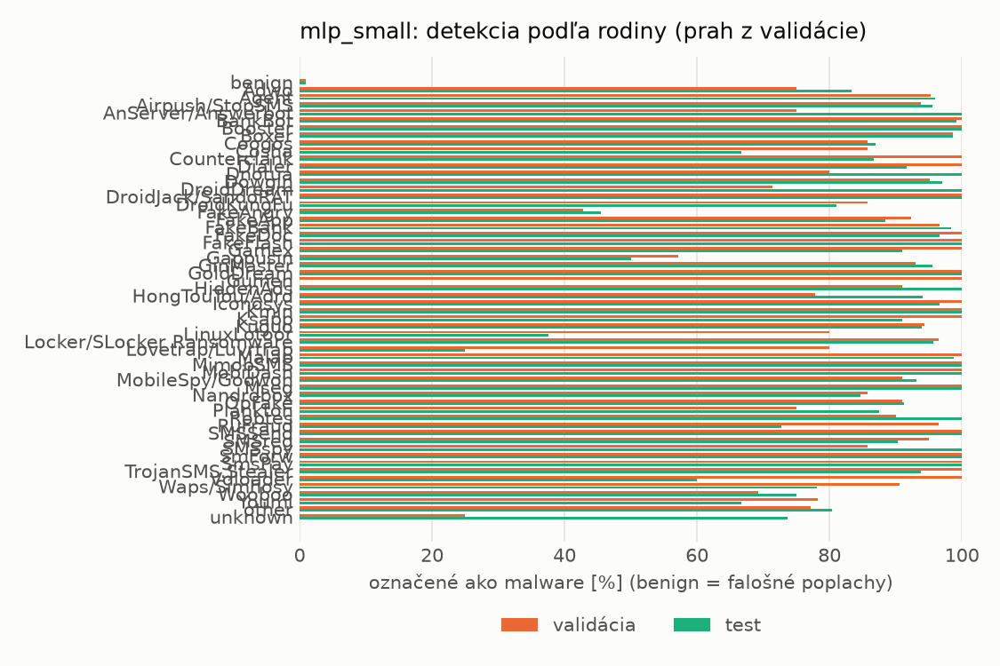
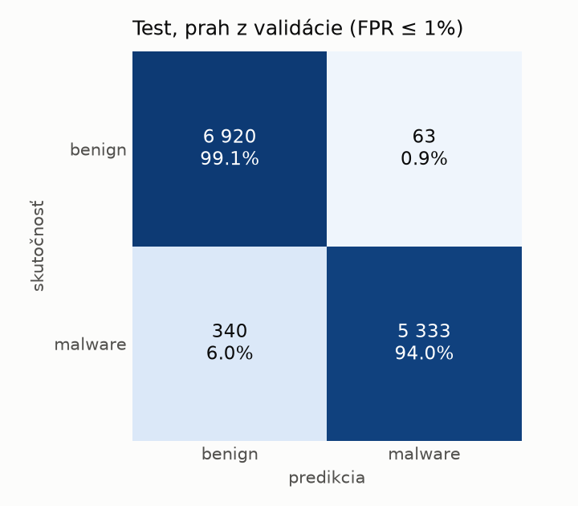
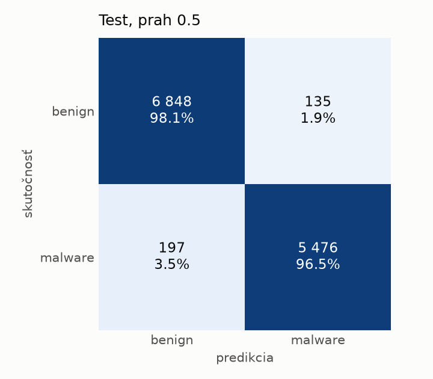
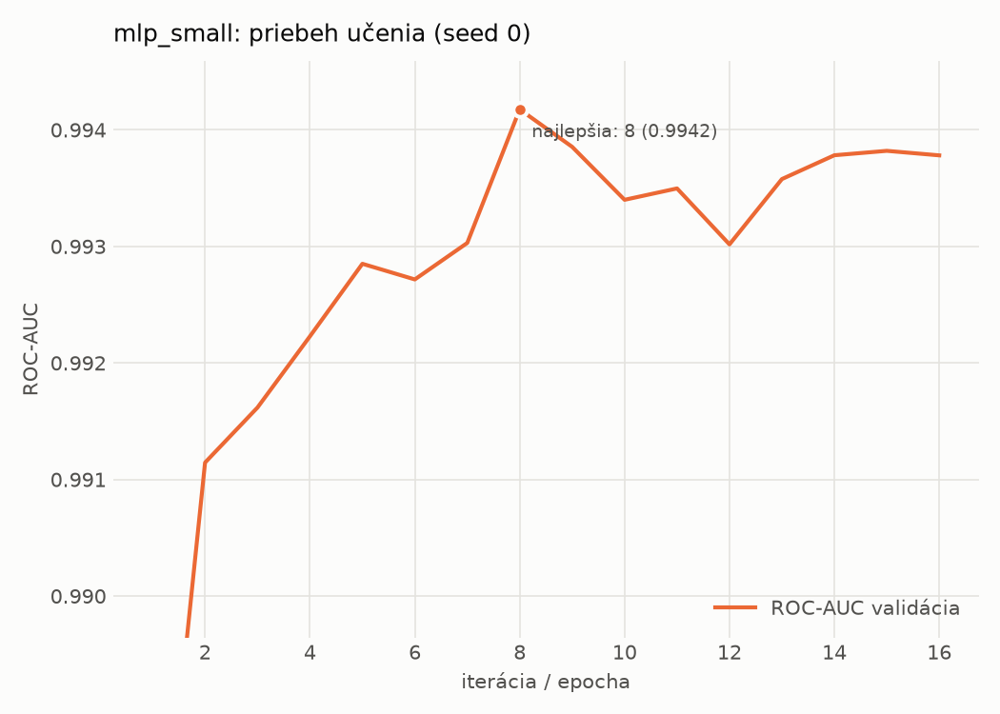

# hybrid/mlp_small – beh `20261123-184647`

> Automaticky generované (`src/training/run_tabular.py`). Konfigurácia: `config.yaml`, protokol: `protocol.yaml`.

- **Model:** `mlp` – malá neurónová sieť (1–2 skryté vrstvy), kandidát na ľahkého študenta
- **Ladenie:** bez ladenia – hyperparametre prevzaté z `runs_v4/real_p/full/hybrid/mlp_small/20261123-000512`
- **Finálne modely:** seedy [0, 1, 2]; hodnoty sú priemer ± smerodajná odchýlka cez seedy
- **Najlepšie hyperparametre:** `{"width_decay": 0.5, "max_epochs": 100, "patience": 8, "hidden_layers": 2, "hidden_width": 256, "dropout": 0.17059205009500078, "lr": 0.0013906274900964423, "weight_decay": 9.337519104222036e-06, "batch_size": 1024}`

## Detekčná kvalita (bez prahu)
| metrika | train (podvzorka) | validácia | test |
|---|---|---|---|
| ROC-AUC | 0.9985 ± 0.0006 | 0.9941 ± 0.0003 | 0.9952 ± 0.0002 |
| PR-AUC | 0.9983 ± 0.0006 | 0.9935 ± 0.0005 | 0.9949 ± 0.0007 |
| TPR pri FPR 1 % | 0.9822 ± 0.0059 | 0.9429 ± 0.0058 | 0.9532 ± 0.0087 |
| TPR pri FPR 0,1 % | 0.9603 ± 0.0149 | 0.7801 ± 0.0881 | 0.8465 ± 0.0145 |
| log loss | 0.0389 ± 0.0091 | 0.0863 ± 0.0022 | 0.0776 ± 0.0026 |
| Brier skóre | 0.0101 ± 0.0024 | 0.0215 ± 0.0010 | 0.0197 ± 0.0013 |

Rozdiel ROC-AUC train − validácia: **0.0044** (veľký rozdiel = preučenie).

## Pri prahu z validácie (FPR ≤ 1% na validácii)
| metrika | train (podvzorka) | validácia | test |
|---|---|---|---|
| accuracy | 0.9825 ± 0.0035 | 0.9700 ± 0.0025 | 0.9703 ± 0.0019 |
| balanced accuracy | 0.9794 ± 0.0040 | 0.9666 ± 0.0029 | 0.9678 ± 0.0020 |
| precision | 0.9987 ± 0.0010 | 0.9866 ± 0.0002 | 0.9904 ± 0.0019 |
| recall (TPR) | 0.9597 ± 0.0074 | 0.9429 ± 0.0058 | 0.9430 ± 0.0028 |
| FPR | 0.0009 ± 0.0007 | 0.0096 ± 0.0002 | 0.0074 ± 0.0015 |
| F1 | 0.9788 ± 0.0043 | 0.9643 ± 0.0030 | 0.9661 ± 0.0022 |
| MCC | 0.9645 ± 0.0071 | 0.9392 ± 0.0049 | 0.9407 ± 0.0039 |

## Pri pevnom prahu 0.5
| metrika | train (podvzorka) | validácia | test |
|---|---|---|---|
| accuracy | 0.9873 ± 0.0032 | 0.9731 ± 0.0019 | 0.9752 ± 0.0018 |
| balanced accuracy | 0.9862 ± 0.0035 | 0.9722 ± 0.0022 | 0.9744 ± 0.0018 |
| precision | 0.9905 ± 0.0016 | 0.9716 ± 0.0007 | 0.9775 ± 0.0022 |
| recall (TPR) | 0.9793 ± 0.0060 | 0.9656 ± 0.0045 | 0.9668 ± 0.0018 |
| FPR | 0.0068 ± 0.0011 | 0.0212 ± 0.0006 | 0.0180 ± 0.0018 |
| F1 | 0.9848 ± 0.0038 | 0.9686 ± 0.0023 | 0.9721 ± 0.0020 |
| MCC | 0.9740 ± 0.0065 | 0.9451 ± 0.0039 | 0.9498 ± 0.0036 |

## Výpočtové nároky (seed 0, testovacia množina)
| meranie | hodnota |
|---|---|
| tréning finálneho modelu | 1.5 s (priemer cez seedy) |
| ladenie spolu | 0 s |
| počet parametrov / uzlov | 107 265 |
| veľkosť modelu na disku | 0.45 MB |
| transformácia vstupu – latencia (1 vlákno) | 0.017 ms |
| transformácia vstupu – priepustnosť | 334 594 vzoriek/s |
| CPU latencia modelu (batch 1, 1 vlákno) | 0.086 ms (p95 0.100) |
| CPU priepustnosť (24 vlákien) | 1 295 513 vzoriek/s |
| GPU latencia (batch 1) | 0.535 ms (p95 0.738) |
| GPU priepustnosť | 1 572 877 vzoriek/s |
| GPU špičková pamäť | 105 MB |

## Grafy
| | |
|---|---|
|  |  |
|  |  |
|  |  |
|  |  |

## Súbory
`metrics.json` (všetky metriky po seedoch vrátane rodín), `timing.json`, `hpo_trials.csv`,
`predictions/<časť>_seed<N>.parquet` (sha256, family, label, score), `model/seed_<N>/`, `log.txt`.
