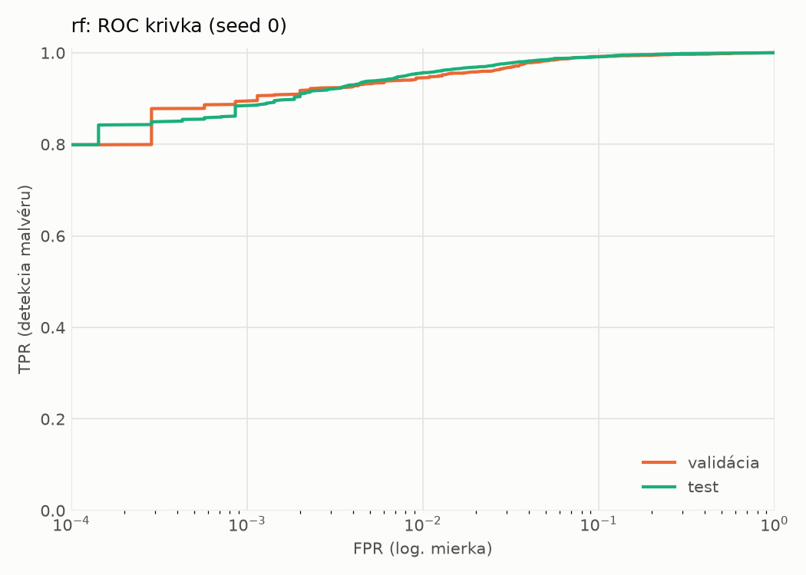
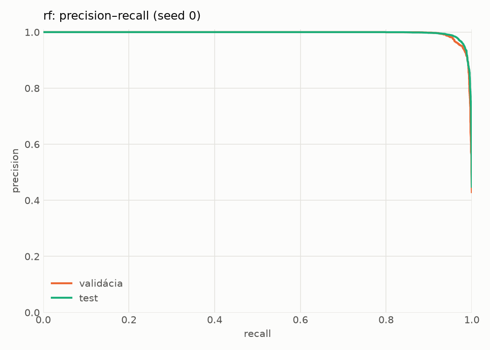
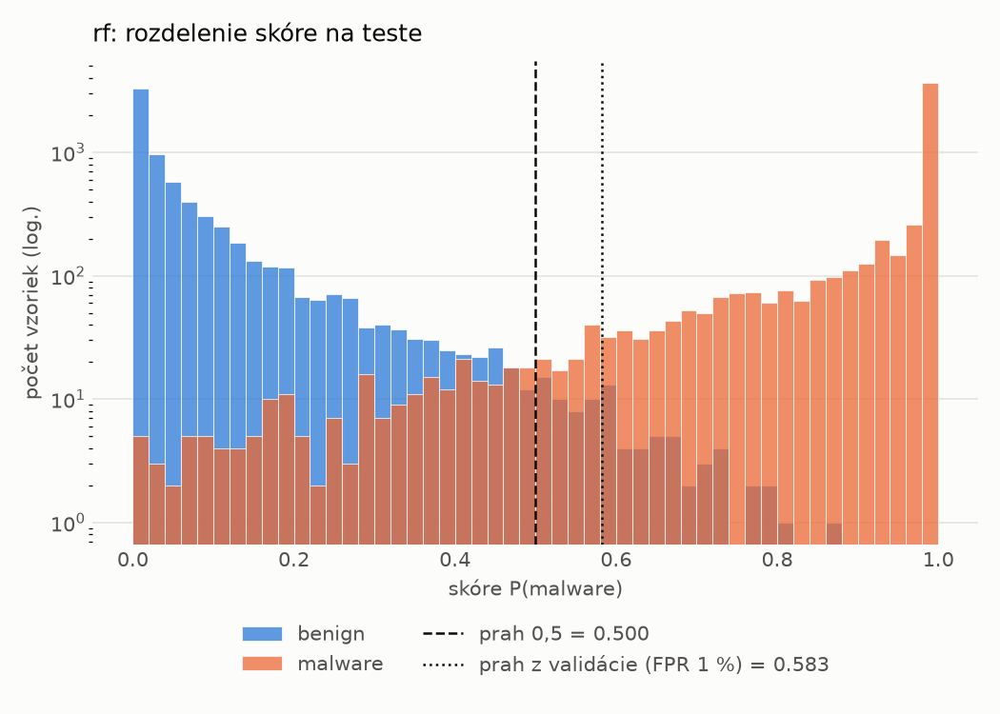
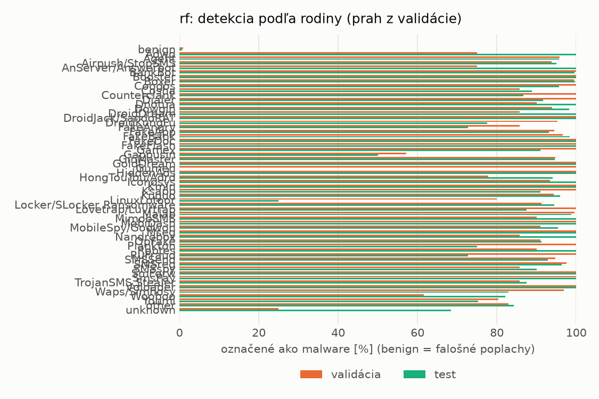
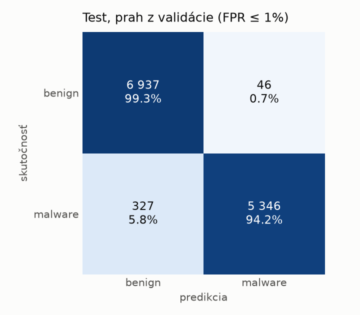
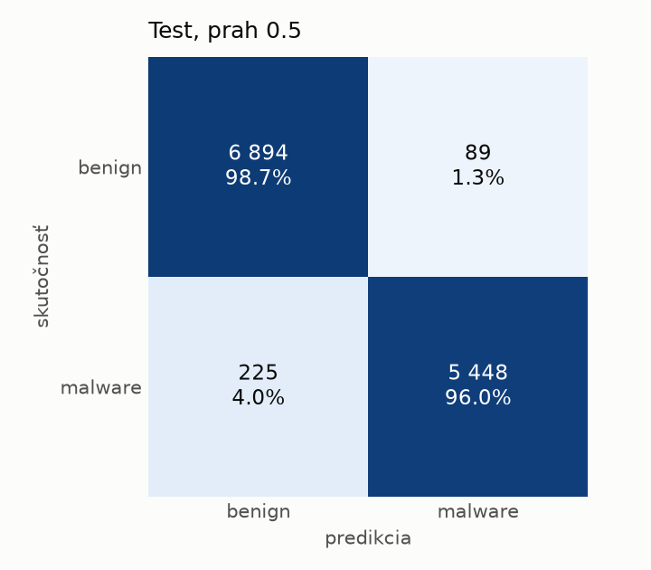

# hybrid/rf – beh `20261123-184617`

> Automaticky generované (`src/training/run_tabular.py`). Konfigurácia: `config.yaml`, protokol: `protocol.yaml`.

- **Model:** `random_forest` – Random Forest (pôvodné hodnoty príznakov)
- **Ladenie:** bez ladenia – hyperparametre prevzaté z `runs_v4/real_p/full/hybrid/rf/20261122-235747`
- **Finálne modely:** seedy [0, 1, 2]; hodnoty sú priemer ± smerodajná odchýlka cez seedy
- **Najlepšie hyperparametre:** `{"n_estimators": 400, "max_depth": null, "min_samples_leaf": 1, "max_features": "sqrt"}`

## Detekčná kvalita (bez prahu)
| metrika | train (podvzorka) | validácia | test |
|---|---|---|---|
| ROC-AUC | 1.0000 ± 0.0000 | 0.9952 ± 0.0001 | 0.9964 ± 0.0001 |
| PR-AUC | 1.0000 ± 0.0000 | 0.9951 ± 0.0000 | 0.9964 ± 0.0000 |
| TPR pri FPR 1 % | 1.0000 ± 0.0000 | 0.9451 ± 0.0014 | 0.9551 ± 0.0016 |
| TPR pri FPR 0,1 % | 1.0000 ± 0.0000 | 0.8919 ± 0.0028 | 0.8847 ± 0.0031 |
| log loss | 0.0267 ± 0.0001 | 0.0981 ± 0.0008 | 0.0979 ± 0.0004 |
| Brier skóre | 0.0028 ± 0.0000 | 0.0241 ± 0.0001 | 0.0239 ± 0.0002 |

Rozdiel ROC-AUC train − validácia: **0.0048** (veľký rozdiel = preučenie).

## Pri prahu z validácie (FPR ≤ 1% na validácii)
| metrika | train (podvzorka) | validácia | test |
|---|---|---|---|
| accuracy | 1.0000 ± 0.0000 | 0.9710 ± 0.0006 | 0.9708 ± 0.0005 |
| balanced accuracy | 1.0000 ± 0.0000 | 0.9678 ± 0.0007 | 0.9681 ± 0.0006 |
| precision | 1.0000 ± 0.0000 | 0.9867 ± 0.0004 | 0.9918 ± 0.0005 |
| recall (TPR) | 1.0000 ± 0.0000 | 0.9451 ± 0.0014 | 0.9426 ± 0.0014 |
| FPR | 0.0000 ± 0.0000 | 0.0096 ± 0.0003 | 0.0063 ± 0.0004 |
| F1 | 1.0000 ± 0.0000 | 0.9655 ± 0.0007 | 0.9666 ± 0.0006 |
| MCC | 1.0000 ± 0.0000 | 0.9411 ± 0.0012 | 0.9416 ± 0.0010 |

## Pri pevnom prahu 0.5
| metrika | train (podvzorka) | validácia | test |
|---|---|---|---|
| accuracy | 1.0000 ± 0.0000 | 0.9713 ± 0.0005 | 0.9755 ± 0.0003 |
| balanced accuracy | 1.0000 ± 0.0000 | 0.9695 ± 0.0005 | 0.9741 ± 0.0003 |
| precision | 1.0000 ± 0.0000 | 0.9758 ± 0.0012 | 0.9839 ± 0.0002 |
| recall (TPR) | 1.0000 ± 0.0000 | 0.9569 ± 0.0007 | 0.9610 ± 0.0006 |
| FPR | 0.0000 ± 0.0000 | 0.0179 ± 0.0009 | 0.0127 ± 0.0001 |
| F1 | 1.0000 ± 0.0000 | 0.9663 ± 0.0006 | 0.9724 ± 0.0003 |
| MCC | 1.0000 ± 0.0000 | 0.9414 ± 0.0010 | 0.9506 ± 0.0006 |

## Výpočtové nároky (seed 0, testovacia množina)
| meranie | hodnota |
|---|---|
| tréning finálneho modelu | 2.4 s (priemer cez seedy) |
| ladenie spolu | 0 s |
| počet parametrov / uzlov | 1 849 376 |
| veľkosť modelu na disku | 148.28 MB |
| CPU latencia modelu (batch 1, 1 vlákno) | 11.667 ms (p95 11.966) |
| CPU priepustnosť (24 vlákien) | 134 852 vzoriek/s |

## Grafy
| | |
|---|---|
|  |  |
|  |  |
|  |  |
|  |  |

## Súbory
`metrics.json` (všetky metriky po seedoch vrátane rodín), `timing.json`, `hpo_trials.csv`,
`predictions/<časť>_seed<N>.parquet` (sha256, family, label, score), `model/seed_<N>/`, `log.txt`.
