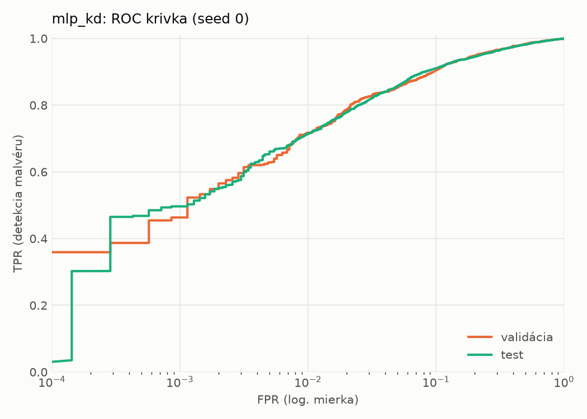
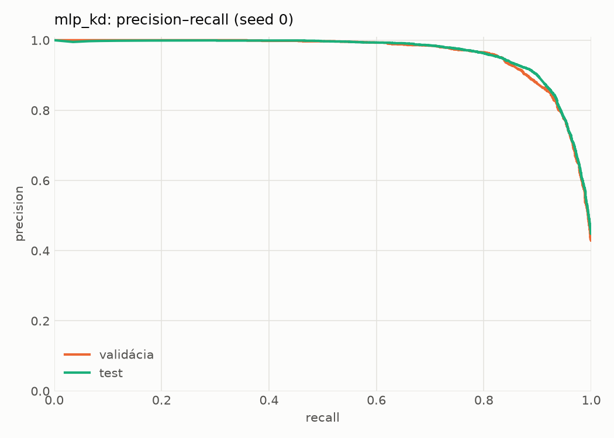
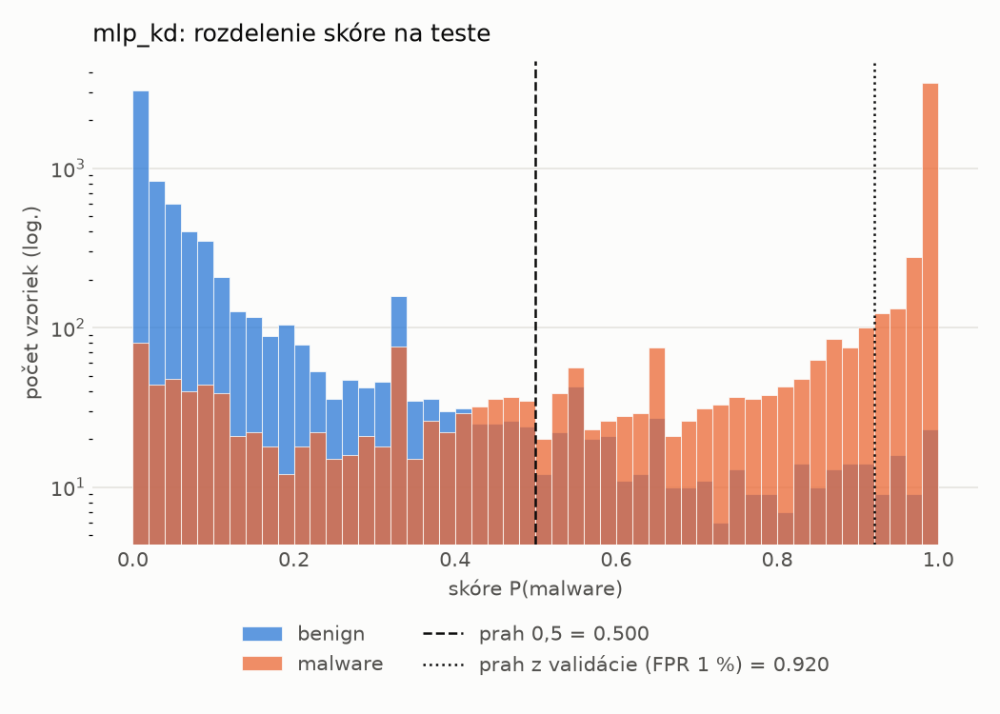
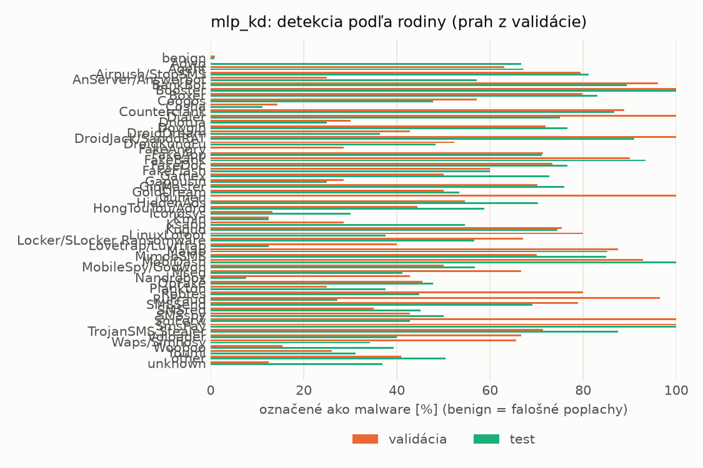
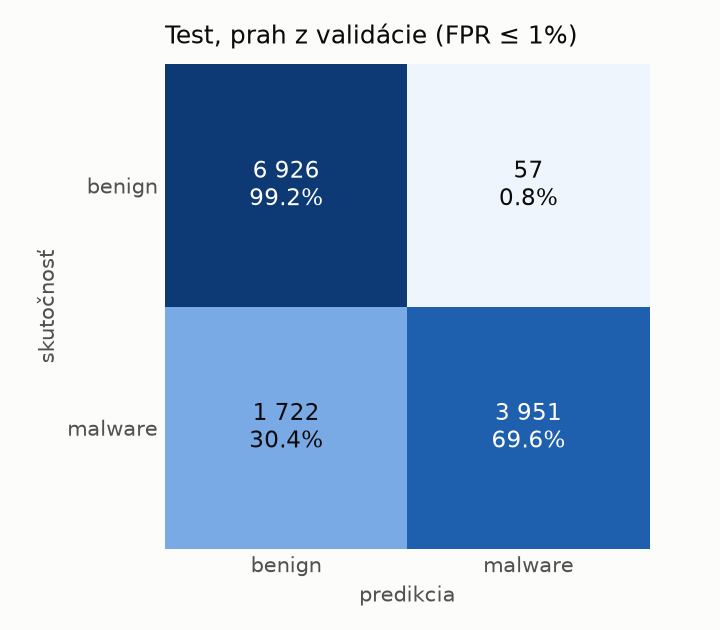
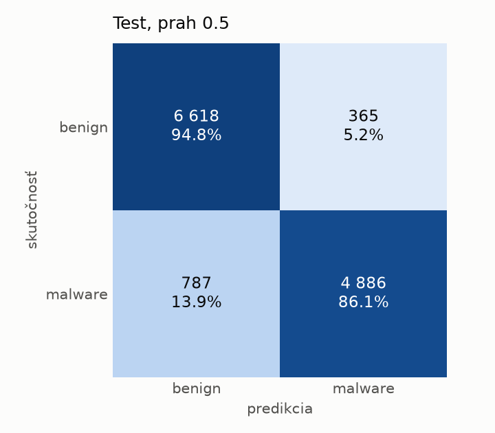
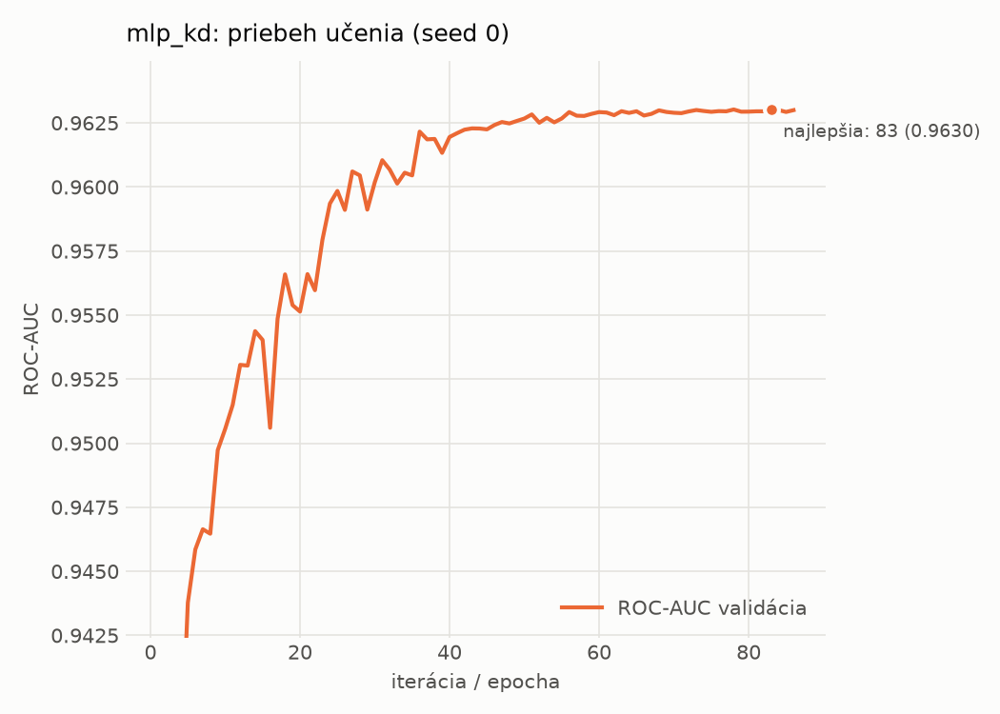

# dynamic/mlp_kd – beh `20261123-185107`

> Automaticky generované (`src/training/run_tabular.py`). Konfigurácia: `config.yaml`, protokol: `protocol.yaml`.

- **Model:** `mlp` – študent – malé MLP učené destiláciou z hybridného učiteľa
- **Ladenie:** bez ladenia – hyperparametre prevzaté z `runs_v4/real_p/full/students_dynamic/mlp_kd/20261123-003616`
- **Finálne modely:** seedy [0, 1, 2]; hodnoty sú priemer ± smerodajná odchýlka cez seedy
- **Najlepšie hyperparametre:** `{"hidden_layers": 1, "max_epochs": 100, "patience": 8, "hidden_width": 64, "dropout": 0.008718220633742228, "lr": 0.002354362488135847, "weight_decay": 3.1986204696979587e-06, "batch_size": 1024, "kd_alpha": 0.2022752781289341, "kd_temperature": 1.263446759011441}`

## Detekčná kvalita (bez prahu)
| metrika | train (podvzorka) | validácia | test |
|---|---|---|---|
| ROC-AUC | 0.9740 ± 0.0016 | 0.9635 ± 0.0018 | 0.9631 ± 0.0007 |
| PR-AUC | 0.9731 ± 0.0017 | 0.9624 ± 0.0017 | 0.9638 ± 0.0006 |
| TPR pri FPR 1 % | 0.8088 ± 0.0139 | 0.7222 ± 0.0119 | 0.7130 ± 0.0049 |
| TPR pri FPR 0,1 % | 0.6029 ± 0.0164 | 0.5059 ± 0.0409 | 0.5070 ± 0.0090 |
| log loss | 0.1882 ± 0.0068 | 0.2357 ± 0.0054 | 0.2398 ± 0.0026 |
| Brier skóre | 0.0536 ± 0.0021 | 0.0674 ± 0.0015 | 0.0675 ± 0.0010 |

Rozdiel ROC-AUC train − validácia: **0.0105** (veľký rozdiel = preučenie).

## Pri prahu z validácie (FPR ≤ 1% na validácii)
| metrika | train (podvzorka) | validácia | test |
|---|---|---|---|
| accuracy | 0.8946 ± 0.0042 | 0.8752 ± 0.0051 | 0.8623 ± 0.0054 |
| balanced accuracy | 0.8759 ± 0.0050 | 0.8562 ± 0.0059 | 0.8475 ± 0.0061 |
| precision | 0.9895 ± 0.0017 | 0.9824 ± 0.0003 | 0.9838 ± 0.0017 |
| recall (TPR) | 0.7576 ± 0.0102 | 0.7222 ± 0.0119 | 0.7044 ± 0.0129 |
| FPR | 0.0059 ± 0.0010 | 0.0097 ± 0.0000 | 0.0094 ± 0.0011 |
| F1 | 0.8581 ± 0.0065 | 0.8324 ± 0.0079 | 0.8210 ± 0.0084 |
| MCC | 0.7941 ± 0.0079 | 0.7588 ± 0.0093 | 0.7404 ± 0.0092 |

## Pri pevnom prahu 0.5
| metrika | train (podvzorka) | validácia | test |
|---|---|---|---|
| accuracy | 0.9291 ± 0.0035 | 0.9084 ± 0.0024 | 0.9109 ± 0.0026 |
| balanced accuracy | 0.9248 ± 0.0036 | 0.9037 ± 0.0026 | 0.9067 ± 0.0028 |
| precision | 0.9312 ± 0.0045 | 0.9117 ± 0.0018 | 0.9310 ± 0.0014 |
| recall (TPR) | 0.8978 ± 0.0039 | 0.8709 ± 0.0040 | 0.8654 ± 0.0049 |
| FPR | 0.0482 ± 0.0032 | 0.0634 ± 0.0012 | 0.0521 ± 0.0009 |
| F1 | 0.9142 ± 0.0042 | 0.8908 ± 0.0030 | 0.8970 ± 0.0032 |
| MCC | 0.8542 ± 0.0072 | 0.8126 ± 0.0048 | 0.8204 ± 0.0052 |

## Výpočtové nároky (seed 0, testovacia množina)
| meranie | hodnota |
|---|---|
| tréning finálneho modelu | 5.7 s (priemer cez seedy) |
| ladenie spolu | 0 s |
| počet parametrov / uzlov | 8 129 |
| veľkosť modelu na disku | 0.04 MB |
| transformácia vstupu – latencia (1 vlákno) | 0.014 ms |
| transformácia vstupu – priepustnosť | 1 266 119 vzoriek/s |
| CPU latencia modelu (batch 1, 1 vlákno) | 0.054 ms (p95 0.063) |
| CPU priepustnosť (24 vlákien) | 6 631 038 vzoriek/s |
| GPU latencia (batch 1) | 0.259 ms (p95 0.289) |
| GPU priepustnosť | 3 270 538 vzoriek/s |
| GPU špičková pamäť | 53 MB |

## Grafy
| | |
|---|---|
|  |  |
|  |  |
|  |  |
|  |  |

## Súbory
`metrics.json` (všetky metriky po seedoch vrátane rodín), `timing.json`, `hpo_trials.csv`,
`predictions/<časť>_seed<N>.parquet` (sha256, family, label, score), `model/seed_<N>/`, `log.txt`.
