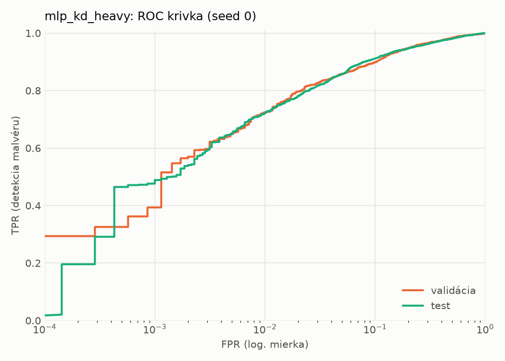
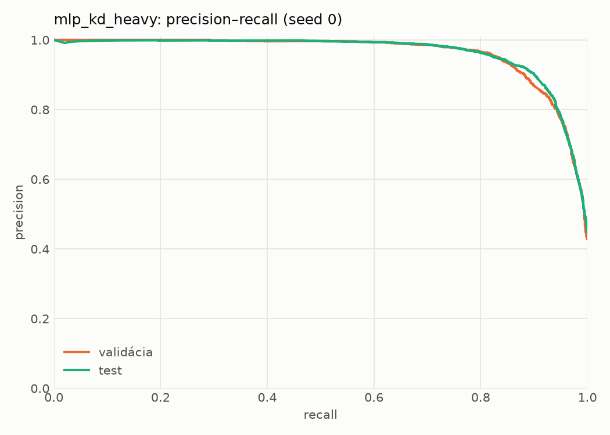
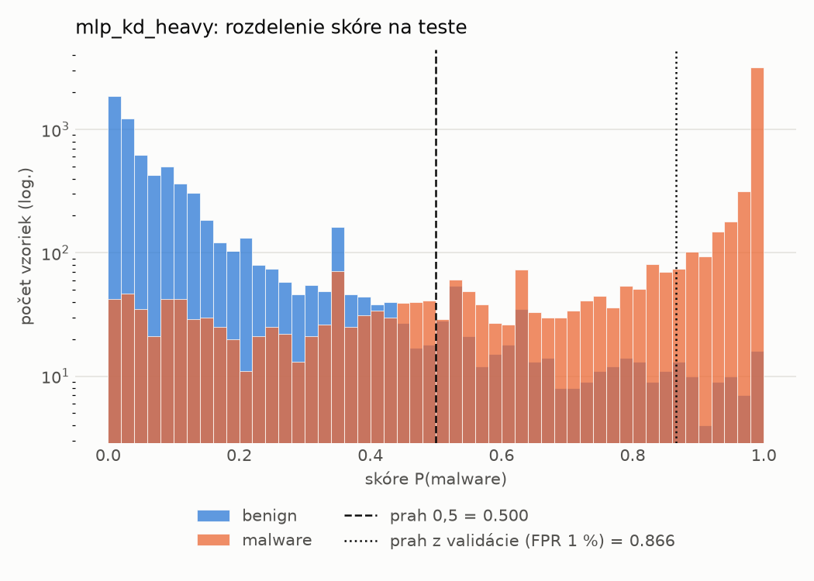
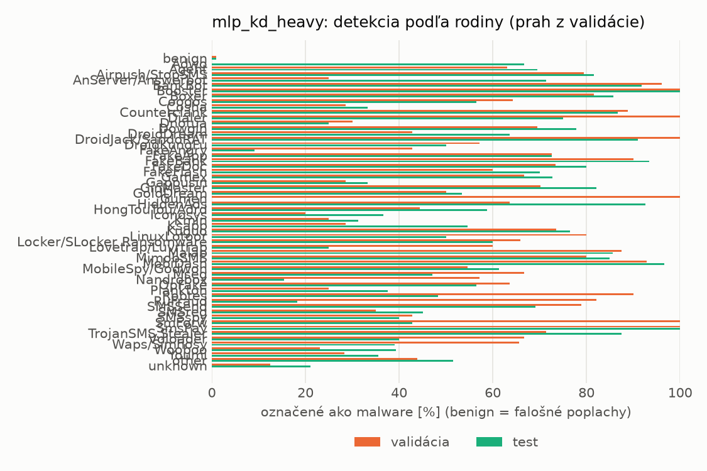
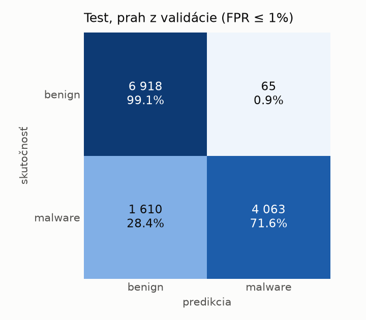
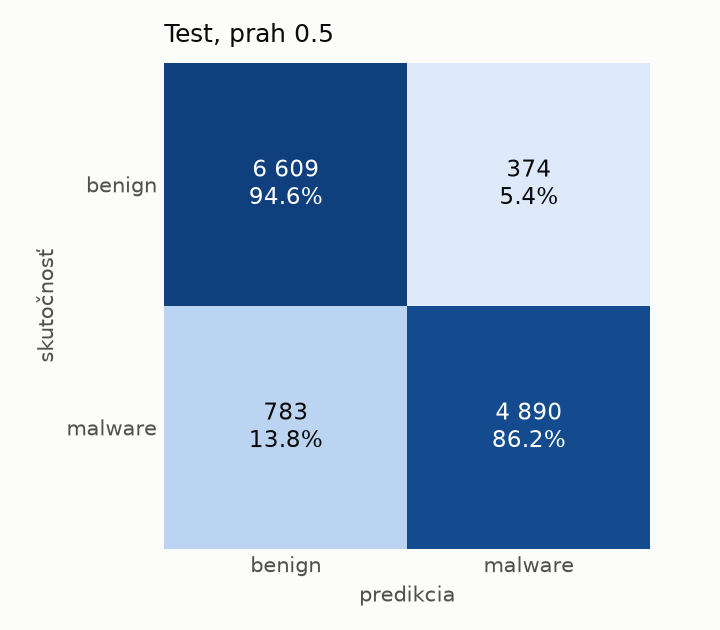
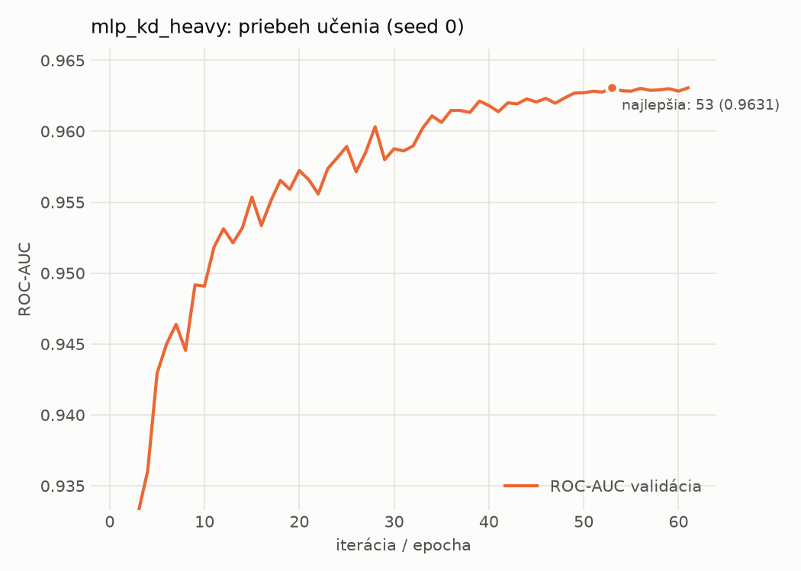

# dynamic/mlp_kd_heavy – beh `20261123-185240`

> Automaticky generované (`src/training/run_tabular.py`). Konfigurácia: `config.yaml`, protokol: `protocol.yaml`.

- **Model:** `mlp` – študent – malé MLP učené destiláciou z mlp_large hybridu (V4)
- **Ladenie:** bez ladenia – hyperparametre prevzaté z `runs_v4/real_p/full/students_dynamic/mlp_kd_heavy/20261123-005328`
- **Finálne modely:** seedy [0, 1, 2]; hodnoty sú priemer ± smerodajná odchýlka cez seedy
- **Najlepšie hyperparametre:** `{"hidden_layers": 1, "max_epochs": 100, "patience": 8, "hidden_width": 64, "dropout": 0.020410116354877387, "lr": 0.0023709262856920267, "weight_decay": 2.3924155608522853e-05, "batch_size": 1024, "kd_alpha": 0.37221474320301356, "kd_temperature": 1.1598739057164045}`

## Detekčná kvalita (bez prahu)
| metrika | train (podvzorka) | validácia | test |
|---|---|---|---|
| ROC-AUC | 0.9755 ± 0.0012 | 0.9644 ± 0.0011 | 0.9635 ± 0.0007 |
| PR-AUC | 0.9743 ± 0.0011 | 0.9631 ± 0.0010 | 0.9641 ± 0.0005 |
| TPR pri FPR 1 % | 0.8070 ± 0.0044 | 0.7225 ± 0.0020 | 0.7173 ± 0.0064 |
| TPR pri FPR 0,1 % | 0.6261 ± 0.0303 | 0.4563 ± 0.0552 | 0.4991 ± 0.0203 |
| log loss | 0.1866 ± 0.0044 | 0.2297 ± 0.0035 | 0.2332 ± 0.0018 |
| Brier skóre | 0.0538 ± 0.0011 | 0.0666 ± 0.0007 | 0.0671 ± 0.0006 |

Rozdiel ROC-AUC train − validácia: **0.0111** (veľký rozdiel = preučenie).

## Pri prahu z validácie (FPR ≤ 1% na validácii)
| metrika | train (podvzorka) | validácia | test |
|---|---|---|---|
| accuracy | 0.8963 ± 0.0013 | 0.8753 ± 0.0009 | 0.8653 ± 0.0037 |
| balanced accuracy | 0.8778 ± 0.0016 | 0.8564 ± 0.0010 | 0.8508 ± 0.0041 |
| precision | 0.9902 ± 0.0004 | 0.9824 ± 0.0000 | 0.9841 ± 0.0003 |
| recall (TPR) | 0.7611 ± 0.0034 | 0.7225 ± 0.0020 | 0.7110 ± 0.0082 |
| FPR | 0.0055 ± 0.0003 | 0.0097 ± 0.0000 | 0.0094 ± 0.0001 |
| F1 | 0.8606 ± 0.0020 | 0.8326 ± 0.0013 | 0.8255 ± 0.0057 |
| MCC | 0.7974 ± 0.0023 | 0.7590 ± 0.0016 | 0.7457 ± 0.0066 |

## Pri pevnom prahu 0.5
| metrika | train (podvzorka) | validácia | test |
|---|---|---|---|
| accuracy | 0.9296 ± 0.0027 | 0.9080 ± 0.0010 | 0.9116 ± 0.0027 |
| balanced accuracy | 0.9256 ± 0.0033 | 0.9037 ± 0.0011 | 0.9076 ± 0.0030 |
| precision | 0.9301 ± 0.0007 | 0.9090 ± 0.0007 | 0.9291 ± 0.0029 |
| recall (TPR) | 0.9004 ± 0.0069 | 0.8732 ± 0.0017 | 0.8690 ± 0.0063 |
| FPR | 0.0492 ± 0.0007 | 0.0657 ± 0.0004 | 0.0539 ± 0.0025 |
| F1 | 0.9150 ± 0.0036 | 0.8907 ± 0.0012 | 0.8980 ± 0.0034 |
| MCC | 0.8553 ± 0.0055 | 0.8119 ± 0.0020 | 0.8215 ± 0.0053 |

## Výpočtové nároky (seed 0, testovacia množina)
| meranie | hodnota |
|---|---|
| tréning finálneho modelu | 5.0 s (priemer cez seedy) |
| ladenie spolu | 0 s |
| počet parametrov / uzlov | 8 129 |
| veľkosť modelu na disku | 0.04 MB |
| transformácia vstupu – latencia (1 vlákno) | 0.015 ms |
| transformácia vstupu – priepustnosť | 777 434 vzoriek/s |
| CPU latencia modelu (batch 1, 1 vlákno) | 0.154 ms (p95 0.163) |
| CPU priepustnosť (24 vlákien) | 4 626 238 vzoriek/s |
| GPU latencia (batch 1) | 0.481 ms (p95 0.519) |
| GPU priepustnosť | 6 423 387 vzoriek/s |
| GPU špičková pamäť | 77 MB |

## Grafy
| | |
|---|---|
|  |  |
|  |  |
|  |  |
|  |  |

## Súbory
`metrics.json` (všetky metriky po seedoch vrátane rodín), `timing.json`, `hpo_trials.csv`,
`predictions/<časť>_seed<N>.parquet` (sha256, family, label, score), `model/seed_<N>/`, `log.txt`.
